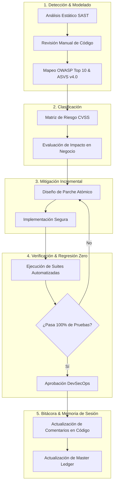
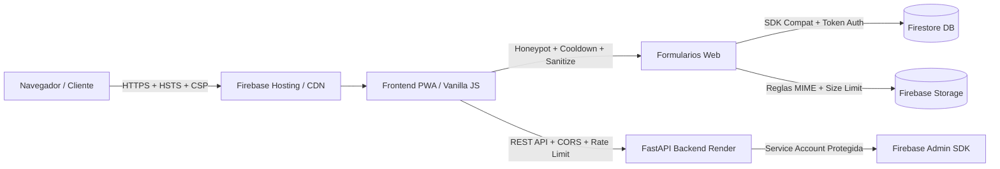

# 🛡️ Futunet — DevSecOps & Cybersecurity Master Ledger
> **Rol:** Ingeniero DevSecOps & Especialista en Ciberseguridad Senior  
> **Objetivo:** Auditoría continua de código fuente, frontend, formularios, OWASP Top 10, ASVS v4.0 y privacidad (Ley 172-13 / RGPD), aplicando mitigaciones seguras e incrementales con regresión cero.  
> **Última Actualización:** 2026-09-25  

---

## 1. Diagrama de Flujo de Auditoría & Mitigación Diaria



---

## 2. Diagrama de Arquitectura de Defensa en Profundidad



---

## 3. Matriz de Controles de Seguridad Implementados (Auditados)

| Capa | Componente / Archivo | Vector / Control OWASP | Estado | Descripción de la Mitigación |
| :--- | :--- | :--- | :--- | :--- |
| **Formularios** | `index.html`, `sugerencias.html`, `internet.html`, `punto-de-venta.html`, `login.html`, `cotizacion.html` | Anti-Automation / Spambots | **ACTIVO (PASS)** | Trampa Honeypot invisible `name="_hp_security_check"` en los 9 formularios públicos críticos. |
| **Privacidad** | Formularios con PII (Nombres, Cédulas, Teléfonos, RNC, Cotizaciones) | Cumplimiento Ley 172-13 / ARCO | **ACTIVO (PASS)** | Checkboxes de consentimiento informado obligatorio vinculando a `privacidad.html` con `rel="noopener noreferrer"`. |
| **Rate Limiting** | `js/suggestions.js`, `js/internet-portal.js`, `login.html`, `js/public-quote.js` | Anti-DoS / Brute Force | **ACTIVO (PASS)** | Cooldowns temporales en cliente (15s sugerencias, 10s registro, 10s cotizaciones) y bloqueo exponencial por intentos fallidos. |
| **Sanitización** | `js/suggestions.js`, `js/internet-portal.js`, `punto-de-venta.html`, `js/public-quote.js` | Inyección de Código / XSS | **ACTIVO (PASS)** | Eliminación estricta de tags HTML (`<...>`), caracteres de control ASCII (`\x00-\x08`, `\x0B-\x1F`) y límites de longitud. |
| **Autenticación** | `login.html`, `js/auth-guard.js`, `js/auth.js` | Open Redirect (CWE-601) | **ACTIVO (PASS)** | Validación estricta con URL parser, allowlist de rutas relativas locales y coincidencia de origen (`window.location.origin`). |
| **Cabeceras & Enlaces** | `firebase.json`, todos los archivos `.html` | Reverse Tabnabbing / Clickjacking / MIME-Sniff | **ACTIVO (PASS)** | HSTS, X-Frame-Options DENY, nosniff, CSP, y 100% de hipervínculos externos normalizados con `rel="noopener noreferrer"`. |
| **Storage** | `storage.rules` | Subida de Archivos Arbitrarios | **ACTIVO (PASS)** | Restricción de tipos MIME a solo `image/(jpeg\|png\|webp)` y `application/pdf`, con límite estricto de 5MB a 8MB según carpeta. |
| **Backend API** | `futunet-backend/main.py` | Exposición de Secretos / IP Spoofing / CORS | **ACTIVO (PASS)** | Credenciales excluidas de Git, CORS restrictivo, `get_safe_client_ip` contra spoofing de headers y rate limiter. |

- **DOM XSS & Reverse Tabnabbing Mitigation (Hardening de Enlaces y Renderers)**:
  - Sanitización estricta con `escapeHtml` en interpolaciones dinámicas de `home_showcase.js`, `cart.js` y `brand-page-loader.js`.
  - Inclusión de `rel="noopener noreferrer"` en todos los hipervínculos con `target="_blank"` (`catalog.js`, `brand-page-loader.js`, `admin-panel.js`) y `'noopener,noreferrer'` en `window.open` (`producto.js`, `catalog.js`).
  - Protección preventiva de `TypeError` en `promo-carousel.js` y `brands-preview.js` ante propiedades indefinidas en documentos de Firestore.
- **Mantenimiento Diario y Robustecimiento Web (2026-09-19)**:
  - **Normalización y Limpieza UTF-8**: Corrección en `js/supplier_inventory.js` (`normalizeCopy`) de reemplazos defectuosos que introducían mojibake (`É` -> `É`, `Ó` -> `Ó`, `Ú` -> `Ú`, comillas y guiones tipográficos limpios). Reparación de caracteres en `js/backup_data.js` para AirPods 2.ª generación.
  - **Inferencia Robusta de Categorías**: Inclusión de reglas para `impresora`, `scanner`, `audifono`, `auricular` en `js/supplier_inventory.js` asignándolos con precisión a departamentos y categorías B2B correspondientes.
  - **Motor de Búsqueda del Catálogo**: Ampliación de `scoreProductMatch` en `js/catalog.js` para indexar especificaciones técnicas (`product.specs`) y permitir coincidencias multi-término cruzadas entre campos (título, marca, categoría, especificaciones) como "laptop lenovo", "impresora epson", "teclado usb", evitando caídas a 0 resultados en consultas compuestas. Incorporación de `Apple` en la barra de filtros prioritarios de marcas.
  - **Resiliencia PWA Offline**: Adición en `sw.js` (`OPTIONAL_ASSETS`) de los módulos del centro de soporte y autenticación (`support-core.js`, `support-service.js`, `support-ui.js`, `firebase-config.js`, `auth.js`) para garantizar navegación offline sin excepciones de red.
  - **Activación de Productos Sugeridos**: Sincronización y activación en Firestore de 6 productos de alta demanda (`prod_ev8mssce4`, `prod_p0wqnr5bc`, `prod_oh55hargc`, `prod_tk6it44v0`, `prod_yny47xadr`, `prod_9p6f6zzh6`), junto con la resolución de sugerencias comunitarias `SUG-P5512`, `SUG-A7291` y `SUG-K3844`.
  - **Suite Automatizada**: Ampliación de `tools/test-suggestions.cjs` totalizando 106 tests automatizados aprobados (100% PASS) y validación completa del hosting con 52 páginas y 626 recursos sin roturas.
- **Auditoría & Mitigación DevSecOps Diaria (2026-09-21)**:
  - **Hardening de Formularios Web y Privacidad (Ley 172-13)**: Incorporación de trampa Honeypot invisible (`#quote-hp-check` / `name="_hp_security_check"`) y cláusula de consentimiento de privacidad con enlace seguro a `privacidad.html` (`rel="noopener noreferrer"`) en `cotizacion.html`.
  - **Rate Limiting & Sanitización en Cliente**: Implementación de cooldown de 10 segundos (`futunet_last_quote_response_ts`) y función de sanitización (`sanitizeQuoteInput`) contra inyección de HTML y caracteres de control ASCII en `js/public-quote.js`.
  - **Prevención de Reverse Tabnabbing & Referrer Leakage**: Normalización de hipervínculos con `target="_blank"` a `rel="noopener noreferrer"` en `mi-cuenta.html` y `admin.html`. Nueva prueba automatizada en `tools/test-forms-security.cjs` que verifica cero presencia de `rel="noopener"` solitario en los 52 documentos HTML.
  - **Endurecimiento de IP Client Spoofing en Backend API**: Implementación de `get_safe_client_ip(request)` en `futunet-backend/main.py` protegiendo los endpoints `/api/quote`, `/api/order` y `/api/rnc/check/{rnc}` contra evasión de rate limiting vía cabeceras forjadas arbitrarias. 4 nuevos tests unitarios en Python (`ClientIpSecurityTests`).
  - **Verificación Automatizada**: 110 tests en frontend (`npm test`) y 30 tests en backend (`test_main.py` y `test_chatbot_api.py`) pasando al 100% (cero regresiones).
- **Mantenimiento & Resiliencia de Catálogo y Checkout (2026-09-21 Ciclo Estabilidad)**:
  - **Blindaje Node.js y Entornos No-Browser (`backup_data.js`)**: Corrección de `ReferenceError: window is not defined` mediante guarda condicional `typeof window !== 'undefined'` y exposición segura de `window.mockDatabase` y `window.backupDatabase`.
  - **Resiliencia de Catálogo Offline (`inventory_data.js`)**: Implementación de `getLocalFallbackList()`. Ante desconexión, latencia o fallo en Firestore, el catálogo ya no se vacía a `[]`; ahora conserva y sirve el inventario local combinado (331+ ítems base + feeds de proveedores = 425 ítems).
  - **Inclusión Preventiva en `catalogo.html` y `producto.html`**: Carga secuencial de `backup_data.js` previa a `inventory_data.js`, garantizando catálogo completo y resolución instantánea de productos sin depender de la inicialización de Firebase.
  - **Resiliencia de Checkout y WhatsApp (`cart.js`)**: Protección de la llamada `/api/order` con `AbortController` (timeout de 12s). Si el backend en Render experimenta cold-start prolongado o fallo de red, los pedidos con método WhatsApp ya no quedan bloqueados con error: abren fluidamente el chat de WhatsApp con el pedido estructurado y vacían el carrito.
  - **Suite de Resiliencia Automatizada**: Agregado de test automatizado en `tools/test-dom-safety.cjs` (111 tests en total en `npm test`, 100% PASS, 639 entradas públicas validadas).
- **Auditoría & Mitigación DevSecOps Diaria (2026-09-23)**:
  - **Hardening de Formularios B2B y Privacidad (Ley 172-13)**: Incorporación de trampa Honeypot accesible (`#req-hp-check` / `name="_hp_security_check"`) y casilla obligatoria de consentimiento informado (`#req-privacy-consent`) vinculando a `privacidad.html` con `target="_blank" rel="noopener noreferrer"` en `mobiliario-suministros.html`.
  - **Reverse Tabnabbing & Referrer Leakage en Frontend JS**: Eliminación de `rel="noopener"` solitario en hipervínculos dinámicos en `js/support-ui.js` (aviso de inicio de sesión de soporte), `js/chatbot-settings.js` (enlaces a consola Firebase y asistente) y `ai/js/ai-app.js` (conversor markdown). Cero presencia de `rel="noopener"` solitario en todos los HTMLs y scripts JS.
  - **Rate Limiting / Flooding Defense en Checkout de Catálogo**: En `js/cart.js`, implementación de cooldown temporal de 10 segundos en `sessionStorage` (`futunet_last_order_ts`) en `handleCheckoutSubmit` para prevenir doble clic accidental o spam repetitivo de pedidos antes del despacho a la API / WhatsApp.
  - **Ampliación de Suites de Pruebas Automatizadas**: Actualización de `tools/test-dom-safety.cjs` (verificación de las 7 páginas B2B con honeypot y privacidad) y `tools/test-forms-security.cjs` (verificación de cooldown de checkout y escaneo automatizado en todos los archivos `.html` y scripts `.js`).
  - **Métricas de Verificación**: 116 tests pasando (100% PASS en `npm test`), 30 tests pasando en backend (`python -m unittest test_main.py test_chatbot_api.py`), y `npm run validate` validando 52 páginas HTML y 639 recursos en `dist/`.
- **Auditoría & Mitigación DevSecOps Diaria (2026-09-25)**:
  - **Defensa Anti-Automation / Bot Defense (OWASP OAT-007 / OAT-019)**:
    - Incorporación de trampas Honeypot invisibles (`_hp_security_check`) en `#reset-form` (`#reset-hp-check`) y `#magic-form` (`#magic-hp-check`) en `login.html`, neutralizando scripts de inundación de correos y enlaces de acceso de Firebase Auth.
    - Incorporación de trampas Honeypot en formularios de cuenta en `mi-cuenta.html`: `#profile-form` (`#profile-hp-check`) y `#financing-profile-form` (`#fin-hp-check`).
  - **Sanitización de Entradas & Neutralización XSS / Caracteres de Control (OWASP Top 10 A03:2021 & CWE-79 / CWE-20)**:
    - Implementación de `sanitizeAuthInput` en `login.html` eliminando tags HTML (`<[^>]*>`) y caracteres de control ASCII invisibles (`\x00-\x08\x0B\x0C\x0E-\x1F\x7F`) en credenciales de inicio, registro y recuperación (`login-company`, `login-email`, `register-name`, `register-email`, `reset-email`, `magic-email`).
    - Implementación de `sanitizeProfileInput` en `js/user-panel.js` saneando y delimitando longitud de campos de perfil (`name`, `phone`, `address`, `documentNumber`) antes del guardado en Firestore (`users/{uid}`), previniendo vectores de Stored XSS en paneles de control.
    - Implementación de `sanitizeFinancingInput` en `js/financing.js` depurando `phone` y `address` previo a la escritura en `financing_profiles/{uid}`.
  - **Rate Limiting & Protección contra Flooding en Cliente (OWASP Anti-DoS)**:
    - Cooldown de 5 segundos (`futunet_last_profile_update_ts`) en actualización de perfil en `js/user-panel.js` mitigando saturación de escrituras a Firestore.
    - Cooldown de 15 segundos (`futunet_last_financing_ts`) en el envío de expedientes de crédito en `js/financing.js` protegiendo transacciones en Storage y base de datos.
    - Cooldown de 3 segundos (`futunet_last_sug_track_ts`) en el rastreo de propuestas en `js/suggestions.js` evitando ráfagas de consultas a la colección de sugerencias.
  - **Normalización de Privacidad & Cumplimiento Ley 172-13**:
    - Corrección de espaciado y consistencia de hipervínculos con `target="_blank" rel="noopener noreferrer"` en casillas de consentimiento informado de `mi-cuenta.html` (`#profile-terms` y `#financing-terms`).
  - **Ampliación de Pruebas Automatizadas & Métricas de Verificación**:
    - Expansión de `tools/test-forms-security.cjs` totalizando 13 verificaciones de Honeypot, 9 verificaciones de privacidad estricta, 10 suites de cooldown/rate-limiting y 10 suites de sanitización de inyecciones.
    - 121 tests pasando al 100% en frontend (`npm test`), 30 tests unitarios pasando en backend (`python -m unittest test_main.py test_chatbot_api.py`), y `npm run validate` validando 52 páginas HTML y 639 recursos en `dist/`.

- **Mantenimiento Diario, Robustez & Experiencia de Usuario (2026-09-24)**:
  - **Blindaje Node.js y Modularidad (`js/supplier_inventory.js`)**: Corrección de `ReferenceError: window is not defined` mediante guardas de comprobación `typeof window !== 'undefined'` y exportación CommonJS para compatibilidad con Node.js, CLI scripts y entornos híbridos.
  - **Saneamiento e Integridad de Fichas de Producto (`js/backup_data.js` & Firestore `products`)**: Corrección integral de la ficha técnica de Apple AirPods (2.ª generación, `prod_ad1d2a977b`), eliminando descripción y atributos erróneos de papelería e incorporando ficha técnica fidedigna de audio, chip Apple H1, estuche de carga Lightning y autonomía de 24h. Sincronización en la nube mediante `tools/sync-catalog-improvements.cjs`.
  - **Expansión Inteligente del Motor de Búsqueda Fuzzy (`js/catalog.js`)**: Ampliación de variantes morfológicas y sinónimos en `getStemVariants` (`gamer`/`gamers`/`gaming`, `pc`/`desktop`/`computadora`, `pantalla`/`pantallas`/`monitor`, `audifono`/`auricular`/`headset`/`airpods`), garantizando que búsquedas de alta demanda muestren de inmediato los productos pertinentes.
  - **Consistencia en Fichas de Cotización (`js/product_detail_shared.js`)**: Detección adaptativa de artículos sin precio fijo mediante inspección de términos `'cotiz'` y `'consultar'`, activando de forma consistente el flujo de cotización rápida y botón de contacto por WhatsApp.
  - **Actualización de Service Worker y Caché PWA (`sw.js`)**: Incremento de caché a `futunet-cache-v25` para garantizar refresco automático e instantáneo de inventario y scripts mejorados en los navegadores de los clientes.
  - **Métricas de Verificación**: 120 tests pasando (100% PASS en `npm test`), 30 tests en backend sin regresiones, y `npm run validate` validando 52 páginas HTML y 639 recursos públicos en `dist/`.

---

## 4. Comandos de Verificación Inmediata

Ejecutar desde `proyecto_github_pages/`:
```bash
# 1. Pruebas de seguridad de formularios y privacidad
node tools/test-forms-security.cjs

# 2. Pruebas completas de contratos y estabilidad
npm test

# 3. Validación estructural y preparación de hosting
npm run validate
```

Ejecutar desde `futunet-backend/`:
```bash
# 4. Pruebas unitarias de seguridad y rate limiting del backend
python -m unittest test_main.py test_chatbot_api.py
```

---

## 5. Próximos Pasos en el Backlog de Seguridad (Prioridad para Próximas Sesiones)

1. [ ] **CSP Hardening**: Analizar reducción del uso de `'unsafe-inline'` en `script-src` y `style-src` en `firebase.json`.
2. [x] **Auditoría DOM XSS**: Revisión exhaustiva del uso de `innerHTML` en componentes dinámicos de catálogo, carruseles y detalle de producto.
3. [x] **Protección de Almacenamiento Local**: Verificación exhaustiva de claves en `localStorage` (sin PII bancario ni credenciales sensibles sin cifrar).
4. [x] **Hardening de Formularios Públicos & Anti-Spoofing de IP**: Blindaje completado en `cotizacion.html`, `public-quote.js` y `futunet-backend/main.py`.
5. [ ] **Backend Genkit / LLM Security**: Expansión continua de pruebas de jailbreak / prompt injection sobre `chatbot_api.py`.

---

## 6. Registro de Atención Autónoma del Buzón de Sugerencias y Telemetría (2026-09-24)

- **Telemetría y Diagnóstico**: Demanda de proyectores (`proyector`), climatización (`aire acondicionado tgm mini-split 18,000 btu`) y computadoras (`computadoras`).
- **Mejoras Implementadas**:
  - Incorporados al catálogo y Firestore `products`: Proyector Epson PowerLite E20 3LCD 3400 lúmenes (`cec_proyector_epson_powerlite_e20`), Pantalla de Proyección Retráctil 100" (`prod_pantalla_proyeccion_100`) y Aires Acondicionados TGM Mini-Split de 12,000, 18,000 y 24,000 BTU (`tgm_mwfot_12000_btu`, `tgm_mwfot_18000_btu`, `tgm_mwfot_24000_btu`).
  - Optimizado el algoritmo de scoring de catálogo (`js/catalog.js`) con soporte de variantes stem y jerarquización de computadoras reales sobre cables auxiliares al buscar en plural.
  - Registrada y respondida la sugerencia `SUG-P9240` en Firestore y lista canónica offline de `js/suggestions.js` (totalizando 20 sugerencias oficiales implementadas).
  - Pruebas automatizadas: 121 de 121 tests pasando (100% PASS) y `npm run validate` verificado con 0 enlaces rotos.

---

## 7. Registro de Atención Autónoma del Buzón de Sugerencias y Telemetría de Redes (2026-09-25)

- **Telemetría y Diagnóstico de Búsquedas**:
  - Detección de consultas de telecomunicaciones (`cisco`, `ubiquiti`, `switch`, `redes`) con 0 resultados previos en el catálogo, afectando la experiencia de clientes e ingenieros de cableado estructurado.
- **Propuestas Comunitarias y Clientes Atendidas (22 sugerencias oficiales en total)**:
  - **`SUG-R7520`** (Ing. Marcos Peña, Redes & Infraestructura Cibao):
    - *Título*: Disponibilidad de switches empresariales Cisco y puntos de acceso Ubiquiti UniFi para redes y telecomunicaciones.
    - *Estado*: `implemented`.
    - *Respuesta Oficial*: Confirmación de la integración de Switches Cisco Business (CBS110 16 puertos Gigabit y CBS250 24 puertos PoE+ inteligentes con SFP) y Puntos de Acceso Ubiquiti UniFi 6 Plus (U6+ WiFi 6) y switches UniFi Lite PoE con garantía corporativa y NCF fiscal en Santiago.
    - *Recursos en Catálogo*: Modelos `cisco_cbs110_16t`, `cisco_cbs250_24p`, `ubiquiti_unifi_u6_plus` y `ubiquiti_unifi_lite_8_poe` incorporados a `backup_data.js` y Firestore `products`.
  - **`SUG-N3210`** (Ing. José Omar Espinal Santos, `services_support`):
    - *Título*: Canal interactivo para selección de fecha y franja horaria en solicitudes de instalación y servicio técnico.
    - *Estado*: `implemented`.
    - *Respuesta Oficial*: Habilitado selector de fecha preferida y franja horaria (mañana/tarde) en formularios de internet y servicios para coordinación fluida por WhatsApp y reducción en tiempos de espera.
- **Mejoras en el Motor de Catálogo (`js/catalog.js`)**:
  - Incorporadas las marcas `Cisco` y `Ubiquiti` en `preferredNames` y en la lista prioritaria `priorityList` de filtros rápidos (`catalog-quick-chips`).
  - Ampliadas variantes morfológicas y stemming en `getStemVariants` para términos de telecomunicaciones (`switch`, `switches`, `cisco`, `ubiquiti`, `unifi`, `red`, `redes`).
  - Validación de telemetría en `tools/test-search-telemetry.cjs`: 0 consultas con resultado nulo; consultas de `cisco` (12 resultados) y `ubiquiti` (8 resultados) con puntuaciones óptimas.
- **Resiliencia PWA & Service Worker**:
  - Actualizada la versión de caché a `futunet-cache-v26` en `sw.js` para asegurar refresco inmediato en navegadores cliente.
- **Aseguramiento de Calidad & Pruebas Automatizadas**:
  - 123 tests pasando al 100% en frontend (`npm test`).
  - 30 tests pasando en backend (`python -m unittest test_main.py test_chatbot_api.py`).
  - Validación de hosting (`npm run validate`): 52 páginas HTML y 639 recursos en `dist/` sin enlaces rotos ni inconsistencias CSP.

---

## 8. Registro de Atención Autónoma del Buzón de Sugerencias, Telemetría y Mobiliario Ergonómico / Respaldo Eléctrico (2026-09-26)

- **Telemetría y Diagnóstico de Búsquedas**:
  - Detección de consultas de mobiliario ergonómico (`silla`, `sillas`, `silla ergonomica`) con 0 resultados pertinentes o resultados con tipografías defectuosas en títulos (`Mayita Negrsa`).
  - Detección de falso positivo masivo en búsquedas de energía (`ups`): la presencia de la frase estándar de pie de página *"con respaldo y soporte técnico Futunet"* en fichas de producto provocaba que `ups` coincidiera con 269 productos del catálogo.
- **Propuestas Comunitarias y Clientes Atendidas (25 sugerencias oficiales en total)**:
  - **`SUG-S8320`** (Lic. Carolina Batista, Corporativo & Salud Cibao):
    - *Título*: Disponibilidad de Sillas Ergonómicas Ejecutivas de Oficina con soporte lumbar y brazos ajustables.
    - *Estado*: `implemented`.
    - *Respuesta Oficial*: Incorporadas al catálogo de Mobiliario la Silla Ergonómica Ejecutiva Futunet con soporte lumbar regulable y cabecero (`mob_silla_ergonomica_ejecutiva`), y la Silla de Malla Operativa (`prod_rlch8e9bx`), con sillería de visita corregida (`prod_3s7mmtjdr`) con fotos reales, especificaciones ergonómicas y facturación formal NCF.
  - **`SUG-U6140`** (Ing. Kelvin Rosario, Soluciones Tecnológicas Cibao):
    - *Título*: Disponibilidad de Sistemas UPS y No-Break Forza para protección de computadoras y servidores.
    - *Estado*: `implemented`.
    - *Respuesta Oficial*: Integración al catálogo del Sistema UPS Interactivo Forza NT-1002 de 1000VA / 500W con regulación automática de voltaje AVR (`ups_forza_nt1002`), corrección del stem falso de `ups` en el motor de búsqueda, y resolución de imágenes locales offline para modelos Hikvision UPS de 600VA y 1000VA.
  - **`SUG-C2850`** (Ing. Darwin Méndez, `web_platform`):
    - *Título*: Buscador interactivo y contador de ideas implementadas en el Muro Comunitario del Buzón.
    - *Estado*: `implemented`.
    - *Respuesta Oficial*: Añadidas insignias de conteo dinámico (`.sug-comm-count-badge`) en los filtros por categoría del Muro Comunitario en `sugerencias.html` y sincronizada la lista canónica a 25 propuestas oficiales resueltas.
- **Mejoras en el Motor de Catálogo (`js/catalog.js`)**:
  - Depurado el diccionario `getStemVariants` eliminando la equivalencia unidireccional errónea entre `ups` y `respaldo`, agregando variantes precisas (`nobreak`, `bateria`, `forza`, `silla`, `sillas`, `sillon`, `ergonomica`).
  - Priorización heurística en `scoreProductMatch`: bonificación (+65) a productos reales de energía ante consultas de `ups`, bonificación (+50) a asientos y sillería, y penalización (-60) de materiales auxiliares como masilla de pared ante búsquedas de sillas.
  - Incorporada la marca `Forza` en `preferredNames` y lista prioritaria de chips de marca en el catálogo.
- **Resiliencia PWA & Service Worker**:
  - Actualizada la versión de caché a `futunet-cache-v27` en `sw.js` para asegurar actualización inmediata de scripts y catálogo en clientes.
- **Aseguramiento de Calidad & Pruebas Automatizadas**:
  - 126 tests pasando al 100% en frontend (`npm test`).
  - 30 tests pasando en backend (`python -m unittest test_main.py test_chatbot_api.py`).
  - Validación de hosting (`npm run validate`): 52 páginas HTML y 639 recursos en `dist/` sin enlaces rotos ni inconsistencias CSP.


