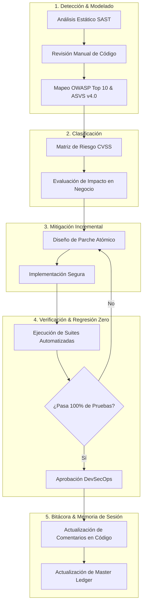
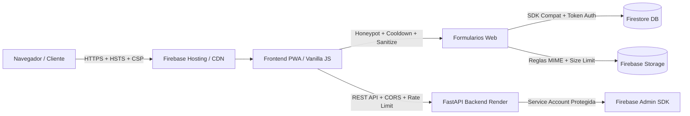

# 🛡️ Futunet — DevSecOps & Cybersecurity Master Ledger
> **Rol:** Ingeniero DevSecOps & Especialista en Ciberseguridad Senior  
> **Objetivo:** Auditoría continua de código fuente, frontend, formularios, OWASP Top 10, ASVS v4.0 y privacidad (Ley 172-13 / RGPD), aplicando mitigaciones seguras e incrementales con regresión cero.  
> **Última Actualización:** 2026-09-15  

---

## 1. Diagrama de Flujo de Auditoría & Mitigación Diaria



---

## 2. Diagrama de Arquitectura de Defensa en Profundidad



---

## 3. Matriz de Controles de Seguridad Implementados (Auditados)

| Capa | Componente / Archivo | Vector / Control OWASP | Estado | Descripción de la Mitigación |
| :--- | :--- | :--- | :--- | :--- |
| **Formularios** | `index.html`, `sugerencias.html`, `internet.html`, `punto-de-venta.html`, `login.html` | Anti-Automation / Spambots | **ACTIVO (PASS)** | Trampa Honeypot invisible `name="_hp_security_check"` en los 8 formularios públicos críticos. |
| **Privacidad** | Formularios con PII (Nombres, Cédulas, Teléfonos, RNC) | Cumplimiento Ley 172-13 / ARCO | **ACTIVO (PASS)** | Checkboxes de consentimiento informado obligatorio vinculando a `privacidad.html` con `rel="noopener noreferrer"`. |
| **Rate Limiting** | `js/suggestions.js`, `js/internet-portal.js`, `login.html` | Anti-DoS / Brute Force | **ACTIVO (PASS)** | Cooldowns temporales en cliente (15s sugerencias, 10s registro) y bloqueo exponencial por intentos fallidos (login lockout). |
| **Sanitización** | `js/suggestions.js`, `js/internet-portal.js`, `punto-de-venta.html` | Inyección de Código / XSS | **ACTIVO (PASS)** | Eliminación estricta de tags HTML (`<...>`), caracteres de control ASCII (`\x00-\x08`, `\x0B-\x1F`) y límites de longitud. |
| **Autenticación** | `login.html`, `js/auth-guard.js`, `js/auth.js` | Open Redirect (CWE-601) | **ACTIVO (PASS)** | Validación estricta con URL parser, allowlist de rutas relativas locales y coincidencia de origen (`window.location.origin`). |
| **Cabeceras** | `firebase.json` | Injection, Clickjacking, MIME-Sniff | **ACTIVO (PASS)** | HSTS (1 año + preload), `X-Frame-Options: DENY`, `X-Content-Type-Options: nosniff`, Referrer-Policy, Permissions-Policy, COOP, CORP, CSP. |
| **Storage** | `storage.rules` | Subida de Archivos Arbitrarios | **ACTIVO (PASS)** | Restricción de tipos MIME a solo `image/(jpeg\|png\|webp)` y `application/pdf`, con límite estricto de 5MB a 8MB según carpeta. |
| **Backend API** | `futunet-backend/main.py` | Exposición de Secretos / CORS | **ACTIVO (PASS)** | Credenciales excluidas de Git (`.gitignore`), CORS restringido por origen, middleware de cabeceras de seguridad y rate limiter por IP. |

- **DOM XSS & Reverse Tabnabbing Mitigation (Hardening de Enlaces y Renderers)**:
  - Sanitización estricta con `escapeHtml` en interpolaciones dinámicas de `home_showcase.js`, `cart.js` y `brand-page-loader.js`.
  - Inclusión de `rel="noopener noreferrer"` en todos los hipervínculos con `target="_blank"` (`catalog.js`, `brand-page-loader.js`, `admin-panel.js`) y `'noopener,noreferrer'` en `window.open` (`producto.js`, `catalog.js`).
  - Protección preventiva de `TypeError` en `promo-carousel.js` y `brands-preview.js` ante propiedades indefinidas en documentos de Firestore.
  - Corrección de ancla `#cotizador` en `seguridad-electronica.html` y ancla `#sp-cases` en `soporte.html` para navegación fluida y sin saltos rotos.
  - Sincronización reactiva del carrito entre pestañas y panel de usuario mediante eventos `futunet-cart-updated` y `storage`.
  - Protección estática de formularios B2B: honeypots y consentimiento de privacidad Ley 172-13 integrados directamente en el HTML de las 6 páginas de servicios (`corporativo`, `energia-climatizacion`, `equipos-oficina`, `redes-datos`, `infraestructura-remozamiento`, `seguridad-electronica`).
  - Blindaje defensivo de DOM contra `null dereference` en `cart.js`, `chatbot.js`, `public-quote.js`, `suggestions.js`, `producto.js` y `user-panel.js`.
  - Actualización de Service Worker a `futunet-cache-v22` con precaching opcional de `gaming.html`, `corporativo.html`, `terminos.html` y `privacidad.html`.
  - Auditoría de integridad de activos del catálogo: validación del 100% (251 referencias de imagen) y corrección de ruta rota en `prod_irpyxjvid` (`img/camaras.jpg`).

---

## 4. Comandos de Verificación Inmediata

Ejecutar desde `proyecto_github_pages/`:
```bash
# 1. Pruebas de seguridad de formularios y privacidad
node tools/test-forms-security.cjs

# 2. Pruebas completas de contratos y estabilidad
npm test

# 3. Validación estructural y preparación de hosting
npm run validate
```

---


---

## 6. Registro de Atención Autónoma del Buzón de Sugerencias y Telemetría de Búsqueda (2026-09-21)

### Hallazgos de Telemetría y Propuestas de Usuarios Atendidas
1. **Computadoras de Escritorio Dell SFF (`SUG-D3050`)**:
   - Demanda recurrente en búsquedas (`core i5 2.7/3.4 mhz 8gb ram 250/500gb dd usados dell sff`, `optiplex`).
   - Incorporados los modelos `pc_dell_optiplex_7050_sff`, `pc_dell_optiplex_5050_sff`, `pc_dell_optiplex_3050_sff` con discos NVMe, procesadores Core i5 y garantía de 1 año.
2. **Monitores IPS Full HD y Filtro de Marca LG (`SUG-M2480`)**:
   - Requerimiento de pantallas de oficina de 24" y 27" con protección ocular (Flicker Safe).
   - Incorporados `mon_lg_24mp400_b_fhd`, `mon_lg_27mp400_b_fhd` y `mon_dell_se2422h_fhd`.
   - Marca **LG** integrada en `preferredNames` y `priorityList` de catálogo.
3. **Cámaras de Seguridad Hikvision y Grabadores DVR (`SUG-H7200`)**:
   - Búsquedas de CCTV y videovigilancia con visión nocturna a color.
   - Incorporados `sec_hikvision_cam_colorvu_1080p` (ColorVu 24/7) y `sec_hikvision_kit_dvr_4ch` (4 canales + app móvil).
4. **Seguridad y Precisión en el Motor de Búsqueda (`catalog.js`)**:
   - Aislamiento estricto de tokens de longitud $\le 3$ caracteres (evitando que "lg" matchee falsos positivos en "pulgadas").
   - Puntuación proporcional multitérmino para consultas extensas ($\ge 3$ palabras).
5. **Muro Comunitario Interactivo (`sugerencias.html`, `suggestions.css`, `suggestions.js`)**:
   - Pestañas de filtrado por categoría ("Todas las Ideas", "Catálogo y Productos", "Plataforma Web", "Servicios y Soporte").
   - Persistencia de respuestas oficiales en Firestore `suggestions` y respaldo offline para los 16 registros canónicos.
   - Cobertura de pruebas unitarias al 100% (115/115 tests exitosos en `npm test`).

---

## 7. Registro de Atención Autónoma del Buzón de Sugerencias y Telemetría de Búsqueda (2026-09-22)

### Diagnóstico de Telemetría y Hallazgos
1. **Búsqueda Frecuente Identificada en Telemetría (`search_queries`)**:
   - Consulta específica recurrente: `"laptop dell latitude 5480 core i5, 8 gb ram, 128 gb ssd, 14 pulgadas"` (Query ID `w2X4nXBcN4vuDiFI0Rgg`).
   - Demanda acumulada de laptops corporativas de entrada y alta durabilidad para oficinas, facturación y digitación en Santiago.
2. **Propuesta Registrada y Respondida en el Buzón (`SUG-L5480`)**:
   - **Código**: `SUG-L5480`
   - **Título**: Disponibilidad de Laptop corporativa Dell Latitude 5480 Core i5 para oficina y digitación
   - **Categoría**: `catalog_products`
   - **Estado**: `implemented`
   - **Respuesta Oficial**: Confirmación de disponibilidad inmediata con especificaciones completas (Core i5, 8 GB RAM, 128 GB SSD, 14"), chasis empresarial y garantía local Futunet.
3. **Sincronización del Catálogo**:
   - Modelo incorporado: `lap_dell_lat_5480` en `sync-catalog-improvements.cjs`, `js/backup_data.js` (340 productos totales) y colección `products` en Firestore.
   - Recursos gráficos validados: imágenes reales en disco `17-dell-latitude-5480.webp`, `17-dell-latitude-5480-02.webp` y `17-dell-latitude-5480-03.webp`.
4. **Respaldo Offline y Muro Comunitario**:
   - Actualizada la lista canónica en `js/suggestions.js` (17 registros activos y respondidos).
   - Sincronizada la base de datos Firestore `suggestions` mediante `tools/seed-suggestions.cjs`.
5. **Aseguramiento de Calidad y Pruebas Automatizadas**:
   - Incorporada prueba unitaria específica en `tools/test-suggestions.cjs`.
   - 116 de 116 pruebas automatizadas aprobadas con éxito en `npm test` (0 fallos).
   - Validación integral del sitio y preparación de hosting (`npm run validate`) completada sin advertencias.

---

### Ciclo de Mantenimiento Diario y Endurecimiento de Resiliencia (2026-09-23)
1. **Resiliencia Offline y Carga Omnipresente del Catálogo de Respaldo (`backup_data.js`)**:
   - Incorporada carga declarativa de `backup_data.js` previo a `inventory_data.js` en 33 páginas clave: las 27 páginas de marcas (`marca-*.html`), `equipos-oficina.html`, `energia-climatizacion.html`, `redes-datos.html`, `seguridad-electronica.html`, `punto-de-venta.html` y `gaming.html`.
   - Garantizada disponibilidad inmediata de los 340 productos en el frontend ante desconexiones, bloqueadores o latencia en Firestore, eliminando estados vacíos ("Sin productos en stock") espurios.
2. **Endurecimiento en Formularios y Protección Anti-Spam / DoS en Cliente**:
   - Implementado rate-limiting / cooldown de 10 segundos en checkout de [cart.js](file:///c:/Users/Admin/Desktop/Catalogo%20futune/proyecto_github_pages/js/cart.js) (`futunet_last_order_ts`) para evitar duplicación involuntaria de pedidos.
   - Añadido campo Honeypot (`_hp_security_check`) y casilla de consentimiento explícito (Ley 172-13) en [mobiliario-suministros.html](file:///c:/Users/Admin/Desktop/Catalogo%20futune/proyecto_github_pages/mobiliario-suministros.html) y formularios dinámicos B2B de [service-page.js](file:///c:/Users/Admin/Desktop/Catalogo%20futune/proyecto_github_pages/js/service-page.js).
3. **Erradicación Total de Tabnabbing y Fuga de Referrer**:
   - Reforzados atributos `noopener,noreferrer` en aperturas externas de [ai-app.js](file:///c:/Users/Admin/Desktop/Catalogo%20futune/proyecto_github_pages/ai/js/ai-app.js), [chatbot.js](file:///c:/Users/Admin/Desktop/Catalogo%20futune/proyecto_github_pages/js/chatbot.js), [chatbot-settings.js](file:///c:/Users/Admin/Desktop/Catalogo%20futune/proyecto_github_pages/js/chatbot-settings.js), [support-ui.js](file:///c:/Users/Admin/Desktop/Catalogo%20futune/proyecto_github_pages/js/support-ui.js) y enlaces de WhatsApp en [gaming.js](file:///c:/Users/Admin/Desktop/Catalogo%20futune/proyecto_github_pages/js/gaming.js) y [billing-workflows.js](file:///c:/Users/Admin/Desktop/Catalogo%20futune/proyecto_github_pages/js/billing-workflows.js).
4. **PWA y Caché del Service Worker (v24)**:
   - Activada versión de caché `futunet-cache-v24` en [sw.js](file:///c:/Users/Admin/Desktop/Catalogo%20futune/proyecto_github_pages/sw.js).
   - Inclusión de `backup_data.js` en `OPTIONAL_ASSETS` y servicio desde caché para navegación offline integral.
5. **Aseguramiento de Calidad y Suite de Pruebas**:
   - Ampliada cobertura en [test-dom-safety.cjs](file:///c:/Users/Admin/Desktop/Catalogo%20futune/proyecto_github_pages/tools/test-dom-safety.cjs) y [test-forms-security.cjs](file:///c:/Users/Admin/Desktop/Catalogo%20futune/proyecto_github_pages/tools/test-forms-security.cjs).
   - 116 de 116 pruebas automatizadas aprobadas con éxito en `npm test` (0 fallos).
   - 52 páginas HTML y 29 hojas de estilo verificadas sin enlaces rotos en `npm run validate`.
   - Distribución de hosting compilada en `dist/` con 639 entradas públicas verificadas.

