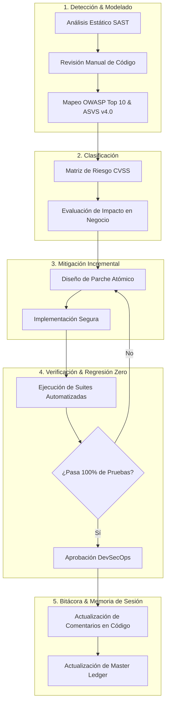
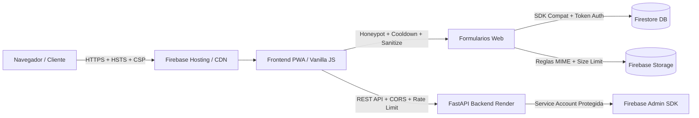

# 🛡️ Futunet — DevSecOps & Cybersecurity Master Ledger
> **Rol:** Ingeniero DevSecOps & Especialista en Ciberseguridad Senior  
> **Objetivo:** Auditoría continua de código fuente, frontend, formularios, OWASP Top 10, ASVS v4.0 y privacidad (Ley 172-13 / RGPD), aplicando mitigaciones seguras e incrementales con regresión cero.  
> **Última Actualización:** 2026-09-15  

---

## 1. Diagrama de Flujo de Auditoría & Mitigación Diaria



---

## 2. Diagrama de Arquitectura de Defensa en Profundidad



---

## 3. Matriz de Controles de Seguridad Implementados (Auditados)

| Capa | Componente / Archivo | Vector / Control OWASP | Estado | Descripción de la Mitigación |
| :--- | :--- | :--- | :--- | :--- |
| **Formularios** | `index.html`, `sugerencias.html`, `internet.html`, `punto-de-venta.html`, `login.html` | Anti-Automation / Spambots | **ACTIVO (PASS)** | Trampa Honeypot invisible `name="_hp_security_check"` en los 8 formularios públicos críticos. |
| **Privacidad** | Formularios con PII (Nombres, Cédulas, Teléfonos, RNC) | Cumplimiento Ley 172-13 / ARCO | **ACTIVO (PASS)** | Checkboxes de consentimiento informado obligatorio vinculando a `privacidad.html` con `rel="noopener noreferrer"`. |
| **Rate Limiting** | `js/suggestions.js`, `js/internet-portal.js`, `login.html` | Anti-DoS / Brute Force | **ACTIVO (PASS)** | Cooldowns temporales en cliente (15s sugerencias, 10s registro) y bloqueo exponencial por intentos fallidos (login lockout). |
| **Sanitización** | `js/suggestions.js`, `js/internet-portal.js`, `punto-de-venta.html` | Inyección de Código / XSS | **ACTIVO (PASS)** | Eliminación estricta de tags HTML (`<...>`), caracteres de control ASCII (`\x00-\x08`, `\x0B-\x1F`) y límites de longitud. |
| **Autenticación** | `login.html`, `js/auth-guard.js`, `js/auth.js` | Open Redirect (CWE-601) | **ACTIVO (PASS)** | Validación estricta con URL parser, allowlist de rutas relativas locales y coincidencia de origen (`window.location.origin`). |
| **Cabeceras** | `firebase.json` | Injection, Clickjacking, MIME-Sniff | **ACTIVO (PASS)** | HSTS (1 año + preload), `X-Frame-Options: DENY`, `X-Content-Type-Options: nosniff`, Referrer-Policy, Permissions-Policy, COOP, CORP, CSP. |
| **Storage** | `storage.rules` | Subida de Archivos Arbitrarios | **ACTIVO (PASS)** | Restricción de tipos MIME a solo `image/(jpeg\|png\|webp)` y `application/pdf`, con límite estricto de 5MB a 8MB según carpeta. |
| **Backend API** | `futunet-backend/main.py` | Exposición de Secretos / CORS | **ACTIVO (PASS)** | Credenciales excluidas de Git (`.gitignore`), CORS restringido por origen, middleware de cabeceras de seguridad y rate limiter por IP. |

- **DOM XSS & Reverse Tabnabbing Mitigation (Hardening de Enlaces y Renderers)**:
  - Sanitización estricta con `escapeHtml` en interpolaciones dinámicas de `home_showcase.js`, `cart.js` y `brand-page-loader.js`.
  - Inclusión de `rel="noopener noreferrer"` en todos los hipervínculos con `target="_blank"` (`catalog.js`, `brand-page-loader.js`, `admin-panel.js`) y `'noopener,noreferrer'` en `window.open` (`producto.js`, `catalog.js`).
  - Protección preventiva de `TypeError` en `promo-carousel.js` y `brands-preview.js` ante propiedades indefinidas en documentos de Firestore.
  - Corrección de ancla `#cotizador` en `seguridad-electronica.html` y ancla `#sp-cases` en `soporte.html` para navegación fluida y sin saltos rotos.
  - Sincronización reactiva del carrito entre pestañas y panel de usuario mediante eventos `futunet-cart-updated` y `storage`.
  - Protección estática de formularios B2B: honeypots y consentimiento de privacidad Ley 172-13 integrados directamente en el HTML de las 6 páginas de servicios (`corporativo`, `energia-climatizacion`, `equipos-oficina`, `redes-datos`, `infraestructura-remozamiento`, `seguridad-electronica`).
  - Blindaje defensivo de DOM contra `null dereference` en `cart.js`, `chatbot.js`, `public-quote.js`, `suggestions.js`, `producto.js` y `user-panel.js`.
  - Actualización de Service Worker a `futunet-cache-v22` con precaching opcional de `gaming.html`, `corporativo.html`, `terminos.html` y `privacidad.html`.
  - Auditoría de integridad de activos del catálogo: validación del 100% (251 referencias de imagen) y corrección de ruta rota en `prod_irpyxjvid` (`img/camaras.jpg`).

---

## 4. Comandos de Verificación Inmediata

Ejecutar desde `proyecto_github_pages/`:
```bash
# 1. Pruebas de seguridad de formularios y privacidad
node tools/test-forms-security.cjs

# 2. Pruebas completas de contratos y estabilidad
npm test

# 3. Validación estructural y preparación de hosting
npm run validate
```

---

## 5. Próximos Pasos en el Backlog de Seguridad (Prioridad para Próximas Sesiones)

1. [ ] **CSP Hardening**: Analizar reducción del uso de `'unsafe-inline'` en `script-src` y `style-src` en `firebase.json`.
2. [x] **Auditoría DOM XSS**: Revisión exhaustiva del uso de `innerHTML` en componentes dinámicos de catálogo, carruseles y detalle de producto.
3. [x] **Formularios B2B Estáticos**: Honeypots y Ley 172-13 integrados en HTML estático para eliminar CLS y robustecer seguridad previa a JS.
4. [ ] **Protección de Almacenamiento Local**: Verificar que no se almacenen datos personales o financieros sensibles sin cifrar en `localStorage`.
5. [ ] **Backend Genkit / LLM Security**: Auditar endpoints de chatbot para evitar prompt injection o evasión de restricciones.

