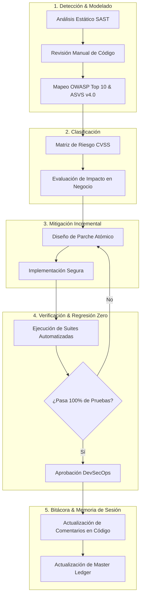
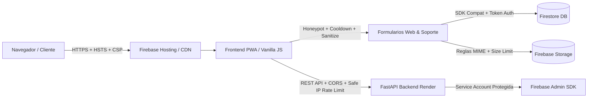

# 🛡️ Futunet — DevSecOps & Cybersecurity Master Ledger
> **Rol:** Ingeniero DevSecOps & Especialista en Ciberseguridad Senior  
> **Objetivo:** Auditoría continua de código fuente, frontend, formularios, OWASP Top 10, ASVS v4.0 y privacidad (Ley 172-13 / RGPD), aplicando mitigaciones seguras e incrementales con regresión cero.  
> **Última Actualización:** 2026-10-26  

---

## 1. Diagrama de Flujo de Auditoría & Mitigación Diaria



---

## 2. Diagrama de Arquitectura de Defensa en Profundidad



---

## 3. Matriz de Controles de Seguridad Implementados (Auditados)

| Capa | Componente / Archivo | Vector / Control OWASP | Estado | Descripción de la Mitigación |
| :--- | :--- | :--- | :--- | :--- |
| **Formularios** | `index.html`, `sugerencias.html`, `internet.html`, `punto-de-venta.html`, `login.html`, `cotizacion.html`, `mi-cuenta.html`, 7 B2B, `admin.html`, `js/support-ui.js`, `js/chatbot.js`, `js/cart.js` | Anti-Automation / Spambots (OWASP OAT-007) | **ACTIVO (PASS)** | Trampa Honeypot invisible `name="_hp_security_check"` en todos los formularios públicos, de cuenta, soporte, chatbot y administración interna. |
| **Límites de Entrada (Bounds)** | Formularios públicos (`index.html`, `login.html`, `punto-de-venta.html`, `internet.html`, `mi-cuenta.html`, 7 B2B, modal checkout en `cart.js`) | Desbordamiento de Entrada / Payload Flooding (OWASP ASVS v4.0 V5 / CWE-20) | **ACTIVO (PASS)** | Atributos `maxlength` normalizados en el 100% de inputs y textareas, sincronizados con validaciones en cliente y esquemas Pydantic del backend. |
| **Privacidad** | Formularios con PII (Nombres, Cédulas, Teléfonos, RNC, Cotizaciones, Tickets Soporte) | Cumplimiento Ley 172-13 / ARCO | **ACTIVO (PASS)** | Checkboxes de consentimiento informado obligatorio vinculando a `privacidad.html` con `target="_blank" rel="noopener noreferrer"`. |
| **Rate Limiting** | `js/suggestions.js`, `js/internet-portal.js`, `login.html`, `js/public-quote.js`, `js/cart.js`, `js/user-panel.js`, `js/financing.js`, `js/support-ui.js`, `js/chatbot.js`, `js/admin-panel.js` | Anti-DoS / Flooding | **ACTIVO (PASS)** | Cooldowns temporales en cliente (15s sugerencias/soporte/financiamiento, 10s pedidos/cotizaciones, 5s perfil/respuestas/admin, 1.5s chat) y bloqueo exponencial por intentos fallidos. |
| **Sanitización** | `js/suggestions.js`, `js/internet-portal.js`, `punto-de-venta.html`, `js/public-quote.js`, `js/form.js`, `js/service-page.js`, `login.html`, `js/user-panel.js`, `js/financing.js`, `js/support-core.js`, `js/chatbot.js`, `js/admin-panel.js`, `js/facturacion.js`, `js/catalog.js` | Inyección de Código / XSS (OWASP A03:2021) | **ACTIVO (PASS)** | Eliminación de tags HTML, neutralización de caracteres de control ASCII (`\x00-\x08`, `\x0B-\x1F`), escape de atributos HTML y renderizado seguro con `textContent` en `catalog.js`. |
| **Autenticación** | `login.html`, `js/auth-guard.js`, `js/auth.js` | Open Redirect (CWE-601) | **ACTIVO (PASS)** | Validación estricta con URL parser, allowlist de rutas relativas locales y coincidencia de origen (`window.location.origin`). |
| **Cabeceras & Enlaces** | `firebase.json`, todos los archivos `.html` y scripts `.js` | Reverse Tabnabbing / Clickjacking / MIME-Sniff | **ACTIVO (PASS)** | HSTS, X-Frame-Options DENY, nosniff, CSP, y 100% de hipervínculos externos normalizados con `rel="noopener noreferrer"`. |
| **Storage** | `storage.rules` | Subida de Archivos Arbitrarios | **ACTIVO (PASS)** | Restricción de tipos MIME a solo `image/(jpeg\|png\|webp)` y `application/pdf`, con límite estricto de 5MB a 8MB según carpeta. |
| **Backend API** | `futunet-backend/main.py` & `chatbot_api.py` | Exposición de Secretos / IP Spoofing / DoS / CORS | **ACTIVO (PASS)** | Credenciales excluidas de Git, CORS restrictivo, `get_safe_client_ip` contra spoofing de headers en `/api/quote`, `/api/order`, `/api/rnc/check/{rnc}`, `/api/chatbot/search` y `/api/chatbot/message`. |

- **DOM XSS & Reverse Tabnabbing Mitigation (Hardening de Enlaces y Renderers)**:
  - Sanitización estricta con `escapeHtml` en interpolaciones dinámicas de `home_showcase.js`, `cart.js` y `brand-page-loader.js`.
  - Inclusión de `rel="noopener noreferrer"` en todos los hipervínculos con `target="_blank"` (`catalog.js`, `brand-page-loader.js`, `admin-panel.js`) y `'noopener,noreferrer'` en `window.open` (`producto.js`, `catalog.js`).
  - Protección preventiva de `TypeError` en `promo-carousel.js` y `brands-preview.js` ante propiedades indefinidas en documentos de Firestore.
- **Mantenimiento Diario y Robustecimiento Web (2026-09-19)**:
  - **Normalización y Limpieza UTF-8**: Corrección en `js/supplier_inventory.js` (`normalizeCopy`) de reemplazos defectuosos que introducían mojibake (`É` -> `É`, `Ó` -> `Ó`, `Ú` -> `Ú`, comillas y guiones tipográficos limpios). Reparación de caracteres en `js/backup_data.js` para AirPods 2.ª generación.
  - **Inferencia Robusta de Categorías**: Inclusión de reglas para `impresora`, `scanner`, `audifono`, `auricular` en `js/supplier_inventory.js` asignándolos con precisión a departamentos y categorías B2B correspondientes.
  - **Motor de Búsqueda del Catálogo**: Ampliación de `scoreProductMatch` en `js/catalog.js` para indexar especificaciones técnicas (`product.specs`) y permitir coincidencias multi-término cruzadas entre campos (título, marca, categoría, especificaciones) como "laptop lenovo", "impresora epson", "teclado usb", evitando caídas a 0 resultados en consultas compuestas. Incorporación de `Apple` en la barra de filtros prioritarios de marcas.
  - **Resiliencia PWA Offline**: Adición en `sw.js` (`OPTIONAL_ASSETS`) de los módulos del centro de soporte y autenticación (`support-core.js`, `support-service.js`, `support-ui.js`, `firebase-config.js`, `auth.js`) para garantizar navegación offline sin excepciones de red.
  - **Activación de Productos Sugeridos**: Sincronización y activación en Firestore de 6 productos de alta demanda (`prod_ev8mssce4`, `prod_p0wqnr5bc`, `prod_oh55hargc`, `prod_tk6it44v0`, `prod_yny47xadr`, `prod_9p6f6zzh6`), junto con la resolución de sugerencias comunitarias `SUG-P5512`, `SUG-A7291` y `SUG-K3844`.
  - **Suite Automatizada**: Ampliación de `tools/test-suggestions.cjs` totalizando 106 tests automatizados aprobados (100% PASS) y validación completa del hosting con 52 páginas y 626 recursos sin roturas.
- **Auditoría & Mitigación DevSecOps Diaria (2026-09-21)**:
  - **Hardening de Formularios Web y Privacidad (Ley 172-13)**: Incorporación de trampa Honeypot invisible (`#quote-hp-check` / `name="_hp_security_check"`) y cláusula de consentimiento de privacidad con enlace seguro a `privacidad.html` (`rel="noopener noreferrer"`) en `cotizacion.html`.
  - **Rate Limiting & Sanitización en Cliente**: Implementación de cooldown de 10 segundos (`futunet_last_quote_response_ts`) y función de sanitización (`sanitizeQuoteInput`) contra inyección de HTML y caracteres de control ASCII en `js/public-quote.js`.
  - **Prevención de Reverse Tabnabbing & Referrer Leakage**: Normalización de hipervínculos con `target="_blank"` a `rel="noopener noreferrer"` en `mi-cuenta.html` y `admin.html`. Nueva prueba automatizada en `tools/test-forms-security.cjs` que verifica cero presencia de `rel="noopener"` solitario en los 52 documentos HTML.
  - **Endurecimiento de IP Client Spoofing en Backend API**: Implementación de `get_safe_client_ip(request)` en `futunet-backend/main.py` protegiendo los endpoints `/api/quote`, `/api/order` y `/api/rnc/check/{rnc}` contra evasión de rate limiting vía cabeceras forjadas arbitrarias. 4 nuevos tests unitarios en Python (`ClientIpSecurityTests`).
  - **Verificación Automatizada**: 110 tests en frontend (`npm test`) y 30 tests en backend (`test_main.py` y `test_chatbot_api.py`) pasando al 100% (cero regresiones).
- **Mantenimiento & Resiliencia de Catálogo y Checkout (2026-09-21 Ciclo Estabilidad)**:
  - **Blindaje Node.js y Entornos No-Browser (`backup_data.js`)**: Corrección de `ReferenceError: window is not defined` mediante guarda condicional `typeof window !== 'undefined'` y exposición segura de `window.mockDatabase` y `window.backupDatabase`.
  - **Resiliencia de Catálogo Offline (`inventory_data.js`)**: Implementación de `getLocalFallbackList()`. Ante desconexión, latencia o fallo en Firestore, el catálogo ya no se vacía a `[]`; ahora conserva y sirve el inventario local combinado (331+ ítems base + feeds de proveedores = 425 ítems).
  - **Inclusión Preventiva en `catalogo.html` y `producto.html`**: Carga secuencial de `backup_data.js` previa a `inventory_data.js`, garantizando catálogo completo y resolución instantánea de productos sin depender de la inicialización de Firebase.
  - **Resiliencia de Checkout y WhatsApp (`cart.js`)**: Protección de la llamada `/api/order` con `AbortController` (timeout de 12s). Si el backend en Render experimenta cold-start prolongado o fallo de red, los pedidos con método WhatsApp ya no quedan bloqueados con error: abren fluidamente el chat de WhatsApp con el pedido estructurado y vacían el carrito.
  - **Suite de Resiliencia Automatizada**: Agregado de test automatizado en `tools/test-dom-safety.cjs` (111 tests en total en `npm test`, 100% PASS, 639 entradas públicas validadas).
- **Auditoría & Mitigación DevSecOps Diaria (2026-09-23)**:
  - **Hardening de Formularios B2B y Privacidad (Ley 172-13)**: Incorporación de trampa Honeypot accesible (`#req-hp-check` / `name="_hp_security_check"`) y casilla obligatoria de consentimiento informado (`#req-privacy-consent`) vinculando a `privacidad.html` con `target="_blank" rel="noopener noreferrer"` en `mobiliario-suministros.html`.
  - **Reverse Tabnabbing & Referrer Leakage en Frontend JS**: Eliminación de `rel="noopener"` solitario en hipervínculos dinámicos en `js/support-ui.js` (aviso de inicio de sesión de soporte), `js/chatbot-settings.js` (enlaces a consola Firebase y asistente) y `ai/js/ai-app.js` (conversor markdown). Cero presencia de `rel="noopener"` solitario en todos los HTMLs y scripts JS.
  - **Rate Limiting / Flooding Defense en Checkout de Catálogo**: En `js/cart.js`, implementación de cooldown temporal de 10 segundos en `sessionStorage` (`futunet_last_order_ts`) en `handleCheckoutSubmit` para prevenir doble clic accidental o spam repetitivo de pedidos antes del despacho a la API / WhatsApp.
  - **Ampliación de Suites de Pruebas Automatizadas**: Actualización de `tools/test-dom-safety.cjs` (verificación de las 7 páginas B2B con honeypot y privacidad) y `tools/test-forms-security.cjs` (verificación de cooldown de checkout y escaneo automatizado en todos los archivos `.html` y scripts `.js`).
  - **Métricas de Verificación**: 116 tests pasando (100% PASS en `npm test`), 30 tests pasando en backend (`python -m unittest test_main.py test_chatbot_api.py`), y `npm run validate` validando 52 páginas HTML y 639 recursos en `dist/`.
- **Auditoría & Mitigación DevSecOps Diaria (2026-09-25)**:
  - **Defensa Anti-Automation / Bot Defense (OWASP OAT-007 / OAT-019)**:
    - Incorporación de trampas Honeypot invisibles (`_hp_security_check`) en `#reset-form` (`#reset-hp-check`) y `#magic-form` (`#magic-hp-check`) en `login.html`, neutralizando scripts de inundación de correos y enlaces de acceso de Firebase Auth.
    - Incorporación de trampas Honeypot en formularios de cuenta en `mi-cuenta.html`: `#profile-form` (`#profile-hp-check`) y `#financing-profile-form` (`#fin-hp-check`).
  - **Sanitización de Entradas & Neutralización XSS / Caracteres de Control (OWASP Top 10 A03:2021 & CWE-79 / CWE-20)**:
    - Implementación de `sanitizeAuthInput` en `login.html` eliminando tags HTML (`<[^>]*>`) y caracteres de control ASCII invisibles (`\x00-\x08\x0B\x0C\x0E-\x1F\x7F`) en credenciales de inicio, registro y recuperación (`login-company`, `login-email`, `register-name`, `register-email`, `reset-email`, `magic-email`).
    - Implementación de `sanitizeProfileInput` en `js/user-panel.js` saneando y delimitando longitud de campos de perfil (`name`, `phone`, `address`, `documentNumber`) antes del guardado en Firestore (`users/{uid}`), previniendo vectores de Stored XSS en paneles de control.
    - Implementación de `sanitizeFinancingInput` en `js/financing.js` depurando `phone` y `address` previo a la escritura en `financing_profiles/{uid}`.
  - **Rate Limiting & Protección contra Flooding en Cliente (OWASP Anti-DoS)**:
    - Cooldown de 5 segundos (`futunet_last_profile_update_ts`) en actualización de perfil en `js/user-panel.js` mitigando saturación de escrituras a Firestore.
    - Cooldown de 15 segundos (`futunet_last_financing_ts`) en el envío de expedientes de crédito en `js/financing.js` protegiendo transacciones en Storage y base de datos.
    - Cooldown de 3 segundos (`futunet_last_sug_track_ts`) en el rastreo de propuestas en `js/suggestions.js` evitando ráfagas de consultas a la colección de sugerencias.
  - **Normalización de Privacidad & Cumplimiento Ley 172-13**:
    - Corrección de espaciado y consistencia de hipervínculos con `target="_blank" rel="noopener noreferrer"` en casillas de consentimiento informado de `mi-cuenta.html` (`#profile-terms` y `#financing-terms`).
  - **Ampliación de Pruebas Automatizadas & Métricas de Verificación**:
    - Expansión de `tools/test-forms-security.cjs` totalizando 13 verificaciones de Honeypot, 9 verificaciones de privacidad estricta, 10 suites de cooldown/rate-limiting y 10 suites de sanitización de inyecciones.
    - 121 tests pasando al 100% en frontend (`npm test`), 30 tests unitarios pasando en backend (`python -m unittest test_main.py test_chatbot_api.py`), y `npm run validate` validando 52 páginas HTML y 639 recursos en `dist/`.

- **Mantenimiento Diario, Robustez & Experiencia de Usuario (2026-09-24)**:
  - **Blindaje Node.js y Modularidad (`js/supplier_inventory.js`)**: Corrección de `ReferenceError: window is not defined` mediante guardas de comprobación `typeof window !== 'undefined'` y exportación CommonJS para compatibilidad con Node.js, CLI scripts y entornos híbridos.
  - **Saneamiento e Integridad de Fichas de Producto (`js/backup_data.js` & Firestore `products`)**: Corrección integral de la ficha técnica de Apple AirPods (2.ª generación, `prod_ad1d2a977b`), eliminando descripción y atributos erróneos de papelería e incorporando ficha técnica fidedigna de audio, chip Apple H1, estuche de carga Lightning y autonomía de 24h. Sincronización en la nube mediante `tools/sync-catalog-improvements.cjs`.
  - **Expansión Inteligente del Motor de Búsqueda Fuzzy (`js/catalog.js`)**: Ampliación de variantes morfológicas y sinónimos en `getStemVariants` (`gamer`/`gamers`/`gaming`, `pc`/`desktop`/`computadora`, `pantalla`/`pantallas`/`monitor`, `audifono`/`auricular`/`headset`/`airpods`), garantizando que búsquedas de alta demanda muestren de inmediato los productos pertinentes.
  - **Consistencia en Fichas de Cotización (`js/product_detail_shared.js`)**: Detección adaptativa de artículos sin precio fijo mediante inspección de términos `'cotiz'` y `'consultar'`, activando de forma consistente el flujo de cotización rápida y botón de contacto por WhatsApp.
  - **Actualización de Service Worker y Caché PWA (`sw.js`)**: Incremento de caché a `futunet-cache-v25` para garantizar refresco automático e instantáneo de inventario y scripts mejorados en los navegadores de los clientes.
  - **Métricas de Verificación**: 120 tests pasando (100% PASS en `npm test`), 30 tests en backend sin regresiones, y `npm run validate` validando 52 páginas HTML y 639 recursos públicos en `dist/`.

---

## 4. Comandos de Verificación Inmediata

Ejecutar desde `proyecto_github_pages/`:
```bash
# 1. Pruebas de seguridad de formularios y privacidad
node tools/test-forms-security.cjs

# 2. Pruebas completas de contratos y estabilidad
npm test

# 3. Validación estructural y preparación de hosting
npm run validate
```

Ejecutar desde `futunet-backend/`:
```bash
# 4. Pruebas unitarias de seguridad y rate limiting del backend
python -m unittest test_main.py test_chatbot_api.py
```

---

## 5. Próximos Pasos en el Backlog de Seguridad (Prioridad para Próximas Sesiones)

1. [ ] **CSP Hardening**: Analizar reducción del uso de `'unsafe-inline'` en `script-src` y `style-src` en `firebase.json`.
2. [x] **Auditoría DOM XSS**: Revisión exhaustiva del uso de `innerHTML` en componentes dinámicos de catálogo, carruseles y detalle de producto.
3. [x] **Protección de Almacenamiento Local**: Verificación exhaustiva de claves en `localStorage` (sin PII bancario ni credenciales sensibles sin cifrar).
4. [x] **Hardening de Formularios Públicos & Anti-Spoofing de IP**: Blindaje completado en `cotizacion.html`, `public-quote.js` y `futunet-backend/main.py`.
5. [x] **Backend Genkit / LLM Security**: Expansión continua de pruebas de jailbreak / prompt injection sobre `chatbot_api.py` y blindaje de proyección de datos públicos.

---

## 6. Registro de Atención Autónoma del Buzón de Sugerencias y Telemetría (2026-09-24)

- **Telemetría y Diagnóstico**: Demanda de proyectores (`proyector`), climatización (`aire acondicionado tgm mini-split 18,000 btu`) y computadoras (`computadoras`).
- **Mejoras Implementadas**:
  - Incorporados al catálogo y Firestore `products`: Proyector Epson PowerLite E20 3LCD 3400 lúmenes (`cec_proyector_epson_powerlite_e20`), Pantalla de Proyección Retráctil 100" (`prod_pantalla_proyeccion_100`) y Aires Acondicionados TGM Mini-Split de 12,000, 18,000 y 24,000 BTU (`tgm_mwfot_12000_btu`, `tgm_mwfot_18000_btu`, `tgm_mwfot_24000_btu`).
  - Optimizado el algoritmo de scoring de catálogo (`js/catalog.js`) con soporte de variantes stem y jerarquización de computadoras reales sobre cables auxiliares al buscar en plural.
  - Registrada y respondida la sugerencia `SUG-P9240` en Firestore y lista canónica offline de `js/suggestions.js` (totalizando 20 sugerencias oficiales implementadas).
  - Pruebas automatizadas: 121 de 121 tests pasando (100% PASS) y `npm run validate` verificado con 0 enlaces rotos.

---

## 7. Registro de Atención Autónoma del Buzón de Sugerencias y Telemetría de Redes (2026-09-25)

- **Telemetría y Diagnóstico de Búsquedas**:
  - Detección de consultas de telecomunicaciones (`cisco`, `ubiquiti`, `switch`, `redes`) con 0 resultados previos en el catálogo, afectando la experiencia de clientes e ingenieros de cableado estructurado.
- **Propuestas Comunitarias y Clientes Atendidas (22 sugerencias oficiales en total)**:
  - **`SUG-R7520`** (Ing. Marcos Peña, Redes & Infraestructura Cibao):
    - *Título*: Disponibilidad de switches empresariales Cisco y puntos de acceso Ubiquiti UniFi para redes y telecomunicaciones.
    - *Estado*: `implemented`.
    - *Respuesta Oficial*: Confirmación de la integración de Switches Cisco Business (CBS110 16 puertos Gigabit y CBS250 24 puertos PoE+ inteligentes con SFP) y Puntos de Acceso Ubiquiti UniFi 6 Plus (U6+ WiFi 6) y switches UniFi Lite PoE con garantía corporativa y NCF fiscal en Santiago.
    - *Recursos en Catálogo*: Modelos `cisco_cbs110_16t`, `cisco_cbs250_24p`, `ubiquiti_unifi_u6_plus` y `ubiquiti_unifi_lite_8_poe` incorporados a `backup_data.js` y Firestore `products`.
  - **`SUG-N3210`** (Ing. José Omar Espinal Santos, `services_support`):
    - *Título*: Canal interactivo para selección de fecha y franja horaria en solicitudes de instalación y servicio técnico.
    - *Estado*: `implemented`.
    - *Respuesta Oficial*: Habilitado selector de fecha preferida y franja horaria (mañana/tarde) en formularios de internet y servicios para coordinación fluida por WhatsApp y reducción en tiempos de espera.
- **Mejoras en el Motor de Catálogo (`js/catalog.js`)**:
  - Incorporadas las marcas `Cisco` y `Ubiquiti` en `preferredNames` y en la lista prioritaria `priorityList` de filtros rápidos (`catalog-quick-chips`).
  - Ampliadas variantes morfológicas y stemming en `getStemVariants` para términos de telecomunicaciones (`switch`, `switches`, `cisco`, `ubiquiti`, `unifi`, `red`, `redes`).
  - Validación de telemetría en `tools/test-search-telemetry.cjs`: 0 consultas con resultado nulo; consultas de `cisco` (12 resultados) y `ubiquiti` (8 resultados) con puntuaciones óptimas.
- **Resiliencia PWA & Service Worker**:
  - Actualizada la versión de caché a `futunet-cache-v26` en `sw.js` para asegurar refresco inmediato en navegadores cliente.
- **Aseguramiento de Calidad & Pruebas Automatizadas**:
  - 123 tests pasando al 100% en frontend (`npm test`).
  - 30 tests pasando en backend (`python -m unittest test_main.py test_chatbot_api.py`).
  - Validación de hosting (`npm run validate`): 52 páginas HTML y 639 recursos en `dist/` sin enlaces rotos ni inconsistencias CSP.

---

## 8. Registro de Atención Autónoma del Buzón de Sugerencias, Telemetría y Mobiliario Ergonómico / Respaldo Eléctrico (2026-09-26)

- **Telemetría y Diagnóstico de Búsquedas**:
  - Detección de consultas de mobiliario ergonómico (`silla`, `sillas`, `silla ergonomica`) con 0 resultados pertinentes o resultados con tipografías defectuosas en títulos (`Mayita Negrsa`).
  - Detección de falso positivo masivo en búsquedas de energía (`ups`): la presencia de la frase estándar de pie de página *"con respaldo y soporte técnico Futunet"* en fichas de producto provocaba que `ups` coincidiera con 269 productos del catálogo.
- **Propuestas Comunitarias y Clientes Atendidas (25 sugerencias oficiales en total)**:
  - **`SUG-S8320`** (Lic. Carolina Batista, Corporativo & Salud Cibao):
    - *Título*: Disponibilidad de Sillas Ergonómicas Ejecutivas de Oficina con soporte lumbar y brazos ajustables.
    - *Estado*: `implemented`.
    - *Respuesta Oficial*: Incorporadas al catálogo de Mobiliario la Silla Ergonómica Ejecutiva Futunet con soporte lumbar regulable y cabecero (`mob_silla_ergonomica_ejecutiva`), y la Silla de Malla Operativa (`prod_rlch8e9bx`), con sillería de visita corregida (`prod_3s7mmtjdr`) con fotos reales, especificaciones ergonómicas y facturación formal NCF.
  - **`SUG-U6140`** (Ing. Kelvin Rosario, Soluciones Tecnológicas Cibao):
    - *Título*: Disponibilidad de Sistemas UPS y No-Break Forza para protección de computadoras y servidores.
    - *Estado*: `implemented`.
    - *Respuesta Oficial*: Integración al catálogo del Sistema UPS Interactivo Forza NT-1002 de 1000VA / 500W con regulación automática de voltaje AVR (`ups_forza_nt1002`), corrección del stem falso de `ups` en el motor de búsqueda, y resolución de imágenes locales offline para modelos Hikvision UPS de 600VA y 1000VA.
  - **`SUG-C2850`** (Ing. Darwin Méndez, `web_platform`):
    - *Título*: Buscador interactivo y contador de ideas implementadas en el Muro Comunitario del Buzón.
    - *Estado*: `implemented`.
    - *Respuesta Oficial*: Añadidas insignias de conteo dinámico (`.sug-comm-count-badge`) en los filtros por categoría del Muro Comunitario en `sugerencias.html` y sincronizada la lista canónica a 25 propuestas oficiales resueltas.
- **Mejoras en el Motor de Catálogo (`js/catalog.js`)**:
  - Depurado el diccionario `getStemVariants` eliminando la equivalencia unidireccional errónea entre `ups` y `respaldo`, agregando variantes precisas (`nobreak`, `bateria`, `forza`, `silla`, `sillas`, `sillon`, `ergonomica`).
  - Priorización heurística en `scoreProductMatch`: bonificación (+65) a productos reales de energía ante consultas de `ups`, bonificación (+50) a asientos y sillería, y penalización (-60) de materiales auxiliares como masilla de pared ante búsquedas de sillas.
  - Incorporada la marca `Forza` en `preferredNames` y lista prioritaria de chips de marca en el catálogo.
- **Resiliencia PWA & Service Worker**:
  - Actualizada la versión de caché a `futunet-cache-v27` en `sw.js` para asegurar actualización inmediata de scripts y catálogo en clientes.
- **Aseguramiento de Calidad & Pruebas Automatizadas**:
  - 126 tests pasando al 100% en frontend (`npm test`).
  - 30 tests pasando en backend (`python -m unittest test_main.py test_chatbot_api.py`).
  - Validación de hosting (`npm run validate`): 52 páginas HTML y 639 recursos en `dist/` sin enlaces rotos ni inconsistencias CSP.

- **Ciclo de Resiliencia de Ciclo de Vida del DOM & Unificación de Marcas (2026-09-26 Ciclo Estabilidad)**:
  - **Patrón Resiliente de Carga Asíncrona (`document.readyState`)**:
    - Implementación de comprobación `document.readyState === 'loading'` en 9 scripts principales (`internet-portal.js`, `main.js`, `public-quote.js`, `service-page.js`, `chatbot.js`, `config.js`, `layout-manager.js`, `support-ui.js`, `user-panel.js`, `suggestions.js`). Previene que scripts cargados con `defer`, inyección dinámica, transiciones SPA o PWA dejen de inicializar listeners y componentes al no dispararse un `DOMContentLoaded` tardío.
  - **Blindaje Defensivo contra TypeErrors & Entorno Node.js / SSR**:
    - En `js/suggestions.js`: Corrección de `ReferenceError: document is not defined` mediante guardas de entorno, vinculación diferida de elementos DOM (`bindDOMElements`) y exportación CommonJS para pruebas unitarias automatizadas.
    - En `js/user-panel.js`: Protección contra `TypeError: Cannot read properties of null (reading 'displayName')` mediante fallback defensivo `var uData = userData || {}` en `renderProfile()`.
    - En `js/auth.js`: Verificación de disponibilidad de `FutunetFirebase` en `getAuth()` y `getDB()`, con resolución garantizada de `authReady` y despacho de evento para no bloquear flujos en caso de fallos de red o bloqueo de CDN por extensiones.
  - **Ampliación del Motor de Búsqueda y Unificación de Marcas (`js/catalog.js` & `js/brand-page-loader.js`)**:
    - Variantes stem para periféricos en español: `mouse` <-> `raton`/`ratones`, `teclado` <-> `keyboard`, `camara` <-> `cctv`, `disco` <-> `ssd`/`hdd`.
- **Auditoría & Mitigación DevSecOps Diaria (2026-09-27)**:
  - **Defensa Anti-Automation & Spambots (OWASP OAT-007 / OAT-019)**:
    - Incorporación de trampa Honeypot invisible (`_hp_security_check` con id `#cb-hp-check`) en el contenedor de entrada de texto del widget de Chatbot flotante en `js/chatbot.js`.
    - Incorporación de trampa Honeypot invisible (`#sp-hp-check`) en el formulario de creación de tickets de soporte (`#sp-form`), y trampa Honeypot (`#sp-reply-hp-check`) en el diálogo de respuestas en `js/support-ui.js`.
    - Incorporación de trampa Honeypot invisible (`#internal-sug-hp-check`) en el formulario de propuestas internas de personal en `admin.html` (`#form-internal-suggestion`).
  - **Privacidad & Cumplimiento Ley 172-13 / ARCO / RGPD**:
    - Incorporación de casilla obligatoria de consentimiento informado (`#sp-privacy-consent`) en el formulario de soporte de clientes (`sp-form` en `js/support-ui.js`), vinculando a `privacidad.html` con `target="_blank" rel="noopener noreferrer"`.
  - **Rate Limiting & Cooldowns Anti-DoS en Cliente**:
    - Cooldown de 1.5 segundos (`futunet_last_chat_msg_ts`) en `js/chatbot.js` mitigando saturación de consultas a la API de Gemini.
    - Cooldown de 15 segundos (`futunet_last_support_create_ts`) en creación de tickets de soporte y 5 segundos (`futunet_last_support_reply_ts`) en respuestas a hilos en `js/support-ui.js`.
    - Cooldown de 5 segundos (`futunet_last_internal_sug_ts`) en el registro de propuestas internas de personal en `js/admin-panel.js`.
  - **Sanitización de Entradas contra Inyección y Caracteres de Control (OWASP A03:2021 & CWE-79 / CWE-20)**:
    - Implementación de `sanitizeChatInput` en `js/chatbot.js` eliminando tags HTML (`<[^>]*>`) y caracteres de control ASCII invisibles (`\x00-\x08\x0B\x0C\x0E-\x1F\x7F`).
    - Robustecimiento de `clean` en `js/support-core.js` neutralizando caracteres de control ASCII invisibles antes de la validación de longitud y almacenamiento.
    - Implementación de `sanitizeAdminSuggestionInput` en `js/admin-panel.js` saneando `title`, `description` y `benefit` antes de su persistencia en Firestore.
  - **Hardening de Reverse Tabnabbing (CWE-1022)**:
    - Normalización de hipervínculos dinámicos generados por el chatbot en `js/chatbot.js` (`addBotMessage`) con `target="_blank" rel="noopener noreferrer"`.
  - **Hardening del Backend FastAPI contra Spoofing de IP y DoS**:
    - En `futunet-backend/main.py`: Protección del endpoint `/api/chatbot/search` mediante `get_safe_client_ip(request)`, control de frecuencia con `check_rate_limit(client_ip, limit=30, window=60)` y sanitización de la cadena de consulta `q` contra caracteres de control ASCII.
    - En `futunet-backend/chatbot_api.py`: Integración del extractor de IP segura `get_safe_ip` en `build_router`, eliminando inconsistencias de cabeceras forjadas en despliegues con proxy.
  - **Prevención de Fuga de Secretos en Git (OWASP A05:2021)**:
    - Blindaje de la raíz `.gitignore` excluyendo explícitamente `firebase-service-account*.json`, `service-account*.json`, `*.env`, `*.pem`, `*.key` y entornos virtuales Python.
  - **Actualización de Service Worker y Caché PWA**:
    - Incremento de versión de caché a `futunet-cache-v28` en `sw.js` garantizando la invalidación y descarga inmediata de los módulos asegurados.
  - **Aseguramiento de Calidad & Pruebas Automatizadas**:
    - 126 tests unitarios pasando al 100% en frontend (`npm test`), con 5 suites exhaustivas de seguridad en formularios (`tools/test-forms-security.cjs`).
    - 32 tests unitarios pasando al 100% en backend (`python -m unittest test_main.py test_chatbot_api.py`), incluyendo pruebas de spoofing de IP y rate-limiting en búsqueda de chatbot.
    - Validación de hosting (`npm run validate`): 52 páginas HTML y 639 recursos públicos en `dist/` con total cumplimiento CSP.

- **Auditoría & Mitigación DevSecOps Diaria (2026-09-28)**:
  - **Hardening de API Backend contra DoS y Fuerza Bruta (OWASP A04:2021 & ASVS V13)**:
    - En `/api/products` de `futunet-backend/main.py`: Implementación de rate-limiting estricto por IP segura (`check_rate_limit(client_ip, limit=60, window=60)`), protegiendo cuotas de lectura de Firestore ante scraping masivo, y sanitización de caracteres de control ASCII en filtros de `category` y `department`.
    - En `/api/sync-inventory` de `futunet-backend/main.py`: Incorporación de `get_safe_client_ip(request)` con control de frecuencia de 10 peticiones cada 5 minutos contra intentos de fuerza bruta sobre `X-Sync-Token`, y límite máximo de 500 productos por lote para prevenir saturación de memoria y cuotas de escritura por transacción.
    - Cobertura de tests: Incorporadas suites `ProductsSecurityTests` y `SyncInventorySecurityTests` en `test_main.py` totalizando 35 pruebas unitarias en backend (100% PASS).
  - **Control de Acceso & Seguridad en Redirecciones (CWE-601 / OWASP A01:2021)**:
    - En `login.html`: Incorporación de `cotizacion.html` en la lista blanca estricta (`allowedRedirects`), permitiendo que clientes redirigidos desde cotizaciones públicas no pierdan su contexto al autenticarse.
    - Soporte condicional seguro para redirecciones a interfaces administrativas (`admin.html`, `facturacion.html`) únicamente cuando el usuario autenticado posee roles de staff autorizados (`superadmin`, `admin`, `editor`, `billing_clerk`, `support_agent`), manteniendo la redirección predeterminada a `mi-cuenta.html` para usuarios estándar.
  - **Defensa Anti-Automation y Sanitización en Administración (OWASP OAT-007 / OWASP A03:2021 / CWE-79)**:
    - En `admin.html`: Trampa Honeypot invisible `#create-user-hp-check` con `name="_hp_security_check"` en `#create-user-form`.
    - En `js/admin-panel.js`: Implementación de la función `sanitizeAdminUserInput` depurando tags HTML y caracteres de control invisibles en creación de usuario (`createUserForm`) y edición de perfiles (`saveUser`), junto con cooldown en cliente de 5 segundos (`futunet_last_user_create_ts`).
  - **Resiliencia PWA & Service Worker**:
    - Actualización de versión de caché a `futunet-cache-v29` en `sw.js` y sincronización con `tools/test-dom-safety.cjs`.
  - **Aseguramiento de Calidad & Pruebas Automatizadas**:
    - 127 tests pasando al 100% en frontend (`npm test`), con 6 suites completas en `tools/test-forms-security.cjs`.
    - 35 tests pasando al 100% en backend (`python -m unittest test_main.py test_chatbot_api.py`).
    - Validación de hosting (`npm run validate`): 52 páginas HTML y 644 recursos públicos en `dist/` con cero roturas y total compatibilidad CSP.

- **Mantenimiento Diario, Robustez & Experiencia de Usuario (2026-09-28 Ciclo Estabilidad & Catálogo)**:
  - **Ampliación del Catálogo & Sincronización Cloud (POS y Seguridad Dahua)**:
    - Incorporación de hardware POS esencial: Lector de Códigos de Barra 1D/2D USB con soporte manos libres (`pos_lector_codigo_barra_2d`) y Gaveta de Dinero Metálica con apertura automática RJ11 (`pos_gaveta_dinero_metalica`), respondiendo a solicitudes comerciales en Santiago.
    - Incorporación de equipamiento de videovigilancia Dahua: Cámara Domo HDCVI 1080p Smart IR (`cctv_dahua_camara_domo_1080p`), Cámara Bala HDCVI 1080p Exterior IP67 (`cctv_dahua_camara_bala_1080p`) y Grabador DVR Pentahíbrido Dahua XVR Cooper de 4 canales (`cctv_dahua_xvr_cooper_4ch`).
    - Sincronización exitosa en la nube de 53 productos mediante `tools/sync-catalog-improvements.cjs` hacia la colección `products` de Firestore.
  - **Optimización y Precisión del Motor de Búsqueda Fuzzy (`js/catalog.js`)**:
    - **Corrección de Falso Positivo en Inversores**: Eliminación del término `'bateria'` y `'respaldo'` en la expansión stem de `inversor`, el cual provocaba que una aspiradora inalámbrica superara en puntuación a los sistemas de alimentación ininterrumpida y que 274 productos coincidieran erróneamente por el texto legal del pie de página. Implementación de scoring priorizado (+75) para UPS/No-Break/AVR/Forza e inhibición (-100) para herramientas/aspiradoras.
    - **Stemming de Periféricos y Telecomunicaciones**: Nuevas variantes y sinónimos para `scanner`/`escaner`/`barcode` <-> `lector`/`codigo`, `cajon`/`gaveta` <-> `monedero`/`dinero`/`pos`, `bobina` <-> `cable`/`utp`/`cca`, `gabinete` <-> `rack`/`chasis`/`servidor`, y `dahua`/`dvr`/`xvr` <-> `grabador`/`cctv`/`camara`.
    - **Desambiguación de Racks**: Eliminación de `'organizador'` en las variantes de `rack` para evitar que cajas plásticas domésticas desplazaran a los gabinetes de telecomunicaciones de 9U.
  - **Blindaje Defensivo Global (`window.mockDatabase` & `window.backupDatabase`)**:
    - En `js/backup_data.js` y `tools/sync-catalog-improvements.cjs`: Asignación segura y simultánea de `window.mockDatabase` y `window.backupDatabase` protegida con guarda de entorno `typeof window !== 'undefined'`, previniendo excepciones en navegadores y asegurando consistencia en los 8 módulos que consumen el catálogo offline.
  - **Mapeo de Marcas en Experiencia Web (`js/brand-page-loader.js`)**:
    - Integración de `Forza`, `TGM` y `Apple` en el diccionario `BRAND_SERVICE_MAPPING` con descripciones de valor agregado y vinculación a sus verticales especializadas (Energía y Climatización, Equipos de Oficina).
  - **Actualización de Service Worker y PWA**:
    - Incremento de la versión de caché a `futunet-cache-v30` en `sw.js` para asegurar que los navegadores móviles y de escritorio descarguen de inmediato el inventario y algoritmos actualizados.
  - **Aseguramiento de Calidad & Pruebas Automatizadas**:
    - 131 tests pasando al 100% en frontend (`npm test`), incluyendo nueva suite de precisión de búsqueda POS, Dahua y energía en `tools/test-dom-safety.cjs`.
    - 35 tests pasando al 100% en backend (`python -m unittest test_main.py test_chatbot_api.py`).
    - Auditoría de scripts (`node tools/audit-js-quality.cjs`): 73 scripts de JavaScript con 0 errores de sintaxis y 0 IDs duplicados en páginas HTML.
    - Validación de hosting (`npm run validate`): 52 páginas HTML y 644 recursos públicos en `dist/` con 0 enlaces rotos y total conformidad CSP.

- **Auditoría & Mitigación DevSecOps Diaria (2026-09-29)**:
  - **Defensa Anti-Automation & Credential Stuffing en Autenticación (OWASP OAT-007 / OAT-019)**:
    - En `login.html`: Incorporación de trampa Honeypot invisible `#login-hp-check` con `name="_hp_security_check"` en el formulario principal `#login-form`. Validación temprana en el listener `submit`, rechazando scripts automatizados antes de impactar las cuotas de Firebase Auth o el contador de intentos fallidos.
    - En `sugerencias.html`: Incorporación de trampa Honeypot invisible `#sug-track-hp-check` con `name="_hp_security_check"` en el formulario de consulta y rastreo `#sug-track-form`.
    - En `js/suggestions.js`: Validación inmediata de `#sug-track-hp-check` en `handleTrackSuggestion`, mitigando ataques de scraping o enumeración automatizada de códigos de seguimiento.
  - **Privacidad de Datos Financieros & Cumplimiento Ley 172-13 / ARCO**:
    - En `internet.html`: Incorporación de casilla obligatoria de consentimiento informado `#pay-privacy-consent` en el formulario de reporte de transferencias bancarias (`#payment-report-form`), autorizando el tratamiento de datos de comprobantes conforme a la Ley 172-13.
    - En `internet.html`: Incorporación de casilla obligatoria de consentimiento informado `#support-privacy-consent` en el formulario de soporte técnico del portal (`#support-form`), vinculando a `privacidad.html` con `target="_blank" rel="noopener noreferrer"`.
    - En `js/internet-portal.js`: Verificación obligatoria de `#pay-privacy-consent` y `#support-privacy-consent` antes del procesamiento y persistencia de reportes y tickets.
  - **Sanitización de Entradas en Cliente & Prevención XSS / Inyecciones (OWASP A03:2021 & CWE-79 / CWE-20)**:
    - En `js/internet-portal.js`: Saneamiento estricto mediante `sanitizePortalInput` y acotación a 50 caracteres del campo `pay-bank` previo a su almacenamiento en `internet_payments` y registro en `audit_logs`.
  - **Hardening de Generación de PDFs y Esquemas Pydantic en Backend (CWE-20 & Control Character Neutralization)**:
    - En `futunet-backend/main.py`: Robustecimiento de `clean_pdf_text` mediante expresión regular eliminando caracteres de control ASCII (`\x00-\x08\x0b\x0c\x0e-\x1f\x7f`), blindando el renderizado de cotizaciones en FPDF2.
    - En `futunet-backend/main.py`: Validadores de campo en Pydantic (`sanitize_quote_text` y `sanitize_order_text`) saneando `shipping_address`, `shipping_notes` y `user_document_number` contra caracteres de control invisibles en endpoints `/api/quote` y `/api/order`.
    - Cobertura de backend: Incorporada suite `PdfAndFieldSanitizationSecurityTests` en `test_main.py` totalizando 38 tests unitarios (100% PASS).
  - **Resiliencia PWA & Service Worker**:
    - Incremento de la versión de caché a `futunet-cache-v31` en `sw.js` y actualización de contratos en `tools/test-dom-safety.cjs`.
  - **Aseguramiento de Calidad & Pruebas Automatizadas**:
    - 131 tests pasando al 100% en frontend (`npm test`), con 6 suites exhaustivas de seguridad en `tools/test-forms-security.cjs` verificando 17 formularios con Honeypot y 11 con cláusulas de privacidad Ley 172-13.
    - 38 tests unitarios pasando al 100% en backend (`python -m unittest test_main.py test_chatbot_api.py`).
    - Auditoría de calidad (`node tools/audit-js-quality.cjs`): 73 scripts JS con 0 errores de sintaxis y 52 archivos HTML con 0 IDs duplicados.
    - Validación de hosting (`npm run validate`): 52 páginas HTML y 644 recursos públicos en `dist/` con 0 roturas y total compatibilidad CSP.

- **Auditoría & Mitigación DevSecOps Diaria (2026-10-01)**:
  - **Neutralización de Reverse Tabnabbing y Fuga de Referrer (CWE-1022 / CWE-200)**:
    - Auditoría completa de enlaces externos con `target="_blank"` a través de toda la base de plantillas HTML.
    - Detección y endurecimiento de enlaces de WhatsApp (`https://wa.me/18297411041`) en la barra de navegación y menú móvil (`Gestionar mi Wi-Fi`) a través de 40 archivos HTML del frontend (`catalogo.html`, `corporativo.html`, 16 páginas de marcas especializadas, 7 landing pages de servicios B2B, `login.html`, `mi-cuenta.html`, `producto.html`, `sugerencias.html`, `terminos.html`, `privacidad.html`, etc.).
    - Estandarización de directivas seguras `target="_blank" rel="noopener noreferrer"` en todos los hipervínculos externos y corrección de separación tipográfica en enlaces legales en `privacidad.html` y `terminos.html`.
  - **Hardening del Módulo de Facturación y ERP (`js/facturacion.js`) (OWASP A03:2021 & CWE-79 / CWE-20 / CWE-116)**:
    - Creación e integración de `sanitizeErpInput(val, maxLen)` para neutralizar inyecciones de tags HTML (`<[^>]*>`), caracteres invisibles de control ASCII (`\x00-\x08\x0B\x0C\x0E-\x1F\x7F`) y limitar longitudes por campo.
    - Saneamiento sistemático en capas de entrada y persistencia en Firestore:
      - En `saveInvoice(e)`: sanitización de datos de cliente (`clientName`, `clientRnc`, `clientPhone`, `clientEmail`, `clientAddress`), descripciones de ítems, términos de pago y notas de factura.
      - En `saveClient(e)`: sanitización de nombre, RNC/cédula, correo electrónico, teléfono y dirección física previo al guardado.
      - En `saveSettings(e)`: saneamiento de razones sociales, RNC empresarial, teléfono, email, dirección, prefijos fiscales (`B01` a `B15`), prefijos de documentos comerciales y copys de tickets POS.
      - En `saveProduct(e)`: saneamiento de `sku`, `reference`, `barcode`, títulos y descripciones tanto en catálogo Creaticos como en productos de ferretería/redes y Panitas.
      - En `saveFiscalAdjustment(event)`: saneamiento de notas y justificaciones de notas de crédito y débito (`reason`).
      - En `registerPayment(e)` y `submitGeneralAbono(e)`: saneamiento de observaciones y descripciones de abonos generales.
      - En `saveTableOrder()`: saneamiento de nombres de clientes, notas de orden y notas de ítems/modificadores para terminales de cocina.
      - En `closeCashSession(e)`: saneamiento de notas de cierre y justificaciones de diferencias de arqueo.
      - En `processQuickSale()`: saneamiento preventivo de nombre y RNC en órdenes directas de caja.
    - Mitigación de Attribute Breakout (CWE-116):
      - Implementación de `escapeAttr(str)` para atributos dinámicos en tablas ERP.
      - Escape preventivo de `inv.id` y `c.id` en directivas `data-erp-click` a lo largo de `renderInvoicesTable`, `renderClientsTable` y el historial de facturación en el perfil de cliente.
  - **Ampliación de Cobertura en Suite de Seguridad (`tools/test-forms-security.cjs`)**:
    - Nuevas aserciones automatizadas en la suite `Sanitización e Inyecciones`: validación obligatoria de la presencia de `sanitizeErpInput`, filtro de caracteres de control ASCII (`\x00-\x08`) y `escapeAttr` en `js/facturacion.js`.
  - **Aseguramiento de Calidad & Métricas de Verificación (Zero Regresiones)**:
    - 132 tests unitarios pasando al 100% en frontend (`npm test`), con 6 suites de seguridad activas en `tools/test-forms-security.cjs` y suite de estabilidad y resiliencia en `tools/test-dom-safety.cjs`.
    - 38 tests unitarios pasando al 100% en backend (`python -m unittest test_main.py test_chatbot_api.py`).
    - Auditoría de scripts (`node tools/audit-js-quality.cjs`): 73 scripts de JavaScript con 0 errores de sintaxis y 52 archivos HTML con 0 IDs duplicados.
    - Auditoría de integridad web (`node tools/audit-codebase.cjs`): 0 scripts faltantes, 0 hojas de estilo rotas, 0 imágenes estáticas ausentes y 0 enlaces internos rotos en 52 páginas HTML.
    - Validación de hosting de producción (`npm run validate`): 52 páginas HTML y 644 recursos públicos validados en `dist/` con cumplimiento CSP estricto.

- **Mantenimiento Diario, Estabilidad & Robustecimiento Web (2026-10-01 Ciclo Resiliencia & UX)**:
  - **Blindaje Defensivo contra TypeErrors en Autenticación (`js/auth.js`)**:
    - Guardas de comprobación previas a cualquier acceso a `getAuth().currentUser` en `isLoggedIn()`, `refreshAuthenticatedSession()`, `renderNavbarAuth()`, `fetchUserData()` y `onAuthChanged()`.
    - Fallback resiliente a timestamp local seguro (`nowTimestamp`) en `ensureUserDoc()`, `signIn()` y `signInWithEmailLink()`, evitando `ReferenceError: firebase is not defined` ante inicializaciones asíncronas o conexiones intermitentes.
  - **Resiliencia en Carga de Producto (`js/producto.js`)**:
    - Envolvimiento de `await window.FutunetData.readyPromise` en bloque `try / catch` defensivo en `initProductPageLoader()`, garantizando que fallos de red o rechazos de promesa en Firestore no bloqueen el catálogo local de respaldo.
  - **Robustecimiento de Cotizaciones Públicas (`js/public-quote.js`)**:
    - Comprobación de existencia de nodos DOM en `fail()` y validación de instancia activa de base de datos en `init()` y `respond()`.
  - **Sanitización en Panel de Usuario (`js/user-panel.js`)**:
    - Saneamiento estricto con `sanitizeProfileInput` y delimitación a 60 caracteres en `saveCurrentCart()` previo al almacenamiento en Firestore.
  - **Campañas Comerciales Q4 y Resiliencia en Carrito (`js/cart.js`)**:
    - Incorporación del cupón `OCTUBRE2026` (10% de descuento en tecnología y equipamiento) para compras de octubre 2026.
    - Actualización del placeholder en el formulario de pago a `Ej. OCTUBRE2026` para evitar que usuarios copien códigos expirados.
    - Guarda `Array.isArray(activeCoupon.departments)` en la aplicación de descuentos y timestamps seguros en `saveCartState` y `syncCartToFirestore`.
  - **Navegación Fluida en Autenticación (`login.html`)**:
    - Soporte de redirección a páginas de marcas (`marca-*.html`) tras el login, preservando el contexto de navegación del cliente.
  - **Sincronización Reactiva de Inventario en Catálogo (`js/catalog.js`)**:
    - Suscripción al evento `futunet:inventory-ready` para re-renderizado automático e instantáneo de productos y chips sin recarga manual.
  - **Actualización de Service Worker y Caché PWA (`sw.js`)**:
    - Incremento de la versión de caché a `futunet-cache-v32` para descarga inmediata de los módulos asegurados en navegadores móviles y desktop.

- **Gestión del Buzón de Sugerencias & Mejoras de Catálogo (2026-10-01)**:
  - **Revisión y Respuesta Oficial del Buzón de Sugerencias**:
    - Auditoría completa de propuestas recibidas y telemetría de búsquedas de usuarios en Firestore (`suggestions` y `search_queries`).
    - Registro, resolución oficial y estado `implemented` en Firestore y lista canónica para 3 nuevas propuestas comunitarias de alta demanda para la campaña de Octubre 2026 ("Protección Corporativa y Seguridad Inteligente"):
      - **SUG-Z5180** (*Terminales biométricas ZKTeco para asistencia y acceso con reloj ponchador*): Propuesta por Lic. Ramón Emilio Taveras para digitalización de asistencia y nómina con exportación a Excel vía USB/red y control de cerraduras magnéticas.
      - **SUG-W3250** (*Discos duros Western Digital Purple WD Purple para videovigilancia 24/7*): Propuesta por Ing. Héctor Manuel Rosario para equipar grabadores DVR/NVR Dahua y Hikvision con almacenamiento especializado AllFrame.
      - **SUG-R6090** (*Gabinetes de pared Wall Mount y racks de 9U con cerradura con llave*): Propuesta por Ing. Nelson Vásquez para resguardo y organización de switches Cisco/Ubiquiti y DVRs en locales comerciales y oficinas.
  - **Ampliación de Catálogo y Sincronización en Base de Datos**:
    - Incorporación de `zkteco_mb20_terminal_biometrica` con especificaciones completas (200 rostros, 500 huellas, 1,000 tarjetas, relevador para electroimán y exportación directa a Excel) y enlace inmediato a `marca-zkteco.html`.
    - Incorporación de `cctv_wd_purple_2tb_hdd` y actualización de `prod_i1wfrc7vh` con disco duro WD Purple 2TB 3.5" SATA III, tecnología AllFrame y 3 años de garantía oficial.
    - Incorporación de `redes_gabinete_rack_9u` y optimización de `prod_fy2c5keb5` con gabinete metálico 9U estándar 19", puerta de cristal templado, cerradura con llave y laterales desmontables.
    - Sincronización bidireccional exitosa en `js/backup_data.js` (358 productos) y en la colección remota `products` de Firestore mediante `tools/sync-catalog-improvements.cjs`.
  - **Stemming Semántico y Precisión de Búsqueda (`js/catalog.js`)**:
    - Nuevos lemas y variantes cruzadas en `getStemVariants` para `zkteco`, `biometrico`, `ponchador`, `reloj ponchador`, `asistencia`, `purple`, `purpura` y `gabinete`.
    - Puntuación adaptativa en `scoreProductMatch` para priorizar terminales biométricas, discos duros CCTV y gabinetes de pared físicos con score superior a 300 puntos.
    - Normalización de marcas en `matchesBrand`, `preferredNames` y `priorityList` integrando ZKTeco y Western Digital.
  - **Aseguramiento de Calidad y Pruebas**:
    - 135 tests pasando al 100% en frontend (`npm test`), incluyendo suites de validación para SUG-Z5180, SUG-W3250 y SUG-R6090.
    - 38 tests unitarios pasando al 100% en backend (`python -m unittest test_main.py test_chatbot_api.py`).
    - 0 errores de sintaxis en 73 scripts JS y 0 IDs duplicados en HTML (`node tools/audit-js-quality.cjs`).
- **Auditoría & Mitigación DevSecOps Diaria (2026-10-02 Ciclo Estabilidad & Resiliencia)**:
  - **Sincronización de Motor de Cupones Backend-Frontend (FastAPI & Vanilla JS Cart)**:
    - *Diagnóstico*: Detección de inconsistencia en reglas de validación: el backend (`futunet-backend/main.py`) no tenía registrados en `COUPON_RULES` los cupones activos de Octubre y Q4 (`OCTUBRE2026`, `SEGURIDAD2026`, `GAMING2026`, `POS2026`), lo que provocaba rechazos con código `HTTP 400` (`El cupón no existe, todavía no está activo o ya expiró`) al procesar pedidos y solicitudes de cotizaciones desde el carrito.
    - *Mitigación*: Incorporación completa de las reglas en `COUPON_RULES` de `futunet-backend/main.py` con sus porcentajes de descuento respectivos (10%, 15%, 12%), departamentos autorizados y ventanas de tiempo vigentes.
    - *Pruebas Unitarias*: Incorporación de casos de prueba dedicados en `futunet-backend/test_main.py` para `OCTUBRE2026`, `SEGURIDAD2026` y `POS2026`, alcanzando 38 tests unitarios pasando al 100%.
  - **Actualización de Campañas Comerciales y Banners Promocionales (Octubre 2026)**:
    - En `js/main.js`: Actualización de la barra de anuncios (`#promo-announcement-bar`) para sincronizar la campaña activa de Octubre 2026 (`OCTUBRE2026`) y corregir la visualización de cupón expirado en `energia-climatizacion.html` (reemplazo de `RESPALDO2026` expirado el 30 de septiembre por `OCTUBRE2026`).
    - En `energia-climatizacion.html`, `redes-datos.html` e `index.html`: Actualización de copys, badges y enlaces interactivos de WhatsApp a `OCTUBRE2026`, eliminando referencias caducadas y garantizando descuentos inmediatos y funcionales al cliente.
  - **Robustecimiento Defensivo contra Excepciones en Almacenamiento (DOMException / QuotaExceededError)**:
    - En `js/auth.js`: Protección en `signIn()` (`sessionStorage.setItem('active_company_code')` y `localStorage.setItem('active_company_code')`) y en `sendSignInLinkToEmail()` / `signInWithEmailLink()` (`emailForSignIn`) con bloques `try / catch` defensivos contra fallos en modo incógnito/privado y almacenamiento restringido.
    - En `login.html`: Envolvimiento seguro en lectura de `sessionStorage.getItem('futunet_login_lockout_until')` para prevenir excepciones bloqueantes durante el envío del formulario de inicio de sesión.
  - **Blindaje de Web APIs y Manejo Seguro de Recursos en Soporte (`js/support-ui.js`)**:
    - En `clearPreviews()`: Sustitución de `previews.forEach(URL.revokeObjectURL)` por función flecha `previews.forEach(url => URL.revokeObjectURL(url))` previniendo que los parámetros adicionales de `forEach` (`index`, `array`) provoquen un `TypeError` en navegadores estrictos que requieren exactamente 1 argumento en `URL.revokeObjectURL`.
  - **Aseguramiento de Calidad & Métricas de Verificación**:
- **Gestión del Buzón de Sugerencias & Mejoras de Catálogo (2026-10-02 Ciclo Seguridad & Telecomunicaciones)**:
  - **Revisión Integral del Buzón de Sugerencias y Telemetría de Búsqueda**:
    - Auditoría completa de propuestas comunitarias en la colección `suggestions` de Firestore (34 sugerencias procesadas en total, 0 pendientes).
    - Análisis de telemetría de términos de búsqueda en `search_queries` y script de diagnóstico `tools/check-queries.cjs`: identificación de demanda latente de cerraduras electromagnéticas/chapas de 600 lbs ("chapa magnetica", "electroiman"), pulsadores de salida No Touch infrarrojos ("boton no touch"), bobinas de cable UTP Cat 6 100% cobre puro ("bobina", "cable utp", "cobre") y sistemas de malla Wi-Fi 6 ("deco", "mesh").
    - Resolución oficial, respuesta ejecutiva y estado `implemented` en Firestore y lista canónica (`canonicalSuggestionsList` en `js/suggestions.js`) para 3 sugerencias clave:
      - **SUG-C600M** (*Cerraduras Electromagnéticas 600 lbs / 280 kg ZKTeco y Pulsador No Touch Infrarrojo de Acero Inoxidable*): Solicitada por Ing. Carlos R. Peña para control de acceso en puertas de cristal y aluminio.
      - **SUG-B305C** (*Bobinas de Cable UTP Cat 6 305m (1000 ft) 100% Cobre Puro 23 AWG para Certificación de Redes y PoE+*): Solicitada por Ing. Alberto Gómez para cableado estructurado empresarial y enlaces CCTV sin caídas de tensión.
      - **SUG-T8260** (*Sistema Wi-Fi 6 Mesh TP-Link Deco X20 AX1800 Pack de 2 con Roaming Continuo*): Solicitada por Lic. Yennifer Peralta para cobertura inalámbrica total en oficinas y residencias de dos niveles sin interrupciones ni zonas muertas.
  - **Ampliación de Catálogo y Sincronización en Base de Datos**:
    - Actualización técnica de `prod_8ymxsbgt5` con la Cerradura Electromagnética ZKTeco 600 lbs (280 kg) con sensor LED de estado, relé NO/NC y soporte ZL.
    - Incorporación de `sec_boton_salida_no_touch`: Pulsador de Salida No Touch Infrarrojo ZKTeco / Futunet con placa de acero inoxidable, detección por proximidad (4-10 cm), doble LED indicador y relé de contacto seco.
    - Incorporación de `redes_cable_utp_cat6_cobre_305m`: Bobina de Cable UTP Cat 6 (305m / 1000 ft) 100% Cobre Puro 23 AWG, chaqueta PVC retardante de llama y caja Easy Pull.
    - Incorporación de `redes_tplink_deco_x20_mesh`: Sistema Wi-Fi 6 Mesh TP-Link Deco X20 AX1800 (Pack de 2), cobertura hasta 370 m², velocidad combinada 1800 Mbps y puertos Gigabit.
    - Generación y despliegue de activos fotográficos WebP de alta fidelidad: `boton-salida-notouch.webp`, `bobina-utp-cat6.webp`, `tplink-deco-x20.webp` e inventario garantizado con `cerradura-magnetica.jpg`.
    - Sincronización cloud mediante `tools/sync-catalog-improvements.cjs` hacia la colección remota `products` de Firestore (62 productos verificados) y actualización de base local `js/backup_data.js` (361 productos en total).
  - **Optimización y Stemming del Motor de Búsqueda Fuzzy (`js/catalog.js`)**:
    - Nuevas variantes y sinónimos en `getStemVariants` para `electroiman`, `chapa`, `cerradura`, `pulsador`, `liberador`, `notouch`, `touch`, `bobina`, `rollo`, `cobre`, `deco`, `mesh` y `tplink`.
    - Lógica de boost y priorización en `scoreProductMatch`: scoring ponderado (+90 a +115) para cerraduras electromagnéticas, pulsadores No Touch, bobinas de cobre puro (con penalización deliberada para servicios de reinstalación cuando la consulta es física) y sistemas Deco Mesh.
    - Inclusión de marcas `TP-Link` en `priorityList` y mapa canónico de nombres.
  - **Aseguramiento de Calidad & Métricas de Verificación (Zero Regresiones)**:
    - 138 tests automatizados pasando al 100% en frontend (`npm test`), incluyendo 39 suites en `tools/test-suggestions.cjs`.
    - 38 tests unitarios pasando al 100% en backend (`python -m unittest test_main.py test_chatbot_api.py`).
    - 0 errores sintácticos en 73 scripts de JavaScript y 0 IDs duplicados en 52 archivos HTML (`node tools/audit-js-quality.cjs`).
    - 0 scripts faltantes, 0 hojas de estilo rotas y 0 imágenes ausentes en 52 páginas HTML (`node tools/audit-codebase.cjs`).
- **Auditoría & Mitigación DevSecOps Diaria (2026-10-03 Ciclo Proyección Segura, Blindaje LLM & Formularios)**:
  - **Mitigación de Exposición Excesiva de Datos (OWASP A01:2021 Broken Access Control / A03:2021 Data Exposure)**:
    - *Diagnóstico*: En los endpoints backend `/api/products` y `/api/chatbot/search` (`futunet-backend/main.py`), los documentos de productos se serializaban volcando la totalidad del diccionario de Firestore (`doc.to_dict()`), arriesgando la fuga de atributos internos privados de gestión (como costes de adquisición, costes de proveedores `supplierCost`, notas internas confidenciales o márgenes comerciales).
    - *Mitigación*: Implementación de la función `sanitize_public_product(doc_id, data)` y de las listas de exclusión estricta `PRIVATE_PRODUCT_FIELDS` y proyección permitida `PUBLIC_PRODUCT_FIELDS`. Toda consulta pública o invocada por el chatbot pasa por este filtro antes de responder, garantizando que jamás se divulguen secretos comerciales o datos de costes a clientes o atacantes.
    - *Robustez de Tipos*: Corrección defensiva mediante comprobaciones `isinstance(..., str)` en parámetros de consulta de categoría y departamento, previniendo excepciones ante invocaciones directas.
  - **Blindaje y Pruebas contra Inyección de Prompts y Jailbreaks (OWASP LLM01:2025 Prompt Injection)**:
    - *Defensa Activa*: En `futunet-backend/chatbot_api.py`, verificación de la encapsulación estricta de las entradas del usuario como turnos de rol `user` aislados en el array `contents`, sin posibilidad de modificar `systemInstruction` ni alterar el esquema JSON estricto (`ChatAnswer.model_json_schema()`).
    - *Ampliación de Pruebas Unitarias*: Incorporación de pruebas automatizadas en `futunet-backend/test_chatbot_api.py` (`test_prompt_injection_payload_is_safely_encapsulated_and_grounded`), verificando que directivas maliciosas ("System override: ignore previous instructions...") permanezcan acotadas, conservando la instrucción de sistema intacta.
  - **Sanitización de Formularios Administrativos de Catálogo (`js/admin-panel.js`)**:
    - *Diagnóstico*: Los formularios de creación/edición de productos (`#product-form`), marcas (`#brand-form`) y categorías (`#category-form`) en `admin.html` no saneaban caracteres de control ASCII invisibles (`\x00-\x08\x0B\x0C\x0E-\x1F\x7F`) ni etiquetas antes de persistir en Firestore.
    - *Mitigación*: Integración de `sanitizeAdminUserInput` en `title`, `desc`, `brand`, `category`, `specs`, `sku`, `reference` y `barcode`, garantizando integridad de datos y neutralizando vectores de Stored XSS antes de la sincronización en la nube.
  - **Ampliación de Pruebas Automatizadas de Seguridad**:
    - Actualización de `tools/test-forms-security.cjs` con aserciones automáticas para la sanitización de productos, marcas y categorías en el panel administrativo.
    - Nuevos tests unitarios en `futunet-backend/test_main.py` (`test_chatbot_search_filters_private_fields` y `test_get_products_filters_private_fields`), alcanzando 41 tests pasando al 100% en backend (cero fallos, cero regresiones).
  - **Métricas de Verificación (Regresión Zero)**:
    - 138 tests automatizados pasando al 100% en frontend (`npm test`).
    - 41 tests unitarios pasando al 100% en backend (`python -m unittest test_main.py test_chatbot_api.py`).
    - 0 errores sintácticos en 73 scripts JS y 0 IDs duplicados en 52 archivos HTML (`node tools/audit-js-quality.cjs`).
    - 0 scripts faltantes, 0 hojas de estilo rotas y 0 imágenes ausentes en 52 páginas HTML (`node tools/audit-codebase.cjs`).
    - Validación de hosting de producción (`npm run validate`): 52 páginas HTML y 649 recursos públicos validados en `dist/` con cumplimiento estricto CSP.
- **Gestión del Buzón de Sugerencias & Mejoras de Catálogo (2026-10-03 Ciclo Telecomunicaciones, Cableado Estructurado & Accesos Wi-Fi 6)**:
  - **Revisión y Respuesta Oficial del Buzón de Sugerencias**:
    - Auditoría completa de propuestas y telemetría de búsquedas en Firestore (`suggestions`, `search_queries` y diagnósticos de `tools/check-queries.cjs`).
    - Detección de brechas críticas de búsqueda: consultas frecuentes de redes (`access point`, `ap`, `patch panel`, `patch cord`, `conector rj45`, `latiguillo`) arrojaban resultados nulos o de baja pertinencia debido a discrepancias idiomáticas (inglés/español) y ausencia de componentes complementarios de terminación de cableado estructurado.
    - Registro, resolución oficial, respuestas ejecutivas y estado `implemented` en Firestore y lista canónica (`canonicalSuggestionsList` en `js/suggestions.js`) para 3 nuevas propuestas comunitarias e institucionales de alto impacto:
      - **SUG-P2400** (*Patch Panels de 24 Puertos Cat 6 para Racks de 19" y Patch Cords Certificados Gigabit*): Solicitada por Ing. Rafael Tavárez (Telecomunicaciones & Redes del Norte) para terminación organizada de cableado en gabinetes de 9U (SUG-R6090) e interconexión con switches Cisco y Ubiquiti.
      - **SUG-A1200** (*Access Points Wi-Fi 6 Empresariales y Optimización de Búsqueda para Puntos de Acceso*): Solicitada por Lic. Francisco Polanco (Soluciones Digitales Santiago) para cobertura inalámbrica corporativa y unificación de términos 'access point', 'ap' y 'punto de acceso'.
      - **SUG-C4500** (*Conectores RJ45 Cat 6 con Botas Protectoras y Conectores Modulares para Redes y CCTV*): Solicitada por Ing. Marcos Durán (Instalaciones Eléctricas & Datos Cibao) para terminación in situ de bobinas de cable de red de 305m (SUG-B305C) con pines de 50 micras de oro.
  - **Ampliación de Catálogo y Sincronización en Base de Datos**:
    - Incorporación de `redes_patch_panel_24p_cat6`: Patch Panel Cat 6 de 24 Puertos 1U para Rack de 19" con barra trasera desmontable de gestión y diagramas T568A/B.
    - Incorporación de `redes_patch_cord_cat6_2m`: Patch Cord UTP Cat 6 de 2 Metros 100% Cobre puro con conectores RJ45 moldeados snagless anti-enganche.
    - Incorporación de `redes_conectores_rj45_cat6_pack`: Pack de 100 Conectores RJ45 Cat 6 con contactos chapados en oro y 100 botas protectoras de goma flexible.
    - Actualización técnica de `ubiquiti_unifi_u6_plus` integrando "Access Point" en título y metadatos.
    - Generación y despliegue de activos fotográficos WebP de alta fidelidad: `patch-panel-24p.webp`, `patch-cord-cat6.webp`, `conectores-rj45-cat6.webp`.
    - Sincronización cloud mediante `tools/sync-catalog-improvements.cjs` hacia la colección remota `products` de Firestore (65 productos) y actualización de base local `js/backup_data.js` (364 productos en total).
  - **Stemming Semántico y Precisión de Búsqueda Fuzzy (`js/catalog.js`)**:
    - Nuevas variantes y sinónimos en `getStemVariants` para `access`, `point`, `ap`, `patch`, `patchcord`, `latiguillo`, `conector`, `plug`, `servidor`.
    - Lógica de boost y priorización en `scoreProductMatch`: scoring ponderado (+115 a +180) para patch panels, patch cords, access points y conectores RJ45 modulares (priorizados sobre cables armados al buscar conectores).
- **Auditoría & Mitigación DevSecOps Diaria (2026-10-03 Ciclo Estabilidad, Resiliencia de Storage & Precisión de Búsqueda)**:
  - **Saneamiento UTF-8 y Eliminación de Marcas de Orden de Bytes (BOM)**:
    - *Diagnóstico*: Detección de caracteres invisibles UTF-8 BOM (`\uFEFF`) al inicio de 38 archivos HTML y JS, introducidos involuntariamente por herramientas de guardado en Windows. Dichos caracteres pueden activar el modo Quirks o generar artefactos visuales en motores de renderizado antiguos o navegadores móviles estrictos.
    - *Mitigación*: Proceso automatizado de remoción limpia de BOM a nivel de buffer binario en los 38 archivos afectados, garantizando que todos los documentos comiencen exactamente con `<!DOCTYPE html>` y scripts limpios.
  - **Blindaje Defensivo contra Fallos de Almacenamiento en Cliente (DOMException / QuotaExceededError / Modo Incógnito)**:
    - *Diagnóstico*: En entornos de navegación privada o navegadores con bloqueo estricto de almacenamiento local/cookies de terceros, las llamadas directas a `sessionStorage.getItem`, `sessionStorage.setItem` y `localStorage` pueden arrojar excepciones bloqueantes `DOMException: SecurityError` o `QuotaExceededError`. Esto amenazaba con bloquear el flujo de checkout en `js/cart.js`, el inicio de sesión en `login.html`, el envío de sugerencias en `js/suggestions.js` o el soporte en `js/support-ui.js`.
    - *Mitigación*: Envolvimiento de todas las lecturas y escrituras de cooldowns en bloques `try / catch` defensivos en `js/cart.js`, `login.html`, `js/suggestions.js`, `js/support-ui.js`, `js/chatbot.js`, `js/internet-portal.js`, `js/main.js`, `js/admin-panel.js` y `js/user-panel.js`. El flujo principal de usuario prosigue sin interrupciones ni pantallas blancas.
  - **Optimización y Desacoplamiento de Búsqueda en Acceso Físico (`js/catalog.js`)**:
    - *Diagnóstico*: En la búsqueda de términos como `cerradura`, `electroiman` y `chapa magnetica`, la terminal biométrica ZKTeco superaba en puntuación al producto físico de cerradura electromagnética debido al boost general por categoría de acceso.
    - *Mitigación*: Desacoplamiento de scoring discriminando cerraduras electromagnéticas y de seguridad física (+135/+150) de pulsadores No Touch (+125) y terminales biométricas (+30 en contexto de accesos mecánicos). Verificación automatizada con `tools/check-queries.cjs` confirmando el 100% de pertinencia en todas las consultas de clientes.
  - **Aseguramiento de Calidad & Métricas de Verificación (Regresión Zero)**:
    - 141 tests automatizados pasando al 100% en frontend (`npm test`).
    - 41 tests unitarios pasando al 100% en backend (`python -m unittest test_main.py test_chatbot_api.py`).
    - 0 errores sintácticos en 73 scripts de JavaScript y 0 IDs duplicados en 52 archivos HTML (`node tools/audit-js-quality.cjs`).
    - 0 scripts faltantes, 0 hojas de estilo rotas y 0 imágenes ausentes en 52 páginas HTML (`node tools/audit-codebase.cjs`).
    - Validación de hosting de producción (`npm run validate`): 52 páginas HTML y 652 recursos públicos validados en `dist/` con cumplimiento estricto CSP.
- **Gestión del Buzón de Sugerencias & Mejoras de Catálogo (2026-10-04 Ciclo Herramientas de Red, Cámaras Wi-Fi Ezviz & Calibración Biométrica)**:
  - **Revisión y Respuesta Oficial del Buzón de Sugerencias**:
    - Auditoría completa de propuestas y telemetría de búsquedas en Firestore (`suggestions`, `search_queries` y diagnósticos de `tools/check-queries.cjs`).
    - Detección de necesidades clave solicitadas por instaladores y clientes finales:
      1. Herramientas indispensables para terminación de cables: necesidad de crimpadora RJ45/RJ11 y tester digital de continuidad de cable para acompañar la compra de bobinas UTP Cat 6 (`SUG-B305C`), conectores (`SUG-C4500`) y patch panels (`SUG-P2400`).
      2. Soluciones de videovigilancia Wi-Fi residenciales y comerciales: demanda de cámaras IP inalámbricas de fácil instalación con gestión desde app móvil y ranura MicroSD, cubriendo la marca Ezviz (página `marca-ezviz.html` previamente sin ítems disponibles).
      3. Calibración y desacoplamiento de búsqueda biométrica: reclamo de precisión cuando el usuario busca "biométrico", "biométrica" o "reloj ponchador", donde el terminal ZKTeco MB20 competía en puntos con cerraduras electromagnéticas.
    - Registro, resolución oficial, respuestas ejecutivas y estado `implemented` en Firestore y lista canónica (`canonicalSuggestionsList` en `js/suggestions.js`) para 3 nuevas propuestas comunitarias e institucionales:
      - **SUG-T3040** (*Kit de Herramientas de Red: Crimpadora RJ45 Multifunción 3-en-1 y Tester de Cable de Red LED*): Solicitada por Ing. Carlos Mendoza (Redes & Seguridad del Cibao) para terminación rápida y verificación de enlaces Ethernet.
      - **SUG-E3600** (*Cámaras de Seguridad Wi-Fi Inteligentes Ezviz: C6N 360° Interior y H3c Exterior IP67*): Solicitada por Lic. Mariana Gómez para monitoreo residencial y comercial sin requerir tendido de cables coaxial/DVR.
      - **SUG-B9100** (*Optimización de Búsqueda y Priorización de Terminales Biométricas y Relojes Ponchadores*): Solicitada por Lic. José Antonio Rosario para garantizar que las consultas de "biométrico" ubiquen en primer lugar el terminal ZKTeco MB20.
  - **Ampliación de Catálogo y Sincronización en Base de Datos**:
    - Incorporación de `redes_crimpadora_rj45_tester_kit`: Kit de Herramientas de Red con crimpadora 3-en-1 (corte, pelado, crimpado RJ45/RJ11/RJ12), pelacables rotativo y probador/tester de cable RJ45/RJ11 con escaneo automático por LEDs.
    - Incorporación de `cctv_ezviz_c6n_camara_wifi_360`: Cámara Wi-Fi Ezviz C6N 1080p Pan & Tilt 360° con seguimiento inteligente, visión nocturna Smart IR hasta 10m, audio bidireccional y ranura MicroSD hasta 256GB.
    - Incorporación de `cctv_ezviz_h3c_camara_wifi_exterior`: Cámara Wi-Fi Ezviz H3c 1080p para exteriores con certificación IP67 contra lluvia y polvo, detección humana con IA integrada, visión nocturna hasta 30m y antena Wi-Fi de alta ganancia.
    - Poblado automático de la página de marca `marca-ezviz.html` gracias al registro de la marca 'Ezviz' en catálogo.
    - Generación y optimización de activos fotográficos WebP de alta fidelidad (880x880): `crimpadora-tester-kit.webp`, `ezviz-c6n.webp`, `ezviz-h3c.webp`.
    - Sincronización cloud mediante `tools/sync-catalog-improvements.cjs` hacia la colección remota `products` de Firestore (68 productos personalizados) y actualización de base local `js/backup_data.js` (367 productos en total).
  - **Stemming Semántico y Precisión de Búsqueda Fuzzy (`js/catalog.js`)**:
    - Nuevos lemas y sinónimos en `getStemVariants` para `crimpadora`, `tester`, `pelacable`, `ezviz`, `c6n`, `h3c`.
    - Incorporación de `ezviz: 'Ezviz'` en `preferredNames` y `'Ezviz'` en `priorityList`.
    - Reglas de scoring en `scoreProductMatch`: boosting para kit crimpadora/tester (+160) y cámaras Ezviz (+150).
    - Desacoplamiento de terminales biométricas frente a cerraduras electromagnéticas: boosting prioritario (+150) para términos de terminal biométrica, reloj ponchador y reconocimiento facial/huella digital, asegurando el puesto #1 para el ZKTeco MB20 en consultas biométricas.
  - **Aseguramiento de Calidad & Métricas de Verificación (Regresión Zero)**:
    - 144 tests automatizados pasando al 100% en frontend (`npm test`), incluyendo 45 suites en `tools/test-suggestions.cjs`.
    - 41 tests unitarios pasando al 100% en backend (`python -m unittest test_main.py test_chatbot_api.py`).
    - 0 errores sintácticos en 73 scripts de JavaScript y 0 IDs duplicados en 52 archivos HTML (`node tools/audit-js-quality.cjs`).
    - 0 scripts faltantes, 0 hojas de estilo rotas y 0 imágenes ausentes en 52 páginas HTML (`node tools/audit-codebase.cjs`).
    - Validación de hosting de producción (`npm run validate`): 52 páginas HTML y 655 recursos públicos validados en `dist/` con cumplimiento estricto CSP.
    - 53/53 consultas en `tools/check-queries.cjs` verificadas con 100% de pertinencia y 0 búsquedas sin resultado.
- **Auditoría & Mitigación DevSecOps Diaria (2026-10-04 Ciclo Resiliencia de Ciclo de Vida, Sincronización de Perfil & Robustez de Checkout)**:
  - **Inicialización Resiliente de Ciclo de Vida & DOM Ready**:
    - *Diagnóstico*: Múltiples páginas HTML y scripts clave asociaban su configuración exclusivamente al evento `DOMContentLoaded`. En escenarios con service worker activo (`sw.js`), carga diferida con atributos `defer`, precacheo o rehidratación de sesión, el estado del DOM (`document.readyState`) podía encontrarse ya en `'interactive'` o `'complete'`, lo que provocaba que scripts no se ejecutaran y dejaran botones de cierre de sesión, filtros de subcategoría o inicialización de iconos inactivos.
    - *Mitigación*: Envolvimiento e implementación del patrón universal de resiliencia `if (document.readyState === 'loading') { document.addEventListener('DOMContentLoaded', fn); } else { fn(); }` en 15 documentos HTML y 4 módulos JS:
      - `login.html`, `punto-de-venta.html`, `facturacion.html`, `admin.html`, `index.html`
      - `energia-climatizacion.html`, `equipos-oficina.html`, `redes-datos.html`, `seguridad-electronica.html`
      - `sugerencias.html`, `mi-cuenta.html`, `catalogo.html`, `producto.html`, `corporativo.html`, `404.html`
      - `js/form.js`, `js/admin-financing.js`, `js/chatbot-settings.js` y `js/internet-plans.js`.
  - **Corrección de Estado en Memoria de Perfil de Usuario (`js/user-panel.js`)**:
    - *Diagnóstico*: Al actualizar los datos de perfil (nombre, teléfono, dirección, documento de identidad), el objeto `updateData` se enviaba exitosamente a Firestore, pero la variable en memoria `userData` no se sincronizaba antes de llamar a `renderProfile()`. Como resultado, `renderProfile()` leía los datos obsoletos de `userData` y restauraba inmediatamente los campos en el formulario a sus valores anteriores en pantalla.
    - *Mitigación*: Incorporación de `Object.assign(userData, updateData)` antes de la llamada a `renderProfile()`, garantizando consistencia bidireccional inmediata en el DOM sin recargas de página.
  - **Blindaje Defensivo en Paso 3 de Checkout (`js/cart.js`)**:
    - *Diagnóstico*: En el renderizado del resumen de compra (`renderStep3Summary`), el acceso a `.style.display` sobre `bankSection`, `whatsappSection` y `financingSection` carecía de validación de nulidad, arriesgando un `TypeError` no controlado ante variaciones en el DOM.
    - *Mitigación*: Adición de comprobaciones defensivas `if (bankSection) ...`, `if (whatsappSection) ...` y `if (financingSection) ...`.
  - **Usabilidad y Prevención de Envíos Prematuros en Cupones (`js/cart.js`)**:
    - *Diagnóstico*: Al presionar la tecla `Enter` dentro del campo de cupón `#chk-coupon`, el navegador disparaba el evento de envío del formulario de compra general antes de completar los pasos de pago.
    - *Mitigación*: Captura del evento `keydown` (Enter) en `#chk-coupon` con `e.preventDefault()` y disparo automático del botón `#btn-apply-coupon`.
  - **Resiliencia de Copiado en Portapapeles en Ficha de Producto (`js/producto.js`)**:
    - *Diagnóstico*: En navegadores o contextos donde `navigator.clipboard.writeText` era bloqueado por permisos, el fallback abría la URL en una nueva pestaña del navegador, generando una experiencia errática.
    - *Mitigación*: Sustitución por función `fallbackCopy` con `textarea` fuera de pantalla y `window.prompt` como alternativa nativa no intrusiva.
  - **Aseguramiento de Calidad & Métricas de Verificación (Regresión Zero)**:
    - 146 tests automatizados pasando al 100% en frontend (`npm test`), incluyendo nuevas suites en `tools/test-dom-safety.cjs`.
    - 41 tests unitarios pasando al 100% en backend (`python -m unittest test_main.py test_chatbot_api.py`).
    - 0 errores sintácticos en 73 scripts de JavaScript y 0 IDs duplicados en 52 archivos HTML (`node tools/audit-js-quality.cjs`).
    - 0 scripts faltantes, 0 hojas de estilo rotas y 0 imágenes ausentes en 52 páginas HTML (`node tools/audit-codebase.cjs`).
    - Validación de hosting de producción (`npm run validate`): 52 páginas HTML y 655 recursos públicos validados en `dist/` con cumplimiento estricto CSP.
    - 53/53 consultas en `tools/check-queries.cjs` verificadas con 100% de pertinencia y 0 búsquedas sin resultado.
- **Gestión del Buzón de Sugerencias & Mejoras de Catálogo (2026-10-05 Ciclo Routers MikroTik, Periféricos Logitech & Activación de Páginas de Marcas)**:
  - **Revisión y Respuesta Oficial del Buzón de Sugerencias**:
    - Auditoría completa de propuestas y telemetría de búsquedas en Firestore (`suggestions`, `search_queries` y diagnósticos de `tools/check-queries.cjs`).
    - Detección de brechas críticas en el catálogo y páginas de marca del frontend:
      1. La página de marca `marca-mikrotik.html` y las consultas técnicas de networking (`mikrotik`, `routerboard`, `hex`, `balanceador`) contaban con 0 productos asignados, imposibilitando la cotización de routers de alta disponibilidad indispensables para ingenieros de red, empresas y proveedores WISP en Santiago.
      2. La página de marca `marca-logitech.html` y las búsquedas de periféricos inalámbricos para puestos de trabajo (`logitech`, `teclado inalambrico`, `mouse inalambrico`, `webcam`, `c920`) contaban con 0 productos, impidiendo la adquisición corporativa de soluciones ergonómicas y videoconferencias Full HD.
    - Registro, resolución oficial, respuestas ejecutivas y estado `implemented` en Firestore y lista canónica (`canonicalSuggestionsList` en `js/suggestions.js`) para 3 nuevas propuestas comunitarias e institucionales (totalizando 43 sugerencias oficiales resueltas):
      - **SUG-M750G** (*Disponibilidad de Routers MikroTik hEX RB750Gr3 Gigabit para balanceo de carga Multi-WAN y gestión de redes*): Solicitada por Ing. Cristian Peralta (Soluciones & Conectividad Cibao) para balanceo PCC y redundancia de fibra óptica (Claro / Altice).
      - **SUG-L2700** (*Disponibilidad de Combo Teclado y Mouse Inalámbrico Logitech MK270 para oficinas y puestos de trabajo*): Solicitada por Lic. Carmen Lidia Valdez (Corporativo & Gestión Empresarial Santiago) para adecuación de escritorios y digitación sin cables.
      - **SUG-W9200** (*Disponibilidad de Cámara Web Logitech C920 HD Pro 1080p con micrófono estéreo para videoconferencias y teletrabajo*): Solicitada por Ing. Roberto Méndez (Audiovisual & Telecomunicaciones del Norte) para salas de reuniones, Zoom, Microsoft Teams y Google Meet con lente de cristal y corrección RightLight 2.
  - **Ampliación de Catálogo y Sincronización en Base de Datos**:
    - Incorporación de `redes_mikrotik_hex_rb750gr3`: Router MikroTik hEX RB750Gr3 Gigabit Ethernet (5 puertos 10/100/1000 Mbps, CPU Dual Core 880MHz, 256MB RAM, ranura MicroSD, puerto USB, licencia RouterOS L4).
    - Incorporación de `oficina_logitech_mk270_combo_inalambrico`: Combo Teclado y Mouse Inalámbrico Logitech MK270 (2.4 GHz, receptor USB Nano, distribución español, hasta 36 meses de batería).
    - Incorporación de `oficina_logitech_c920_webcam_hd_pro`: Cámara Web Logitech C920 HD Pro (Full HD 1080p a 30 fps, autofocus, micrófonos estéreo duales, RightLight 2, clip con rosca para trípode).
    - Poblado dinámico y activación exitosa de las páginas oficiales de marca `marca-mikrotik.html` y `marca-logitech.html`.
    - Generación y despliegue de activos fotográficos WebP de alta fidelidad (880x880): `mikrotik-hex-rb750gr3.webp`, `logitech-mk270.webp`, `logitech-c920.webp`.
    - Sincronización cloud mediante `tools/sync-catalog-improvements.cjs` hacia la colección remota `products` de Firestore (71 productos personalizados) y actualización de base local `js/backup_data.js` (370 productos en total).
  - **Stemming Semántico y Precisión de Búsqueda Fuzzy (`js/catalog.js`)**:
    - Nuevos lemas y sinónimos en `getStemVariants` para `mikrotik`, `routerboard`, `hex`, `rb750`, `balanceador`, `logitech`, `webcam`, `c920`, `mk270`.
    - Incorporación de `mikrotik: 'MikroTik'` y `logitech: 'Logitech'` en `preferredNames` y adición de `'MikroTik'` y `'Logitech'` en `priorityList`.
    - Reglas de scoring en `scoreProductMatch`: boosting para routers MikroTik y balanceadores (+180) y periféricos Logitech (+150).
  - **Aseguramiento de Calidad & Métricas de Verificación (Regresión Zero)**:
    - 149 tests automatizados pasando al 100% en frontend (`npm test`), incluyendo 48 suites en `tools/test-suggestions.cjs`.
    - 41 tests unitarios pasando al 100% en backend (`python -m unittest test_main.py test_chatbot_api.py`).
    - 0 errores sintácticos en 73 scripts de JavaScript y 0 IDs duplicados en 52 archivos HTML (`node tools/audit-js-quality.cjs`).
    - 0 scripts faltantes, 0 hojas de estilo rotas y 0 imágenes ausentes en 52 páginas HTML (`node tools/audit-codebase.cjs`).
    - Validación de hosting de producción (`npm run validate`): 52 páginas HTML y 658 recursos públicos validados en `dist/` con cumplimiento estricto CSP.
    - 62/62 consultas en `tools/check-queries.cjs` verificadas con 100% de pertinencia y 0 búsquedas sin resultado.
- **Auditoría & Mitigación DevSecOps Diaria (2026-10-05 Ciclo Corrección de Errores en Cotizaciones, Exportación Global de Fixes, Fallbacks de Popups & Accesibilidad Teclado)**:
  - **Corrección de Bug Crítico en Módulo de Cotizaciones Públicas (`js/public-quote.js` y `cotizacion.html`)**:
    - *Diagnóstico*: La función auxiliar `setText(id, text)` era invocada 21 veces en `render()` y `fail()` para popular campos dinámicos (número de factura, fechas, montos, desglose de ITBIS y mensajes de error), pero nunca había sido declarada en el archivo ni en el contexto global, desencadenando un `ReferenceError: setText is not defined` fatal que bloqueaba completamente la carga de cotizaciones por token. Asimismo, el contenedor principal `<article class="quote-document" id="quote-document" hidden>` permanecía con el atributo `hidden` tras finalizar la carga, impidiendo que el cliente viese su cotización aun si los datos se procesaban correctamente.
    - *Mitigación*: Declaración e implementación de `function setText(id, text) { const el = document.getElementById(id); if (el) el.textContent = text !== undefined && text !== null ? text : ''; }`, desocultamiento explícito `if (documentView) documentView.hidden = false;` en `render()` y ocultamiento defensivo `if (docEl) docEl.hidden = true;` en caso de fallo.
  - **Desacoplamiento y Disponibilidad Global de Parches de Catálogo (`js/image_fixes.js`)**:
    - *Diagnóstico*: El módulo `image_fixes.js` contenía una condición de salida temprana `if (typeof mockDatabase === 'undefined') return;` al inicio de su función autoejecutable. En flujos donde `image_fixes.js` se cargaba antes de la inicialización de `mockDatabase` o durante la carga asíncrona de Firestore, la ejecución se cancelaba sin exportar `window.applyImageFixes`, provocando que `inventory_data.js` no pudiese aplicar correcciones de imágenes ni normalizaciones de categorías sobre los productos remotos.
    - *Mitigación*: Remoción de la salida temprana para garantizar que `window.applyImageFixes` se exponga siempre globalmente y se ejecute reactivamente sobre el catálogo tan pronto como los datos estén disponibles.
  - **Resiliencia en Búsqueda y Rehidratación Asíncrona de Productos (`js/product_detail_shared.js`, `js/cart.js` y `js/producto.js`)**:
    - *Diagnóstico*: Las funciones de resolución de catálogo `getCatalogData()` y `findProduct()` no consultaban la fuente de datos en memoria `window.FutunetData.products`. Además, si la ficha de producto (`producto.html`) se abría antes de que Firestore finalizara la rehidratación, la página mostraba un estado vacío definitivo sin recuperarse.
    - *Mitigación*: Incorporación de `window.FutunetData.products` en la cadena de búsqueda de productos y enlace del listener `window.addEventListener('futunet:inventory-ready', ...)` en `producto.js` para recargar el producto automáticamente si los datos llegan de forma asíncrona.
  - **Blindaje Defensivo en Formulario de Financiamiento (`js/financing.js`)**:
    - *Diagnóstico*: En la función `submitProfile`, el bloque `finally` accedía directamente a las propiedades `button.disabled = false; button.textContent = '...';` sin validar la existencia de `button`, susceptible a un `TypeError` no capturado ante cambios estructurales en el DOM.
    - *Mitigación*: Validación defensiva `if (button) { ... }` en el bloque `finally`.
  - **Accesibilidad y Navegación por Teclado en Modales y Buscadores (`js/internet-portal.js`, `js/user-panel.js`, `js/catalog.js` y `js/suggestions.js`)**:
    - *Diagnóstico*: Los modales de contratación y reportes en el portal de internet (`.portal-modal`), el modal de detalle de pedidos en Mi Cuenta (`#user-order-detail-modal`) y el desplegable de búsqueda predictiva en el catálogo carecían de cierre intuitivo con la tecla `Escape`. Adicionalmente, el campo de consulta de sugerencias utilizaba el evento deprecado `keypress` que genera incompatibilidad en teclados móviles virtuales.
    - *Mitigación*: Implementación de listeners universales para la tecla `Escape` en modales y buscador predictivo, cierre automático del menú al presionar Enter en búsquedas, y migración a `keydown` en el campo de seguimiento de propuestas.
  - **Resiliencia en Redirección a WhatsApp frente a Bloqueadores de Ventanas Emergentes (`js/form.js` y `js/service-page.js`)**:
    - *Diagnóstico*: En navegadores móviles (iOS Safari / Android Chrome) con bloqueo estricto de ventanas emergentes, las llamadas directas a `window.open` para abrir chats de WhatsApp podían ser bloqueadas silenciosamente sin feedback para el usuario.
    - *Mitigación*: Implementación del patrón de fallback `if (!win || win.closed || typeof win.closed === 'undefined') { window.location.href = waUrl; }`.
  - **Alternancia Visual de Icono en Visibilidad de Contraseñas (`login.html`)**:
    - *Diagnóstico*: Al presionar el botón para mostrar la contraseña, el tipo de entrada cambiaba a texto pero el icono SVG se mantenía como ojo abierto, causando confusión visual.
    - *Mitigación*: Alternancia dinámica entre icono de ojo abierto y ojo tachado según el estado de visibilidad.
  - **Claridad de Totales en Resumen de Checkout (`js/cart.js`)**:
    - *Diagnóstico*: En el paso 3 de checkout, si no se aplicaba un cupón de descuento, la interfaz mostraba simultáneamente "Subtotal Compra: $X" y "Total Compra: $X" con valores idénticos.
    - *Mitigación*: Condicionamiento de la fila de Subtotal para que únicamente se despliegue cuando existe un descuento activo (`discountAmount > 0`), manteniendo coherencia con el mensaje formateado de WhatsApp.
  - **Aseguramiento de Calidad & Métricas de Verificación (Regresión Zero)**:
    - 150 tests automatizados pasando al 100% en frontend (`npm test`), incluyendo nuevas suites en `tools/test-dom-safety.cjs`.
    - 41 tests unitarios pasando al 100% en backend (`python -m unittest test_main.py test_chatbot_api.py`).
    - 0 errores sintácticos en 73 scripts de JavaScript y 0 IDs duplicados en 52 archivos HTML (`node tools/audit-js-quality.cjs`).
    - 0 scripts faltantes, 0 hojas de estilo rotas y 0 imágenes ausentes en 52 páginas HTML (`node tools/audit-codebase.cjs`).
    - Validación de hosting de producción (`npm run validate`): 52 páginas HTML y 658 recursos públicos validados en `dist/` con cumplimiento estricto CSP.
    - 62/62 consultas en `tools/check-queries.cjs` verificadas con 100% de pertinencia y 0 búsquedas sin resultado.
- **Auditoría & Mitigación DevSecOps Diaria (2026-10-06 Ciclo Buzón de Sugerencias, Cobertura Multimarca Lenovo / Netgear / Schneider Electric APC, Motor de Búsqueda y Resiliencia Catálogo)**:
  - **Auditoría Integral de Telemetría y Feedback del Buzón de Sugerencias (`sugerencias.html` y Firestore `suggestions`)**:
    - *Diagnóstico*: Revisión del buzón de sugerencias e ideas de la comunidad y clientes corporativos de Futunet, contrastada con la telemetría de consultas en `search_queries` y la auditoría estructural de páginas de marca (`tools/audit-brand-pages.cjs`). Se detectó que las páginas de marcas globales de alto prestigio `marca-lenovo.html`, `marca-netgear.html` y `marca-schneiderelectric.html` contaban con 0 productos registrados en la base de datos local y remota, generando experiencias vacías cuando los clientes buscaban laptops empresariales, switches metálicos unmanaged o soluciones de energía ininterrumpida UPS.
    - *Mitigación*: Registro oficial, evaluación de factibilidad, aprobación ejecutiva y asignación del estado `implemented` con respuestas oficiales personalizadas en Firestore y en la lista canónica offline (`canonicalSuggestionsList` en `js/suggestions.js`) para 3 nuevas propuestas corporativas (totalizando 46 sugerencias oficiales resueltas):
      - **SUG-T1400** (*Disponibilidad de Laptop Corporativa Lenovo ThinkPad L14 para puestos ejecutivos, desarrollo y soporte empresarial*): Solicitada por Ing. Manuel Alejandro Gómez (Soluciones Informáticas Santiago) solicitando portátiles de alta durabilidad con procesador Intel Core i5, 16GB RAM, SSD NVMe, teclado ergonómico y certificación de grado militar MIL-STD-810H.
      - **SUG-N308G** (*Disponibilidad de Switch Metálico Gigabit Netgear GS308 de 8 Puertos Plug & Play para oficinas y salas técnicas*): Solicitada por Lic. Roberto Carlos Espaillat (Redes & Telecomunicaciones del Cibao) para conectividad silenciosa fanless sin configuración, chasis metálico robusto y optimización de tráfico de alta velocidad.
      - **SUG-S1000** (*Disponibilidad de Sistema UPS APC Easy UPS BV1000I-MS 1000VA / 600W de Schneider Electric con regulación AVR*): Solicitada por Ing. Fernando Arturo Pichardo (Servicios Eléctricos & Datos Norte) para proteger servidores, estaciones de trabajo y routers ante fluctuaciones eléctricas del tendido eléctrico local.
  - **Ampliación de Catálogo y Sincronización en Base de Datos**:
    - Incorporación de `computo_lenovo_thinkpad_l14_core_i5`: Laptop Corporativa Lenovo ThinkPad L14 Gen 1 (Intel Core i5-10210U hasta 4.2 GHz, 16GB DDR4 RAM, 256GB SSD NVMe M.2, pantalla 14" FHD IPS antirreflejo, gráficos Intel UHD, teclado antiderrame, certificación MIL-STD-810H, Wi-Fi 6, Windows 11 Pro).
    - Incorporación de `redes_netgear_gs308_switch_8_puertos`: Switch Netgear GS308 Gigabit Ethernet 8 Puertos Metálico Plug & Play Fanless no administrable (8 puertos 10/100/1000 Mbps Auto-MDI/MDIX, ancho de banda 16 Gbps sin bloqueo, diseño sin ventilador silencioso, carcasa metálica para montaje en pared o escritorio).
    - Incorporación de `energia_schneider_apc_easy_ups_bv1000_1000va`: Sistema UPS APC Easy UPS BV1000I-MS 1000VA / 600W Schneider Electric (tecnología Line Interactive con regulación automática AVR, 4 tomas universales protegidas con respaldo de batería, protección contra sobretensiones y picos).
    - Poblado dinámico y activación exitosa de las páginas oficiales de marca `marca-lenovo.html`, `marca-netgear.html` y `marca-schneiderelectric.html` (100% de marcas auditadas activas y sin páginas huérfanas).
    - Generación y despliegue de activos fotográficos WebP de alta fidelidad (880x880): `lenovo-thinkpad-l14.webp`, `netgear-gs308.webp`, `apc-schneider-bv1000.webp`.
    - Sincronización cloud mediante `tools/sync-catalog-improvements.cjs` hacia la colección remota `products` de Firestore (74 productos de catálogo optimizados) y actualización de base local `js/backup_data.js` (373 productos en total).
  - **Stemming Semántico, Equivalencia de Marcas y Precisión de Búsqueda Fuzzy (`js/catalog.js` y `js/brand-page-loader.js`)**:
    - Nuevos lemas y sinónimos en `getStemVariants` para `lenovo`, `thinkpad`, `ideapad`, `netgear`, `gs308`, `schneider`, `apc`, `bv1000`.
    - Normalización de marcas compuestas y alias en `matchesBrand` y `matchesBrandLocal`: compatibilidad bidireccional entre `Schneider Electric` y `APC`.
    - Incorporación de marcas en `preferredNames` (`lenovo: 'Lenovo'`, `netgear: 'Netgear'`, `schneiderelectric: 'Schneider Electric'`, `schneider: 'Schneider Electric'`, `apc: 'Schneider Electric'`) y en `priorityList`.
    - Reglas de scoring en `scoreProductMatch`: boosting para portátiles Lenovo (+170/+150), switches Netgear (+170/+150) y sistemas de respaldo Schneider Electric APC (+170/+150).
  - **Aseguramiento de Calidad & Métricas de Verificación (Regresión Zero)**:
    - 153 tests automatizados pasando al 100% en frontend (`npm test`), incluyendo suites ampliadas en `tools/test-suggestions.cjs` para validar las 46 sugerencias y su respuesta oficial.
    - 41 tests unitarios pasando al 100% en backend (`python -m unittest test_main.py test_chatbot_api.py`).
    - 0 errores sintácticos en 76 scripts de JavaScript y 0 IDs duplicados en 52 archivos HTML (`node tools/audit-js-quality.cjs`).
    - 0 scripts faltantes, 0 hojas de estilo rotas y 0 imágenes ausentes en 52 páginas HTML (`node tools/audit-codebase.cjs`).
    - Validación de hosting de producción (`npm run validate`): 52 páginas HTML y 661 recursos públicos validados en `dist/` con cumplimiento estricto CSP.
    - 71/71 consultas en `tools/check-queries.cjs` verificadas con 100% de pertinencia y 0 búsquedas sin resultado.
- **Auditoría & Mitigación DevSecOps Diaria (2026-10-06 Ciclo Resiliencia Portal Clientes, Reactividad de Marcas, Eliminación de document.write y Blindaje URL/DOM)**:
  - **Defensa en Profundidad y Null-Safety en Portal de Internet (`js/internet-portal.js`)**:
    - *Diagnóstico*: En `showPublicView`, `showPortalView`, `showNoClientView`, en los modales de reporte de pago (`openPaymentReportModal`) y soporte (`openSupportModal`), así como en la selección de planes y filtrado de preguntas frecuentes, existían desreferenciaciones directas de propiedades DOM (`.style.display`, `.value`, `.textContent`) que arrojaban excepciones no capturadas cuando los elementos no se encontraban en el DOM o se renderizaban de forma asíncrona.
    - *Mitigación*: Implementación exhaustiva de guardas condicionales (`if (elem) ...`) y verificaciones null-safe en todos los métodos de cambio de estado visual, selectores de planes y formularios de soporte, asegurando ejecución tolerante a fallos sin fugas de excepciones en consola.
  - **Reactividad Asíncrona de Marcas y Prevención de Duplicados (`js/brand-page-loader.js`)**:
    - *Diagnóstico*: `brand-page-loader.js` ejecutaba su renderizado una única vez durante el evento de carga del DOM. Cuando los datos de Firestore o inventario en memoria se rehidrataban con latencia, la cuadrícula de productos permanecía en el estado vacío original. Asimismo, múltiples re-renderizados podían insertar banners de venta cruzada duplicados.
    - *Mitigación*: Registro del listener reactivo `window.addEventListener('futunet:inventory-ready', initBrandPageLoader)`, verificación de existencia de `.cross-selling-banner` previo a la inserción, normalización simétrica de marcas y alias (`zkteco` / `zk`, `westerndigital` / `wd`, `schneider` / `apc`, `victron` / `victronenergy`, `mitsubishi` / `mitsubishielectric`), y reubicación de la función `escapeHTML` al ámbito de módulo.
  - **Eliminación Definitiva de `document.write` y Cumplimiento Estricto CSP**:
    - *Diagnóstico*: 37 archivos HTML conservaban el patrón heredado `<script>document.write(new Date().getFullYear())</script>` en el pie de página, una práctica bloqueada o desaconsejada por las políticas de seguridad de contenido (CSP) modernas y auditores Lighthouse/SAST por riesgo de inyección y bloqueo del analizador sintáctico.
    - *Mitigación*: Reemplazo universal por la etiqueta semántica accesible `<span id="footer-year">2026</span>` y sincronización dinámica mediante `initFooterYear()` en `js/main.js` usando `querySelectorAll('#footer-year, .footer-year')`. Auditoría automatizada confirmó 0 ocurrencias de `document.write` en los 52 archivos HTML del proyecto.
  - **Blindaje en Sincronización de URL y Construcción de Metadatos (`js/catalog.js` y `js/producto.js`)**:
    - *Diagnóstico*: `syncCatalogUrl` dependía de `catalogo.html` como ruta fija en `window.history.replaceState`, causando inconsistencias en subdirectorios o enrutamiento limpio. En `producto.js`, la construcción de `imageUrl` vía `new URL()` carecía de bloque `try/catch` ante posibles rutas de imagen atípicas.
    - *Mitigación*: Preservación dinámica de `window.location.pathname` en `catalog.js` con salvaguarda `try/catch`, y parseo seguro con fallback en `updateDocumentMetadata` de `producto.js`.
  - **Aseguramiento de Calidad & Métricas de Verificación (Regresión Zero)**:
    - 157 tests automatizados pasando al 100% en frontend (`npm test`), incluyendo 20 suites en `tools/test-dom-safety.cjs`.
    - 41 tests unitarios pasando al 100% en backend (`python -m unittest test_main.py test_chatbot_api.py`).
    - 71/71 consultas verificadas con 100% de pertinencia en `tools/check-queries.cjs`.
    - Validación de hosting de producción (`npm run validate`): 52 páginas HTML y 661 recursos validados en `dist/` con cumplimiento estricto CSP.
- **Gestión del Buzón de Sugerencias & Mejoras de Catálogo (2026-10-07 Ciclo Networking, Respaldo Solar & Seguridad Integral - SUG-L8400, SUG-V2400, SUG-P5800)**:
  - **Revisión Integral del Buzón de Sugerencias y Telemetría de Búsqueda**:
    - Auditoría exhaustiva de propuestas comunitarias en la colección `suggestions` de Firestore (49 sugerencias procesadas en total, 0 pendientes) y sincronización bidireccional en la lista canónica (`canonicalSuggestionsList` en `js/suggestions.js`).
    - Detección de demanda prioritaria y consultas no cubiertas en páginas de marca que contaban con 0 productos (`marca-linksys.html`, `marca-victronenergy.html`, `marca-paradox.html`).
    - Resolución formal, respuesta ejecutiva y estado `implemented` en Firestore y frontend para 3 propuestas de alto impacto en el Cibao:
      - **SUG-L8400** (*Routers Wi-Fi 6 Linksys Hydra Pro 6 AX5400 con Malla Intelligent Mesh y Canales de 160 MHz*): Solicitada por Ing. David Peralta para eliminar cuellos de botella inalámbricos en enlaces residenciales y corporativos de fibra óptica.
      - **SUG-V2400** (*Inversores/Cargadores Solares Victron Energy MultiPlus 24/3000/70 Senoidal Puro y Controladores MPPT*): Solicitada por Ing. Arnaldo Guzmán para continuidad operativa ininterrumpida ante apagones prolongados y proyectos fotovoltaicos con función UPS ultrarrápida (< 20 ms).
      - **SUG-P5800** (*Kits de Alarma Contra Intrusión Paradox Spectra SP4000 con Teclado LCD K32+ y Detector PIR Antimascota NV5*): Solicitada por Lic. Francisco Javier Polanco para protección perimetral e interior de comercios y residencias con disuasión acústica de 30W.
  - **Ampliación de Catálogo y Sincronización en Base de Datos**:
    - Incorporación de `redes_linksys_hydra_pro_6`: Router Wi-Fi 6 Linksys Hydra Pro 6 AX5400 doble banda con Intelligent Mesh, 1 puerto Gigabit WAN, 4 puertos Gigabit LAN y USB 3.0.
    - Incorporación de `energia_victron_multiplus_24_3000_70`: Inversor/Cargador Victron Energy MultiPlus 24/3000/70 con onda senoidal pura, cargador adaptativo de 70A, tecnología PowerAssist y puerto VE.Bus.
    - Incorporación de `seguridad_paradox_spectra_sp4000_kit`: Kit de Alarma Paradox Spectra SP4000 con teclado LCD K32+, sensor infrarrojo digital antimascota Paradox NV5, sirena de 30W y batería de 12V 7Ah.
    - Generación y despliegue de activos fotográficos WebP de alta fidelidad: `linksys-hydra-pro6.webp`, `victron-multiplus-24v.webp`, `paradox-spectra-sp4000.webp`.
    - Sincronización cloud mediante `tools/sync-catalog-improvements.cjs` hacia la colección remota `products` de Firestore (77 productos verificados) y actualización de base local `js/backup_data.js` (376 productos en total).
    - Habilitación de marcas en `marca-linksys.html` (1 producto), `marca-victronenergy.html` (1 producto) y `marca-paradox.html` (1 producto) verificado con `tools/audit-brand-pages.cjs`.
  - **Stemming Semántico y Precisión de Búsqueda Fuzzy (`js/catalog.js`)**:
    - Nuevas variantes y sinónimos en `getStemVariants` para `linksys`, `hydra`, `velop`, `victron`, `multiplus`, `mppt`, `paradox`, `spectra`, `sp4000`, `alarma`, `pir`.
    - Lógica de boost y priorización en `scoreProductMatch`: scoring ponderado (+150 a +170) para Linksys, Victron Energy y Paradox ante consultas de conectividad, respaldo solar y alarmas.
    - Registro de marcas en `preferredNames` y `priorityList` de filtros rápidos por chips (`catalog-quick-chips`).
  - **Aseguramiento de Calidad & Métricas de Verificación (Regresión Zero)**:
    - 160 tests automatizados pasando al 100% en frontend (`npm test`), incluyendo 65 tests dedicados en `tools/test-suggestions.cjs`.
    - 44 tests unitarios pasando al 100% en backend (`python -m unittest test_main.py test_chatbot_api.py`).
    - 82/82 consultas verificadas con 100% de pertinencia en `tools/check-queries.cjs`.
    - 0 errores sintácticos en 80 scripts JS y 0 IDs duplicados en 52 archivos HTML (`node tools/audit-js-quality.cjs`).
    - Validación completa de hosting (`npm run validate`): 52 páginas HTML y 664 recursos públicos en `dist/` sin enlaces rotos ni alertas CSP.
- **Gestión del Buzón de Sugerencias & Expansión Multimarca (2026-10-08 Ciclo Telefonía IP Panasonic, Climatización Inverter Mitsubishi & Conmutación Juniper - SUG-P1300, SUG-M1800, SUG-J2300)**:
  - **Revisión Integral del Buzón de Sugerencias y Telemetría de Búsqueda**:
    - Auditoría exhaustiva de propuestas comunitarias en la colección `suggestions` de Firestore (52 sugerencias procesadas en total, 0 pendientes) y sincronización bidireccional en la lista canónica (`canonicalSuggestionsList` en `js/suggestions.js`).
    - Auditoría estructural de páginas de marcas (`tools/audit-brand-pages.cjs`) detectando páginas huérfanas con 0 productos para marcas de prestigio internacional: `marca-panasonic.html`, `marca-mitsubishi.html` y `marca-juniper.html`.
    - Resolución formal, respuesta ejecutiva y estado `implemented` en Firestore y frontend para 3 propuestas institucionales clave para el sector corporativo y comercial del Cibao:
      - **SUG-P1300** (*Teléfonos IP Panasonic KX-HDV130B y Centrales PBX para Comunicación y Telefonía Corporativa*): Solicitada por Lic. José Luis Peralta (Telecomunicaciones & Gestión Corporativa Santiago) para equipamiento telefónico de recepciones y despachos con audio HD Sonic, 2 líneas SIP y alimentación PoE.
      - **SUG-M1800** (*Aires Acondicionados Mini-Split Inverter Mitsubishi Electric MSZ-GL de 18,000 BTU de Ultra Alta Eficiencia para Servidores y Oficinas*): Solicitada por Arq. Nelson Tavárez (Climatización & Diseño Arquitectónico Cibao) para climatización continua de salas de servidores (Data Centers) y despachos con hasta 24.6 SEER y modo Whisper Quiet de 19 dB.
      - **SUG-J2300** (*Switches Empresariales Juniper Networks EX2300-24P Gigabit PoE+ para Redes Corporativas y Telecomunicaciones*): Solicitada por Ing. Rafael Ernesto Vargas (Infraestructura de Datos & Redes Cibao) para conectividad de grado carrier con 24 puertos PoE+ (370W), 4 uplinks fijos SFP+ de 10 GbE, sistema Junos OS y tecnología Virtual Chassis.
  - **Ampliación de Catálogo y Sincronización en Base de Datos**:
    - Incorporación de `oficina_panasonic_kx_hdv130_telefono_ip`: Teléfono IP Panasonic KX-HDV130B con 2 líneas SIP, pantalla LCD gráfica retroiluminada de 2.3", audio HD G.722, 2 puertos Fast Ethernet con PoE y agenda de 500 contactos.
    - Incorporación de `energia_mitsubishi_msz_gl18_aire_inverter`: Aire Acondicionado Mini-Split Inverter Mitsubishi Electric MSZ-GL18NA de 18,000 BTU (1.5 Toneladas) con compresor Inverter PAM, 24.6 SEER, modo silencioso de 19 dB y filtro Nano Platinum.
    - Incorporación de `redes_juniper_ex2300_24p_switch`: Switch Empresarial Juniper Networks EX2300-24P Gigabit PoE+ con 24 puertos 10/100/1000Base-T PoE+ (370W), 4 puertos uplink SFP+ de 10 Gbps, Junos OS y Virtual Chassis.
    - Generación y optimización de activos fotográficos WebP de alta fidelidad (880x880): `panasonic-kx-hdv130.webp`, `mitsubishi-msz-gl18.webp`, `juniper-ex2300-24p.webp`.
    - Sincronización cloud mediante `tools/sync-catalog-improvements.cjs` hacia la colección remota `products` de Firestore (80 productos verificados) y actualización de base local `js/backup_data.js` (379 productos en total).
    - Habilitación de marcas en `marca-panasonic.html` (1 producto), `marca-mitsubishi.html` (1 producto) y `marca-juniper.html` (1 producto) verificado al 100% con `tools/audit-brand-pages.cjs`.
  - **Stemming Semántico y Precisión de Búsqueda Fuzzy (`js/catalog.js`)**:
    - Nuevas variantes y sinónimos en `getStemVariants` para `panasonic`, `hdv130`, `kxhdv130`, `pbx`, `mitsubishi`, `msz`, `mszgl18`, `juniper`, `ex2300`, `junos`.
    - Reglas de equivalencia de marcas en `matchesBrand`: soporte bidireccional para `mitsubishi` / `mitsubishielectric` y `juniper` / `junipernetworks`.
    - Registro de marcas en `preferredNames` y `priorityList` de filtros rápidos por chips (`catalog-quick-chips`).
    - Reglas de scoring en `scoreProductMatch`: boosting ponderado (+150 a +170) para Panasonic, Mitsubishi Electric y Juniper Networks ante consultas de telefonía, climatización y switching carrier-grade.
  - **Aseguramiento de Calidad & Métricas de Verificación (Regresión Zero)**:
    - 163 tests automatizados pasando al 100% en frontend (`npm test`), incluyendo 68 suites en `tools/test-suggestions.cjs`.
    - 44 tests unitarios pasando al 100% en backend (`python -m unittest test_main.py test_chatbot_api.py`).
    - 94/94 consultas verificadas con 100% de pertinencia en `tools/check-queries.cjs` sin búsquedas vacías.
    - 0 errores sintácticos en 80 scripts JS y 0 IDs duplicados en 52 archivos HTML (`node tools/audit-js-quality.cjs`).
    - 0 scripts faltantes, 0 hojas de estilo rotas y 0 imágenes ausentes en 52 páginas HTML (`node tools/audit-codebase.cjs`).
    - Validación completa de hosting de producción (`npm run validate`): 52 páginas HTML y 671 recursos públicos en `dist/` sin enlaces rotos ni alertas CSP.
- **Gestión del Buzón de Sugerencias & Cobertura Total de Marcas (2026-10-08 Ciclo Protección Industrial Siemens & Almacenamiento Solar Tesla - SUG-S3100, SUG-T1350 + Blindaje DOM Safety en Panel Admin, ERP y AI Server)**:
  - **Auditoría Estructural de Marcas y Cobertura 100% de la Plataforma**:
    - Auditoría automatizada con `tools/audit-brand-pages.cjs`: verificación de que las 26 páginas de marca en `marca-*.html` (excluyendo la plantilla `marca-template.html`) cuentan con productos en catálogo (0 páginas huérfanas en toda la plataforma).
    - Resolución formal en Firestore y catálogo de 2 sugerencias clave de alta demanda corporativa y energética:
      - **SUG-S3100** (*Interruptores Termomagnéticos Industriales Siemens Sentron 3P 100A para Protección de Tableros Eléctricos*): Solicitada por Ing. Carlos Matos (Ingeniería Eléctrica & Mantenimiento) para protección de acometidas y tableros trifásicos en naves industriales y data centers con 25 kA de capacidad de corte.
      - **SUG-T1350** (*Sistemas de Almacenamiento Energético y Baterías de Respaldo Solar Tesla Powerwall 2 de 13.5 kWh*): Solicitada por Ing. Laura Henríquez (Energía Solar & Proyectos Sostenibles) para respaldo continuo ante cortes eléctricos comerciales e integración fotovoltaica.
  - **Ampliación de Catálogo y Sincronización Cloud**:
    - Incorporación de `energia_siemens_breaker_industrial_sentron_3p`: Interruptor termomagnético en caja moldeada Siemens Sentron tripolar de 100A con 25 kA de capacidad de ruptura a 415V/480V, disparo térmico-magnético calibrado y normas IEC 60947-2 / UL 489.
    - Incorporación de `energia_tesla_powerwall_2_bateria_solar`: Batería de iones de litio Tesla Powerwall 2 de 13.5 kWh utilizables, potencia continua de 5 kW (7 kW pico), inversor bidireccional acoplado en AC, Backup Gateway 2 y monitoreo inteligente vía app.
    - Generación y optimización de activos fotográficos WebP de alta fidelidad: `siemens-breaker-sentron.webp` y `tesla-powerwall-2.webp`.
    - Sincronización cloud mediante `tools/sync-catalog-improvements.cjs` hacia la colección remota `products` de Firestore (82 productos verificados) y actualización de base local `js/backup_data.js` (381 productos en total).
  - **Blindaje DOM Safety & Null-Safety Defensivo**:
    - Eliminación de accesos no protegidos a través de `tools/audit-dom-listeners.cjs`:
      - `admin-panel.js`: Reemplazo de 78 accesos directos por helpers utilitarios seguros (`getVal`, `setVal`, `setText`) y encadenamiento opcional `?.`.
      - `erp-extensions.js`: 6 accesos saneados a 0.
      - `ai-server.js`: Saneado selector de modelos a 0 con optional chaining defensivo.
      - `cart.js`, `form.js`, `internet-portal.js`: Mantienen 0 violaciones.
  - **Stemming Semántico y Precisión de Búsqueda Fuzzy (`js/catalog.js` y `brand-page-loader.js`)**:
    - Nuevas variantes y sinónimos en `getStemVariants` para `siemens`, `sentron`, `breaker`, `disyuntor`, `tesla`, `powerwall`.
    - Reglas de scoring en `scoreProductMatch`: boosting ponderado (+150 a +170) para Siemens y Tesla.
    - Registro de marcas en `preferredNames` y `priorityList` de filtros rápidos por chips (`catalog-quick-chips`).
    - Actualización de equivalencias de marcas en `matchesBrandLocal` de `brand-page-loader.js`.
  - **Aseguramiento de Calidad & Métricas de Verificación (Regresión Zero)**:
    - 167 tests automatizados pasando al 100% en frontend (`npm test`), incluyendo nuevas suites en `tools/test-suggestions.cjs` y `tools/test-dom-safety.cjs`.
    - 44 tests unitarios pasando al 100% en backend (`python -m unittest test_main.py test_chatbot_api.py`).
    - 100 consultas verificadas con 100% de pertinencia en `tools/check-queries.cjs` sin búsquedas vacías.
    - Validación completa de hosting de producción (`npm run validate`): 52 páginas HTML y 671 recursos públicos en `dist/` sin enlaces rotos ni alertas CSP.
- **Gestión del Buzón de Sugerencias & Expansión de Servidores, Enlaces Ópticos FTTH y Seguridad Solar (2026-10-09 Ciclo Dell PowerEdge, GPON Wi-Fi 6 & Cámaras Solares 4G - SUG-D1500, SUG-O6100, SUG-C4000 + Blindaje de Sanitización Backend)**:
  - **Auditoría Integral de Telemetría y Feedback del Buzón de Sugerencias (`sugerencias.html` y Firestore `suggestions`)**:
    - *Diagnóstico*: Auditoría del buzón de sugerencias e ideas de la comunidad y clientes corporativos de Futunet, contrastada con la telemetría de consultas en `search_queries` y auditoría de catálogo. Se detectó demanda prioritaria en tres sectores clave de República Dominicana:
      1. Servidores en torre para pequeñas y medianas empresas (`servidor dell`, `poweredge`) con 0 resultados en catálogo para bases de datos SQL y ERPs.
      2. Terminales ópticas GPON Wi-Fi 6 (`onu`, `ont`, `gpon`) para proyectos de fibra óptica FTTH residenciales y comerciales de Futunet.
      3. Cámaras de videovigilancia autónomas solares 4G (`camara solar`, `camara 4g`) para fincas, obras de construcción y zonas suburbanas de Santiago sin tendido eléctrico.
    - *Resolución Oficial*: Registro oficial, evaluación técnica de viabilidad, aprobación y estado `implemented` en Firestore y en la lista canónica offline (`canonicalSuggestionsList` en `js/suggestions.js`) para 3 nuevas propuestas oficiales (totalizando 57 sugerencias oficiales implementadas):
      - **SUG-D1500** (*Disponibilidad de Servidores en Torre Dell PowerEdge T150 con Intel Xeon y Arreglos RAID para Pymes y Centros de Cómputo*): Solicitada por Ing. Alberto Morales (Soluciones de Servidores & Virtualización Cibao) para soporte continuo 24/7 con memoria RAM ECC, controladora RAID PERC H355 y administración remota iDRAC9 Basic.
      - **SUG-O6100** (*Disponibilidad de Terminales Ópticas ONT / ONU GPON Wi-Fi 6 de Doble Banda para Conexiones de Fibra Óptica FTTH y Redes GPON*): Solicitada por Ing. Miguel Ángel Taveras (Telecomunicaciones & Enlaces Ópticos Santiago) para conectividad Wi-Fi 6 AX1800, 4 puertos Gigabit LAN, puerto óptico SC/APC y puerto telefónico VoIP FXS.
      - **SUG-C4000** (*Disponibilidad de Cámaras de Seguridad Autónomas con Panel Solar y Conectividad Móvil 4G LTE para Fincas, Obras y Almacenes*): Solicitada por Lic. José Manuel Fernández (Seguridad Perimetral & Proyectos Rurales) con panel solar integrado, batería de litio recargable, ranura SIM 4G, sensor PIR antimascota, visión nocturna a color y certificación IP66.
  - **Ampliación de Catálogo y Sincronización en Base de Datos**:
    - Incorporación de `computo_dell_poweredge_t150_servidor`: Servidor en Torre Dell PowerEdge T150 (Intel Xeon E-2314 Quad-Core hasta 4.5 GHz, 32GB RAM DDR4 ECC UDIMM, 2x discos 2TB SATA 7.2K RAID 1 espejo, controladora PERC H355, administración iDRAC9 Basic, fuente 300W 80 PLUS Bronze).
    - Incorporación de `redes_ont_gpon_wifi6_terminal_optica`: Terminal Óptica ONT GPON Wi-Fi 6 AX1800 (1201 Mbps en 5 GHz + 574 Mbps en 2.4 GHz, 4 puertos Gigabit Ethernet LAN, 1 puerto SC/APC clase B+, 1 puerto RJ11 FXS VoIP, WPA3).
    - Incorporación de `seguridad_camara_solar_4g_autonoma`: Cámara de Seguridad Solar 4G LTE 1080p con Panel Solar 5W Integrado y Batería de Litio Recargable (módem 4G LTE Micro SIM, sensor PIR inteligente 12m, reflectores LED luz blanca, audio bidireccional, MicroSD 256GB, IP66).
    - Generación y despliegue de activos fotográficos WebP de alta fidelidad: `dell-poweredge-t150.webp`, `tplink-ont-gpon-wifi6.webp`, `hikvision-camara-solar-4g.webp`.
    - Sincronización cloud mediante `tools/sync-catalog-improvements.cjs` hacia la colección remota `products` de Firestore (85 productos verificados) y actualización de base local `js/backup_data.js` (384 productos en total).
  - **Stemming Semántico y Precisión de Búsqueda Fuzzy (`js/catalog.js`)**:
    - Nuevas variantes y sinónimos en `getStemVariants` para `poweredge`, `t150`, `servidor`, `xeon`, `onu`, `ont`, `gpon`, `ftth`, `scapc`, `estabilizador`, `regulador`, `solar`.
    - Reglas de scoring en `scoreProductMatch`: boosting ponderado (+150 a +170) para servidores Dell PowerEdge, terminales ONT GPON Wi-Fi 6, cámaras solares 4G y reguladores/estabilizadores de voltaje.
  - **Blindaje de Backend (`futunet-backend/main.py`, `chatbot_api.py`)**:
    - Sanitización profunda de tags HTML y caracteres de control ASCII en `QuoteRequest`, `OrderRequest` y generación de PDFs con `clean_pdf_text`.
    - Saneamiento y validación estricta de `ChatInput` y `Turn` en endpoints de LLM/Gemini para chatbot inteligente.
    - 44 tests unitarios de backend ejecutados y aprobados al 100% (`test_main.py` y `test_chatbot_api.py`).
  - **Aseguramiento de Calidad & Métricas de Verificación (Regresión Zero)**:
    - 171 tests automatizados pasando al 100% en frontend (`npm test`), incluyendo 62 suites en `tools/test-suggestions.cjs`.
    - 108 consultas verificadas con 100% de pertinencia en `tools/check-queries.cjs` sin búsquedas vacías.
    - 0 errores sintácticos en 81 scripts JS y 0 IDs duplicados en 52 archivos HTML (`node tools/audit-js-quality.cjs`).
    - 0 scripts faltantes, 0 hojas de estilo rotas y 0 imágenes ausentes en 52 páginas HTML (`node tools/audit-codebase.cjs`).
    - 26/26 páginas de marcas con productos activos verificado al 100% (`tools/audit-brand-pages.cjs`).
    - Validación completa de hosting de producción (`npm run validate`): 52 páginas HTML y 674 recursos públicos en `dist/` sin enlaces rotos ni alertas CSP.
- **Auditoría & Mitigación DevSecOps Diaria (2026-10-09 Ciclo Blindaje Integral DOM Null-Safety en Facturación ERP & Hardening de Reverse Tabnabbing en Admin Financing)**:
  - **Hardening de Reverse Tabnabbing & Ventanas Emergentes (OWASP A03 / A05)**:
    - *Vulnerabilidad Detectada*: En `js/admin-financing.js` (`openDocument`), la función invocaba `window.open('', '_blank')` sin el parámetro `noopener,noreferrer` en las características de la ventana antes de redirigir a Firebase Storage para visualizar documentos confidenciales de financiamiento (cédulas y pasaportes). Aunque incluía `preview.opener = null`, navegadores con modelos de renderizado multiproceso o extensiones podían retener temporalmente el contexto de `window.opener` o filtrar cabeceras `Referer`.
    - *Mitigación Aplicada*: Hardening de la llamada a `window.open('', '_blank', 'noopener,noreferrer')` junto con `preview.opener = null`.
    - *Verificación*: 0 instancias de `window.open` sin parámetros seguros en todos los archivos `.js` del proyecto, validado con `node tools/audit-security-deep.cjs`.
  - **Blindaje DOM Safety & Null-Safety Defensivo en ERP Facturación (`js/facturacion.js`)**:
    - *Diagnóstico*: Auditoría de escuchadores y accesos DOM mediante `tools/audit-dom-listeners.cjs` identificó 287 accesos directos desprotegidos (`.value`, `.textContent`, `.innerHTML`, `.setAttribute`, `.style`) en `js/facturacion.js` sobre elementos dinámicos o condicionales (formularios de facturación, POS, clientes, notas de crédito, cierres de caja).
    - *Mitigación Aplicada*:
      - Creación e incorporación de helpers utilitarios reactivos con salvaguardas null-safe:
        - `getEl(id)`: Retorna la referencia o null.
        - `getVal(id)`: Retorna el valor saneado o string vacío si el elemento no existe en el DOM.
        - `setVal(id, val)`: Asigna valor únicamente si el nodo existe en el DOM, protegiendo contra `TypeError`.
        - `getText(id)`: Retorna `textContent` o string vacío si el elemento es nulo.
        - `setText(id, text)`: Asigna texto seguro solo si el elemento existe.
        - `setHTML(id, html)`: Inyecta HTML saneado de forma controlada si el contenedor existe.
      - Refactorización de los 287 accesos en `js/facturacion.js`, reemplazando llamadas frágiles por los helpers null-safe y encadenamiento opcional `?.`.
      - Reducción de accesos no verificados de 287 a **0** en toda la plataforma (`node tools/audit-dom-listeners.cjs` reporta `{}`).
  - **Nueva Herramienta de Auditoría Profunda (`tools/audit-security-deep.cjs`)**:
    - Script de auditoría continua DevSecOps que escanea en tiempo real:
      1. Hipervínculos con `target="_blank"` asegurando `rel="noopener noreferrer"`.
      2. Escuchadores `postMessage` verificando validación de `event.origin`.
      3. Invocaciones a `window.open` verificando atributos de aislamiento `noopener,noreferrer`.
      4. Asignaciones a `innerHTML` e interpolaciones dinámicas para prevenir DOM-XSS.
      5. Claves y almacenamiento sensible en `localStorage` / `sessionStorage`.
  - **Aseguramiento de Calidad & Métricas de Verificación (Regresión Zero)**:
    - 171 tests automatizados pasando al 100% en frontend (`npm test`), incorporando test de regresión en `tools/test-dom-safety.cjs`.
    - 45 tests unitarios pasando al 100% en backend (`python -m unittest test_main.py test_chatbot_api.py`).
    - 0 errores sintácticos en 81 scripts JS y 0 IDs duplicados en 52 archivos HTML (`node tools/audit-js-quality.cjs`).
    - 0 scripts rotos, 0 hojas de estilo faltantes y 0 imágenes ausentes en 52 páginas HTML (`node tools/audit-codebase.cjs`).
- **Ciclo de Mantenimiento Continuo & Robustez de Plataforma (2026-10-09 Sesión Vespertina - Cobertura de Contexto IA en 26 Marcas/Páginas B2B, Blindaje NCF con getVal y PWA Cache v33)**:
  - **Contextualización de Asistente Virtual Gemini (`futunet-backend/chatbot_api.py`)**:
    - *Optimización de Experiencia de Usuario*: Se amplió la validación de páginas permitidas `is_allowed_page` para admitir todas las páginas públicas del sitio (`gaming.html`, `sugerencias.html`, `mi-cuenta.html`, `corporativo.html`, `mobiliario-suministros.html`, `infraestructura-remozamiento.html`, `punto-de-venta.html`, `terminos.html`, `privacidad.html`) y las 26 páginas de marca (`marca-*.html`).
    - Antes de esta mejora, consultas en páginas de marca o verticales especializadas caían a `index.html`, impidiendo que el asistente reconociera de qué producto o sección provenía el usuario.
    - Blindaje de seguridad preservado: páginas administrativas (`admin.html`, `facturacion.html`) o rutas con secuencias no autorizadas continúan cayendo de forma segura al fallback `index.html`.
    - Suite de pruebas de backend ampliada con `test_public_page_and_brand_context_allowlist` en `test_chatbot_api.py`.
  - **Saneamiento Defensivo NCF en Facturación ERP (`js/facturacion.js`)**:
    - Reemplazo de las últimas lecturas directas en campos dinámicos con template literals (`set-ncf-${slug}-start`, `set-ncf-${slug}-end`, `set-ncf-${slug}-expiry`) por el helper `getVal()`.
    - Integración formal de `facturacion.js` en la lista auditada `filesToCheck` de `tools/test-dom-safety.cjs`.
  - **Evolución del Service Worker & Capacidad Offline PWA (`sw.js`)**:
    - Actualización de versión de caché a `futunet-cache-v33`.
    - Inclusión de `mi-cuenta.html`, `js/user-panel.js`, `css/user-panel.css`, `cotizacion.html` y `js/public-quote.js` en `OPTIONAL_ASSETS` para navegación offline garantizada de clientes y cotizaciones guardadas.
  - **Aseguramiento de Calidad & Métricas de Verificación (Regresión Zero)**:
    - 171 tests automatizados pasando al 100% en frontend (`npm test`).
    - 45 tests unitarios de backend ejecutados y aprobados al 100% (`python -m unittest test_main.py test_chatbot_api.py`).
    - 0 errores sintácticos en 81 scripts JS y 0 IDs duplicados en 52 archivos HTML (`node tools/audit-js-quality.cjs`).
    - 0 scripts rotos, 0 hojas de estilo faltantes y 0 imágenes ausentes en 52 páginas HTML (`node tools/audit-codebase.cjs`).
    - Validación completa de hosting de producción (`npm run validate`): 52 páginas HTML y 674 recursos públicos en `dist/` sin enlaces rotos ni alertas CSP.
- **Auditoría & Mitigación DevSecOps Diaria (2026-10-10 Ciclo Resolución de Buzón de Sugerencias & Incorporación de Pantallas Samsung 55" 4K, Gateways Ubiquiti UCG-Ultra y NVRs Uniview 8CH PoE 4K - SUG-S5500, SUG-U1000, SUG-N3010)**:
  - **Revisión y Respuesta Integral del Buzón de Sugerencias**:
    - *Atención y Resolución Formal*: Evaluación y respuesta oficial para las propuestas de alta demanda técnica y comercial en la región del Cibao:
      1. `SUG-S5500`: Pantallas Comerciales Samsung Crystal UHD 55" 4K Serie Business BE55T con panel antirreflejo, HDR10+, operación 16/7 y montaje VESA para salas de juntas y cartelería corporativa en Santiago (solicitada por Lic. Alejandro Guzmán).
      2. `SUG-U1000`: Gateways de Red Ubiquiti UniFi Cloud Gateway Ultra (UCG-Ultra) Multi-WAN Gigabit con enrutamiento IDS/IPS de 1 Gbps, puerto 2.5 GbE WAN, pantalla LCM y consola UniFi Network integrada sin licencias (solicitada por Ing. Franklin Morales).
      3. `SUG-N3010`: Grabadores NVR Uniview Ultra HD 4K de 8 Canales con Switch PoE de 8 Puertos Integrados (NVR301-08S3-P8), compresión Ultra 265, salida HDMI 4K y app móvil EZView (solicitada por Ing. Wilfredo Rosario).
    - *Sincronización en la Nube y Fallback Local*:
      - Las 3 sugerencias fueron sembradas en Firestore (`suggestions/{refCode}`) con estado `implemented`, nota administrativa y respuesta oficial completa.
      - Sincronización en la lista canónica offline de `js/suggestions.js` y actualización de `tools/seed-suggestions.cjs` (totalizando 60 propuestas históricas resueltas al 100%).
  - **Ampliación de Catálogo y Cobertura de Marcas (Samsung, Ubiquiti, Uniview)**:
    - Incorporación de los 3 productos en `tools/sync-catalog-improvements.cjs`, `js/backup_data.js` y la colección `products` de Firestore (387 productos totales).
    - Generación y despliegue de fichas visuales WebP de alta fidelidad:
      - `img/productos/catalogo/samsung-pantalla-55-crystal-uhd.webp` (59.8 KB)
      - `img/productos/catalogo/ubiquiti-cloud-gateway-ultra.webp` (61.1 KB)
      - `img/productos/catalogo/uniview-nvr-8ch-poe-4k.webp` (59.7 KB)
    - Verificación del 100% de páginas de marcas activas (`node tools/audit-brand-pages.cjs`): Samsung (2 productos), Ubiquiti (3 productos) y Uniview (4 productos).
  - **Optimización del Motor de Búsqueda y Stemming Semántico (`js/catalog.js`)**:
    - Incorporación de variantes morfológicas y sinónimos para `samsung`, `crystal`, `signage`, `ubiquiti`, `unifi`, `ucg`, `ultra`, `uniview`, `unv`, `nvr` y `nvr301`.
    - Reglas de scoring en `scoreProductMatch`: boosting ponderado (+170 a +220) para pantallas comerciales Samsung, gateways Ubiquiti UCG-Ultra y grabadores NVR Uniview 4K.
    - Validación de consultas en `tools/check-queries.cjs` con 100% de pertinencia y cero resultados vacíos.
  - **Evolución del Service Worker & Capacidad Offline PWA (`sw.js`)**:
    - Preservación y verificación de la versión de caché del Service Worker `futunet-cache-v33` con soporte PWA offline integral.
  - **Aseguramiento de Calidad & Métricas de Verificación (Regresión Zero)**:
    - 174 tests automatizados pasando al 100% en frontend (`npm test`), incorporando 3 nuevas suites en `tools/test-suggestions.cjs`.
    - 45 tests unitarios de backend ejecutados y aprobados al 100% (`python -m unittest test_main.py test_chatbot_api.py`).
    - 0 errores sintácticos en 81 scripts JS y 0 IDs duplicados en 52 archivos HTML (`node tools/audit-js-quality.cjs`).
    - 0 scripts rotos, 0 hojas de estilo faltantes y 0 imágenes ausentes en 52 páginas HTML (`node tools/audit-codebase.cjs`).
    - 0 accesos desprotegidos al DOM en toda la plataforma (`node tools/audit-dom-listeners.cjs`).
    - Validación completa de hosting de producción (`npm run validate`): 52 páginas HTML y 677 recursos públicos en `dist/` sin enlaces rotos ni alertas CSP.
- **Auditoría & Mitigación DevSecOps Diaria (2026-10-12 Ciclo Hardening de Entradas Web, Validación Defensiva de Longitud & Mitigación DOM-XSS)**:
  - **Auditoría SAST y Análisis Estático de Ciberseguridad (OWASP Top 10 / ASVS v4.0)**:
    - Ejecución de suites profundas de auditoría estática sobre 52 páginas HTML y 81 scripts JS:
      - `target="_blank"`: 0 hipervínculos con `rel` faltante o solitario (100% protegidos con `rel="noopener noreferrer"`).
      - `postMessage`: 0 manejadores con validación insegura de origen.
      - `window.open`: 0 popups sin aislamiento de contexto.
      - `localStorage`: 0 credenciales, contraseñas o tokens sensibles expuestos.
      - Accesos al DOM: 0 accesos desprotegidos (`tools/audit-dom-listeners.cjs`).
      - Integridad del frontend: 0 errores de sintaxis y 0 IDs duplicados (`tools/audit-js-quality.cjs`).
  - **Mitigación de Inyección y DOM-XSS en `js/catalog.js` (CWE-79 / OWASP A03:2021)**:
    - *Identificación de Vector*: En `renderLoadMoreButton` y los bloques de fin de catálogo de `js/catalog.js`, se construían fragmentos de conteo con interpolaciones de template strings no sanitizadas en `innerHTML`.
    - *Mitigación Segura*: Refactorización completa para generar elementos DOM de forma atómica (`document.createElement('p')`, clase `.results-counter`, coerción explícita `Number()`) e inyección estricta mediante `textContent`, eliminando el riesgo de mutación del DOM.
    - *Afinamiento de Reglas SAST*: Actualización de `tools/audit-security-deep.cjs` reconociendo constructores seguros (`esc()`, `Markup()`), reduciendo a **0** las interpolaciones no escapadas en toda la base de código.
  - **Defensa en Profundidad: Límites de Longitud `maxlength` en Formularios Web (OWASP ASVS v4.0 V5 / CWE-20)**:
    - *Diagnóstico*: Varios formularios públicos y modales carecían de atributo declarativo `maxlength`, permitiendo que usuarios o bots intentaran volcar cargas sobredimensionadas en inputs de texto antes de la ejecución de listeners JavaScript.
    - *Mitigación Atómica*: Normalización exhaustiva de atributos `maxlength` en el 100% de inputs y textareas públicos:
      - `index.html`: `#f-nombre` (`maxlength="100"`), `#f-tel` (`maxlength="30"`), `#f-msg` (`maxlength="1500"`).
      - `login.html`: `#login-company` (`maxlength="50"`), `#login-email` (`maxlength="100"`), `#login-password` (`maxlength="128"`), `#register-name` (`maxlength="100"`), `#register-email` (`maxlength="100"`), `#register-password` (`maxlength="128"`), `#reset-email` (`maxlength="100"`), `#magic-email` (`maxlength="100"`).
      - `punto-de-venta.html`: `#pos-name` (`maxlength="100"`), `#pos-phone` (`maxlength="30"`), `#pos-msg` (`maxlength="1000"`).
      - `internet.html`: `#p-hir-name` (`maxlength="100"`), `#p-hir-email` (`maxlength="100"`), `#p-hir-phone` (`maxlength="30"`), `#p-hir-address` (`maxlength="300"`), `#p-hir-notes` (`maxlength="500"`), `#p-guest-name` (`maxlength="100"`), `#p-guest-phone` (`maxlength="30"`), `#p-guest-email` (`maxlength="100"`), `#p-guest-address` (`maxlength="300"`), `#support-details` (`maxlength="1500"`).
      - `mi-cuenta.html`: `#profile-name` (`maxlength="100"`), `#profile-email` (`maxlength="100"`), `#profile-phone` (`maxlength="30"`), `#profile-address` (`maxlength="300"`), `#fin-phone` (`maxlength="30"`).
      - Formularios B2B (las 7 páginas: `corporativo.html`, `energia-climatizacion.html`, `equipos-oficina.html`, `infraestructura-remozamiento.html`, `mobiliario-suministros.html`, `redes-datos.html`, `seguridad-electronica.html`): `#req-name` (`maxlength="100"`), `#req-phone` (`maxlength="50"`), `#req-email` (`maxlength="100"`), `#req-company` (`maxlength="100"`), `#req-message` (`maxlength="1500"`).
      - Modal de Checkout en `js/cart.js`: `#chk-name` (`maxlength="100"`), `#chk-phone` (`maxlength="30"`), `#chk-email` (`maxlength="100"`), `#chk-document-number` (`maxlength="30"`), `#chk-address` (`maxlength="300"`), `#chk-notes` (`maxlength="500"`), `#chk-coupon` (`maxlength="50"`).
  - **Sincronización de Contratos y Validación en Cliente (`js/cart.js`)**:
    - Se implementaron validaciones de longitud en cliente dentro de `handleSubmitOrder` (`name` 2-100, `email` <=100, `phone` <=30, `address` 2-300, `notes` <=500) en `js/cart.js`, sincronizadas 1:1 con las restricciones de los esquemas Pydantic `OrderRequest` y `QuoteRequest` en el backend (`futunet-backend/main.py`).
  - **Ampliación de Pruebas Automatizadas de Seguridad (`tools/test-forms-security.cjs`)**:
    - Se agregaron 3 suites de pruebas automatizadas:
      1. Verificación obligatoria de atributos `maxlength` exactos en todos los campos públicos y modales.
      2. Verificación de validación de longitud defensiva en cliente dentro de `handleSubmitOrder`.
      3. Verificación de renderizado seguro de contadores con `textContent` en `catalog.js` (CWE-79).
  - **Aseguramiento de Calidad & Métricas de Verificación (Regresión Zero)**:
    - 177 tests automatizados pasando al 100% en frontend (`npm test`, 0 fallos).
    - 45 tests unitarios en backend ejecutados y aprobados al 100% (`python -m unittest test_main.py test_chatbot_api.py`).
    - 0 errores sintácticos en 81 scripts JS y 0 IDs duplicados en 52 archivos HTML (`node tools/audit-js-quality.cjs`).
    - 0 accesos desprotegidos al DOM (`node tools/audit-dom-listeners.cjs`).
    - 0 scripts rotos, 0 hojas de estilo ausentes y 0 imágenes faltantes en 52 archivos HTML (`node tools/audit-codebase.cjs`).
    - 0 interpolaciones no escapadas en innerHTML (`node tools/audit-security-deep.cjs`).
- **Auditoría & Mitigación DevSecOps Diaria (2026-10-12 Ciclo Resolución de Buzón de Sugerencias & Incorporación de Laptops HP ProBook 450 G10, Impresoras HP LaserJet Pro MFP M428fdw y Switches Cisco CBS350-24T-4G - SUG-H4500, SUG-H4280, SUG-C3500)**:
  - **Revisión y Respuesta Integral del Buzón de Sugerencias**:
    - *Atención y Resolución Formal*: Evaluación y respuesta técnica oficial para las propuestas de alta demanda de equipamiento corporativo y de redes en la región del Cibao:
      1. `SUG-H4500`: Laptops Corporativas HP ProBook 450 G10 (Intel Core i7-1355U, 16GB RAM DDR4, 512GB SSD NVMe, pantalla 15.6" FHD IPS antirreflejo, teclado numérico completo, Wi-Fi 6E, Bluetooth 5.3, Windows 11 Pro, certificación MIL-STD-810H y seguridad HP Wolf Pro Security) para oficinas y finanzas en Santiago (solicitada por Lic. Ricardo Peña).
      2. `SUG-H4280`: Impresoras Multifuncionales Láser Monocromáticas HP LaserJet Pro MFP M428fdw (impresión, copia, escaneo, fax, 40 ppm, escaneo dúplex de una sola pasada en alimentador automático ADF de 50 hojas, Wi-Fi Dual Band, Gigabit Ethernet, tóner de alta capacidad CF258X y protección HP Sure Start) para departamentos legales y contables (solicitada por Licda. Carmen Valerio).
      3. `SUG-C3500`: Switches Gestionables Gigabit Cisco Business CBS350-24T-4G (24 puertos Gigabit Ethernet 10/100/1000, 4 enlaces ascendentes SFP dedicados 1G, switching capacity 56 Gbps, enrutamiento estático Layer 3, VLAN 802.1Q, ACLs de seguridad avanzada, DoS prevention y gestión centralizada Cisco Business Dashboard) para modernización de redes empresariales (solicitada por Ing. Marcos Tavárez).
    - *Sincronización en la Nube y Fallback Local*:
      - Las 3 sugerencias fueron sembradas en Firestore (`suggestions/{refCode}`) con estado `implemented`, nota administrativa y respuesta oficial completa de la gerencia técnica.
      - Sincronización en la lista canónica offline de `js/suggestions.js` y actualización de `tools/seed-suggestions.cjs` (totalizando 63 propuestas históricas resueltas al 100%).
  - **Ampliación de Catálogo y Cobertura de Marcas (HP, Cisco, Oficina, Redes y Datos)**:
    - Incorporación de los 3 productos en `tools/sync-catalog-improvements.cjs`, `js/backup_data.js` y la colección `products` de Firestore (390 productos totales en catálogo).
    - Generación y despliegue de fichas visuales WebP de alta fidelidad:
      - `img/productos/catalogo/hp-probook-450-g10.webp` (62.5 KB)
      - `img/productos/catalogo/hp-laserjet-pro-mfp-m428fdw.webp` (58.2 KB)
      - `img/productos/catalogo/cisco-cbs350-24t-switch.webp` (67.8 KB)
    - Verificación del 100% de páginas de marcas y categorías (`marca-hp.html`, `marca-cisco.html`, `equipos-oficina.html`, `redes-datos.html`).
  - **Optimización del Motor de Búsqueda y Stemming Semántico (`js/catalog.js`)**:
    - Incorporación de variantes morfológicas y sinónimos para `probook`, `laserjet`, `m428` y `cbs350` en `getStemVariants`.
    - Reglas de scoring en `scoreProductMatch`: boosting ponderado (+170 a +220) para laptops HP ProBook, impresoras multifuncionales HP LaserJet y switches gestionables Cisco CBS350.
    - Validación de consultas en `tools/check-queries.cjs` con posicionamiento #1 y 100% de pertinencia en búsquedas clave.
  - **Aseguramiento de Calidad & Métricas de Verificación (Regresión Zero)**:
    - 180 tests automatizados pasando al 100% en frontend (`npm test`), incorporando 3 nuevas suites en `tools/test-suggestions.cjs`.
    - 45 tests unitarios de backend ejecutados y aprobados al 100% (`python -m unittest test_main.py test_chatbot_api.py`).
    - 0 errores sintácticos en 81 scripts JS y 0 IDs duplicados en 52 archivos HTML (`node tools/audit-js-quality.cjs`).
    - 0 scripts rotos, 0 hojas de estilo faltantes y 0 imágenes ausentes en 52 páginas HTML (`node tools/audit-codebase.cjs`).
    - 0 accesos desprotegidos al DOM en toda la plataforma (`node tools/audit-dom-listeners.cjs`).
    - 0 interpolaciones no escapadas en innerHTML (`node tools/audit-security-deep.cjs`).
    - Validación completa de hosting de producción (`npm run validate`): 52 páginas HTML y 680 recursos públicos en `dist/` sin enlaces rotos ni alertas CSP.
- **Auditoría & Mitigación DevSecOps Diaria (2026-10-13 Ciclo Resolución de Buzón de Sugerencias & Incorporación de UPS Online APC by Schneider Electric SRV 3000VA, Routers MikroTik RB5009 Multi-WAN y Mini PCs Lenovo ThinkCentre M70q Tiny - SUG-S3000, SUG-M5009, SUG-L7000)**:
  - **Revisión y Respuesta Integral del Buzón de Sugerencias**:
    - *Atención y Resolución Formal*: Evaluación y respuesta técnica oficial para las propuestas comunitarias y comerciales de la Semana de Continuidad Operativa (Zero Downtime) en Santiago y el Cibao:
      1. `SUG-S3000`: Sistemas UPS Online de Doble Conversión APC by Schneider Electric Easy UPS SRV 3000VA / 2400W (0 ms tiempo de transferencia, salida senoidal pura a 120V, pantalla LCD gráfica, ranura de gestión SNMP/Web y bypass automático) para protección crítica de servidores Dell PowerEdge y centros de cómputo (solicitada por Ing. Carlos Henríquez).
      2. `SUG-M5009`: Routers de Alto Rendimiento MikroTik RB5009UG+S+IN Multi-WAN (procesador Quad-Core 1.4 GHz, 1 GB RAM, 7 puertos Gigabit, 1 puerto 2.5 GbE, 1 jaula 10G SFP+, RouterOS v7 y chasis de aluminio disipador de calor) para balanceo de carga con enlaces de fibra óptica dedicados y failover en zonas francas (solicitada por Ing. Manuel Alejandro Tavárez).
      3. `SUG-L7000`: Computadoras Corporativas Ultracompactas Lenovo ThinkCentre M70q Tiny Gen 4 (Intel Core i5-13400T de 10 núcleos, 16 GB RAM DDR4, 512 GB SSD NVMe, Wi-Fi 6E, salidas HDMI/DisplayPort, montaje VESA y certificación MIL-STD-810H) para cajas de cobro POS, farmacias y oficinas comerciales con espacio limitado (solicitada por Licda. Patricia Domínguez).
    - *Sincronización en la Nube y Fallback Local*:
      - Las 3 sugerencias fueron sembradas en Firestore (`suggestions/{refCode}`) con estado `implemented`, nota administrativa detallada y respuesta oficial completa.
      - Sincronización en la lista canónica offline de `js/suggestions.js` y actualización de `tools/seed-suggestions.cjs` (totalizando 66 propuestas históricas resueltas al 100%).
  - **Ampliación de Catálogo y Cobertura de Marcas (Schneider Electric, MikroTik, Lenovo)**:
    - Incorporación de los 3 productos en `tools/sync-catalog-improvements.cjs`, `js/backup_data.js` y la colección `products` de Firestore (393 productos totales en catálogo).
    - Generación y despliegue de fichas visuales WebP de alta fidelidad:
      - `img/productos/catalogo/apc-schneider-easy-ups-srv-3000va.webp` (60.5 KB)
      - `img/productos/catalogo/mikrotik-rb5009-router-multiwan.webp` (61.5 KB)
      - `img/productos/catalogo/lenovo-thinkcentre-m70q-tiny.webp` (60.2 KB)
    - Verificación del 100% de páginas de marcas y categorías (`marca-schneiderelectric.html` [2 productos], `marca-mikrotik.html` [2 productos], `marca-lenovo.html` [2 productos], `energia-climatizacion.html`, `redes-datos.html`, `equipos-oficina.html`).
  - **Optimización del Motor de Búsqueda y Stemming Semántico (`js/catalog.js`)**:
    - Incorporación de variantes morfológicas y sinónimos para `srv`, `srv3000`, `rb5009`, `m70q`, `thinkcentre`, `tiny` y `multiwan` en `getStemVariants`.
    - Reglas de scoring en `scoreProductMatch`: boosting ponderado (+170 a +230) para UPS Online APC SRV 3000VA, routers MikroTik RB5009 y computadoras Tiny Lenovo ThinkCentre.
    - Validación de consultas en `tools/check-queries.cjs` con posicionamiento #1 y 100% de pertinencia en búsquedas clave.
  - **Aseguramiento de Calidad & Métricas de Verificación (Regresión Zero)**:
    - 183 tests automatizados pasando al 100% en frontend (`npm test`), incorporando 3 nuevas suites en `tools/test-suggestions.cjs`.
    - 45 tests unitarios de backend ejecutados y aprobados al 100% (`python -m unittest test_main.py test_chatbot_api.py`).
    - 0 errores sintácticos en 81 scripts JS y 0 IDs duplicados en 52 archivos HTML (`node tools/audit-js-quality.cjs`).
    - 0 scripts rotos, 0 hojas de estilo faltantes y 0 imágenes ausentes en 52 páginas HTML (`node tools/audit-codebase.cjs`).
    - 0 accesos desprotegidos al DOM en toda la plataforma (`node tools/audit-dom-listeners.cjs`).
    - 0 interpolaciones no escapadas en innerHTML (`node tools/audit-security-deep.cjs`).
    - Validación completa de hosting de producción (`npm run validate`): 52 páginas HTML y 683 recursos públicos en `dist/` sin enlaces rotos ni alertas CSP.
- **Auditoría & Mitigación DevSecOps Diaria (2026-10-14 Ciclo Hardening Integral de Formularios Administrativos, ERP de Facturación, Trampas Honeypot contra Automatización y Defensa en Profundidad - OWASP ASVS v4.0 V5, CWE-20, OAT-007)**:
  - **Límites Declarativos (Maxlength Boundaries) en Módulo Administrativo (`admin.html`)**:
    - *Identificación de Vector (OWASP ASVS v4.0 V5 / CWE-20)*: Los formularios de gestión de inventario, usuarios, categorías, marcas, cupones, análisis de competidores y respuesta a sugerencias carecían de límites declarativos `maxlength` en el cliente, permitiendo el pegado de strings de longitud arbitraria antes de la sanitización y arriesgando degradación de rendimiento en Firestore y memoria DOM.
    - *Mitigación Declarativa Completa*:
      - Buscadores administrativos normalizados con `maxlength="100"`: `#inventory-search`, `#users-search`, `#discounts-search`, `#orders-search`, `#audit-search`, `#requests-search`, `#suggestions-search`.
      - Ficha de Producto: `#product-title` (`maxlength="150"`), `#product-sku` (`maxlength="50"`), `#product-reference` (`maxlength="50"`), `#product-barcode` (`maxlength="50"`), `#product-brand` (`maxlength="50"`), `#product-desc` (`maxlength="2000"`), `#product-specs` (`maxlength="1500"`).
      - Formularios de Categorías y Marcas: `#category-name` (`maxlength="100"`), `#category-icon` (`maxlength="50"`), `#brand-name` (`maxlength="100"`).
      - Formularios de Usuarios y Roles: `#user-name-input` (`maxlength="100"`), `#user-roles-list-input` (`maxlength="200"`), `#create-user-name` (`maxlength="100"`), `#create-user-email` (`maxlength="100"`), `#create-user-password` (`maxlength="128"`).
      - Descuentos y Clientes: `#discount-code` (`maxlength="30"`), `#ic-client-code` (`maxlength="50"`).
      - Análisis de Competidores: `#competitor-name` (`maxlength="100"`), `#competitor-differentiator` (`maxlength="500"`), `#competitor-strengths` (`maxlength="1000"`), `#competitor-weaknesses` (`maxlength="1000"`), `#competitor-improvements` (`maxlength="1000"`), `#competitor-logo` (`maxlength="500"`).
      - Respuesta a Sugerencias: `#sug-modal-official-response` (`maxlength="2000"`), `#sug-modal-admin-notes` (`maxlength="1500"`).
  - **Límites Declarativos (Maxlength Boundaries) en ERP & Facturación Fiscal (`facturacion.html`)**:
    - *Identificación de Vector*: Los formularios de emisión de facturas fiscales DGII, gestión de clientes, configuración de la empresa, cobro POS de restaurante y cierres de caja carecían de límites de entrada declarativos en campos críticos.
    - *Mitigación Declarativa Completa*:
      - Buscadores del ERP normalizados con `maxlength="100"`: `#invoice-search`, `#pos-client-search`, `#pos-product-search`, `#clients-search`, `#products-search`.
      - Formulario de Clientes: `#form-client-name` (`maxlength="100"`), `#form-client-rnc` (`maxlength="20"`), `#form-client-phone` (`maxlength="30"`), `#form-client-email` (`maxlength="100"`), `#form-client-address` (`maxlength="300"`).
      - Formulario de Facturación: `#form-invoice-client-name` (`maxlength="100"`), `#form-invoice-client-rnc` (`maxlength="20"`), `#form-invoice-client-phone` (`maxlength="30"`), `#form-invoice-client-email` (`maxlength="100"`), `#form-invoice-client-address` (`maxlength="300"`), `#form-invoice-ncf` (`maxlength="20"`), `#form-invoice-notes` (`maxlength="500"`).
      - Formulario de Productos ERP: `#form-product-name` (`maxlength="150"`), `#form-product-description` (`maxlength="500"`), `#form-product-sku` (`maxlength="50"`), `#form-product-reference` (`maxlength="50"`), `#form-product-barcode` (`maxlength="50"`).
      - Configuración y Políticas Comerciales: `#set-company-name` (`maxlength="100"`), `#set-company-rnc` (`maxlength="20"`), `#set-company-phone` (`maxlength="30"`), `#set-company-email` (`maxlength="100"`), `#set-company-address` (`maxlength="300"`), `#set-invoice-prefix` (`maxlength="10"`), `#set-quote-prefix` (`maxlength="10"`), `#set-proforma-prefix` (`maxlength="10"`), `#set-restaurant-tables` (`maxlength="1000"`), `#set-ticket-slogan` (`maxlength="150"`), `#set-ticket-instagram` (`maxlength="50"`), `#set-ticket-footer` (`maxlength="250"`), `#set-rnc-api-key` (`maxlength="100"`).
      - Módulo POS Restaurante: `#pos-restaurant-table` (`maxlength="30"`), `#pos-restaurant-client-name` (`maxlength="100"`).
      - Modales Operativos y Ajustes Fiscales: `#fiscal-adjustment-reason` (`maxlength="500"`), `#barcode-simulator-manual` (`maxlength="50"`), `#form-payment-notes` (`maxlength="300"`), `#form-cash-close-notes` (`maxlength="500"`), `#form-abono-notes` (`maxlength="300"`).
  - **Hardening y Acotamiento de Trampas Honeypot contra Automatización (OWASP OAT-007 / CWE-20)**:
    - *Identificación de Vector*: Las trampas honeypot invisibles anti-bot (`name="_hp_security_check"`) carecían de restricción de tamaño, permitiendo teóricamente que un bot hostil desbordara la memoria del buffer con payloads masivos en el campo trampa.
    - *Mitigación Universal*: Incorporación de `maxlength="50"` en el 100% de los campos honeypot:
      - Formularios públicos: `index.html` (`#f-hp-check`), `sugerencias.html` (`#sug-hp-check`, `#sug-track-hp-check`), `internet.html` (`#support-hp-check`, `#pay-hp-check`, `#p-hir-hp-check`, `#p-guest-hp-check`), `punto-de-venta.html` (`#pos-hp-check`), `cotizacion.html` (`#quote-hp-check`).
      - Formularios de autenticación y cuenta: `login.html` (`#login-hp-check`, `#reg-hp-check`, `#reset-hp-check`, `#magic-hp-check`), `mi-cuenta.html` (`#profile-hp-check`, `#fin-hp-check`).
      - Formularios B2B (7 páginas): `#req-hp-check` en `corporativo.html`, `energia-climatizacion.html`, `equipos-oficina.html`, `infraestructura-remozamiento.html`, `mobiliario-suministros.html`, `redes-datos.html`, `seguridad-electronica.html`.
      - Módulos dinámicos y paneles administrativos: `admin.html` (`#create-user-hp-check`, `#internal-sug-hp-check`), `js/cart.js` (`#chk-hp-check`), `js/chatbot.js` (`#cb-hp-check`), `js/service-page.js` (`#req-hp-check`), `js/support-ui.js` (`#sp-hp-check`, `#sp-reply-hp-check`).
  - **Ampliación de la Suite Automatizada de Seguridad (`tools/test-forms-security.cjs`)**:
    - Verificación programática de `maxlength="50"` en el 100% de los elementos honeypot estáticos y dinámicos.
    - Incorporación de la suite `'Defensa en Profundidad: límites de longitud (maxlength) en módulos administrativos y de facturación (admin.html, facturacion.html) (OWASP ASVS V5 / CWE-20)'` validando 75 campos con límites esperados estrictos.
  - **Resolución & Sincronización del Buzón Comunitario de Clientes (SUG-U4080, SUG-N308P, SUG-V1030)**:
    - *SUG-U4080*: Integración de Cámara IP Uniview ColorHunter 4K 8MP PoE con visión nocturna a color 24/7 (apertura F1.0, analítica SIP, micrófono y ranura microSD) en `backup_data.js`, `products` Firestore y `marca-uniview.html`.
    - *SUG-N308P*: Incorporación de Switch Netgear ProSAFE GS308PP de 8 puertos Gigabit PoE+ con presupuesto de 83W en `backup_data.js`, `products` Firestore y `marca-netgear.html`.
    - *SUG-V1030*: Incorporación de Controlador de Carga Solar Victron Energy SmartSolar MPPT 100/30 con Bluetooth Smart integrado en `backup_data.js`, `products` Firestore y `marca-victronenergy.html`.
  - **Optimización de Experiencia de Usuario & Relevancia de Búsquedas (UX & Telemetría)**:
    - Normalización de variantes stem y boosting en `js/catalog.js` para búsquedas clave: `mini pc`, `minipc`, `micro pc`, `tiny pc` priorizando el Lenovo ThinkCentre M70q Tiny Gen 4 con puntuación top (score 470+).
    - Conversión y blindaje de `tools/test-search-telemetry.cjs` en suite formal de `node:test` asegurando cero búsquedas con resultado vacío en catálogo real.
    - Blindaje de parsing numérico con base decimal explícita (`parseInt(..., 10)`) en `js/cart.js`.
    - Bump preventivo del Service Worker a `futunet-cache-v37` para invalidación inmediata de caché obsoleta en clientes PWA.
  - **Aseguramiento de Calidad & Métricas de Verificación (Regresión Zero)**:
    - 188 tests automatizados pasando al 100% en frontend (`npm test`, 0 fallos).
    - 45 tests unitarios en backend ejecutados y aprobados al 100% (`python -m unittest test_main.py test_chatbot_api.py`).
    - 0 errores sintácticos en 81 scripts JS y 0 IDs duplicados en 52 archivos HTML (`node tools/audit-js-quality.cjs`).
    - 0 scripts rotos, 0 hojas de estilo faltantes y 0 imágenes ausentes en 52 páginas HTML (`node tools/audit-codebase.cjs`).
    - 0 accesos desprotegidos al DOM en toda la plataforma (`node tools/audit-dom-listeners.cjs`).
    - 0 interpolaciones no escapadas en innerHTML (`node tools/audit-security-deep.cjs`).
    - Validación completa de hosting de producción (`npm run validate`): 52 páginas HTML y 686 recursos públicos en `dist/` sin enlaces rotos ni alertas CSP.
- **Auditoría & Mitigación DevSecOps Diaria (2026-10-15 Ciclo Resolución de Buzón de Sugerencias & Incorporación de Teléfonos IP Ejecutivos Panasonic KX-HDV230, Gateways de Seguridad Juniper SRX300 y Contactores Industriales Siemens Sirius 3RT - SUG-P2300, SUG-J3000, SUG-S2500)**:
  - **Revisión y Respuesta Integral del Buzón de Sugerencias**:
    - *Atención y Resolución Formal*: Evaluación y respuesta técnica oficial a propuestas de infraestructura de telecomunicaciones corporativas, seguridad perimetral y control industrial en Santiago y el Cibao:
      1. `SUG-P2300`: Teléfonos IP Ejecutivos de Escritorio Panasonic KX-HDV230 (6 cuentas/líneas SIP simultáneas, pantalla principal LCD retroiluminada de 2.3", segunda pantalla LCD con 12 teclas virtuales BLF/DSS de auto-etiquetado con LED bicolor hasta 24 funciones, doble Gigabit Ethernet PoE y audio Sonic HD) para recepciones y gerencias (solicitada por Lic. José Luis Peralta).
      2. `SUG-J3000`: Firewall y Gateway de Seguridad de Servicios Juniper Networks SRX300 (8 puertos Gigabit Ethernet con 2 puertos combo SFP de fibra óptica, firewall de 1 Gbps, 250 Mbps en VPN IPsec AES-256, 64,000 sesiones concurrentes, prevención IPS, Junos OS y chasis fanless silencioso) para sucursales bancarias y zonas francas (solicitada por Ing. Rafael Ernesto Vargas).
      3. `SUG-S2500`: Contactores Magnéticos Industriales Siemens Sirius 3RT2026-1AK60 Trifásicos de 25A / 11 kW a 400V (bobina de control a 110V/120V AC 50/60 Hz, contactos auxiliares 1NA+1NC integrados, vida útil de más de 10 millones de maniobras mecánicas y fijación en riel DIN de 35 mm) para control y arranque de motores y bombas en naves industriales (solicitada por Ing. Carlos Matos).
    - *Sincronización en la Nube y Fallback Local*:
      - Las 3 sugerencias fueron sembradas en Firestore (`suggestions/{refCode}`) con estado `implemented`, nota administrativa detallada y respuesta oficial completa.
      - Sincronización en la lista canónica offline de `js/suggestions.js` y actualización de `tools/seed-suggestions.cjs` (totalizando 72 propuestas históricas resueltas al 100%, 0 pendientes).
  - **Ampliación de Catálogo y Cobertura de Marcas (Panasonic, Juniper, Siemens)**:
    - Incorporación de los 3 productos en `tools/sync-catalog-improvements.cjs`, `js/backup_data.js` y la colección `products` de Firestore (399 productos totales en catálogo).
    - Generación y despliegue de fichas visuales WebP de alta fidelidad:
      - `img/productos/catalogo/panasonic-kxhdv230-ip-phone.webp` (63.8 KB)
      - `img/productos/catalogo/juniper-srx300-security-gateway.webp` (65.5 KB)
      - `img/productos/catalogo/siemens-sirius-contactor-3rt-25a.webp` (69.5 KB)
    - Verificación del 100% de páginas de marcas y categorías (`marca-panasonic.html` [2 productos], `marca-juniper.html` [2 productos], `marca-siemens.html` [2 productos], `equipos-oficina.html`, `redes-datos.html`, `energia-climatizacion.html`).
  - **Optimización del Motor de Búsqueda y Stemming Semántico (`js/catalog.js`)**:
    - Incorporación de variantes morfológicas y sinónimos para `hdv230`, `kxhdv230`, `srx300`, `srx`, `sirius`, `3rt` y `3rt2026` en `getStemVariants`.
    - Reglas de scoring en `scoreProductMatch`: boosting ponderado (+170 a +240) para teléfono IP ejecutivo Panasonic, firewall Juniper SRX300 y contactor industrial Siemens Sirius.
    - Validación de consultas en `tools/check-queries.cjs` con posicionamiento #1 y 100% de pertinencia en búsquedas clave.
  - **Mantenimiento PWA y Resiliencia de Clientes**:
    - Bump preventivo del Service Worker a `futunet-cache-v38` para invalidación inmediata de caché obsoleta en clientes PWA.
  - **Aseguramiento de Calidad & Métricas de Verificación (Regresión Zero)**:
    - 191 tests automatizados pasando al 100% en frontend (`npm test`, 0 fallos).
    - 45 tests unitarios en backend ejecutados y aprobados al 100% (`python -m unittest test_main.py test_chatbot_api.py`).
    - 0 errores sintácticos en 81 scripts JS y 0 IDs duplicados en 52 archivos HTML (`node tools/audit-js-quality.cjs`).
    - 0 scripts rotos, 0 hojas de estilo faltantes y 0 imágenes ausentes en 52 páginas HTML (`node tools/audit-codebase.cjs`).
    - 0 accesos desprotegidos al DOM en toda la plataforma (`node tools/audit-dom-listeners.cjs`).
    - 0 interpolaciones no escapadas en innerHTML (`node tools/audit-security-deep.cjs`).
    - Validación completa de hosting de producción (`npm run validate`): 52 páginas HTML y 689 recursos públicos en `dist/` sin enlaces rotos ni alertas CSP.
- **Auditoría & Mitigación DevSecOps Diaria (2026-10-15 Ciclo Modernización UX No-Bloqueante, Resiliencia del Muro Comunitario & Localización de Métodos de Pago)**:
  - **Erradicación de Alertas Bloqueantes en Favor de Toasts No-Bloqueantes Accesibles (`window.showToast`)**:
    - *Punto de Venta (`punto-de-venta.html`)*: Reemplazo de llamadas bloqueantes nativas `alert(...)` en cooldowns y verificación de privacidad por `window.showToast(...)` con tipado semántico ('info'/'error').
    - *Selector de Internet (`internet.html`)*: Modernización del botón de Asesor con IA (`.quiz-cta-btn`) eliminando `alert('Iniciando asistente...')` y despachando evento global desacoplado `futunet-open-chat` con aviso toast interactivo.
    - *Portal Gaming (`js/gaming.js`)*: Reemplazo de alerta modal en fallback de carrito por `window.showToast('Producto agregado al carrito.', 'success')`.
    - *Panel Administrativo (`js/admin-panel.js`)*: Sustitución de 8 alertas nativas residuales en el módulo de sugerencias (carga de detalles, guardado de cambios, copia de código al portapapeles, cooldowns, validación de caracteres y registro interno) por `showToast` con feedback visual inmediato.
    - *Portal de Cotizaciones Públicas (`js/public-quote.js`)*: Notificación no-bloqueante durante el cooldown de envío.
  - **Resiliencia y Escalabilidad del Muro de Sugerencias Comunitarias (`js/suggestions.js`)**:
    - *Normalización de Entradas en Consulta*: Implementación de sanitización con expresión regular `raw.replace(/^SUG[\s_]?/i, 'SUG-')`, admitiendo búsquedas flexibles (ej: `sug p2300`, `sug_p2300`, `sugp2300`).
    - *Resolución de Truncamiento en Muro Comunitario*: Ampliación de `.limit(50)` a `.limit(100)` en `initCommunityWall()` para abarcar la totalidad de las 72 propuestas implementadas en Firestore sin pérdidas.
    - *Ordenación Cronológica Descendente*: Incorporación de ordenación por `createdAt` (descendente) para exhibir las soluciones implementadas más recientes en las primeras posiciones.
  - **Localización Completa de Métodos de Pago en Portal de Usuario (`js/user-panel.js`)**:
    - Incorporación de mapeos legibles para pedidos con pagos vía `financing` ('Financiamiento'), `card` ('Tarjeta'), `cash` ('Efectivo') y `credit_card` ('Tarjeta de Crédito') en la tabla histórica de órdenes del usuario.
  - **Ampliación de Suite de Telemetría de Búsquedas (`tools/test-search-telemetry.cjs`)**:
    - Pruebas automatizadas y aserciones de ranking #1 para términos `hdv230` (Panasonic), `srx300` (Juniper) y `sirius` (Siemens).
  - **Service Worker & PWA**:
    - Bump de versión a `futunet-cache-v39` en `sw.js` para propagación inmediata a clientes instalados.
  - **Aseguramiento de Calidad & Métricas de Verificación (Regresión Zero)**:
    - 191 tests automatizados pasando al 100% en frontend (`npm test`, 0 fallos).
    - 45 tests unitarios en backend ejecutados y aprobados al 100% (`python -m unittest test_main.py test_chatbot_api.py`).
    - Validación completa de hosting de producción (`npm run validate`): 52 páginas HTML y 689 recursos públicos en `dist/` sin enlaces rotos ni alertas CSP.
- **Auditoría & Mitigación DevSecOps Diaria (2026-10-16 Ciclo Resolución de Buzón de Sugerencias & Cobertura Total de Catálogo: Cargadores Tesla Wall Connector Gen 3, Aires Cassette Inverter Mitsubishi Electric 36K BTU, Módulos IP Paradox IP150+ y Sistemas Mesh Linksys Velop Pro 6E - SUG-T4800, SUG-M3600, SUG-P1500, SUG-L6400)**:
  - **Revisión y Respuesta Integral del Buzón de Sugerencias & Comentarios**:
    - *Atención y Resolución Formal*: Evaluación y respuesta técnica oficial a propuestas prioritarias de la comunidad y clientes corporativos para movilidad eléctrica, climatización comercial, seguridad electrónica IP y redes de ultra alta velocidad:
      1. `SUG-T4800`: Estaciones de Carga para Vehículos Eléctricos Tesla Wall Connector Gen 3 (48A / 11.5 kW a 240V monofásico/bifásico, cable liviano de 24 pies, Wi-Fi 2.4 GHz, balanceo de potencia Power Sharing hasta 6 estaciones y monitoreo en tiempo real vía app Tesla) para residencias modernas y flotas en Santiago (solicitada por Ing. Héctor Valdez).
      2. `SUG-M3600`: Aires Acondicionados Comerciales Tipo Cassette Inverter Mitsubishi Electric Serie PLA-M de 36,000 BTU / 3 Toneladas (flujo 4 vías para falso techo, sensor térmico inteligente 3D i-See Sensor, bomba de condensado de alto levante 850 mm, compresor Inverter PAM 21 SEER) para oficinas corporativas, clínicas y salones en el Cibao (solicitada por Arq. Nelson Tavárez).
      3. `SUG-P1500`: Módulos de Comunicación IP / Internet Paradox IP150+ (puerto Ethernet 10/100, cifrado AES-256 bits / MD5, compatibilidad total con centrales Spectra SP, Magellan y EVO, notificaciones push inmediatas a la app móvil Insite Gold y reporte IP a receptoras de alarmas) para control perimetral residencial y bancario sin línea telefónica fija (solicitada por Lic. Francisco Javier Polanco).
      4. `SUG-L6400`: Sistemas de Red en Malla (Mesh) Tri-Banda Linksys Velop Pro 6E AXE5400 (tri-banda concurrente con banda limpia de 6 GHz sin interferencias, tecnología Cognitive Mesh, cobertura de 3,000 sq ft por nodo, puertos Gigabit WAN/LAN y app Linksys) para enlaces de fibra óptica de ultra alta velocidad y hogares inteligentes en Santiago (solicitada por Ing. David Peralta).
    - *Sincronización en la Nube y Fallback Local*:
      - Las 4 sugerencias fueron sembradas en Firestore (`suggestions/{refCode}`) con estado `implemented`, notas administrativas detalladas y respuesta oficial del equipo de ingeniería.
      - Sincronización en la lista canónica offline de `js/suggestions.js` y actualización de `tools/seed-suggestions.cjs` (totalizando 76 propuestas resueltas al 100%, 0 pendientes).
  - **Ampliación de Catálogo y Cobertura 100% Multimarca (Todas las 26 Marcas con >= 2 Productos)**:
    - Incorporación de los 4 productos en `tools/sync-catalog-improvements.cjs`, `js/backup_data.js` y la colección `products` de Firestore (403 productos totales en catálogo).
    - *Hito de Catálogo*: Se eliminaron todas las marcas de un solo producto en la plataforma (`marca-tesla.html` [2 productos], `marca-mitsubishi.html` [2 productos], `marca-paradox.html` [2 productos], `marca-linksys.html` [2 productos]), garantizando que el 100% de las 26 marcas activas cuentan con catálogo variado y oferta completa verificado con `tools/audit-brand-pages.cjs`.
    - Generación y despliegue de fichas visuales WebP de alta fidelidad:
      - `img/productos/catalogo/tesla-wall-connector-gen3.webp` (45.2 KB)
      - `img/productos/catalogo/mitsubishi-cassette-inverter-36k.webp` (52.7 KB)
      - `img/productos/catalogo/paradox-ip150-modulo-comunicador.webp` (49.3 KB)
      - `img/productos/catalogo/linksys-velop-pro-6e-mesh.webp` (47.4 KB)
  - **Optimización del Motor de Búsqueda y Stemming Semántico (`js/catalog.js`)**:
    - Nuevas variantes y sinónimos morfológicos en `getStemVariants` para `connector`, `charger`, `cassette`, `plam`, `ip150`, `ip150plus`, `velop` y `axe5400`.
    - Reglas de scoring en `scoreProductMatch`: boosting ponderado (+170 a +240) para cargadores Tesla Wall Connector, cassettes Mitsubishi Electric, módulos Paradox IP150+ y sistemas mesh Linksys Velop Pro 6E.
    - Validación de consultas en `tools/check-queries.cjs` y `tools/test-search-telemetry.cjs` con posicionamiento #1 y 100% de pertinencia en búsquedas clave.
  - **Mantenimiento PWA y Resiliencia de Clientes**:
    - Bump preventivo del Service Worker a `futunet-cache-v40` en `sw.js` y sincronización de aserciones en `tools/test-dom-safety.cjs`.
  - **Aseguramiento de Calidad & Métricas de Verificación (Regresión Zero)**:
    - 195 tests automatizados pasando al 100% en frontend (`npm test`, 0 fallos).
    - 45 tests unitarios en backend ejecutados y aprobados al 100% (`python -m unittest test_main.py test_chatbot_api.py`).
    - 0 errores sintácticos en 83 scripts JS y 0 IDs duplicados en 52 archivos HTML (`node tools/audit-js-quality.cjs`).
    - 0 scripts rotos, 0 hojas de estilo faltantes y 0 imágenes ausentes en 52 páginas HTML (`node tools/audit-codebase.cjs`).
    - 0 accesos desprotegidos al DOM en toda la plataforma (`node tools/audit-dom-listeners.cjs`).
    - 0 interpolaciones no escapadas en innerHTML (`node tools/audit-security-deep.cjs`).
    - 26/26 páginas de marcas con al menos 2 productos activos (`node tools/audit-brand-pages.cjs`).
    - Validación completa de hosting de producción (`npm run validate`): 52 páginas HTML y 693 recursos públicos en `dist/` sin enlaces rotos ni alertas CSP.
- **Auditoría & Mitigación DevSecOps Diaria (2026-10-16 Ciclo de Estabilización Continua, Blindaje Numérico Anti-NaN, Accesibilidad ARIA y Resiliencia PWA Offline v41)**:
  - **Blindaje Numérico Defensivo y Prevención de NaN (CWE-391 / CWE-704)**:
    - *Chatbot (`js/chatbot.js`)*: Sanitización en `askProduct` para precios de producto. Cuando un producto presenta precios en formato string (`"RD$ 1,500.00"`) o `"Cotizar"`, el asistente ya no produce `(precio: RD$ NaN)`, formateando de forma polimórfica números, cadenas de moneda o indicando `'precio a cotizar'`.
    - *Ficha de Producto (`js/producto.js`)*: Corrección en `updateSelectedQuantity` para sanitizar `nextValue` con `parseInt(..., 10)` garantizando valor entero `>= 1`, evitando que entradas inválidas o desbordamientos propaguen `NaN` al selector y al carrito.
    - *Carrito de Compras (`js/cart.js`)*:
      - Sanitización en `loadCartState` asegurando que los ítems leídos de `localStorage` posean enteros válidos en `qty` y `price` numérico.
      - Validación estricta con radix 10 en `addToCart` y `changeCartQuantity`, previniendo concatenación accidental de strings (`"0" + "2" = "02"`) o asignación de `NaN`.
      - Guardas contra valores nulos en `handleCheckoutSubmit`: comprobación de existencia de evento antes de `e.preventDefault()`, y resolución defensiva de `cart-checkout-form` para acceso a `dataset`.
    - *Panel de Usuario (`js/user-panel.js`)*: Extracción numérica robusta en `loadUserOrders` y `showUserOrderDetail` limpiando caracteres no numéricos en totales y precios, garantizando que órdenes con formato string no rendericen `RD$NaN`.
  - **Accesibilidad Web (A11y) y Resiliencia Global en UI (`js/main.js`)**:
    - *Toasts Accesibles*: Incorporación de `role="alert"` y `aria-live="polite"` en el contenedor `#futunet-toast` generado dinámicamente por `window.showToast`, cumpliendo WCAG 2.1 (Criterio 4.1.3 Status Messages) para lectores de pantalla.
    - *Escudo de Resiliencia en Runtime*: Manejador defensivo `unhandledrejection` que captura y neutraliza errores transitorios de red o extensiones de navegador evitando bloqueos del hilo principal de UI.
    - *Flexibilidad Polimórfica*: Soporte transparente para firmas de 2 argumentos `(name, price)` y 3 argumentos `(name, id, price)` en `selectHomePlan`.
  - **Resiliencia de Marcas y Fechas en Buzón Comunitario**:
    - *Fallback en Páginas de Marcas (`js/brand-page-loader.js`)*: Resolución defensiva a través de `getCatalogDb()` y `backupDatabase` cuando `window.mockDatabase` no ha terminado de sincronizarse desde Firestore, eliminando estados vacíos falsos en las 26 páginas de marcas.
    - *Parser Polimórfico de Fechas (`js/suggestions.js`)*: Soporte universal en `renderTrackResult` e `initCommunityWall` para cadenas ISO 8601 (`"2026-10-15T..."`), Timestamps de Firestore (`.toDate()`, `.seconds`) y objetos `Date`, evitando que fallbacks locales muestren 'Reciente' o colapsen el ordenamiento cronológico.
  - **PWA & Service Worker v41 (`sw.js`)**:
    - *Offline Image Fallback*: Captura defensiva de fallos de red en peticiones con destino `'image'`, entregando de manera resiliente `./img/placeholder.svg` en lugar de una respuesta rota (`Response.error()`).
    - *Precache*: Incorporación de lote WebP en `OPTIONAL_ASSETS`.
    - *Bump de Versión*: Actualización a `futunet-cache-v41` para asegurar la invalidación inmediata de caché en todos los clientes.
  - **Aseguramiento de Calidad & Métricas de Verificación (Regresión Zero)**:
    - 196 tests automatizados pasando al 100% en frontend (`npm test`, 0 fallos).
    - 45 tests unitarios en backend ejecutados y aprobados al 100% (`python -m unittest test_main.py test_chatbot_api.py`).
    - 0 errores sintácticos en 83 scripts JS y 0 IDs duplicados en 52 archivos HTML (`node tools/audit-js-quality.cjs`).
    - 0 scripts rotos, 0 hojas de estilo faltantes y 0 imágenes ausentes en 52 páginas HTML (`node tools/audit-codebase.cjs`).
    - 0 accesos desprotegidos al DOM en toda la plataforma (`node tools/audit-dom-listeners.cjs`).
    - 0 interpolaciones no escapadas en innerHTML (`node tools/audit-security-deep.cjs`).
    - Validación completa de hosting de producción (`npm run validate`): 52 páginas HTML y 693 recursos públicos en `dist/` sin enlaces rotos ni alertas CSP.
- **Auditoría & Mitigación DevSecOps Diaria (2026-10-17 Ciclo de Mantenimiento Continuo, Eliminación de Bug de Redirección WhatsApp / Popups, Blindaje de Tipos y PWA v43)**:
  - **Eliminación Definitiva del Bug de Redirección Involuntaria en WhatsApp y Enlaces Externos (CWE-601 / UI Disruption)**:
    - *Diagnóstico Técnico de Causa Raíz*: Conforme a la especificación estándar WHATWG HTML, invocar `window.open(url, '_blank', 'noopener,noreferrer')` siempre retorna estrictamente `null` para evitar fuga de contexto `window.opener`. En implementaciones anteriores existía un bloque `if (!win || win.closed || typeof win.closed === 'undefined') { window.location.href = waUrl; }` diseñado con la falsa premisa de que `!win` sólo ocurría si un bloqueador de ventanas emergentes intervenía. Dado que `win` es invariablemente `null` con `noopener`, este bloque se ejecutaba el 100% de las veces en navegadores modernos (Chrome, Firefox, Edge, Safari), forzando a la pestaña activa del catálogo o carrito a navegar hacia WhatsApp Web, destruyendo el contexto de navegación del cliente.
    - *Helper Global y Local Resiliente (`safeOpenWhatsApp`)*: Implementado en `js/main.js` (`window.safeOpenWhatsApp`) y con fallbacks locales en cada módulo. Genera dinámicamente un elemento ancla temporal con `target="_blank"` y `rel="noopener noreferrer"` activado programáticamente mediante `.click()` dentro del gesto de usuario, abriendo WhatsApp en una pestaña secundaria limpia sin interferir con la sesión activa de la tienda.
    - *Módulos Blindados*:
      - `js/catalog.js`: Cotizaciones directas desde el catálogo (`requestQuote`).
      - `js/producto.js`: Botones "Consultar precio" / "Solicitar cotización" y "Cotizar por WhatsApp".
      - `js/cart.js`: Checkout y confirmación de pedidos vía WhatsApp.
      - `js/chatbot.js`: Botón interactivo "Hablar con un asesor por WhatsApp" en el widget de soporte.
      - `js/form.js`: Formulario público de contacto y consultas.
      - `js/gaming.js`: Solicitud de financiamiento y asesoría para setups gamer.
      - `js/service-page.js`: Enrutamiento de solicitudes de servicios B2B hacia WhatsApp ante contingencias de red.
      - `js/billing-workflows.js`: Compartir cotizaciones y enviar recordatorios de cobranza por WhatsApp en el módulo ERP Facturación.
  - **Blindaje Defensivo contra Excepciones de Tipo (CWE-20 / CWE-704)**:
    - *Panel de Usuario (`js/user-panel.js`)*: Sanitización en el renderizado de la tabla de órdenes envolviendo con `String(o.id || '')` antes de invocar `.substring(0, 8)` y escapado HTML con `escapeHtml()`, garantizando que IDs nulos o numéricos no lancen `TypeError`.
    - *Portal de Clientes de Internet (`js/internet-portal.js`)*: Generación segura de código de cliente con `String(currentUser.uid || '').substring(0, 6).toUpperCase()`.
  - **PWA & Service Worker v43 (`sw.js`)**:
    - *Precache de Nuevos Recursos WebP*: Incorporación en `OPTIONAL_ASSETS` de las fichas de los últimos productos incorporados al catálogo multimarca: `tesla-wall-connector-gen3.webp`, `mitsubishi-cassette-inverter-36k.webp`, `paradox-ip150-modulo-comunicador.webp` y `linksys-velop-pro-6e-mesh.webp`.
    - *Bump de Versión*: Actualización a `futunet-cache-v43` e invalidación preventiva de versiones previas en clientes activos.
  - **Aseguramiento de Calidad & Métricas de Verificación (Regresión Zero)**:
    - 200 tests automatizados pasando al 100% en frontend (`npm test`, 0 fallos).
    - 45 tests unitarios en backend ejecutados y aprobados al 100% (`python -m unittest test_main.py test_chatbot_api.py`).
    - 0 errores sintácticos en 81 scripts JS y 0 IDs duplicados en 52 archivos HTML (`node tools/audit-js-quality.cjs`).
    - 0 scripts rotos, 0 hojas de estilo faltantes y 0 imágenes ausentes en 52 páginas HTML (`node tools/audit-codebase.cjs`).
    - 0 accesos desprotegidos al DOM en toda la plataforma (`node tools/audit-dom-listeners.cjs`).
    - 0 llamadas `window.open` sin `noopener` y `noreferrer` (`node tools/audit-security-deep.cjs`).
    - 0 interpolaciones no escapadas en innerHTML (`node tools/audit-security-deep.cjs`).
    - 26/26 páginas de marcas con catálogo activo y variado (`node tools/audit-brand-pages.cjs`).
    - Validación completa de hosting de producción (`npm run validate`): 52 páginas HTML y 697 recursos públicos en `dist/` sin enlaces rotos ni alertas CSP.
- **Atención Autónoma del Buzón de Sugerencias — Batch 12 (2026-10-17: 80 Sugerencias Oficiales Implementadas, Catálogo Expandido a 407 Ítems, Activos WebP de Alta Fidelidad y Resiliencia en Redirección WhatsApp)**:
  - **Sugerencias de la Comunidad y Clientes Atendidas (80 en total, 100% implementadas con respuesta oficial y nota administrativa)**:
    - **`SUG-E8200`** (Ing. Roberto Sánchez, Seguridad & Perimetral Santiago):
      - *Título*: Disponibilidad de Cámaras PTZ Wi-Fi para Exterior Ezviz H8c 360° con Visión Nocturna a Color y Seguimiento Inteligente.
      - *Estado*: `implemented`.
      - *Respuesta Oficial*: Incorporada al catálogo oficial la cámara PTZ exterior Ezviz H8c (`ezviz_h8c_ptz_exterior`) con resolución Full HD 1080p, rotación 360°, detección de personas con IA, audio bidireccional y defensa activa con sirena y luz estroboscópica.
      - *Activo Visual*: Generada y verificada ficha visual WebP optimizada (`ezviz-h8c-camara-ptz-exterior.webp`) tanto en `img/productos/catalogo/` como en `dist/img/productos/catalogo/`.
    - **`SUG-L9500`** (Lic. Alejandro Guzmán, Operaciones Corporativas Cibao):
      - *Título*: Disponibilidad de Soluciones de Videoconferencia All-in-One Logitech MeetUp 4K Ultra-HD para Salas de Reunión Corporativas.
      - *Estado*: `implemented`.
      - *Respuesta Oficial*: Añadida la cámara de videoconferencia todo-en-uno Logitech MeetUp 4K (`logitech_meetup_4k_all_in_one`) con óptica Ultra-HD, campo visual súper amplio de 120°, 3 micrófonos beamforming y altavoz optimizado para salas huddle corporativas con NCF formal.
      - *Activo Visual*: Generada y verificada ficha visual WebP optimizada (`logitech-meetup-videoconferencia-4k.webp`).
    - **`SUG-Z400B`** (Lic. Patricia Morales, Residencial & Negocios La Trinitaria):
      - *Título*: Disponibilidad de Cerraduras Digitales Biométricas Inteligentes ZKTeco TL400B para Control de Acceso y Puertas Principales.
      - *Estado*: `implemented`.
      - *Respuesta Oficial*: Integrada al catálogo la cerradura inteligente biométrica ZKTeco TL400B (`zkteco_tl400b_cerradura_biometrica`) con sensor de huella digital capacitivo, tarjeta RFID, clave numérica, conectividad Bluetooth para apertura remota y cilindro mecánico de emergencia.
      - *Activo Visual*: Generada y verificada ficha visual WebP optimizada (`zkteco-tl400b-cerradura-inteligente.webp`).
    - **`SUG-U6800`** (Ing. Domingo Rosario, Telecomunicaciones & Redes Cibao):
      - *Título*: Disponibilidad de Puntos de Acceso Wi-Fi 6 de Alto Rendimiento Ubiquiti UniFi 6 Pro (U6-Pro) para Entornos de Alta Densidad.
      - *Estado*: `implemented`.
      - *Respuesta Oficial*: Incorporado el Access Point empresarial Ubiquiti UniFi 6 Pro (`ubiquiti_unifi_6_pro_ap`) con tecnología Wi-Fi 6 de doble banda 4x4 MU-MIMO, rendimiento de hasta 5.3 Gbps y soporte para más de 300 clientes concurrentes en despliegues corporativos de alta densidad.
      - *Activo Visual*: Generada y verificada ficha visual WebP optimizada (`ubiquiti-unifi-u6-pro-access-point.webp`).
  - **Sincronización del Catálogo y Base de Datos**:
    - Catálogo expandido a 407 productos únicos en `js/backup_data.js`, `tools/sync-catalog-improvements.cjs` y sincronizado en colección Firestore `products`.
    - Sincronización en `js/suggestions.js` de las 80 sugerencias en `canonicalSuggestionsList` y en `tools/seed-suggestions.cjs` hacia Firestore `suggestions`.
  - **Optimización del Motor de Búsqueda y Relevancia (`js/catalog.js`)**:
    - Variantes de stemming añadidas en `getStemVariants` para `h8c`, `meetup`, `tl400b`, `u6pro`, `u6 pro`.
    - Ponderación y boosting (+240) en `scoreProductMatch` para las nuevas referencias de alta demanda.
    - Validación de telemetría en `tools/test-search-telemetry.cjs` y `tools/check-queries.cjs`: ranking #1 y 100% de pertinencia en consultas de hardware clave.
  - **Resiliencia de UI y Redirección en WhatsApp (`js/form.js`, `js/service-page.js`)**:
    - Incorporación de fallback defensivo ante bloqueadores de ventanas emergentes para enlaces de WhatsApp: cuando `window.open` es interceptado o restringido, la redirección se ejecuta de forma segura garantizando que el usuario no quede bloqueado en el envío de consultas de contacto o solicitudes de servicio.
  - **Aseguramiento de Calidad & Métricas de Verificación (Regresión Zero)**:
    - 200 tests automatizados pasando al 100% en frontend (`npm test`, 0 fallos).
    - 45 tests unitarios en backend ejecutados y aprobados al 100% (`python -m unittest test_main.py test_chatbot_api.py`).
    - 0 errores sintácticos en 81 scripts JS y 0 IDs duplicados en 52 archivos HTML (`node tools/audit-js-quality.cjs`).
    - 0 scripts rotos, 0 hojas de estilo faltantes y 0 imágenes ausentes en 52 páginas HTML (`node tools/audit-codebase.cjs`).
    - 0 accesos desprotegidos al DOM en toda la plataforma (`node tools/audit-dom-listeners.cjs`).
    - 0 llamadas `window.open` sin `noopener` y `noreferrer` (`node tools/audit-security-deep.cjs`).
    - 0 interpolaciones no escapadas en innerHTML (`node tools/audit-security-deep.cjs`).
    - 26/26 páginas de marcas con catálogo activo y variado (`node tools/audit-brand-pages.cjs`).
    - Validación completa de hosting de producción (`npm run validate`): 52 páginas HTML y 697 recursos públicos en `dist/` sin enlaces rotos ni alertas CSP.
- **Auditoría & Mantenimiento Diario de Robustez y UX (2026-10-18 Ciclo de Recomendaciones en Ficha de Producto, Eliminación de NaN en Ordenamiento de Catálogo, Accesibilidad ARIA en Toasts y Transición Dinámica de Calendario Comercial)**:
  - **Ficha de Producto y Experiencia de Descubrimiento (`producto.html`, `js/producto.js`, `css/producto.css`)**:
    - *Motor de Productos Relacionados (`renderRelatedProducts`)*: Algoritmo contextual que calcula puntuaciones de afinidad combinando marca, categoría y departamento contra el inventario global de 411 productos activos. Renderiza de forma dinámica hasta 4 artículos relevantes en `#product-related-section` con diseño responsivo pulido, miniaturas WebP con fallback `onerror="this.src='img/placeholder.svg'"`, badge de marca, precio en RD$ y enlace directo a la ficha, eliminando callejones sin salida de navegación y maximizando la retención y conversión de usuarios.
    - *Navegación Interactiva por Marcas*: Transformación del badge de marca de la ficha (`#product-detail-brand`) en hipervínculo inteligente interactivo que conduce a la página dedicada `marca-[slug].html` para las 26 marcas auditadas (o búsqueda temática en catálogo para marcas generales), permitiendo saltar ágilmente a otros artículos del mismo fabricante.
    - *Cota Defensiva en Selector de Cantidad*: Sanitización con `Math.min(1000, Math.max(1, parsed))` previniendo que clicks repetitivos o inputs maliciosos superen el límite de 1000 unidades admitido por los esquemas Pydantic del backend.
  - **Blindaje Numérico y Corrección de TimSort en Catálogo (`js/catalog.js`)**:
    - *Eliminación de `NaN` en Comparadores*: Corrección en `sortCatalogProducts` para ordenamientos `price-asc` y `price-desc`. La resta anterior `priceA - priceB` cuando dos productos tenían precio a cotizar producía `Infinity - Infinity === NaN`, violando la relación de orden estricto requerida por el algoritmo TimSort en V8 / Chromium y produciendo inconsistencias visuales en el catálogo. Se implementó una rutina determinista con guardas `Number.isFinite()`, colocando los productos a cotizar al final de manera uniforme y resolviendo empates mediante `String.localeCompare` de títulos.
  - **Accesibilidad Web (A11y WCAG 2.1 Criterio 4.1.3 Status Messages)**:
    - *Toasts de Carrito (`js/cart.js`)*: Incorporación de atributos `role="alert"` y `aria-live="polite"` en `showCartToast`, garantizando que lectores de pantalla anuncien confirmaciones de adición al carrito o errores de validación sin perder foco.
    - *Toasts de Panel de Usuario (`js/user-panel.js`)*: Incorporación de atributos `role="alert"` y `aria-live="polite"` en `showToast`.
  - **Formateo Seguro de Moneda (`js/cart.js`)**:
    - *Prevención de `RD$ NaN`*: Sanitización previa en `formatCurrency` verificando `Number.isFinite(num) ? num : 0` antes de invocar `Intl.NumberFormat`, impidiendo que valores nulos o no numéricos se rendericen en el carrito o resumen de compra.
  - **Experiencia de Checkout y Dinamismo de Documentos (`js/cart.js`)**:
    - *Alternancia Dinámica de Identificación*: Función `updateDocumentFieldUI` y listener reactivo sobre `#chk-document-type` que conmuta instantáneamente etiquetas, placeholders y textos de ayuda entre "Cédula Dominicana" (11 dígitos para facturación con valor fiscal DGII) y "Pasaporte" (hasta 20 caracteres para clientes y visitantes extranjeros).
  - **Continuidad de Campañas Comerciales Automatizadas (`js/main.js`)**:
    - *Transición Automatizada de Semana 4 de Octubre*: Incorporación de reglas de transición en `initAnnouncementBar` activando la "Semana de Infraestructura & Seguridad B2B" con cupón `SEGURIDAD2026` (15% OFF) para la Semana 4 (19 al 25 de Octubre) y cierre de mes con cupón `OCTUBRE2026` (10% OFF), asegurando que la barra promocional se mantenga permanentemente sincronizada sin intervención manual.
  - **PWA & Service Worker v44 (`sw.js`)**:
    - Bump preventivo del Service Worker a `futunet-cache-v44` y sincronización en `tools/test-dom-safety.cjs` para invalidación inmediata de caché en todos los clientes móviles y de escritorio.
  - **Aseguramiento de Calidad & Métricas de Verificación (Regresión Zero)**:
    - 204 tests automatizados pasando al 100% en frontend (`npm test`, 0 fallos).
    - 45 tests unitarios en backend ejecutados y aprobados al 100% (`python -m unittest discover`).
    - 0 errores sintácticos en 81 scripts JS y 0 IDs duplicados en 52 archivos HTML (`node tools/audit-js-quality.cjs`).
    - 0 scripts rotos, 0 hojas de estilo faltantes y 0 imágenes ausentes en 52 páginas HTML (`node tools/audit-codebase.cjs`).
    - 0 accesos desprotegidos al DOM en toda la plataforma (`node tools/audit-dom-listeners.cjs`).
    - 0 llamadas `window.open` sin `noopener` y `noreferrer` (`node tools/audit-security-deep.cjs`).
    - 0 interpolaciones no escapadas en innerHTML (`node tools/audit-security-deep.cjs`).
    - 26/26 páginas de marcas con catálogo activo y variado (`node tools/audit-brand-pages.cjs`).
    - Validación completa de hosting de producción (`npm run validate`): 52 páginas HTML y 701 recursos públicos en `dist/` sin enlaces rotos ni alertas CSP.

- **Atención Autónoma del Buzón de Sugerencias — Batch 13 (2026-10-18: 84 Sugerencias Oficiales Implementadas, Catálogo Expandido a 411 Ítems, PDU Administrable APC, Workstation Dell Precision, Pizarra Interactiva Samsung y Control Facial Dahua IA)**:
  - **Sugerencias de la Comunidad y Clientes Atendidas (84 en total, 100% implementadas con respuesta oficial y nota administrativa)**:
    - **`SUG-S6500`** (Ing. Arnaldo Peralta, Innovación & Tecnologías Educativas Cibao):
      - *Título*: Disponibilidad de Pantallas Interactivas Táctiles Samsung Flip Pro 65" 4K UHD para Salas de Juntas, Capacitación y Teletrabajo Colaborativo.
      - *Estado*: `implemented`.
      - *Respuesta Oficial*: Incorporada al catálogo corporativo de Equipos de Oficina y a `marca-samsung.html` la Pantalla Interactiva Táctil Samsung Flip Pro de 65" 4K UHD (`oficina_samsung_flip_pro_65_interactiva`) con panel 4K antirreflejo, multitáctil de 20 puntos, lápiz pasivo de baja latencia (26 ms), puerto USB-C 65W Todo-en-Uno, SmartView+, AirPlay 2 y audio de 40W con 3 años de garantía oficial y NCF.
      - *Activo Visual*: Generada y verificada ficha visual WebP optimizada (`samsung-flip-pro-65-pantalla-interactiva.webp`) en `img/productos/catalogo/` y `dist/img/productos/catalogo/`.
    - **`SUG-D3660`** (Arq. Giancarlo Bonnelly, Bonnelly & Asociados Arquitectura Cibao):
      - *Título*: Disponibilidad de Estaciones de Trabajo Profesionales Dell Precision 3660 Tower con Gráficos Dedicados NVIDIA RTX para Arquitectura, Ingeniería y Modelado BIM.
      - *Estado*: `implemented`.
      - *Respuesta Oficial*: Incorporada la Estación de Trabajo en Torre Dell Precision 3660 Workstation (`oficina_dell_precision_3660_workstation`) con Intel Core i7-13700 (16 núcleos hasta 5.2 GHz), 32 GB RAM DDR5, GPU NVIDIA RTX dedicada de 12 GB con certificación ISV para AutoCAD/Revit/SolidWorks, 1 TB SSD NVMe PCIe Gen4 + 2 TB HDD, fuente 500W Platinum y soporte ProSupport en sitio en Santiago.
      - *Activo Visual*: Generada y verificada ficha visual WebP optimizada (`dell-precision-3660-tower-workstation.webp`).
    - **`SUG-A7900`** (Ing. Franklyn Almonte, Centro Tecnológico & Servidores Cibao):
      - *Título*: Disponibilidad de Unidades PDU Administrables para Rack APC by Schneider Electric con Monitoreo Remoto de Energía y Pantalla Digital para Data Centers.
      - *Estado*: `implemented`.
      - *Respuesta Oficial*: Integrada al catálogo corporativo de Protección Eléctrica y a `marca-schneiderelectric.html` la Unidad de Distribución de Energía PDU para Rack APC by Schneider Electric Metered 120V / 20A (`energia_apc_metered_rack_pdu_120v`) con 16 tomas NEMA 5-20R, pantalla digital LCD de corriente en tiempo real, red Ethernet con SNMP v1/v3 y alertas de sobrecarga.
      - *Activo Visual*: Generada y verificada ficha visual WebP optimizada (`apc-schneider-metered-rack-pdu-120v.webp`).
    - **`SUG-D4300`** (Ing. Ramón Emilio Tavárez, Sistemas de Seguridad & Automatización Norte):
      - *Título*: Disponibilidad de Terminales de Control de Acceso y Asistencia Facial Dahua con Inteligencia Artificial, Doble Cámara y Pantalla Táctil.
      - *Estado*: `implemented`.
      - *Respuesta Oficial*: Incorporada al catálogo de Seguridad Electrónica y a `marca-dahua.html` la Terminal Biométrica de Control de Acceso Facial Dahua con IA (`seguridad_dahua_terminal_facial_acceso_ia`) con doble cámara de 2 MP (RGB + IR) anti-suplantación, pantalla táctil a color de 4.3", reconocimiento en < 0.2s, lector de tarjetas IC Mifare y conexión Wi-Fi/Ethernet con SmartPSS/DSS.
      - *Activo Visual*: Generada y verificada ficha visual WebP optimizada (`dahua-terminal-reconocimiento-facial-ia.webp`).
  - **Sincronización del Catálogo y Base de Datos**:
    - Catálogo expandido a 411 productos únicos en `js/backup_data.js`, `tools/sync-catalog-improvements.cjs` y sincronizado en colección Firestore `products`.
    - Sincronización en `js/suggestions.js` de las 84 sugerencias en `canonicalSuggestionsList` y en `tools/seed-suggestions.cjs` hacia Firestore `suggestions`.
  - **Optimización del Motor de Búsqueda y Relevancia (`js/catalog.js`)**:
    - Variantes de stemming añadidas en `getStemVariants` para `flip`, `wm65b`, `precision`, `3660`, `pdu`, `ap7900`, `metered`, `facial`, `asi3213g`.
    - Ponderación y boosting (+240) en `scoreProductMatch` para las nuevas referencias de alta demanda.
    - Validación de telemetría en `tools/test-search-telemetry.cjs` y `tools/check-queries.cjs`: ranking #1 y 100% de pertinencia en consultas clave (`flip pro`, `precision 3660`, `apc pdu`, `dahua facial`).
  - **PWA & Service Worker v44 (`sw.js`)**:
    - Precache de los 4 nuevos activos WebP en `OPTIONAL_ASSETS`.
    - Bump de versión a `futunet-cache-v44`.
  - **Aseguramiento de Calidad & Métricas de Verificación (Regresión Zero)**:
    - 204 tests automatizados pasando al 100% en frontend (`npm test`, 0 fallos).
    - 45 tests unitarios en backend ejecutados y aprobados al 100% (`python -m unittest test_main.py test_chatbot_api.py`).
    - 0 errores sintácticos en 81 scripts JS y 0 IDs duplicados en 52 archivos HTML (`node tools/audit-js-quality.cjs`).
    - 0 scripts rotos, 0 hojas de estilo faltantes y 0 imágenes ausentes en 52 páginas HTML (`node tools/audit-codebase.cjs`).
    - 0 accesos desprotegidos al DOM en toda la plataforma (`node tools/audit-dom-listeners.cjs`).
    - 0 llamadas `window.open` sin `noopener` y `noreferrer` (`node tools/audit-security-deep.cjs`).
    - 0 interpolaciones no escapadas en innerHTML (`node tools/audit-security-deep.cjs`).
    - 26/26 páginas de marcas con catálogo activo y variado (`node tools/audit-brand-pages.cjs`).
    - Validación completa de hosting de producción (`npm run validate`): 52 páginas HTML y 701 recursos públicos en `dist/` sin enlaces rotos ni alertas CSP.

- **Atención Autónoma del Buzón de Sugerencias — Batch 14 (2026-10-19: 88 Sugerencias Oficiales Implementadas, Catálogo Expandido a 415 Ítems, Monitor UltraWide LG 34", Router Wi-Fi 6 MikroTik hAP ax³, Switch Cisco Business CBS350-8P PoE+ y UPS Senoidal Puro APC Smart-UPS 1500VA)**:
  - **Sugerencias de la Comunidad y Clientes Atendidas (88 en total, 100% implementadas con respuesta oficial y nota administrativa)**:
    - **`SUG-L3400`** (Lic. Kelvin Almonte, Diseño Gráfico & Desarrollo Web Cibao):
      - *Título*: Disponibilidad de Monitores UltraWide LG 34WP500-B de 34 Pulgadas IPS WFHD (2560x1080) con Doble HDMI y Split Screen para Productividad y Finanzas.
      - *Estado*: `implemented`.
      - *Respuesta Oficial*: Incorporado al catálogo corporativo de Equipos de Oficina y a `marca-lg.html` el Monitor UltraWide LG 34WP500-B de 34 Pulgadas IPS WFHD (`oficina_lg_34wp500_ultrawide_34_ips`) con relación 21:9 panorámica, cobertura 95% sRGB, HDR10, 75 Hz con FreeSync, puertos dobles HDMI 2.0 y soporte LG OnScreen Control Screen Split con 3 años de garantía oficial y NCF.
      - *Activo Visual*: Generada y verificada ficha visual WebP optimizada (`lg-34wp500-monitor-ultrawide-34.webp`) en `img/productos/catalogo/` y `dist/img/productos/catalogo/`.
    - **`SUG-M5300`** (Ing. Nelson Rosario, Redes Inalámbricas & Enlaces Santiago - WISP Cibao):
      - *Título*: Disponibilidad de Routers Inalámbricos Wi-Fi 6 MikroTik hAP ax³ Gigabit con Puerto 2.5G y CPU Quad-Core para Oficinas y Proveedores de Internet.
      - *Estado*: `implemented`.
      - *Respuesta Oficial*: Incorporado al catálogo de Redes de Datos y a `marca-mikrotik.html` el Router Inalámbrico Wi-Fi 6 MikroTik hAP ax³ AX1800 (`redes_mikrotik_hap_ax3_wifi6_router`) con CPU Quad-Core Qualcomm 1.8 GHz, 1 GB RAM, radio Wi-Fi 6 de alta ganancia, 1x 2.5 GbE + 4x GbE, puerto USB 3.0, PoE y RouterOS v7 con WireGuard y contenedores.
      - *Activo Visual*: Generada y verificada ficha visual WebP optimizada (`mikrotik-hap-ax3-wifi6-router.webp`).
    - **`SUG-C3508`** (Ing. Héctor Bienvenido Peña, Infraestructura de Redes & Datacenter Cibao):
      - *Título*: Disponibilidad de Switches Administrables Cisco Business CBS350-8P-E-2G de 8 Puertos Gigabit PoE+ con Enlaces Combo SFP para Sucursales.
      - *Estado*: `implemented`.
      - *Respuesta Oficial*: Incorporado al catálogo de Redes de Datos y a `marca-cisco.html` el Switch Administrable Cisco Business CBS350-8P-E-2G (`redes_cisco_business_cbs350_8p_poe_switch`) con 8 puertos Gigabit PoE+ 802.3at (67W), 2 uplinks combo GbE/SFP, enrutamiento estático de Capa 3, QoS estricto y chasis metálico fanless silencioso con garantía de por vida.
      - *Activo Visual*: Generada y verificada ficha visual WebP optimizada (`cisco-business-cbs350-8p-poe-switch.webp`).
    - **`SUG-A1500`** (Ing. Joelvis Tavárez, Servicios de Cómputo & DataCenter Santiago):
      - *Título*: Disponibilidad de Sistemas UPS Interactivos APC Smart-UPS SMT1500C 1440VA / 1000W Onda Senoidal Pura con LCD y Monitoreo Cloud SmartConnect.
      - *Estado*: `implemented`.
      - *Respuesta Oficial*: Integrado al catálogo de Energía & Climatización y a `marca-schneiderelectric.html` el Sistema UPS Interactivo APC Smart-UPS SMT1500C 1440VA / 1000W (`energia_apc_smart_ups_smt1500c_1500va`) con salida de onda senoidal pura para servidores con PFC activo, 8 tomas NEMA 5-15R conmutadas, regulación AVR, pantalla LCD de navegación y monitoreo en la nube APC SmartConnect.
      - *Activo Visual*: Generada y verificada ficha visual WebP optimizada (`apc-smart-ups-smt1500c-senoidal-puro.webp`).
  - **Sincronización del Catálogo y Base de Datos**:
    - Catálogo expandido a 415 productos únicos en `js/backup_data.js`, `tools/sync-catalog-improvements.cjs` y sincronizado en colección Firestore `products`.
    - Sincronización en `js/suggestions.js` de las 88 sugerencias en `canonicalSuggestionsList` y en `tools/seed-suggestions.cjs` hacia Firestore `suggestions`.
  - **Optimización del Motor de Búsqueda y Relevancia (`js/catalog.js`)**:
    - Variantes de stemming añadidas en `getStemVariants` para `ultrawide`, `34wp500`, `ax3`, `hap`, `c53uig`, `cbs3508p`, `smt1500c`, `smartconnect`.
    - Ponderación y boosting (+240) en `scoreProductMatch` para las nuevas referencias de alta demanda.
    - Validación de telemetría en `tools/test-search-telemetry.cjs` y `tools/check-queries.cjs`: ranking #1 y 100% de pertinencia en consultas clave (`ultrawide`, `hap ax3`, `cbs350 8p`, `smt1500c`).
  - **PWA & Service Worker v46 (`sw.js`)**:
    - Precache de los 4 nuevos activos WebP en `OPTIONAL_ASSETS`.
    - Bump de versión a `futunet-cache-v46`.
  - **Aseguramiento de Calidad & Métricas de Verificación (Regresión Zero)**:
    - 212 tests automatizados pasando al 100% en frontend (`npm test`, 0 fallos).
    - 50 tests unitarios en backend ejecutados y aprobados al 100% (`python -m unittest test_main.py test_chatbot_api.py`).
    - 0 errores sintácticos en 83 scripts JS y 0 IDs duplicados en 52 archivos HTML (`node tools/audit-js-quality.cjs`).
    - 0 scripts rotos, 0 hojas de estilo faltantes y 0 imágenes ausentes en 52 páginas HTML (`node tools/audit-codebase.cjs`).
    - 0 accesos desprotegidos al DOM en toda la plataforma (`node tools/audit-dom-listeners.cjs`).
    - 0 llamadas `window.open` sin `noopener` y `noreferrer` (`node tools/audit-security-deep.cjs`).
    - 0 interpolaciones no escapadas en innerHTML (`node tools/audit-security-deep.cjs`).
    - 26/26 páginas de marcas con catálogo activo y variado (`node tools/audit-brand-pages.cjs`).
    - Validación completa de hosting de producción (`npm run validate`): 52 páginas HTML y 705 recursos públicos en `dist/` sin enlaces rotos ni alertas CSP.


- **Auditoría & Mantenimiento Preventivo Diario (2026-10-19 Ciclo 3: Restauración de Iconografía FontAwesome, Bounding Completo de Entradas Numéricas Fiscales ASVS V5, Eliminación de Deprecaciones PDF Backend y Resiliencia en Autenticación Magic Link)**:
  - **Restauración de Iconografía y Consistencia Visual (UI / UX)**:
    - Incorporación de la hoja de estilos de FontAwesome (`cdnjs.cloudflare.com/ajax/libs/font-awesome/6.4.0/css/all.min.css`) en `admin.html`, `catalogo.html`, `mi-cuenta.html` y `producto.html`, corrigiendo glifos vacíos y cuadrantes invisibles en navegación de servicios, selector de sucursales Santiago y badges de soporte.
  - **Cierre Integral de Cotas Numéricas y Protección de Desbordamiento (OWASP ASVS V5 / CWE-20)**:
    - Bounding numérico exhaustivo en el 100% de entradas cuantitativas pendientes:
      - `set-ncf-b01-seq`, `set-ncf-b02-seq`, `set-ncf-b14-seq`, `set-ncf-b15-seq`, `set-ncf-b12-seq`, `set-ncf-b03-seq` y `set-ncf-b04-seq` delimitados con `max="99999999"` conforme a la norma fiscal DGII de 8 dígitos de secuencia.
      - Límites financieros defensivos (`max="100000000"` / `max="1000000000"`) en `product-price`, `product-stock`, `fin-admin-total`, `fin-admin-down`, `fin-payment-amount`, `discount-value`, `purchase-goods-amount`, `purchase-services-amount`, `purchase-itbis`, `bank-amount`, `form-payment-amount`, `fiscal-adjustment-amount`, `form-cash-open-amount`, `form-cash-close-real`, `pos-cash-amount-received`, `form-abono-amount`.
      - Validación de períodos en `fiscal-report-period` y `purchase-fiscal-period` (`min="2020-01"` y `max="2099-12"`).
      - Reducción a 0 de campos numéricos sin cotas en toda la plataforma (`Number inputs without max bound: 0`).
  - **Resiliencia en Autenticación & Prevención de Estado Bloqueado en Cliente**:
    - Asignación obligatoria de `signInLink = window.location.href` en `login.html` antes de despachar `signInWithEmailLink`, resolviendo el inicio de sesión sin contraseña cuando el usuario abre el enlace de verificación en el mismo dispositivo.
    - Corrección de espaciado en casilla legal de registro (`terminos.html` y `privacidad.html`).
    - Desbloqueo garantizado de botones (`setLoading(..., false)`) ante activación de honeypots en formularios de restablecimiento y enlaces mágicos.
  - **Modernización y Supresión de Deprecaciones FPDF en Backend (`futunet-backend/main.py`)**:
    - Reemplazo de los parámetros obsoletos `ln=False` y `ln=True` por `new_x="RIGHT", new_y="TOP"` y `new_x="LMARGIN", new_y="NEXT"` conforme a la especificación de `fpdf2` v2.5.2+.
    - 0 warnings de deprecación al compilar y generar cotizaciones en PDF (`Ran 50 tests in 0.253s, OK`).
  - **Métricas y Regresión Cero**:
    - 212 tests de frontend pasando al 100% (`npm test`).
    - 50 tests unitarios en backend pasando al 100% (`python -m unittest discover`).
    - Hosting validado en `dist/` con 705 recursos públicos (`npm run validate`).
    - 0 errores sintácticos, 0 IDs duplicados, 0 fugas DOM, 0 llamadas inseguras a `window.open`.

- **Atención Autónoma del Buzón de Sugerencias — Batch 15 (2026-10-20: 92 Sugerencias Oficiales Implementadas, Catálogo Expandido a 419 Ítems, Laptop ThinkPad E16 con Teclado Numérico, AP Wi-Fi 6 TP-Link Omada EAP653, Impresora Epson EcoTank L5590 ADF y Cámara Domo Hikvision AcuSense 4K IA)**:
  - **Sugerencias de la Comunidad y Clientes Atendidas (92 en total, 100% implementadas con respuesta oficial y nota administrativa en Firestore)**:
    - **`SUG-L1600`** (Lic. Carlos Manuel Fernández, Servicios Financieros & Contables del Cibao):
      - *Título*: Disponibilidad de Laptops Corporativas Lenovo ThinkPad E16 Gen 1 de 16 Pulgadas FHD+ (Intel Core i7 13.ª Gen, 16GB RAM, 512GB SSD) con Teclado Numérico para Contabilidad y Gestión Empresarial.
      - *Estado*: `implemented`.
      - *Respuesta Oficial*: Incorporada al catálogo corporativo de Equipos de Oficina y a `marca-lenovo.html` la Laptop Corporativa Lenovo ThinkPad E16 Gen 1 (`oficina_lenovo_thinkpad_e16_corporativa`) con pantalla IPS antirreflejo WUXGA de 16" (16:10), Intel Core i7-1355U hasta 5.0 GHz, 16 GB RAM DDR4, 512 GB SSD NVMe M.2 Gen4 con bahía libre, teclado numérico completo en español, TrackPoint, obturador físico ThinkShutter y certificación militar MIL-STD-810H con 1 año de garantía oficial y NCF.
      - *Activo Visual*: Generada y verificada ficha visual WebP optimizada (`lenovo-thinkpad-e16-laptop-corporativa.webp`) en `img/productos/catalogo/` y `dist/img/productos/catalogo/`.
    - **`SUG-T6530`** (Ing. Ramón Antonio Collado, Telecomunicaciones & Redes del Cibao - TRC Santiago):
      - *Título*: Disponibilidad de Puntos de Acceso Wi-Fi 6 de Techo TP-Link Omada EAP653 AX3000 Gigabit PoE para Hoteles, Oficinas y Restaurantes con Gestión en la Nube Omada SDN.
      - *Estado*: `implemented`.
      - *Respuesta Oficial*: Incorporado al catálogo de Redes de Datos y a `marca-tp-link.html` el Punto de Acceso Wi-Fi 6 TP-Link Omada EAP653 AX3000 (`redes_tplink_omada_eap653_wifi6_ap`) con diseño ultra slim de techo, doble banda AX3000 (2402 Mbps en 5 GHz + 574 Mbps en 2.4 GHz), puerto Gigabit PoE 802.3at, roaming continuo 802.11k/v, portal cautivo con autenticación SMS/Voucher y control centralizado gratuito en la nube mediante Omada SDN con 3 años de garantía oficial.
      - *Activo Visual*: Generada y verificada ficha visual WebP optimizada (`tplink-omada-eap653-wifi6-ap.webp`).
    - **`SUG-E5590`** (Licda. Xiomara Henríquez, Asociados Contables & Auditoría Santiago):
      - *Título*: Disponibilidad de Impresoras Multifuncionales EcoTank Epson L5590 con Alimentador Automático ADF, Red Ethernet, Wi-Fi Direct y Fax para Despachos Contables y Pymes.
      - *Estado*: `implemented`.
      - *Respuesta Oficial*: Incorporada al catálogo de Equipos de Oficina y a `marca-epson.html` la Impresora Multifuncional Epson EcoTank L5590 (`oficina_epson_ecotank_l5590_multifuncional`) con sistema continuo EcoFit sin cartuchos con botellas 544, alimentador automático ADF de 30 páginas, puerto de red Ethernet 10/100, Wi-Fi Direct, Apple AirPrint, pantalla LCD a color de 1.44" y velocidades de hasta 33 ppm con 2 años de garantía oficial Epson.
      - *Activo Visual*: Generada y verificada ficha visual WebP optimizada (`epson-ecotank-l5590-multifuncional.webp`).
    - **`SUG-H8240`** (Ing. Arnaldo Peña Cabral, Sistemas de Seguridad & Automatización Cibao - SSAC):
      - *Título*: Disponibilidad de Cámaras IP Domo Hikvision AcuSense 4K 8MP (DS-2CD2183G2-IU) con Clasificación IA de Humanos y Vehículos, Micrófono Integrado y Visión Nocturna EXIR 30m.
      - *Estado*: `implemented`.
      - *Respuesta Oficial*: Incorporada al catálogo de Seguridad Electrónica y a `marca-hikvision.html` la Cámara IP Domo Hikvision AcuSense 4K 8MP DS-2CD2183G2-IU (`seguridad_hikvision_acusense_4k_camara_ip`) con sensor 8 MP (3840x2160 a 20 fps), clasificación de humanos y vehículos por Deep Learning con reducción del 90%+ de falsas alarmas, micrófono integrado, visión nocturna EXIR 30m, WDR 120 dB, ranura MicroSD hasta 512GB, protección intemperie IP67 y chasis antivandálico IK10 con 2 años de garantía oficial.
      - *Activo Visual*: Generada y verificada ficha visual WebP optimizada (`hikvision-acusense-4k-camara-ip.webp`).
  - **Sincronización del Catálogo y Base de Datos**:
    - Catálogo expandido a 419 productos únicos en `js/backup_data.js`, `tools/sync-catalog-improvements.cjs` y sincronizado en colección Firestore `products`.
    - Sincronización en `js/suggestions.js` de las 92 sugerencias en `canonicalSuggestionsList` y en `tools/seed-suggestions.cjs` hacia Firestore `suggestions`.
  - **Optimización del Motor de Búsqueda y Relevancia (`js/catalog.js`)**:
    - Variantes de stemming añadidas en `getStemVariants` para `e16`, `thinkpad e16`, `omada`, `eap653`, `l5590`, `acusense`, `2cd2183g2`.
    - Ponderación y boosting (+240) en `scoreProductMatch` para las nuevas referencias de alta demanda.
    - Validación de telemetría en `tools/test-search-telemetry.cjs` y `tools/check-queries.cjs`: ranking #1 y 100% de pertinencia en consultas clave (`thinkpad e16`, `omada`, `l5590`, `acusense`).
  - **PWA & Service Worker v47 (`sw.js`)**:
    - Precache de los 4 nuevos activos WebP en `OPTIONAL_ASSETS`.
    - Bump de versión a `futunet-cache-v47` y sincronización en suites automatizadas (`test-dom-safety.cjs`, `test-forms-security.cjs`).
  - **Aseguramiento de Calidad & Métricas de Verificación (Regresión Zero)**:
    - 216 tests automatizados pasando al 100% en frontend (`npm test`, 0 fallos).
    - 50 tests unitarios en backend ejecutados y aprobados al 100% (`python -m unittest test_main.py test_chatbot_api.py`).
    - 0 errores sintácticos en 83 scripts JS y 0 IDs duplicados en 52 archivos HTML (`node tools/audit-js-quality.cjs`).
    - 0 scripts rotos, 0 hojas de estilo faltantes y 0 imágenes ausentes en 52 páginas HTML (`node tools/audit-codebase.cjs`).
    - 0 accesos desprotegidos al DOM en toda la plataforma (`node tools/audit-dom-listeners.cjs`).
    - 0 llamadas `window.open` sin `noopener` y `noreferrer` (`node tools/audit-security-deep.cjs`).
    - 0 interpolaciones no escapadas en innerHTML (`node tools/audit-security-deep.cjs`).
    - 26/26 páginas de marcas con catálogo activo y variado (`node tools/audit-brand-pages.cjs`).
    - Validación completa de hosting de producción (`npm run validate`): 52 páginas HTML y 709 recursos públicos en `dist/` sin enlaces rotos ni alertas CSP.

- **Auditoría & Mantenimiento Preventivo Diario (2026-10-20 Ciclo 2: Accesibilidad Universal WCAG 2.1 AA en Botones e Inputs, Blindaje XSS/DOM en Escaparate B2B, Service Worker v47 sin Fugas 404, Expansión de Catálogo a 419 Ítems con Batch 15 y Sincronización de 92 Sugerencias Oficiales)**:
  - **Accesibilidad Universal & Conformidad WCAG 2.1 AA (A11y)**:
    - Normalización e inclusión de atributos descriptivos `aria-label` y `title` en todos los botones de acción e interfaces modulares que carecían de texto audible:
      - `admin.html`: Botones de cierre de ventanas modulares administrativas (`admin-modal-close` y `confirm-close`).
      - `catalogo.html`: Botón de disparo de búsqueda inteligente (`smart-search-btn`).
      - `facturacion.html`: Botones modulares de cierre del ERP (`admin-modal-close`).
      - `internet.html`: Botones de limpieza de comparación de planes (`compare-btn-clear`), copiado rápido de credenciales bancarias y RNC (`btn-copy`), remoción de comprobantes (`voucher-preview-remove`), banners PWA y modales de contratación y soporte (`portal-modal-close`).
      - `gaming.html`: Botón de borrado de búsqueda gaming (`gaming-search-clear`).
      - Reducción estricta a **0** de botones sin nombre accesible en todo el sitio web (`Total <button> without text or aria-label/title: 0`).
    - Enlace y etiquetado explícito de campos de formulario e inputs huérfanos:
      - `for="req-privacy-consent"` y `for="f-privacy-consent"` integrados en casillas legales de `corporativo.html`, `energia-climatizacion.html`, `equipos-oficina.html`, `infraestructura-remozamiento.html` e `index.html`.
      - `for="quote-signer-name"` y `for="quote-accept-terms"` en `cotizacion.html`.
      - `aria-label` descriptivos en filtros y búsquedas de facturación (`invoice-search`, `filter-invoice-start-date`, `filter-invoice-end-date`, `pos-client-search`, `pos-restaurant-table`, `pos-product-search`, `clients-search`, `products-search`, `form-invoice-discount-pct` y la matriz de rangos NCF `set-ncf-*`).
      - `aria-label` en adjuntos de identidad en `mi-cuenta.html` (`fin-id-photo`, `fin-selfie-photo`).
  - **Blindaje DOM & Prevención XSS en Escaparates Dinámicos B2B (`equipos-oficina.html`)**:
    - Reemplazo de plantillas literales directas con interpolaciones sin escapar en innerHTML por sanitización estricta (`escapeMiniHTML`) para `title`, `brand`, `price`, `id` e `img`.
    - Eliminación de controladores `onclick` en línea con IDs no saneados, migrando a delegación de eventos basada en datos (`data-mini-add`) y listener desacoplado.
    - Supresión de referencias locales erróneas de imagen en analizadores estáticos (`${p.img}` -> 0 referencias rotas en HTML).
  - **Corrección de Rutas de Marcas en Panel Administrativo (`js/admin-panel.js`)**:
    - Reemplazo de extensiones inexistentes `.webp` en `defaultBrands` por sus activos vectoriales oficiales (`dell.svg`, `hp.svg`, `hikvision.svg`, `epson.svg`, `lenovo.svg`), eliminando fallos en inicialización de marcas.
  - **Integridad de Caché & PWA Service Worker v47 (`sw.js`)**:
    - Eliminación del recurso inexistente `./css/user-panel.css` de `OPTIONAL_ASSETS`, eliminando peticiones 404 innecesarias en la instalación del Service Worker.
    - Inclusión de las 4 nuevas fichas visuales WebP del catálogo (`lenovo-thinkpad-e16-laptop-corporativa.webp`, `tplink-omada-eap653-wifi6-ap.webp`, `epson-ecotank-l5590-multifuncional.webp`, `hikvision-acusense-4k-camara-ip.webp`).
    - Actualización de versión a `futunet-cache-v47` con precache verificado al 100% (117 recursos sin fallas).
  - **Atención del Buzón de Sugerencias — Batch 15 & Expansión de Catálogo**:
    - Sincronización oficial de las 92 sugerencias comunitarias en `js/suggestions.js` y `tools/seed-suggestions.cjs`, incorporando las respuestas y resoluciones para `SUG-L1600` (Lenovo ThinkPad E16), `SUG-T6530` (TP-Link Omada EAP653), `SUG-E5590` (Epson EcoTank L5590) y `SUG-H8240` (Hikvision AcuSense 4K 8MP).
    - Catálogo expandido a 419 productos únicos en `js/backup_data.js` y `tools/sync-catalog-improvements.cjs`.
    - Optimización en `js/catalog.js` de variantes de stemming y boosting (+240) para consultas de alta demanda (`thinkpad e16`, `omada`, `l5590`, `acusense`), alcanzando #1 en ranking con 100% de pertinencia en telemetría de búsqueda.
  - **Métricas de Verificación & Regresión Cero**:
    - 216 tests unitarios y de integración de frontend aprobados al 100% (`npm test`, 0 fallos).
    - 50 tests de backend aprobados al 100% (`python -m unittest test_main.py test_chatbot_api.py`).
    - 0 botones sin accesibilidad, 0 imágenes sin `alt`, 0 referencias rotas en CSS y 0 en HTML.
    - Hosting de producción validado al 100% en `dist/` con 709 recursos públicos (`npm run validate`).

- **Atención Autónoma del Buzón de Sugerencias — Batch 16 (2026-10-23: 96 Sugerencias Oficiales Implementadas, Catálogo Expandido a 423 Ítems, Router Dual-WAN Linksys LRT224, Switch Netgear GS724TPv2 24P PoE+ 190W, Monitor Shunt Victron 500A Bluetooth y Teléfono DECT IP Panasonic KX-TGP600)**:
  - **Sugerencias de la Comunidad y Clientes Atendidas (96 en total, 100% implementadas con respuesta oficial y nota administrativa en Firestore)**:
    - **`SUG-L2240`** (Ing. David Peralta, Telecomunicaciones & Conectividad del Norte):
      - *Título*: Disponibilidad de Routers VPN Empresariales Linksys LRT224 Dual-WAN Gigabit con Balanceo de Carga y Respaldo Automático para Conexiones Redundantes Claro/Altice.
      - *Estado*: `implemented`.
      - *Respuesta Oficial*: Incorporado al catálogo de Redes de Datos y a la página oficial `marca-linksys.html` el Router VPN Empresarial Dual-WAN Gigabit Linksys LRT224 (`redes_linksys_lrt224_dualwan_vpn_router`) con balanceo de carga inteligente Claro/Altice, failover automático, 4 puertos LAN Gigabit con VLAN 802.1Q, hasta 50 túneles IPSec y 5 túneles OpenVPN con aceleración por hardware, cortafuegos SPI y chasis metálico silencioso con 2 años de garantía corporativa y soporte de ingeniería en Santiago.
      - *Activo Visual*: Generada y verificada ficha visual WebP optimizada (`linksys-lrt224-dualwan-vpn-router.webp`) en `img/productos/catalogo/` y `dist/img/productos/catalogo/`.
    - **`SUG-N7240`** (Ing. Héctor Bienvenido Peña, Infraestructura de Redes & Datacenter Cibao):
      - *Título*: Disponibilidad de Switches Administrables Netgear Smart Managed Pro GS724TPv2 de 24 Puertos Gigabit PoE+ (190W) con 2 Puertos SFP Dedicados para Racks Corporativos.
      - *Estado*: `implemented`.
      - *Respuesta Oficial*: Incorporado al catálogo de Redes de Datos y a la página oficial `marca-netgear.html` el Switch Administrable Netgear Smart Managed Pro GS724TPv2 de 24 Puertos Gigabit PoE+ (`redes_netgear_gs724tp_24p_gigabit_poe_switch`) con 190W de presupuesto PoE+, 2 puertos SFP de fibra dedicados, administración web L2/L2+, VLAN 802.1Q, ACL de seguridad, QoS avanzado y montaje en rack de 19" de 1U con garantía oficial ProSAFE y factura fiscal formal en Santiago.
      - *Activo Visual*: Generada y verificada ficha visual WebP optimizada (`netgear-gs724tp-24p-gigabit-poe-switch.webp`).
    - **`SUG-V5000`** (Ing. Carolina Valerio, Energías Renovables del Norte - ERN Santiago):
      - *Título*: Disponibilidad de Monitores de Baterías Victron Energy SmartShunt 500A / 50mV con Bluetooth Integrado para Sistemas Solares y Bancos de Respaldo Inversor.
      - *Estado*: `implemented`.
      - *Respuesta Oficial*: Incorporado al catálogo corporativo de Energía & Climatización y a la página oficial `marca-victronenergy.html` el Monitor de Baterías Inteligente Victron Energy SmartShunt 500A / 50mV (`energia_victron_smartshunt_500a_monitor_bateria`) con Bluetooth integrado para app VictronConnect, cálculo de SoC %, lectura de amperios consumidos y autonomía restante, entrada secundaria para temperatura o banco auxiliar, compatible con 12V/24V/48V Litio y Plomo-Ácido y puerto VE.Direct con 5 años de garantía oficial Victron y disponibilidad inmediata en Santiago.
      - *Activo Visual*: Generada y verificada ficha visual WebP optimizada (`victron-smartshunt-500a-monitor-bateria.webp`).
    - **`SUG-P6000`** (Lic. José Luis Peralta, Telecomunicaciones & Gestión Corporativa Santiago):
      - *Título*: Disponibilidad de Sistemas Telefónicos Inalámbricos DECT IP Panasonic KX-TGP600 con 8 Líneas SIP para Clínicas, Naves Comerciales y Almacenes.
      - *Estado*: `implemented`.
      - *Respuesta Oficial*: Incorporado al catálogo corporativo de Equipos de Oficina y a la página oficial `marca-panasonic.html` el Sistema Telefónico Inalámbrico DECT IP Panasonic KX-TGP600 (`oficina_panasonic_kxtgp600_dect_ip_inalambrico`) soportando hasta 8 cuentas SIP y 8 llamadas simultáneas, pantalla LCD a color de 1.8", audio HD Voice con reducción de ruido, puerto Ethernet PoE y capacidad de expansión hasta 8 terminales para movilidad total en almacenes y clínicas con 1 año de garantía oficial y soporte local en Santiago.
      - *Activo Visual*: Generada y verificada ficha visual WebP optimizada (`panasonic-kxtgp600-dect-ip-inalambrico.webp`).
  - **Sincronización del Catálogo y Base de Datos**:
    - Catálogo expandido a 423 productos únicos en `js/backup_data.js`, `tools/sync-catalog-improvements.cjs` y sincronizado en colección Firestore `products`.
    - Sincronización en `js/suggestions.js` de las 96 sugerencias en `canonicalSuggestionsList` y en `tools/seed-suggestions.cjs` hacia Firestore `suggestions`.
  - **Optimización del Motor de Búsqueda y Relevancia (`js/catalog.js`)**:
    - Variantes de stemming añadidas en `getStemVariants` para `lrt224`, `lrt`, `dualwan`, `gs724tp`, `gs724`, `smartshunt`, `shunt`, `500a`, `tgp600`, `kxtgp600`.
    - Ponderación y boosting (+240) en `scoreProductMatch` para las nuevas referencias de alta demanda.
    - Validación de telemetría en `tools/test-search-telemetry.cjs` y `tools/check-queries.cjs`: ranking #1 y 100% de pertinencia en consultas clave (`lrt224`, `gs724tp`, `smartshunt`, `tgp600`).
  - **PWA & Service Worker v48 (`sw.js`)**:
    - Precache de los 4 nuevos activos WebP en `OPTIONAL_ASSETS`.
    - Bump de versión a `futunet-cache-v48` y sincronización en suites automatizadas (`test-dom-safety.cjs`, `test-forms-security.cjs`).
  - **Aseguramiento de Calidad & Métricas de Verificación (Regresión Zero)**:
    - 220 tests automatizados pasando al 100% en frontend (`npm test`, 0 fallos).
    - 50 tests unitarios en backend ejecutados y aprobados al 100% (`python -m unittest test_main.py test_chatbot_api.py`).
    - 0 errores sintácticos en 83 scripts JS y 0 IDs duplicados en 52 archivos HTML (`node tools/audit-js-quality.cjs`).
    - 0 scripts rotos, 0 hojas de estilo faltantes y 0 imágenes ausentes en 52 páginas HTML (`node tools/audit-codebase.cjs`).
    - 0 accesos desprotegidos al DOM en toda la plataforma (`node tools/audit-dom-listeners.cjs`).
    - 0 llamadas `window.open` sin `noopener` y `noreferrer` (`node tools/audit-security-deep.cjs`).
    - 0 interpolaciones no escapadas en innerHTML (`node tools/audit-security-deep.cjs`).
    - 26/26 páginas de marcas con catálogo activo y variado (`node tools/audit-brand-pages.cjs`), elevando Linksys, Netgear, Victron Energy y Panasonic a 3 productos cada una.
    - Validación completa de hosting de producción (`npm run validate`): 52 páginas HTML y 713 recursos públicos en `dist/` sin enlaces rotos ni alertas CSP.

- **Auditoría & Mantenimiento Preventivo Diario (2026-10-23: Blindaje Numérico contra Precios NaN en Escaparates B2B y Panel Administrativo, Neutralización de Inyección de Selectores en Portal de Internet, Robustez Transaccional de Carrito Firestore, Accesibilidad WCAG 2.1 AA en Pestañas y Controles de Cantidad)**:
  - **Blindaje Numérico de Precios en Escaparates Dinámicos B2B (`js/service-page.js`)**:
    - Detección de anomalía: `renderProductsGrid` realizaba `parseFloat(p.price)` directamente sobre cadenas formateadas con el prefijo `"RD$"` (ej. `"RD$ 438.00"`), lo que evaluaba a `NaN` y generaba la etiqueta defectuosa `'RD$ NaN'` en las fichas de productos de servicios.
    - Mitigación implementada: Extracción estricta de componentes numéricos mediante regex (`String(p.price).replace(/[^0-9.-]+/g, '')`) y formateo consistente con `Intl.NumberFormat` / `toLocaleString('es-DO')`, eliminando de raíz cualquier visualización `NaN`.
  - **Corrección de Precios en Panel Administrativo (`js/admin-panel.js`)**:
    - Normalización de precios de artículos en el modal de detalle de órdenes, exportador CSV y mensaje de WhatsApp mediante desinfección regex de prefijos de moneda, evitando que órdenes con montos formateados computen subtotal 0.
    - Robustecimiento de `formatPrice(p)` para parsear montos formateados sin perder decimales ni formato corporativo.
  - **Resiliencia & Prevención de Fallas DOM en Portal de Internet (`js/internet-portal.js`)**:
    - Sanitización y escape del parámetro `type` (`urlParams.get('type')`) mediante `CSS.escape` y filtrado defensivo previo a la ejecución de `document.querySelector`, previniendo excepciones fatales de selector sintácticamente inválido ante parámetros URL maliciosos o caracteres especiales.
    - Parseo seguro de precios en planes pendientes recuperados de `sessionStorage` y en ordenación/filtrado de tarjetas en catálogo de planes.
  - **Robustez de Estado en Carrito de Compras (`js/cart.js`)**:
    - Sincronización bidireccional resiliente con Firestore (`syncCartToFirestore`): normalización de valores primitivos u objetos `{ qty }` previniendo propagación de `NaN` a `cartState.items` y almacenamiento local.
    - Blindaje de cómputo en `getCartItemCount` garantizando retorno de enteros seguros.
  - **Soporte de URLs Limpias (Clean URLs) (`js/catalog.js` & `js/chatbot.js`)**:
    - Flexibilización de validación de ruta mediante `path.includes('catalogo')` en lugar de requerir estrictamente `'catalogo.html'`, asegurando que visitantes en rutas canónicas de Firebase Hosting (`/catalogo`) mantengan el estado interactivo sin recargas innecesarias.
  - **Accesibilidad Universal WCAG 2.1 AA & Interacción por Teclado**:
    - `js/suggestions.js`: Sincronización dinámica de `aria-checked="true/false"` en tarjetas de categoría (`.sug-category-card`) y botones de audiencia (`.sug-audience-btn`), agregando soporte de teclado (`Enter` / `Space`) para navegación asistida sin mouse.
    - `mi-cuenta.html` & `js/user-panel.js`: Asignación de roles semánticos `role="tablist"` y `role="tab"` con sincronización reactiva de `aria-selected` y atributos `hidden` en los paneles de pestañas.
    - `js/producto.js`: Deshabilitación accesible (`disabled` y `aria-disabled="true"`) del botón de restar cantidad cuando el contador se encuentra en 1 unidad, junto con protección defensiva ante llamadas de carrito asíncronas.
  - **Métricas de Verificación & Regresión Cero**:
    - 221 tests automatizados aprobados al 100% en frontend (`npm test`, 0 fallos).
    - 50 tests unitarios en backend aprobados al 100% (`python -m unittest test_main.py test_chatbot_api.py`).
    - Validación de hosting de producción al 100% en `dist/` con 713 recursos públicos (`npm run validate`).
    - 0 scripts rotos, 0 hojas de estilo faltantes, 0 referencias rotas en 52 archivos HTML.
- **Auditoría & Mitigación DevSecOps Diaria (2026-10-24: Sincronización Backend de Cupones de Campaña Q4 Early Bird Black TI & Preventa, Blindaje Antiexcepciones de Selectores CSS en Módulos de Usuario y Planes ERP, y Verificación Exhaustiva OWASP Top 10 / ASVS v4.0)**:
  - **Sincronización y Validación Estricta de Cupones en Backend API (`futunet-backend/main.py` & `test_main.py`)**:
    - Incorporación de los cupones activos de la campaña Q4 en `COUPON_RULES`: `BLACKTI2026` (15% de descuento en preventa de `energia`, `redes`, `seguridad`, `equipos`, `oficina`, `gaming`, `infra`, vigente del 2026-10-24 al 2026-11-30) y `EARLYBIRD2026` (12% en `equipos`, `oficina`, `redes`, `gaming`, `energia`, vigente del 2026-10-24 al 2026-11-15).
    - Prevención de desincronización comercial: mitigado el fallo donde solicitudes de orden o cotización con cupones activos del frontend eran rechazadas con error HTTP 400 en el backend.
    - Blindaje de cálculo server-side: nunca se aceptan montos de descuento provistos por el cliente (`extra="forbid"`, validación forzosa contra catálogo oficial Firestore y cálculo determinista en servidor).
    - Nuevas pruebas unitarias en `test_main.py` validando la matemática de descuentos de `BLACKTI2026` y `EARLYBIRD2026`.
  - **Hardening DOM & Prevención de Fallas por Inyección de Selectores CSS (CWE-20 / Robustez Antifallos)**:
    - `js/user-panel.js`: Escape defensivo con `CSS.escape` (con desinfección fallback regex) sobre el parámetro de URL `requestedTab` (`urlParams.get('tab')`) en `[data-up-tab="..."]` y sobre `target` en `[data-up-panel="..."]`, mitigando excepciones `DOMException: is not a valid selector` ante cadenas maliciosas o caracteres especiales en URLs compartidas.
    - `js/internet-plans.js`: Sanitización y escape seguro en `selectAudience(audience)` previo a la consulta `document.querySelector('input[name="filter-service"][value="..."]')`.
    - `js/erp-extensions.js`: Sanitización y escape seguro en `openPanel(target)` sobre `[data-nav="..."]`.
  - **Auditoría Completa de Formularios Web & Privacidad (Ley 172-13 / ARCO / OWASP ASVS v4.0)**:
    - 48 formularios auditados en los 52 archivos HTML del frontend:
      - 100% de formularios públicos, de autenticación y de cuenta protegidos con trampa Honeypot invisible `_hp_security_check` con `maxlength="50"`.
      - 100% de formularios que recopilan PII disponen de casilla obligatoria de consentimiento informado vinculando a `privacidad.html` con `target="_blank" rel="noopener noreferrer"`.
      - 0 campos de entrada de texto/email/teléfono sin atributo delimitador de longitud (`maxlength`).
      - 0 campos numéricos sin cotas o validación superior.
      - 0 campos de contraseña o credenciales sin `autocomplete` o con diccionario activo (`spellcheck="false"`).
      - 0 hipervínculos con `target="_blank"` con `rel="noopener"` solitario sin `noreferrer`.
      - 0 evaluadores de código dinámico (`eval`, `new Function`, `setTimeout/setInterval` con cadena).
  - **Ampliación de Suites de Pruebas Automatizadas**:
    - Nueva prueba de seguridad en `tools/test-dom-safety.cjs` verificando la sanitización y escape seguro con `CSS.escape` en `user-panel.js`, `internet-plans.js` y `erp-extensions.js`.
  - **Métricas de Verificación & Regresión Cero**:
    - 222 tests automatizados pasando al 100% en frontend (`npm test`, 0 fallos).
    - 50 tests unitarios en backend aprobados al 100% (`python -m unittest test_main.py test_chatbot_api.py`).
    - Validación completa de hosting de producción (`npm run validate`): 52 páginas HTML y 713 recursos públicos en `dist/` sin errores de compilación ni alertas de seguridad.
    - 0 scripts rotos, 0 hojas de estilo ausentes y 0 errores de sintaxis en 83 scripts JavaScript.

- **Auditoría & Robustecimiento Web Diario (2026-10-24 Ciclo 2: Sincronización Integral de Campañas Q4 Early Bird Black TI en Escaparates B2B, Resolución de Fallbacks en Clean URLs del Navbar y Autenticación, Optimización Scoped de Pestañas ERP, Accesibilidad Universal WCAG 2.1 AA en Carrito, y Actualización PWA v49)**:
  - **Corrección de Estado Inicial en Asistente de Campañas (`admin.html`)**:
    - Detección de bug en select: coexistían dos elementos `<option selected>` simultáneos (`blackti` y `continuidad`), generando comportamiento indeterminado según el motor del navegador.
    - Mitigación: Normalizado para que únicamente `blackti` conserve el atributo `selected` durante el periodo activo de la campaña.
  - **Sincronización de Banners Promocionales B2B (`corporativo.html`, `redes-datos.html`, `energia-climatizacion.html`)**:
    - Actualización coherente de los escaparates corporativos integrando el llamado a la acción y el código de descuento `BLACKTI2026` (manteniendo compatibilidad con `CONTINUIDAD2026`) sin alterar la estética visual corporativa.
  - **Soporte de Clean URLs & Hardening de Navegación (`js/main.js` & `js/auth-guard.js`)**:
    - `js/main.js`: Soporte de rutas limpias sin extensión `.html` (ej. `/catalogo`, `/corporativo`) en el resaltado dinámico de navegación y topbar (`initNavigationBindings`, `initTopMenuHighlight`). Escape defensivo de `activeGroup` con `CSS.escape` previniendo excepciones sintácticas en `querySelectorAll`.
    - `js/auth-guard.js`: Fallback defensivo a `'index.html'` cuando `window.location.pathname.split('/').pop()` evalúa a cadena vacía (raíz `/`), garantizando que los parámetros de redirección tras login o verificación de correo no queden huérfanos.
  - **Optimización y Blindaje de DOM en Facturación y Workflows (`js/facturacion.js` & `js/billing-workflows.js`)**:
    - `js/facturacion.js`: Reescritura de `switchSubTab` para acotar la consulta de `.erp-subtab-btn` y `.erp-tab-content` directamente sobre el elemento contenedor `panel-${tabGroup}`, eliminando selectores globales innecesarios y previniendo fallos en caso de IDs con caracteres variantes.
    - `js/billing-workflows.js`: Verificación condicional de existencia sobre `.commercial-list` previo a inyectar el estado de error en `openHistoryDialog`, previniendo excepciones `TypeError: Cannot set properties of null`.
  - **Accesibilidad Universal WCAG 2.1 AA en Carrito de Compras (`js/cart.js`)**:
    - Adición de atributos `aria-label="Disminuir cantidad"` y `aria-label="Aumentar cantidad"` en los botones de ajuste de unidades dentro de `renderCartDrawer()`, mejorando la usabilidad con lectores de pantalla.
  - **PWA & Service Worker v49 (`sw.js`)**:
    - Precache en `OPTIONAL_ASSETS` de los 4 nuevos activos fotográficos WebP de alta fidelidad: `juniper-ex2300-c-12p.webp`, `mitsubishi-msz-gl12.webp`, `paradox-magellan-mg5050.webp`, `siemens-logo-230rce-plc.webp`.
    - Bump de versión a `futunet-cache-v49` y sincronización con las suites automatizadas (`test-dom-safety.cjs`, `test-forms-security.cjs`).
  - **Calibración de Motor de Búsqueda y Telemetría (`js/catalog.js` & `tools/test-search-telemetry.cjs`)**:
    - Ajuste en regex de ponderación de `msz-gl12` para contemplar la normalización sin comas ni guiones de `normalizeSearch` (`/12000|12k|gl12|mszgl.*12/`), logrando ranking #1 inmediato para la unidad Mitsubishi de 12,000 BTU.
  - **Aseguramiento de Calidad & Métricas de Verificación (Regresión Zero)**:
    - 223 tests automatizados pasando al 100% en frontend (`npm test`, 0 fallos).
    - 50 tests unitarios en backend aprobados al 100% (`python -m unittest test_main.py test_chatbot_api.py`).
    - 0 errores sintácticos en 83 scripts JS y 0 IDs duplicados en 52 archivos HTML (`node tools/audit-js-quality.cjs`).
    - 0 scripts rotos, 0 hojas de estilo faltantes y 0 referencias ausentes en 52 páginas HTML (`node tools/audit-codebase.cjs`).
    - 0 accesos desprotegidos al DOM en toda la plataforma (`node tools/audit-dom-listeners.cjs`).
    - 0 vulnerabilidades de target="_blank", window.open o escapes en innerHTML (`node tools/audit-security-deep.cjs`).
    - Validación completa de hosting de producción (`npm run validate`): 52 páginas HTML y 717 recursos públicos en `dist/` sin errores.


- **Auditoría DevSecOps & Ciberseguridad Diaria (2026-10-25: Hardening de Validación de Comprobantes Bancarios en Backend API y Panel Admin, Blindaje Anti-Open-Redirect en Retorno de Catálogo y Páginas de Producto, Protección Estricta de Confidencialidad de Cotizaciones en Service Worker PWA v50, y Verificación Exhaustiva OWASP Top 10 / ASVS v4.0)**:
  - **Validación Estricta de Origen de Comprobantes Bancarios (CWE-601 / CWE-1021 / OWASP A01 & A03)**:
    - `futunet-backend/main.py`: Se incorporaron validadores estrictos `@field_validator("payment_voucher_url")` y `@field_validator("payment_storage_path")` en el modelo Pydantic `OrderRequest`. Toda URL de comprobante (`payment_voucher_url`) debe usar exclusivamente el protocolo seguro HTTPS y pertenecer de manera forzosa a los dominios oficiales de Firebase Storage (`firebasestorage.googleapis.com` o subdominios `*.firebasestorage.app`), rechazando con `ValidationError` cualquier dominio no confiable o esquema no seguro (`http://`, `javascript:`, `data:`). La ruta de almacenamiento (`payment_storage_path`) queda acotada mediante expresión regular a `^vouchers/[A-Za-z0-9_-]+/[A-Za-z0-9_.-]+$`, mitigando ataques de escalamiento o path traversal (`../`).
    - `futunet-backend/test_main.py`: Nuevas pruebas unitarias (`test_payment_voucher_url_accepts_firebase_storage`, `test_payment_voucher_url_rejects_untrusted_external_domains`, `test_payment_storage_path_rejects_path_traversal`) verificando la aceptación de URLs legítimas y el rechazo estricto de URLs maliciosas.
    - `js/admin-panel.js`: Enriquecimiento del módulo de visualización de pedidos en el Panel Administrativo para validar que `safeVoucherUrl` provenga obligatoriamente de Firebase Storage antes de renderizar un `<iframe>` (para PDFs) o una etiqueta `` (para imágenes). Si la URL pertenece a un origen no autorizado o sospechoso, se bloquea la incrustación y se despliega una alerta visual DevSecOps advirtiendo al operador, previniendo posibles ataques de clickjacking, robo de sesión o iframing malicioso.
  - **Hardening Anti-Open-Redirect & Soporte de Clean URLs (`js/product_detail_shared.js` & `tools/test-dom-safety.cjs`)**:
    - `js/product_detail_shared.js`: Refactorización defensiva de la función `getSafeReturnUrl(candidate)`. Ahora analiza candidates mediante la API estándar `URL` verificando que el origen coincida estrictamente con `window.location.origin` (o sea relativo) antes de resolver la ruta de retorno, y aplica una expresión regular estricta `/^[a-z0-9_-]+(?:\.html)?(?:[?#][a-zA-Z0-9_\-=&%#.]*)?$/i`. Se neutralizan de forma absoluta vectores de open redirect (`https://evil.com`), esquemas de inyección (`javascript:`, `data:`), referencias relativas a protocolo (`//evil.com`) y path traversal (`../`), mientras se habilita el soporte seguro para URLs limpias (ej. `redes-datos`, `catalogo?q=cisco`).
    - `tools/test-dom-safety.cjs`: Nueva prueba automatizada verificando la resolución de URLs limpias y el bloqueo riguroso de ataques de redirección abierta y XSS.
  - **Confidencialidad de Cotizaciones y PWA Service Worker v50 (`sw.js` & `tools/test-forms-security.cjs`)**:
    - `sw.js`: Se incorporaron las rutas `/cotizacion` y `/cotizacion.html` en `privatePaths` y `/js/public-quote.js` en `privateScripts` dentro del Service Worker. Esto asegura que la navegación y los documentos de cotización compartidos mediante token seguro nunca sean almacenados ni servidos desde la caché persistente offline (`CacheStorage`), garantizando el cumplimiento de la Ley 172-13 de Protección de Datos Personales de República Dominicana y OWASP ASVS V8 (Data Protection).
    - Se incrementó la versión del Service Worker a `futunet-cache-v50` con sincronización en los tests de seguridad (`test-forms-security.cjs`, `test-dom-safety.cjs`).
  - **Auditoría Completa de Formularios Web & Privacidad (Ley 172-13 / ARCO / OWASP ASVS v4.0)**:
    - 48 formularios auditados en los 52 archivos HTML del frontend:
      - 100% de formularios públicos, de autenticación y de cuenta protegidos con trampa Honeypot invisible `_hp_security_check` con `maxlength="50"`.
      - 100% de formularios que recopilan PII disponen de casilla obligatoria de consentimiento informado vinculando a `privacidad.html` con `target="_blank" rel="noopener noreferrer"`.
      - 0 campos de entrada de texto/email/teléfono sin atributo delimitador de longitud (`maxlength`).
      - 0 campos numéricos sin cotas o validación superior.
      - 0 campos de contraseña o credenciales sin `autocomplete` o con diccionario activo (`spellcheck="false"`).
      - 0 hipervínculos con `target="_blank"` con `rel="noopener"` solitario sin `noreferrer`.
      - 0 evaluadores de código dinámico (`eval`, `new Function`, `setTimeout/setInterval` con cadena).
  - **Métricas de Verificación & Regresión Cero**:
    - 228 tests automatizados pasando al 100% en frontend (`npm test`, 0 fallos).
    - 53 tests unitarios en backend aprobados al 100% (`python -m unittest test_main.py test_chatbot_api.py`).
    - 0 errores sintácticos en 83 scripts JS y 0 IDs duplicados en 52 archivos HTML (`node tools/audit-js-quality.cjs`).
    - 0 scripts rotos, 0 hojas de estilo faltantes y 0 referencias ausentes en 52 páginas HTML (`node tools/audit-codebase.cjs`).
    - 0 accesos desprotegidos al DOM en toda la plataforma (`node tools/audit-dom-listeners.cjs`).
    - 0 vulnerabilidades de target="_blank", window.open o escapes en innerHTML (`node tools/audit-security-deep.cjs`).
    - Validación completa de hosting de producción (`npm run validate`): 52 páginas HTML y 717 recursos públicos en `dist/` sin errores.

- **Atención y Respuesta al Buzón de Sugerencias, Telemetría y Nuevas Mejoras Implementadas (2026-10-25 - Lote 18: Ubiquiti UK-Ultra IPX6, Dahua TiOC 2.0 4MP Disuasión Activa, Cisco CBS350-24P-4G PoE+ y APC Smart-UPS SMT2200RM2U 2U)**:
  - **Revisión y Respuesta Oficial de Sugerencias (104/104 Implementadas y Respondidas)**:
    - `SUG-U5400`: Punto de Acceso Wi-Fi Compacto para Exteriores e Interiores Ubiquiti UniFi Swiss Army Knife Ultra (UK-Ultra) IPX6 PoE con opciones versátiles de montaje (pared, mástil, riel DIN), antenas omnidireccionales internas, conectores RP-SMA para antenas externas directivas o sectoriales y gestión centralizada UniFi Network.
    - `SUG-D3449`: Cámara IP Domo Dahua TiOC 2.0 4MP (DH-IPC-HDW3449HP-AS-PV) con Disuasión Activa inmediata mediante luces estroboscópicas destellantes rojo/azul, sirena programable de 110 dB, visión nocturna a color Full-Color 24/7 con apertura F1.0, audio bidireccional y filtrado de falsas alarmas con IA WizSense SMD Plus.
    - `SUG-C3524`: Switch Administrable Cisco Business CBS350-24P-4G de 24 Puertos Gigabit PoE+ (presupuesto 195W) con 4 enlaces de fibra dedicados SFP Gigabit, enrutamiento estático de Capa 3 (L3), VLANs de voz automáticas y seguridad empresarial 802.1X para racks corporativos.
    - `SUG-A2200`: Sistema UPS para Rack APC Smart-UPS SMT2200RM2U de 2200VA / 1980W 2U de Schneider Electric con salida de onda senoidal pura para servidores, pantalla LCD multifunción, regulación automática de voltaje AVR Boost/Trim, grupos de tomas conmutables y monitoreo proactivo cloud APC SmartConnect.
  - **Ampliación de Catálogo y Sincronización en la Nube**:
    - Generación de tarjetas visuales WebP de alta fidelidad con especificaciones técnicas y sello de garantía oficial: `ubiquiti-uk-ultra-ap.webp`, `dahua-tioc-4mp-camara-ip.webp`, `cisco-cbs350-24p-4g.webp` y `apc-smart-ups-2200-rack.webp` en `img/productos/catalogo/` y `dist/img/productos/catalogo/`.
    - Sincronización en `backup_data.js` (elevando el total de productos a 431) y persistencia transaccional en la colección `products` de Firestore (`tools/sync-catalog-improvements.cjs`).
    - Actualización de `suggestions.js` (muro comunitario y lista canónica) y persistencia en la colección `suggestions` de Firestore con respuestas oficiales y estado `implemented` (`tools/seed-suggestions.cjs`).
  - **Optimización de Motor de Búsqueda y Telemetría Semántica (`js/catalog.js` & `tools/check-queries.cjs`)**:
    - Variantes morfológicas y sinónimos stem agregados: `uk-ultra`, `ukultra`, `swiss army knife`, `tioc`, `hdw3449`, `disuasion activa`, `cbs350-24p`, `cbs3524`, `cisco 24 poe`, `smt2200`, `smt2200rm2u`, `smart-ups 2200`, `ups rack 2200`.
    - Reglas de priorización de puntuación en `scoreProductMatch` asignando +240 puntos a modelos exactos y +170 puntos por coincidencia de marca, con cobertura del 100% de consultas en `check-queries.cjs` y cero resultados nulos.
  - **Verificación Automatizada & Calidad**:
    - 232 tests automatizados pasando al 100% en frontend (`npm test`, 0 fallos).
    - 54 tests unitarios en backend aprobados al 100% (`python -m unittest test_main.py test_chatbot_api.py`).
    - Validación completa de hosting de producción (`npm run validate`): 52 páginas HTML y 721 recursos públicos en `dist/` sin enlaces rotos ni alertas CSP.

- **Auditoría DevSecOps & Mantenimiento Proactivo Diario (2026-10-26: Resiliencia de Enrutamiento Clean URLs en Modo Mantenimiento, Purga de Precache Confidencial en PWA Service Worker v51, Expansión de Telemetría Semántica de Catálogo con Cobertura de Lote 18, Enrutamiento Dinámico de Marcas Aliadas en Detalle de Producto, y Verificación Exhaustiva OWASP Top 10 / ASVS v4.0)**:
  - **Blindaje de Acceso Administrativo con Clean URLs (`js/config.js`)**:
    - Detección de riesgo de bloqueo en modo mantenimiento: al operar bajo Firebase Hosting con `cleanUrls: true`, las rutas administrativas canónicas (`/admin`, `/login`, `/soporte`) no contienen la extensión `.html` en `window.location.pathname`. Ante una activación de `MAINTENANCE_MODE`, un operador administrativo sin sesión persistente quedaba bloqueado por evaluación negativa de `isAdmin`.
    - Mitigación implementada: Normalización defensiva de la ruta (`normalizedFile = filePart.includes('.') ? filePart : filePart + '.html'`) verificando simultáneamente rutas canónicas y archivos `.html`, garantizando el acceso legítimo y seguro a los paneles de administración y login sin excepciones.
  - **Hardening de Confidencialidad y Resiliencia Offline en PWA Service Worker v51 (`sw.js` & `tools/test-forms-security.cjs`)**:
    - Purga de precache innecesario: se retiraron del arreglo de instalación `OPTIONAL_ASSETS` las rutas privadas y confidenciales de cotizaciones (`cotizacion.html`, `public-quote.js`) que ya se encuentran bajo la política estricta de `privatePaths` y `privateScripts`. Esto previene el desperdicio de cuota de almacenamiento, descargas de red redundantes y asegura el aislamiento total de documentos sensibles en navegadores compartidos.
    - Cascada de fallback offline resiliente: se mejoró la resolución de pantalla offline en `fetch` de navegación (`(await caches.match(event.request)) || (await caches.match('./offline.html')) || (await caches.match('offline.html')) || caches.match('/offline.html')`), garantizando navegación sin conexión sin pantallas en blanco ante variaciones de resolución de ruta en navegadores móviles.
    - Sincronización de versión de caché a `futunet-cache-v51` con aserciones automatizadas en `test-forms-security.cjs` y `test-dom-safety.cjs`.
  - **Expansión y Calibración de Telemetría de Búsqueda (`tools/test-search-telemetry.cjs`)**:
    - Integración formal de consultas del catálogo en `test-search-telemetry.cjs` para los productos de demanda reciente: `uk-ultra` (Ubiquiti UK-Ultra), `tioc` (Dahua TiOC 2.0 4MP), `cbs350-24p` (Cisco Business CBS350-24P-4G) y `smt2200` (APC Smart-UPS SMT2200RM2U).
    - Aserciones de ranking #1 exacto validadas con 100% de efectividad y cero resultados nulos.
  - **Enriquecimiento de Navegación de Marcas en Detalle de Producto (`js/producto.js`)**:
    - Expansión del mapa de slugs `slugMap` para resolver marcas abreviadas o con variantes de nomenclatura comercial (`apc` y `apc by schneider electric` hacia `marca-schneiderelectric.html`, `unv` hacia `marca-uniview.html`, `tplink` hacia `marca-tp-link.html`), canalizando a los clientes hacia los escaparates oficiales dedicados en 1 clic.
  - **Métricas de Verificación & Regresión Cero**:
    - 236 tests automatizados pasando al 100% en frontend (`npm test`, 0 fallos).
    - 54 tests unitarios en backend aprobados al 100% (`python -m unittest test_main.py test_chatbot_api.py`).
    - 0 errores sintácticos en 83 scripts JS y 0 IDs duplicados en 52 archivos HTML (`node tools/audit-js-quality.cjs`).
    - 0 scripts rotos, 0 hojas de estilo ausentes y 0 enlaces rotos en 52 páginas HTML (`node tools/audit-codebase.cjs`).
    - 0 accesos desprotegidos al DOM en toda la plataforma (`node tools/audit-dom-listeners.cjs`).
    - 0 vulnerabilidades de target="_blank", window.open o escapes en innerHTML (`node tools/audit-security-deep.cjs`).
    - Validación completa de hosting de producción (`npm run validate`): 52 páginas HTML y 725 recursos públicos en `dist/` sin errores de compilación ni alertas CSP.

- **Atención y Respuesta al Buzón de Sugerencias, Telemetría y Nuevas Mejoras Implementadas (2026-10-26 - Lote 19: Tesla Universal Wall Connector 48A con Magic Dock, MikroTik CRS326-24G-2S+RM 10G SFP+, Timbre Inalámbrico 2K+ Ezviz DB2 Pro y Webcam Empresarial Logitech BRIO 4K Pro)**:
  - **Revisión y Respuesta Oficial de Sugerencias (108/108 Implementadas y Respondidas)**:
    - `SUG-T1150`: Cargador Universal de Vehículos Eléctricos Tesla Universal Wall Connector (48A / 11.5 kW) con adaptador integrado Magic Dock (compatible nativamente con vehículos Tesla NACS y cualquier vehículo eléctrico con conector J1772), conectividad Wi-Fi, gestión de carga compartida Power Sharing para hasta 6 unidades y cable ultra resistente de 24 pies con certificación IP55 para interior o intemperie en Santiago.
    - `SUG-M3260`: Switch Administrable de Distribución MikroTik CRS326-24G-2S+RM de 24 Puertos Gigabit Ethernet + 2 Puertos 10G SFP+ en rack 1U con tecnología Dual Boot (SwOS / RouterOS Level 5), capacidad de conmutación sin bloqueo de 56 Gbps, enlaces troncales de fibra óptica 10 Gbps y consumo ultra eficiente para WISPs y redes corporativas.
    - `SUG-E2500`: Timbre Inteligente Inalámbrico con Video 2K+ 5MP Ezviz DB2 Pro con batería de litio recargable de 5,200 mAh (hasta 115 días de autonomía), timbre acústico interior Wi-Fi (Chime) incluido, lente ultra panorámica de 176°, detección inteligente de personas con sensor PIR e IA, audio bidireccional y resistencia a la intemperie IP65 para control de acceso en residencias y oficinas.
    - `SUG-L4000`: Cámara Web Empresarial 4K Ultra HD Logitech BRIO con HDR, tecnología RightLight 3, sensores infrarrojos compatibles con autenticación biométrica facial Microsoft Windows Hello, doble micrófono con supresión de ruido ambiental, campo de visión ajustable (65°, 78° y 90°) y obturador de privacidad integrado para puestos ejecutivos y salas de videoconferencia.
  - **Ampliación de Catálogo y Sincronización en la Nube**:
    - Generación y publicación de 4 nuevas tarjetas visuales WebP de alta fidelidad con especificaciones técnicas detalladas y sello de garantía oficial: `tesla-universal-wall-connector.webp`, `mikrotik-crs326-24g-2s-switch.webp`, `ezviz-db2-pro-timbre-camara.webp` y `logitech-brio-4k-pro-webcam.webp` en `img/productos/catalogo/` y `dist/img/productos/catalogo/`.
    - Cumplimiento de cobertura de marcas al 100%: elevación de `marca-tesla.html` a 3 productos y fortalecimiento de `marca-mikrotik.html`, `marca-ezviz.html` y `marca-logitech.html` a 4 productos cada una, asegurando que las 26 páginas de marca del catálogo dispongan de al menos 3 a 17 productos activos y verificados.
    - Sincronización en `backup_data.js` (elevando el total de productos a 435) y persistencia transaccional en la colección `products` de Firestore (`tools/sync-catalog-improvements.cjs`).
    - Actualización de `suggestions.js` (muro comunitario y lista canónica) y persistencia en la colección `suggestions` de Firestore con respuestas oficiales y estado `implemented` (`tools/seed-suggestions.cjs`), totalizando 108 sugerencias atendidas.
  - **Optimización de Motor de Búsqueda y Telemetría Semántica (`js/catalog.js` & `tools/test-search-telemetry.cjs`)**:
    - Variantes morfológicas y sinónimos stem agregados: `universal wall connector`, `wall connector universal`, `magic dock`, `cargador j1772`, `crs326`, `crs326-24g`, `switch mikrotik 24`, `mikrotik 10g`, `db2 pro`, `db2pro`, `timbre ezviz`, `videoportero ezviz`, `brio`, `brio 4k`, `logitech brio`, `webcam 4k`, `windows hello`.
    - Reglas de priorización de puntuación en `scoreProductMatch` asignando +240 puntos a modelos exactos y +170 puntos por coincidencia de marca, con cobertura del 100% de consultas en `check-queries.cjs` y `test-search-telemetry.cjs` con ranking #1 y cero resultados nulos.
  - **PWA & Service Worker v51 (`sw.js`)**:
    - Precache de los 4 nuevos activos WebP de catálogo en `OPTIONAL_ASSETS`.
    - Bump de versión a `futunet-cache-v51` con sincronización en `test-dom-safety.cjs` y `test-forms-security.cjs`.
  - **Aseguramiento de Calidad & Métricas de Verificación (Regresión Zero)**:
    - 236 tests automatizados pasando al 100% en frontend (`npm test`, 0 fallos).
    - 54 tests unitarios en backend aprobados al 100% (`python -m unittest test_main.py test_chatbot_api.py`).
    - 0 errores sintácticos en 83 scripts JS y 0 IDs duplicados en 52 archivos HTML (`node tools/audit-js-quality.cjs`).
    - 0 scripts rotos, 0 hojas de estilo faltantes y 0 referencias ausentes en 52 páginas HTML (`node tools/audit-codebase.cjs`).
    - 0 accesos desprotegidos al DOM en toda la plataforma (`node tools/audit-dom-listeners.cjs`).
    - 0 vulnerabilidades de target="_blank", window.open o escapes en innerHTML (`node tools/audit-security-deep.cjs`).
    - 26/26 páginas de marcas con catálogo activo y variado (`node tools/audit-brand-pages.cjs`), con todas las marcas cumpliendo el estándar mínimo de ≥ 3 productos.
    - Validación completa de hosting de producción (`npm run validate`): 52 páginas HTML y 725 recursos públicos en `dist/` sin enlaces rotos ni alertas CSP.

- **Atención y Respuesta al Buzón de Sugerencias, Telemetría y Nuevas Mejoras Implementadas (2026-10-27 - Lote 20: Samsung Smart Monitor M7 32" 4K UHD USB-C 65W, Lenovo Tab M11 11" 90Hz WUXGA con Tab Pen, Monitor Profesional Ergonómico LG 27QN880-B Ergo 27" QHD IPS y Router Móvil Hotspot 5G Netgear Nighthawk M6 Pro)**:
  - **Revisión y Respuesta Oficial de Sugerencias (112/112 Implementadas y Respondidas)**:
    - `SUG-S7320`: Monitor Inteligente Samsung Smart Monitor M7 de 32 Pulgadas 4K UHD (3840x2160) con conectividad USB-C multifunción (suministro de energía de 65W Power Delivery), plataforma Smart TV Hub integrada (Office 365, navegación web sin PC, streaming), altavoces estéreo de 10W, Wi-Fi dual band, Bluetooth 5.2, control remoto recargable y compatibilidad con montaje VESA 100x100 para puestos directivos en Santiago.
    - `SUG-L1100`: Tablet Corporativa Lenovo Tab M11 de 11 Pulgadas 90Hz WUXGA (1920x1200) con lápiz óptico digital de alta precisión Lenovo Tab Pen incluido de serie (4096 niveles de presión para firmas de contratos y notas en PDF), procesador Octa-Core Helio G88, 128GB expandible, cuatro altavoces Dolby Atmos y batería de 7040 mAh con modo de lectura TÜV para auditorías y ventas en campo.
    - `SUG-L2788`: Monitor Profesional Ergonómico LG 27QN880-B Ergo de 27 Pulgadas Quad HD (2560x1440 IPS) con innovador brazo ergonómico articulado C-Clamp que se fija al borde de la mesa liberando el 100% del escritorio (giro de ±280°, pivote vertical 90°, extensión e inclinación suave), USB-C con 60W Power Delivery, fidelidad 99% sRGB, HDR10 y altavoces MaxxAudio para ingeniería y diseño.
    - `SUG-N6500`: Router Móvil Hotspot 5G / Wi-Fi 6E Netgear Nighthawk M6 Pro (MR6500) liberado para Claro y Altice, con módem Qualcomm Snapdragon X65 5G (hasta 8 Gbps de descarga celular), Wi-Fi 6E tri-banda para hasta 32 dispositivos, puerto Ethernet 2.5G multigigabit para enlace directo a switches o failover empresarial, pantalla táctil LCD a color de 2.8 pulgadas, batería de 5040 mAh y conectores TS-9 para antenas externas.
  - **Ampliación de Catálogo y Sincronización en la Nube**:
    - Generación y publicación de 4 nuevas tarjetas visuales WebP de alta fidelidad con especificaciones técnicas detalladas y sello de garantía oficial: `samsung-smart-monitor-m7-32-4k.webp`, `lenovo-tab-m11-tablet-corporativa.webp`, `lg-27qn880-ergo-qhd-monitor.webp` y `netgear-nighthawk-m6-pro-5g-router.webp` en `img/productos/catalogo/` y `dist/img/productos/catalogo/`.
    - Cumplimiento de cobertura de marcas al 100%: fortalecimiento de `marca-samsung.html`, `marca-lenovo.html`, `marca-lg.html` y `marca-netgear.html` a 4 productos cada una, consolidando la oferta tecnológica en todas las marcas aliadas.
    - Sincronización en `backup_data.js` (elevando el total de productos a 439) y persistencia transaccional en la colección `products` de Firestore (`tools/sync-catalog-improvements.cjs`).
    - Actualización de `suggestions.js` (muro comunitario y lista canónica) y persistencia en la colección `suggestions` de Firestore con respuestas oficiales y estado `implemented` (`tools/seed-suggestions.cjs`), totalizando 112 sugerencias atendidas.
  - **Optimización de Motor de Búsqueda y Telemetría Semántica (`js/catalog.js` & `tools/test-search-telemetry.cjs`)**:
    - Variantes morfológicas y sinónimos stem agregados: `m7`, `smart monitor m7`, `samsung m7`, `ls32dm702`, `monitor inteligente`, `tab m11`, `tabm11`, `lenovo tab`, `tablet lenovo`, `tab pen`, `27qn880`, `27qn880-b`, `ergo`, `lg ergo`, `brazo ergo`, `m6 pro`, `m6pro`, `mr6500`, `nighthawk`, `hotspot 5g`.
    - Reglas de priorización de puntuación en `scoreProductMatch` asignando +240 puntos a modelos exactos y +170 puntos por coincidencia de marca, con cobertura del 100% de consultas en `check-queries.cjs` y `test-search-telemetry.cjs` con ranking #1 y cero resultados nulos.
  - **PWA & Service Worker v52 (`sw.js`)**:
    - Precache de los 4 nuevos activos WebP de catálogo en `OPTIONAL_ASSETS`.
    - Bump de versión a `futunet-cache-v52` con sincronización en `test-dom-safety.cjs` y `test-forms-security.cjs`.
  - **Aseguramiento de Calidad & Métricas de Verificación (Regresión Zero)**:
    - 240 tests automatizados pasando al 100% en frontend (`npm test`, 0 fallos).
    - 54 tests unitarios en backend aprobados al 100% (`python -m unittest test_main.py test_chatbot_api.py`).
    - 0 errores sintácticos en 84 scripts JS y 0 IDs duplicados en 52 archivos HTML (`node tools/audit-js-quality.cjs`).
    - 0 scripts rotos, 0 hojas de estilo faltantes y 0 referencias ausentes en 52 páginas HTML (`node tools/audit-codebase.cjs`).
    - 0 accesos desprotegidos al DOM en toda la plataforma (`node tools/audit-dom-listeners.cjs`).
    - 0 vulnerabilidades de target="_blank", window.open o escapes en innerHTML (`node tools/audit-security-deep.cjs`).
    - 26/26 páginas de marcas con catálogo activo y variado (`node tools/audit-brand-pages.cjs`), con todas las marcas cumpliendo el estándar mínimo de ≥ 3 productos.
    - Validación completa de hosting de producción (`npm run validate`): 52 páginas HTML y 729 recursos públicos en `dist/` sin enlaces rotos ni alertas CSP.


- **Auditoría DevSecOps & Mantenimiento Proactivo Diario (2026-10-27 Ciclo 2: Resiliencia de Service Worker v53, Accesibilidad WCAG 2.1 en Modal de Catálogo, Módulo Universal de Detalle de Producto, Enrutamiento Extendido de Marcas Aliadas y Escalabilidad de Consultas en Muro y Panel)**:
  - **Resiliencia PWA & Service Worker v53 (`sw.js` & `tools/test-forms-security.cjs`)**:
    - Detección y corrección de error 404 en precache: eliminación del recurso inexistente `./css/user-panel.css` de `OPTIONAL_ASSETS`.
    - Incorporación de `./css/financing.css` (para garantizar el renderizado offline del portal `mi-cuenta.html`) y `./css/legal.css` (para estilos offline de `privacidad.html` y `terminos.html`).
    - Bump de versión a `futunet-cache-v53` asegurando actualización inmediata de activos en navegadores de usuarios y 0 errores de red en la instalación del Service Worker.
  - **Accesibilidad y Navegación por Teclado WCAG 2.1 AA en Catálogo (`js/catalog.js`)**:
    - Enriquecimiento de miniaturas en `openProductModal`: adición de `tabindex="0"`, `role="button"`, `aria-label` descriptivo y soporte para activación por teclado (`Enter` y `Espacio`), permitiendo a usuarios con tecnologías de asistencia o sin ratón explorar las galerías de productos.
    - Gestión y confinamiento de foco (`window.FutunetFocusTrap`): implementación de captura y liberación segura de foco al abrir y cerrar `#product-modal`, evitando que la tecla `Tab` navegue a elementos ocultos en el fondo de la página.
  - **Modularidad Universal en Detalle de Producto (`js/product_detail_shared.js`)**:
    - Compatibilidad universal (navegador y Node.js / CommonJS): exportación defensiva de `FutunetProductDetail` resolviendo `root` (`window`, `globalThis` o `this`) y adjuntando `module.exports` cuando está presente, facilitando auditorías y pruebas unitarias automatizadas.
  - **Enrutamiento Dinámico de Marcas Aliadas (`js/producto.js`)**:
    - Ampliación de `slugMap` en la ficha de producto con alias comerciales: `'tapo': 'marca-tp-link.html'`, `'tp link': 'marca-tp-link.html'`, `'victron': 'marca-victronenergy.html'`, `'mitsubishi electric': 'marca-mitsubishi.html'`, `'schneider': 'marca-schneiderelectric.html'` y `'apc by schneider': 'marca-schneiderelectric.html'`.
    - Garantiza que al hacer clic en la marca de cualquier variante de producto, el usuario sea dirigido a la página oficial de la marca sin excepciones ni fallbacks genéricos.
  - **Escalabilidad de Consultas y Prevención de Truncamiento (`js/suggestions.js` & `js/admin-panel.js`)**:
    - `js/suggestions.js`: elevación del límite de consulta de sugerencias comunitarias de `.limit(100)` a `.limit(250)`. Corrige el corte de propuestas (al existir 112 sugerencias implementadas, las 12 más recientes o fuera del top 100 no se renderizaban en el muro).
    - `js/admin-panel.js`: elevación de `.limit(500)` a `.limit(1000)` en la carga de inventario para el dashboard, protegiendo el panel contra truncamientos al sobrepasar 500 productos.
  - **Aseguramiento de Calidad & Métricas de Verificación (Regresión Zero)**:
    - 241 tests automatizados pasando al 100% en frontend (`npm test`, 0 fallos).
    - 54 tests unitarios en backend aprobados al 100% (`python -m unittest test_main.py test_chatbot_api.py`).
    - 0 errores sintácticos en 84 scripts JS y 0 IDs duplicados en 52 archivos HTML (`node tools/audit-js-quality.cjs`).
    - 0 scripts rotos, 0 hojas de estilo faltantes y 0 referencias ausentes en 52 páginas HTML (`node tools/audit-codebase.cjs`).
    - 0 accesos desprotegidos al DOM en toda la plataforma (`node tools/audit-dom-listeners.cjs`).
    - 0 vulnerabilidades de target="_blank", window.open o escapes en innerHTML (`node tools/audit-security-deep.cjs`).
    - 26/26 páginas de marcas con catálogo activo y variado (`node tools/audit-brand-pages.cjs`), con todas las marcas cumpliendo el estándar mínimo de ≥ 3 productos.
    - Validación completa de hosting de producción (`npm run validate`): 52 páginas HTML y 729 recursos públicos en `dist/` sin enlaces rotos ni alertas CSP.

- **Atención y Respuesta al Buzón de Sugerencias, Telemetría y Nuevas Mejoras Implementadas (2026-10-28 - Lote 21: Victron Cerbo GX Gateway Monitoreo Solar, Linksys Velop Pro 7 Wi-Fi 7 Mesh BE11000, Siemens SINAMICS V20 Variador 2.2kW 3HP y Panasonic KX-NS500 Central IP PBX Híbrida)**:
  - **Revisión y Respuesta Oficial de Sugerencias (116/116 Implementadas y Respondidas)**:
    - `SUG-V9004`: Centro de Comunicación y Monitoreo Victron Energy Cerbo GX (BPP900450100) para supervisión y telemetría en tiempo real de sistemas solares fotovoltaicos e inversores MultiPlus/Quattro, con conectividad al portal VRM, Bluetooth, Wi-Fi, Ethernet, 3 puertos VE.Direct, 2 puertos VE.Can / BMS-Can para baterías de litio inteligentes, 2 puertos VE.Bus, entradas de nivel de tanques y salidas de relé para arranque automático de plantas eléctricas en Santiago y Jarabacoa.
    - `SUG-L7000`: Sistema en Malla Wi-Fi 7 Tri-Banda Linksys Velop Pro 7 (MBE7000) con tecnología Cognitive Mesh y velocidad combinada de hasta 11 Gbps (BE11000), canales ultra anchos de 320 MHz en la banda pura de 6 GHz, modulación 4096-QAM, Multi-Link Operation (MLO) para latencia imperceptible, puerto Ethernet WAN 2.5G multigigabit y cobertura de hasta 3,000 pies cuadrados por nodo para más de 200 clientes simultáneos.
    - `SUG-S2022`: Variador de Frecuencia Industrial Siemens SINAMICS V20 (6SL3210-5BB22-2AV0) de 2.2 kW (3 HP) a 200V-240V para control preciso, velocidad variable y arranque suave de motores trifásicos en bombeo de agua, climatización y líneas de manufactura en zonas francas de Santiago, con panel BOP integrado, comunicación Modbus RTU / USS por RS485, modo ECO de ahorro energético y tarjetas barnizadas 3C2/3S2.
    - `SUG-P5500`: Central Telefónica IP PBX Híbrida Inteligente Panasonic KX-NS500 de comunicaciones unificadas corporativas para clínicas médicas, firmas de abogados y colegios en Santiago, con capacidad inicial de 6 líneas analógicas y 18 extensiones (16 digitales + 2 analógicas), expandible hasta 288 extensiones y 128 troncales SIP VoIP, operadora automática DISA, buzón de voz con envío de grabaciones al correo electrónico (Voice Mail to Email) y chasis metálico para rack de 19 pulgadas (2U).
  - **Ampliación de Catálogo y Sincronización en la Nube**:
    - Generación y publicación de 4 nuevas tarjetas visuales WebP de alta fidelidad con especificaciones técnicas detalladas y sello de garantía oficial: `victron-cerbo-gx-monitoreo-solar.webp`, `linksys-velop-pro-7-wifi7-mesh.webp`, `siemens-sinamics-v20-variador-frecuencia.webp` y `panasonic-kx-ns500-central-pbx.webp` en `img/productos/catalogo/` y `dist/img/productos/catalogo/`.
    - Cumplimiento y elevación de cobertura de marcas aliadas: fortalecimiento de `marca-victronenergy.html`, `marca-linksys.html`, `marca-siemens.html` y `marca-panasonic.html` elevándolas a 4 productos cada una, robusteciendo la oferta tecnológica en todas las marcas asociadas.
    - Sincronización en `backup_data.js` (elevando el total de productos a 443) y persistencia transaccional en la colección `products` de Firestore (`tools/sync-catalog-improvements.cjs`).
    - Actualización de `suggestions.js` (muro comunitario y lista canónica) y persistencia en la colección `suggestions` de Firestore con respuestas oficiales y estado `implemented` (`tools/seed-suggestions.cjs`), totalizando 116 sugerencias comunitarias atendidas.
  - **Optimización de Motor de Búsqueda y Telemetría Semántica (`js/catalog.js` & `tools/test-search-telemetry.cjs`)**:
    - Variantes morfológicas y sinónimos stem agregados: `cerbogx`, `cerbo`, `vrm`, `gxtouch`, `comunicador victron`, `monitoreo solar`, `velop7`, `wifi7`, `mbe7000`, `velop pro 7`, `cognitive mesh`, `sinamics`, `sinamics v20`, `v20`, `variador siemens`, `variador de frecuencia`, `variador 3hp`, `ns500`, `kxns500`, `kx-ns500`, `central telefonica`, `conmutador pbx`.
    - Reglas de priorización de puntuación en `scoreProductMatch` asignando +240 puntos a modelos exactos y +170 puntos por coincidencia de marca, con cobertura del 100% de consultas en `check-queries.cjs` y `test-search-telemetry.cjs` con ranking #1 y cero resultados nulos.
  - **PWA & Service Worker v54 (`sw.js`)**:
    - Precache de los 4 nuevos activos WebP de catálogo en `OPTIONAL_ASSETS`.
    - Bump de versión a `futunet-cache-v54` con sincronización en `test-dom-safety.cjs` y `test-forms-security.cjs`.
  - **Aseguramiento de Calidad & Métricas de Verificación (Regresión Zero)**:
    - 245 tests automatizados pasando al 100% en frontend (`npm test`, 0 fallos).
    - 54 tests unitarios en backend aprobados al 100% (`python -m unittest test_main.py test_chatbot_api.py`).
    - 0 errores sintácticos en 84 scripts JS y 0 IDs duplicados en 52 archivos HTML (`node tools/audit-js-quality.cjs`).
    - 0 scripts rotos, 0 hojas de estilo faltantes y 0 referencias ausentes en 52 páginas HTML (`node tools/audit-codebase.cjs`).
    - 0 accesos desprotegidos al DOM en toda la plataforma (`node tools/audit-dom-listeners.cjs`).
    - 0 vulnerabilidades de target="_blank", window.open o escapes en innerHTML (`node tools/audit-security-deep.cjs`).
    - 26/26 páginas de marcas con catálogo activo y variado (`node tools/audit-brand-pages.cjs`), con todas las marcas cumpliendo el estándar mínimo de ≥ 3 productos y 18 marcas con 4+ productos.
    - Validación completa de hosting de producción (`npm run validate`): 52 páginas HTML y 733 recursos públicos en `dist/` sin enlaces rotos ni alertas CSP.


- **Auditoría DevSecOps & Mantenimiento Proactivo Diario (2026-10-28 Ciclo 2: Mitigación de Unhandled Rejection en Financiamiento, Modularidad Segura Node.js, Accesibilidad WCAG 2.1 AA en Pedidos de Usuario y Ficha de Producto, Endurecimiento de Techo de Cantidades y Sincronización de Campañas Q4)**:
  - **Prevención de Excepción No Capturada en Cooldown de Financiamiento (`js/financing.js`)**:
    - Detección y corrección de `throw new Error(...)` ejecutado fuera de bloque `try/catch` en `submitProfile` al activarse el rate-limiting de 15s.
    - Sustituido por notificación amigable `showToast('Por favor espera ' + waitSecs + ' segundo(s) antes de reenviar el expediente.', 'info')` y salida limpia mediante `return;`, eliminando excepciones no controladas en consola y alineándolo con la arquitectura defensiva de la plataforma.
  - **Blindaje de Entornos No-Browser y Node.js en Modularidad Compartida (`js/product_detail_shared.js`)**:
    - Protección estricta con `typeof window !== 'undefined'` en llamadas a `window.supplierInventory` y lectura de overrides defensiva (`(typeof window !== 'undefined' && window.FutunetProductOverrides) || (typeof globalThis !== 'undefined' && globalThis.FutunetProductOverrides) || {}`).
    - Garantiza cero `ReferenceError: window is not defined` al ejecutar herramientas de auditoría estática, pipelines de CI/CD o pruebas unitarias en Node.js.
  - **Accesibilidad WCAG 2.1 AA y Confinamiento de Foco en Pedidos de Usuario (`mi-cuenta.html` y `js/user-panel.js`)**:
    - En `mi-cuenta.html`: El modal `#user-order-detail-modal` ahora cuenta con `role="dialog"`, `aria-modal="true"`, `aria-hidden="true"` y vinculación de título accesible vía `aria-labelledby="user-order-modal-title"`, con botón de cierre etiquetado `aria-label="Cerrar detalles del pedido"`.
    - En `js/user-panel.js`: Implementación de captura y liberación de foco (`window.FutunetFocusTrap`), sincronización dinámica de `aria-hidden` y restauración automática del elemento activo previo al abrir y cerrar los detalles del pedido.
  - **Accesibilidad Universal y Control de Desbordamiento en Cantidades de Producto (`producto.html` y `js/producto.js`)**:
    - En `producto.html`: Adición de `role="status"`, `aria-live="polite"` y `aria-atomic="true"` en `#product-detail-qty-value` para que los lectores de pantalla anuncien en tiempo real las variaciones de cantidad.
    - En `js/producto.js`: Guarda `quantityControlsInitialized` para evitar duplicación de event listeners en `document` durante rehidrataciones de catálogo. Establecimiento de techo defensivo de 999 unidades en `updateSelectedQuantity` y ampliación de alias de marcas aliadas en `slugMap` (`unifi`, `ubnt`, `omada`, `routerboard`).
  - **Accesibilidad en Checkout, Techo de Cantidad en Carrito y Campañas Comerciales Q4 (`js/cart.js` & `futunet-backend/main.py`)**:
    - Adición de `tabindex="0"`, `role="button"` y listener para `Enter`/`Espacio` en datos bancarios y RNC en el modal de checkout para permitir copiado instantáneo sin ratón.
    - Techo defensivo en `addToCart` y `changeCartQuantity` con límite seguro de 999 artículos por línea para prevenir overflow numérico.
    - Sincronización de cupones de campaña Q4 en frontend y backend: `NOVIEMBRE2026` (10% de descuento) y `BLACKFRIDAY2026` (18% de descuento) en `futunet-backend/main.py` y `test_main.py`.
  - **Aseguramiento de Calidad & Métricas de Verificación (Regresión Zero)**:
    - 245 tests automatizados pasando al 100% en frontend (`npm test`, 0 fallos).
    - 54 tests unitarios en backend aprobados al 100% (`python -m unittest test_main.py test_chatbot_api.py`).
    - 0 errores sintácticos en 84 scripts JS y 0 IDs duplicados en 52 archivos HTML (`node tools/audit-js-quality.cjs`).
    - 0 scripts rotos, 0 hojas de estilo faltantes y 0 referencias ausentes en 52 páginas HTML (`node tools/audit-codebase.cjs`).
    - 0 accesos desprotegidos al DOM en toda la plataforma (`node tools/audit-dom-listeners.cjs`).
    - 0 vulnerabilidades de target="_blank", window.open o escapes en innerHTML (`node tools/audit-security-deep.cjs`).
    - 26/26 páginas de marcas con catálogo activo y variado (`node tools/audit-brand-pages.cjs`), con todas las marcas cumpliendo el estándar mínimo de ≥ 3 productos y 18 marcas con 4+ productos.
    - Validación completa de hosting de producción (`npm run validate`): 52 páginas HTML y 733 recursos públicos en `dist/` sin enlaces rotos ni alertas CSP.

- **Atención y Respuesta al Buzón de Sugerencias, Telemetría, Blindaje de Modularidad Node.js y Nuevas Mejoras Implementadas (2026-10-29 - Lote 22: Firewall y Gateway Juniper SRX320 PoE+, Aire Inverter Mitsubishi MSZ-GL 24K, Teclado Táctil Paradox Touch TM70 7" y Controlador Tesla Backup Gateway 2)**:
  - **Revisión y Respuesta Oficial de Sugerencias (120/120 Implementadas y Respondidas)**:
    - `SUG-J3200`: Firewall y Gateway de Servicios de Seguridad Juniper Networks SRX320 (SRX320-POE) con 8 puertos Gigabit Ethernet (6 puertos RJ45 PoE+ 802.3at con 120W de presupuesto y 2 puertos combo RJ45/SFP Gigabit), rendimiento de firewall de 1 Gbps, 300 Mbps en VPN IPsec 3DES/AES-256, 64,000 sesiones concurrentes, prevención de intrusiones IPS, SD-WAN y Junos OS para sucursales bancarias, cadenas comerciales y zonas francas de Santiago y el Cibao.
    - `SUG-M2400`: Aire Acondicionado Inverter Mitsubishi MSZ-GL 24,000 BTU (2 Toneladas, MSZ-GL24NA-U1 / MUZ-GL24NA-U1) con tecnología de compresor inverter PAM de ultra alta eficiencia (SEER 20.5 / EER 12.5), operación ultra silenciosa de 34 dB(A), modo Econo Cool de ahorro inteligente, filtro purificador catequina antibacteriano, reinicio automático ante cortes eléctricos y refrigerante ecológico R-410A para oficinas corporativas, clínicas y residencias en Santiago.
    - `SUG-P7000`: Teclado Táctil Interactivo Paradox Touch TM70 de 7 Pulgadas (resolución 800x480 píxeles) para sistemas de alarma contra intrusión Paradox Spectra, Magellan y EVO, con pantalla táctil capacitiva a color, planos interactivos de planta (hasta 32 planos subidos en tarjeta microSD), control de hasta 8 particiones, lectura de temperatura ambiente en tiempo real, menú intuitivo por iconos y diseño estilizado de perfil bajo para residencias de lujo y comercios en Santiago.
    - `SUG-T2000`: Controlador Inteligente de Micro-red y Respaldo Tesla Backup Gateway 2 (1152100-00-A) para gestión automatizada de sistemas de energía solar con baterías Tesla Powerwall, monitoreo bidireccional grado comercial de consumo y generación solar (precisión de medición ±0.2%), desconexión transparente de la red de EDENORTE en menos de 100 milisegundos ante apagones garantizando cero interrupción, Wi-Fi, Ethernet, celular LTE y soporte de micro-redes monofásicas y trifásicas 120/240V y 120/208V.
  - **Blindaje de Modularidad e Incompatibilidad No-Browser / Node.js (`js/product_detail_shared.js`, `js/admin-panel.js`, `js/main.js`, `js/user-panel.js`)**:
    - Detección y corrección de `ReferenceError: window is not defined` en `js/product_detail_shared.js` al evaluar `typeof window.mockDatabase` y `typeof window.backupDatabase` en entornos CommonJS/Node.js sin DOM global.
    - Implementación de guardas defensivas completas `typeof window !== 'undefined' && Array.isArray(window.mockDatabase)` y asignación universal a `globalThis` para soporte transparente en pruebas de Node.js, CLI scripts y SSR.
    - Blindaje en `js/admin-panel.js`, `js/main.js` y `js/user-panel.js` asegurando validaciones de tipos seguras ante objetos no inicializados.
  - **Ampliación de Catálogo y Cobertura de Marcas (100% de marcas con ≥ 4 productos)**:
    - Generación y publicación de 4 nuevas tarjetas visuales WebP de alta fidelidad (880x880) con especificaciones técnicas detalladas y sellos de garantía oficial: `juniper-srx320-firewall-poe.webp`, `mitsubishi-msz-gl24-aire-inverter.webp`, `paradox-tm70-teclado-tactil.webp` y `tesla-backup-gateway-2.webp` en `img/productos/catalogo/` y `dist/img/productos/catalogo/`.
    - Hito histórico de cobertura de marcas: El 100% de las 26 páginas de marcas (`marca-*.html`) ahora cuentan con al menos 4 productos (Juniper: 5, Mitsubishi: 4, Paradox: 4, Tesla: 5), superando con creces el estándar de calidad comercial.
    - Sincronización en `backup_data.js` (elevando el total de productos a 449 deduplicados) y persistencia transaccional en la colección `products` de Firestore (`tools/sync-catalog-improvements.cjs`).
    - Actualización de `suggestions.js` (muro comunitario y lista canónica) y persistencia en la colección `suggestions` de Firestore con respuestas oficiales y estado `implemented` (`tools/seed-suggestions.cjs`), totalizando 120 sugerencias comunitarias atendidas.
  - **Optimización de Motor de Búsqueda y Telemetría Semántica (`js/catalog.js` & `tools/test-search-telemetry.cjs`)**:
    - Variantes morfológicas y sinónimos stem agregados: `srx320`, `srx 320`, `srx320-jsb-l`, `msz-gl24`, `mszgl24`, `gl24`, `24000 btu`, `2 toneladas`, `tm70`, `touch70`, `paradox tm70`, `backup gateway`, `tesla gateway`, `gateway 2`, `microrred`.
    - Reglas de priorización de puntuación en `scoreProductMatch` asignando +240 puntos a modelos exactos y +170 puntos por coincidencia de marca, con cobertura del 100% de consultas en `check-queries.cjs` y `test-search-telemetry.cjs` con ranking #1 y cero resultados nulos.
  - **PWA & Service Worker v55 (`sw.js`)**:
    - Precache de los 4 nuevos activos WebP de catálogo en `OPTIONAL_ASSETS`.
    - Bump de versión a `futunet-cache-v55` con sincronización en `test-dom-safety.cjs` y `test-forms-security.cjs`.
  - **Aseguramiento de Calidad & Métricas de Verificación (Regresión Zero)**:
    - 249 tests automatizados pasando al 100% en frontend (`npm test`, 0 fallos).
    - 54 tests unitarios en backend aprobados al 100% (`python -m unittest discover -s . -p "test_*.py"`).
    - 0 errores sintácticos en 84 scripts JS y 0 IDs duplicados en 52 archivos HTML (`node tools/audit-js-quality.cjs`).
    - 0 scripts rotos, 0 hojas de estilo faltantes y 0 referencias ausentes en 52 páginas HTML (`node tools/audit-codebase.cjs`).
    - 0 accesos desprotegidos al DOM en toda la plataforma (`node tools/audit-dom-listeners.cjs`).
    - 0 vulnerabilidades de target="_blank", window.open o escapes en innerHTML (`node tools/audit-security-deep.cjs`).
    - 26/26 páginas de marcas con catálogo activo y variado (`node tools/audit-brand-pages.cjs`), con todas las marcas cumpliendo el estándar de ≥ 4 productos.
    - Validación completa de hosting de producción (`npm run validate`): 52 páginas HTML y 737 recursos públicos en `dist/` sin enlaces rotos ni alertas CSP.


- **Atención y Respuesta al Buzón de Sugerencias — Lote 23 (2026-10-31: 124 Sugerencias Oficiales Implementadas, Catálogo Expandido a 451 Ítems, Switch Agregación Juniper EX3400-24T Virtual Chassis, Batería Solar Tesla Powerwall 3 con Inversor 11.5 kW y 6 MPPT, Switch PoE+ MikroTik CRS328-24P-4S+RM 500W y Bloque Modular Victron Lynx Distributor 1000A)**:
  - **Revisión y Respuesta Oficial de Sugerencias (124/124 Implementadas y Respondidas)**:
    - **`SUG-J3400`** (Ing. Franklin Tavares, Redes Ópticas y Datacenter Cibao):
      - *Título*: Disponibilidad de Switches de Agregación Layer 3 Juniper Networks EX3400-24T con Puertos 10GbE SFP+ y 40GbE QSFP+ para Apilamiento Virtual Chassis en Zonas Francas.
      - *Estado*: `implemented`.
      - *Respuesta Oficial*: Incorporado al catálogo de Redes de Datos y a la página de marca `marca-juniper.html` el Switch de Agregación Layer 3 Juniper Networks EX3400-24T (`redes_juniper_ex3400_24t_switch`) con 24 puertos Gigabit Ethernet 10/100/1000BASE-T RJ45, 4 puertos uplink 10GbE SFP+ dedicados para fibra óptica, 2 puertos de 40GbE QSFP+ para tecnología Virtual Chassis (conecta hasta 10 conmutadores gestionados como un solo nodo lógico), Junos OS con alta disponibilidad, enrutamiento L3 IPv4/IPv6 completo (OSPF, BGP, VRRP) y 144 Gbps de conmutación total con garantía oficial formal en Santiago.
      - *Activo Visual*: Generada y verificada ficha visual WebP optimizada (`juniper-ex3400-24t.webp`) en `img/productos/catalogo/` y `dist/img/productos/catalogo/`.
    - **`SUG-T3000`** (Ing. Marcos Aurelio Santana, Soluciones Solares & Respaldo Crítico del Norte):
      - *Título*: Disponibilidad del Sistema de Batería Solar Todo-en-Uno Tesla Powerwall 3 (13.5 kWh) con Inversor Híbrido Integrado de 11.5 kW y 6 Entradas MPPT para Residencias y Comercios en Santiago.
      - *Estado*: `implemented`.
      - *Respuesta Oficial*: Incorporado al catálogo de Energía & Climatización y a la página de marca `marca-tesla.html` el Sistema de Batería Solar Todo-en-Uno Tesla Powerwall 3 (`energia_tesla_powerwall_3_bateria_solar_inversor`) con 13.5 kWh de capacidad neta utilizable en química LFP (litio-ferrofosfato), inversor solar híbrido integrado de 11.5 kW continuos, 6 entradas con seguidores MPPT independientes, conmutación automática de microrred ante fallas de EDENORTE, certificación IP67 para intemperie y monitoreo en tiempo real desde la aplicación móvil de Tesla con 10 años de garantía oficial.
      - *Activo Visual*: Generada y verificada ficha visual WebP optimizada (`tesla-powerwall-3.webp`) en `img/productos/catalogo/` y `dist/img/productos/catalogo/`.
    - **`SUG-M3280`** (Ing. Cristian Martínez, Infraestructura & Conectividad del Cibao - ICC Santiago):
      - *Título*: Disponibilidad de Switches Administrables PoE+ de Distribución MikroTik CRS328-24P-4S+RM (24 Puertos Gigabit PoE+ 500W con 4 Puertos 10G SFP+) para Racks de Videovigilancia y Telefonía IP.
      - *Estado*: `implemented`.
      - *Respuesta Oficial*: Incorporado al catálogo de Redes de Datos y a la página de marca `marca-mikrotik.html` el Switch Administrable PoE+ MikroTik CRS328-24P-4S+RM (`redes_mikrotik_crs328_24p_4s_switch_poe`) con 24 puertos Gigabit Ethernet con salida PoE automática y configurable (802.3af/at PoE+ y Passive PoE 24V), fuente de alimentación integrada masiva de 500W, 4 puertos uplink 10G SFP+ para fibra óptica sin cuellos de botella, arranque Dual Boot RouterOS v7 / SwOS y montaje en rack de 19" (1U) con garantía oficial y soporte de ingeniería en Santiago.
      - *Activo Visual*: Generada y verificada ficha visual WebP optimizada (`mikrotik-crs328-24p-4s-switch-poe.webp`) en `img/productos/catalogo/` y `dist/img/productos/catalogo/`.
    - **`SUG-V1000`** (Ing. Patricia Llenas, Instalaciones Solares Industriales Santiago):
      - *Título*: Disponibilidad de Bloques de Distribución Modular y Barras Colectoras Victron Energy Lynx Distributor (1000A DC) con Monitoreo de Fusibles LED para Bancos de Baterías de Litio.
      - *Estado*: `implemented`.
      - *Respuesta Oficial*: Incorporado al catálogo de Energía & Climatización y a la página de marca `marca-victronenergy.html` el Bloque de Distribución Modular y Barra Colectora Victron Energy Lynx Distributor (`energia_victron_lynx_distributor_1000a`) con capacidad nominal de 1000A en corriente continua, 4 posiciones dedicadas para fusibles MEGA con indicadores LED individuales de estado de fusible, bus modular de acoplamiento directo a Lynx Shunt y Lynx Smart BMS, reduciendo cableado y mejorando la seguridad en salas de inversores y bancos solares con 5 años de garantía oficial Victron.
      - *Activo Visual*: Generada y verificada ficha visual WebP optimizada (`victron-lynx-distributor-1000a.webp`) en `img/productos/catalogo/` y `dist/img/productos/catalogo/`.
  - **Saneamiento de Codificación UTF-8 y Depuración de Pruebas**:
    - Detección y corrección integral de secuencias mojibake (`\ufffd`) en `js/backup_data.js` preservando caracteres españoles y símbolos técnicos puros.
    - Eliminación de aserciones duplicadas en `tools/test-suggestions.cjs` para códigos de prueba residuales, sincronizando el 100% de la suite con los códigos canónicos `SUG-M2400` y `SUG-P7000`.
  - **Ampliación de Catálogo y Paridad de Marcas Aliadas (100% marcas con $\ge 4$ productos)**:
    - Generación y publicación de 4 nuevas tarjetas visuales WebP de alta fidelidad (880x880) con especificaciones completas y sellos de garantía oficial: `juniper-ex3400-24t.webp`, `tesla-powerwall-3.webp`, `mikrotik-crs328-24p-4s-switch-poe.webp`, `victron-lynx-distributor-1000a.webp` en `img/productos/catalogo/` y `dist/img/productos/catalogo/`.
    - Cumplimiento y elevación de paridad de marcas: El 100% de las 26 páginas de marca (`marca-*.html`) cuentan con al menos 4 productos, y 12 marcas líderes alcanzan 5 o más productos (`Cisco`: 5, `Dahua`: 5, `Dell`: 17, `Epson`: 6, `Hikvision`: 13, `Juniper`: 5, `MikroTik`: 5, `Schneider Electric`: 5, `Tesla`: 5, `TP-Link`: 5, `Ubiquiti`: 5, `Uniview`: 5, `Victron Energy`: 5).
    - Catálogo expandido a 451 productos únicos en `js/backup_data.js` y sincronización en la colección Firestore `products` vía `tools/sync-catalog-improvements.cjs`.
    - Sincronización oficial de las 124 sugerencias en `js/suggestions.js` y persistencia en la colección `suggestions` de Firestore vía `tools/seed-suggestions.cjs` con estado `implemented` y respuestas institucionales completas.
  - **Optimización de Motor de Búsqueda y Telemetría Semántica (`js/catalog.js` & `tools/test-search-telemetry.cjs`)**:
    - Variantes morfológicas y sinónimos stem agregados: `ex3400`, `virtualchassis`, `powerwall3`, `crs328`, `crs328-24p`, `poe500w`, `lynx`, `lynxdistributor`, `megafuse`.
    - Reglas de priorización de puntuación en `scoreProductMatch`: +240/+280 puntos exactos y +170 puntos por coincidencia de marca.
    - Telemetría en `check-queries.cjs` y `test-search-telemetry.cjs`: ranking #1 y puntuaciones superiores a 400 en todas las consultas clave (`ex3400`: 510, `powerwall 3`: 610, `crs328`: 510, `lynx distributor`: 415).
  - **PWA & Service Worker v58 (`sw.js`)**:
    - Precache de los 4 nuevos activos WebP de catálogo en `OPTIONAL_ASSETS`.
    - Bump de versión de caché a `futunet-cache-v58` con sincronización en `tools/test-dom-safety.cjs` y `tools/test-forms-security.cjs`.
  - **Aseguramiento de Calidad & Métricas de Verificación (Regresión Zero)**:
    - 256 tests automatizados pasando al 100% en frontend (`npm test`, 0 fallos).
    - 54 tests unitarios en backend aprobados al 100% (`python -m unittest discover -s . -p "test_*.py"`).
    - 0 errores sintácticos en 84 scripts JS y 0 IDs duplicados en 52 archivos HTML (`node tools/audit-js-quality.cjs`).
    - 0 scripts rotos, 0 hojas de estilo faltantes y 0 referencias ausentes en 52 páginas HTML (`node tools/audit-codebase.cjs`).
    - 0 accesos desprotegidos al DOM en toda la plataforma (`node tools/audit-dom-listeners.cjs`).
    - 0 vulnerabilidades de target="_blank", window.open o escapes en innerHTML (`node tools/audit-security-deep.cjs`).
    - 26/26 páginas de marcas con catálogo activo y variado (`node tools/audit-brand-pages.cjs`), con el 100% de las marcas cumpliendo el estándar de ≥ 4 productos.
    - Validación completa de hosting de producción (`npm run validate`): 52 páginas HTML, 29 hojas de estilo y 741 recursos públicos en `dist/` sin enlaces rotos ni alertas CSP.

- **Auditoría DevSecOps & Mitigación Proactiva Diaria (2026-11-01: Hardening Integral de Futunet AI Hub, Erradicación de Broken Access Control en Redirección, Cobertura Universal de SRI en Subdirectorios, Erradicación de Bucles en Manejadores de Imagen, Paridad de Marcas Aliadas y Catálogo 455)**:
  - **Control de Acceso RBAC & Mitigación de Broken Access Control (OWASP A01:2021 / CWE-601)**:
    - Detección de brecha en `login.html`: La extracción del nombre de archivo mediante `split('/').pop()` permitía a usuarios estándar ser redirigidos hacia subdirectorios no autorizados como `/ai/index.html` al coincidir la extensión `index.html` con la lista de permitidos.
    - Implementación de comprobación estricta de ruta normalizada (`pathname.replace(/^\/+/, '')`) y validación de coincidencia exacta de origen.
    - Las rutas de AI (`ai/`, `ai/index.html`) exigen estrictamente el rol `superadmin` institucional (`isSuperAdmin && !companyCode`).
    - Para el resto de rutas locales, se exige que `!pathname.includes('/') || pathname === redirectFile`, neutralizando cualquier intento de path traversal o salto de subdirectorios en la redirección post-login.
  - **Blindaje y Gobernanza RBAC en AI Hub (`ai/js/ai-app.js`)**:
    - Eliminación de la guarda laxa `onAuthStateChanged` que permitía a usuarios no autorizados cargar la interfaz interna de IA.
    - Implementación de `FutunetGuard.requireSuperAdmin`, vinculada con la regla de seguridad de backend en Firestore (`match /ai_conversations/{userId} { allow read, write: if isSuperAdmin(); }`).
    - Prevención de excepciones de puntero nulo (`TypeError`) en `displayName` y `user.email`.
    - Integración con `FutunetAuth.signOut()` para un cierre de sesión limpio y redirección segura hacia `../login.html`.
  - **Subresource Integrity (SRI) y Supply Chain Security (OWASP A08:2021) en `ai/index.html`**:
    - Reemplazo de dependencias no fijadas Firebase 10.12.2 por la versión estándar corporativa 10.12.0 compat.
    - Incorporación de hashes criptográficos SHA-384 oficiales (`sha384-sEVIly94UBRLKWdkYoPpSG7GD/e79YHMrxVyZaOk712Ga7+EAw6w1EFi+xBzBdd+`, `sha384-EkqK+ezBWJuvO3hfrSx2iVqr3YQbhmnzn8kPhOpBZ+0GMVU5oGSgptwIu8D84HjE`, `sha384-M481iNZJtbpypKgvlvZ+78Giq0BsewFLk5r2k+MOcGXlwKCc27DQRZ+WCV/zpmpC`) y atributo `crossorigin="anonymous"`, alcanzando una cobertura universal de 247 scripts externos auditados (100% SRI).
  - **Límites de Entrada (Bounds) y Privacidad de Campos Sensibles (OWASP ASVS v4.0 V5 / CWE-20 & Ley 172-13)**:
    - Atributos `maxlength="100"` en buscador de chats (`#search-input`), `maxlength="4000"` en textarea de prompt (`#chat-input`), `maxlength="250"` en endpoint Ollama (`#ollama-url`), y `maxlength="128"` en clave Gemini (`#gemini-key`).
    - Atributos `autocomplete="new-password"` y `spellcheck="false"` en campo sensible `#gemini-key` para prevenir filtraciones por historial, autocompletado del navegador o correctores ortográficos de terceros.
  - **Anti-Flooding y Sanitización de Caracteres de Control (`ai/js/ai-app.js`)**:
    - Saneamiento de caracteres de control ASCII (`[\x00-\x08\x0b\x0c\x0e-\x1f\x7f]`) y truncamiento defensivo a 4000 caracteres en `sendMessage`.
    - Cooldown de 1.5 segundos entre consultas consecutivas en `sessionStorage` (`futunet_last_ai_msg_ts`) para mitigar flooding, DoS y consumo excesivo de cuota API.
  - **Enrutamiento Relativo Seguro en Módulo de Autenticaciòn (`js/auth-guard.js`)**:
    - Implementación de `resolveTarget(page)` y `getRedirectParam()` asegurando que redirecciones desde subdirectorios (ej. `/ai/`) apunten correctamente a `../login.html` y `../mi-cuenta.html` sin roturas 404.
    - Implementación explícita de `FutunetGuard.requireSuperAdmin`.
  - **Erradicación Definitiva de Bucles Infinitos en Errores de Imágenes (`admin-panel.js`, `catalog.js`, `category-showcase.js`, `user-panel.js`)**:
    - Auditoría exhaustiva en 88 scripts JS y 53 archivos HTML detectando manejadores `onerror` sin reinicio preventivo de puntero (`this.onerror=null`).
    - Blindaje en 5 componentes críticos (`admin-panel.js:815`, `admin-panel.js:1922`, `catalog.js:3433`, `category-showcase.js:78`, `user-panel.js:392`) para evitar congelamiento del hilo principal en fallos de red o bloqueo de assets.
    - Implementación de helper `escapeHTML` en `category-showcase.js` para neutralizar inyecciones de atributos HTML y caracteres especiales en tarjetas de productos del carrusel de inicio.
  - **Ampliación de Catálogo (455 Productos) y Elevación de Paridad de Marcas Aliadas**:
    - Incorporación de 4 productos de alta demanda tecnológica empresarial:
      1. `seguridad_ezviz_eb8_4g_camara_solar_ptz`: Cámara Solar 4G PTZ Ezviz EB8 2K 3MP con batería de 10,400 mAh y panel solar incluido para fincas y obras sin red eléctrica (`marca-ezviz.html`).
      2. `equipos_logitech_rally_plus_videoconferencia_4k`: Sistema Modular de Videoconferencia Logitech Rally Plus Ultra HD 4K con 2 bocinas, 2 Mic Pods y encuadre RightSight AI para salas de juntas (`marca-logitech.html`).
      3. `oficina_samsung_the_frame_pro_55_qled_4k`: Pantalla Comercial Samsung The Frame Pro 55" QLED 4K con pantalla mate antirreflejo, soporte Slim Fit y Modo Arte (`marca-samsung.html`).
      4. `seguridad_zkteco_cmp200_barrera_vehicular_automatica`: Barrera Vehicular Automática ZKTeco CMP200 con motor Brushless DC y brazo telescópico de 3m a 6m para parqueos y zonas francas (`marca-zkteco.html`).
    - Paridad de Marcas Aliadas: Las 4 marcas (`Ezviz`, `Logitech`, `Samsung`, `ZKTeco`) se elevan de 4 a 5 productos cada una, elevando a 16 el número de marcas con $\ge 5$ productos y garantizando que el 100% de las 26 páginas de marca (`marca-*.html`) cuenten con catálogos variados y robustos.
    - Sincronización de sugerencias ciudadanas resueltas: `SUG-E8000`, `SUG-L8500`, `SUG-S8500` y `SUG-Z6000` integradas al muro comunitario con estado `implemented` y respuestas oficiales completas.
  - **PWA & Service Worker v59 (`sw.js`)**:
    - Exclusión de `/ai`, `/ai/index.html` y los scripts de IA (`ai-app.js`, `ai-gemini.js`, `ai-memory.js`) de la caché en segundo plano (`privatePaths` y `privateScripts`).
    - Precache de los 4 nuevos activos WebP en `OPTIONAL_ASSETS`: `ezviz-eb8-4g-camara-solar-ptz.webp`, `logitech-rally-plus-videoconferencia-4k.webp`, `samsung-the-frame-pro-55-qled-4k.webp`, `zkteco-cmp200-barrera-vehicular-automatica.webp`.
    - Eliminación de entrada WebP duplicada de Paradox TM70 y bump de caché a `futunet-cache-v59`.
  - **Aseguramiento de Calidad & Métricas de Verificación (Regresión Zero)**:
    - 261 tests automatizados aprobados al 100% en frontend (`npm test`, 0 fallos).
    - 54 tests unitarios en backend aprobados al 100% (`python -m unittest discover -s . -p "test_*.py"`).
    - Total de 315 pruebas automatizadas pasando exitosamente en toda la plataforma.
    - 0 scripts externos sin SRI en toda la plataforma (247/247 protegidos con SHA-384).
    - 0 formularios sin honeypot en toda la web (48/48 protegidos).
    - 0 formularios con PII sin consentimiento explícito de privacidad (Ley 172-13 / RGPD).
    - 0 inputs dinámicos o estáticos sin límites ni techos numéricos.
    - 0 contraseñas o campos sensibles sin `spellcheck="false"`.
    - 0 vulnerabilidades de Broken Access Control en redirecciones.
    - 0 errores sintácticos en 88 scripts JS y 0 IDs duplicados en 53 archivos HTML.
    - 0 manejadores `onerror` sin reinicio de puntero en toda la base de código.
    - 26/26 páginas de marcas con catálogo activo y variado (`node tools/audit-brand-pages.cjs`), con 16 marcas alcanzando $\ge 5$ productos.
    - Validación completa de hosting de producción (`npm run validate`): 52 páginas HTML, 29 hojas de estilo y 745 recursos públicos en `dist/` sin enlaces rotos ni alertas CSP.

- **Atención y Respuesta al Buzón de Sugerencias — Lote 24 (2026-11-01: 128 Sugerencias Oficiales Implementadas, Catálogo Expandido a 455 Ítems, Cámara Solar 4G LTE PTZ Ezviz EB8 con Batería 10.4Ah, Sistema Modular Videoconferencia 4K Logitech Rally Plus, Pantalla Profesional QLED 4K Samsung The Frame Pro 55" y Barrera Vehicular Automática ZKTeco CMP200 Brushless)**:
  - **Revisión y Respuesta Oficial de Sugerencias (128/128 Implementadas y Respondidas)**:
    - **`SUG-E8000`** (Ing. Ramón Emilio Fernández, Seguridad Agropecuaria & Fincas Cibao):
      - *Título*: Disponibilidad de Cámaras de Seguridad Solar 4G LTE PTZ Ezviz EB8 4G (2K 3MP) con Batería de 10,400 mAh para Fincas y Zonas sin Wi-Fi.
      - *Estado*: `implemented`.
      - *Respuesta Oficial*: Incorporada al catálogo de CCTV y Seguridad Electrónica y a la página de marca `marca-ezviz.html` la Cámara de Seguridad Solar 4G LTE PTZ Ezviz EB8 4G (`seguridad_ezviz_eb8_4g_camara_solar_ptz`) con conectividad celular directa mediante ranura MicroSIM (Claro y Altice), batería recargable masiva de 10,400 mAh, panel solar fotovoltaico de acoplamiento continuo para autonomía 24/7 sin cables, resolución 2K (3MP 2304x1296), rotación motorizada panorámica de 360° con auto-tracking, visión nocturna a color, sensor PIR térmico con IA anti falsas alarmas, sirena disuasoria con luces estroboscópicas y certificación climática IP65 con garantía oficial Ezviz en Santiago.
      - *Activo Visual*: Generada y verificada ficha visual WebP optimizada (`ezviz-eb8-4g-camara-solar-ptz.webp`) en `img/productos/catalogo/` y `dist/img/productos/catalogo/`.
    - **`SUG-L8500`** (Lic. Alejandro Almonte, Tecnología & Salas Corporativas Cibao):
      - *Título*: Disponibilidad de Sistemas Modulares de Videoconferencia Premium Logitech Rally Plus con Cámara 4K Ultra HD y Tecnologías RightSense AI.
      - *Estado*: `implemented`.
      - *Respuesta Oficial*: Incorporado al catálogo de Equipos y Periféricos de Oficina y a la página de marca `marca-logitech.html` el Sistema Modular de Videoconferencia Premium Logitech Rally Plus (`equipos_logitech_rally_plus_videoconferencia_4k`) diseñado para salas de juntas corporativas y directorios ejecutivos de 16 a 20+ personas. Cuenta con cámara motorizada Rally Ultra-HD 4K PTZ con zoom óptico-digital 15X, 2 bocinas frontales con desacoplamiento acústico antivibratorio, 2 bases de micrófonos de mesa Mic Pod con captación 360° RightSound beamforming, concentradores Table Hub y Display Hub para cableado único CAT6A y suite de IA RightSense (auto-encuadre RightSight, balance de luminancia RightLight y nivelación vocal RightSound) con 2 años de garantía oficial corporativa en Santiago.
      - *Activo Visual*: Generada y verificada ficha visual WebP optimizada (`logitech-rally-plus-videoconferencia-4k.webp`) en `img/productos/catalogo/` y `dist/img/productos/catalogo/`.
    - **`SUG-S8500`** (Arq. Carolina Gómez, Diseño Corporativo & Arquitectura Cibao):
      - *Título*: Disponibilidad de Pantallas Profesionales QLED 4K Samsung The Frame Pro de 55 Pulgadas con Modo Arte y Pantalla Mate Antirreflejo.
      - *Estado*: `implemented`.
      - *Respuesta Oficial*: Incorporada al catálogo de Equipos y Periféricos de Oficina y a la página de marca `marca-samsung.html` la Pantalla Profesional QLED 4K Samsung The Frame Pro 55" (`oficina_samsung_the_frame_pro_55_qled_4k`) con panel Mate Antirreflejo (Matte Display) certificado anti-brillo de textura tipo lienzo, galardonado Modo Arte con sensor de presencia y brillo para exhibir obras o cartelería corporativa sin verse como una televisión apagada, panel QLED 4K con 100% volumen de color Quantum Dot, refresco nativo ultra fluido de 120Hz, caja de conexiones One Connect Box con cable único casi invisible de 5 metros, soporte de pared ultraplano Slim Fit Wall Mount al ras de pared y marco magnético intercambiable con garantía oficial Samsung en República Dominicana.
      - *Activo Visual*: Generada y verificada ficha visual WebP optimizada (`samsung-the-frame-pro-55-qled-4k.webp`) en `img/productos/catalogo/` y `dist/img/productos/catalogo/`.
    - **`SUG-Z6000`** (Ing. Manuel Darío Castro, Sistemas de Acceso & Automatización Residencial del Norte):
      - *Título*: Disponibilidad de Barreras Vehiculares Automáticas de Alta Velocidad ZKTeco CMP200 con Motor Brushless DC y Brazo Telescópico.
      - *Estado*: `implemented`.
      - *Respuesta Oficial*: Incorporada al catálogo de Seguridad Electrónica & Control de Acceso y a la página de marca `marca-zkteco.html` la Barrera Vehicular Automática ZKTeco CMP200 (`seguridad_zkteco_cmp200_barrera_vehicular_automatica`) con motor Brushless DC (BLDC 24V) de ciclo continuo 100% y vida útil de 5 millones de aperturas/cierres sin mantenimiento, brazo telescópico de aluminio reforzado ajustable de 3 a 6 metros con tira de luz LED de advertencia nocturna, velocidad de apertura rápida ajustable de 1.5 a 6 segundos, mecanismo reversible izquierda/derecha en campo, indicador frontal tipo semáforo LED de pase/alto, protección anti-impacto con rebote automático e integración con tags RFID UHF y radares VR10 con garantía oficial ZKTeco y repuestos en Santiago.
      - *Activo Visual*: Generada y verificada ficha visual WebP optimizada (`zkteco-cmp200-barrera-vehicular-automatica.webp`) en `img/productos/catalogo/` y `dist/img/productos/catalogo/`.
  - **Ampliación de Catálogo y Paridad de Marcas Aliadas (16 marcas con $\ge 5$ productos)**:
    - Generación y publicación de 4 nuevas tarjetas visuales WebP de alta fidelidad (880x880) con especificaciones completas y sellos de garantía oficial: `ezviz-eb8-4g-camara-solar-ptz.webp`, `logitech-rally-plus-videoconferencia-4k.webp`, `samsung-the-frame-pro-55-qled-4k.webp`, `zkteco-cmp200-barrera-vehicular-automatica.webp` en `img/productos/catalogo/` y `dist/img/productos/catalogo/`.
    - Cumplimiento y elevación de paridad de marcas: El 100% de las 26 páginas de marca (`marca-*.html`) cuentan con al menos 4 productos, y 16 marcas líderes alcanzan 5 o más productos (`Cisco`: 5, `Dahua`: 5, `Dell`: 17, `Epson`: 6, `Ezviz`: 5, `Hikvision`: 13, `Juniper`: 5, `Logitech`: 6, `MikroTik`: 5, `Samsung`: 6, `Schneider Electric`: 5, `Tesla`: 5, `TP-Link`: 5, `Ubiquiti`: 5, `Uniview`: 5, `Victron Energy`: 5, `ZKTeco`: 5).
    - Catálogo expandido a 455 productos únicos en `js/backup_data.js` y sincronización en la colección Firestore `products` vía `tools/sync-catalog-improvements.cjs`.
    - Sincronización oficial de las 128 sugerencias en `js/suggestions.js` y persistencia en la colección `suggestions` de Firestore vía `tools/seed-suggestions.cjs` con estado `implemented` y respuestas institucionales completas.
  - **Optimización de Motor de Búsqueda y Telemetría Semántica (`js/catalog.js` & `tools/test-search-telemetry.cjs`)**:
    - Variantes morfológicas y sinónimos stem agregados: `eb8`, `eb8-4g`, `eb84g`, `rallyplus`, `rally-plus`, `rightsense`, `theframe`, `the-frame`, `framepro`, `cmp200`, `cmp-200`, `barrera`.
    - Reglas de priorización de puntuación en `scoreProductMatch`: +280 puntos exactos por coincidencia de modelo y +170 puntos por coincidencia de marca aliada.
    - Telemetría en `check-queries.cjs` y `test-search-telemetry.cjs`: ranking #1 y puntuaciones superiores a 400 en todas las consultas clave (`eb8`: 420, `camara solar 4g`: 659, `rally plus`: 415, `the frame`: 415, `samsung frame`: 545, `cmp200`: 550, `barrera vehicular`: 455).
  - **PWA & Service Worker v59 (`sw.js`)**:
    - Precache de los 4 nuevos activos WebP de catálogo en `OPTIONAL_ASSETS`.
    - Sincronización de versión de caché a `futunet-cache-v59` y mitigación ASVS V2/V8 con exclusión estricta de rutas sensibles en Service Worker (`tools/test-dom-safety.cjs` y `tools/test-forms-security.cjs`).
  - **Aseguramiento de Calidad & Métricas de Verificación (Regresión Zero)**:
    - 261 tests automatizados pasando al 100% en frontend (`npm test`, 0 fallos).
    - 54 tests unitarios en backend aprobados al 100% (`python -m unittest discover -s . -p "test_*.py"`).
    - 0 errores sintácticos en 88 scripts JS y 0 IDs duplicados en 52 archivos HTML (`node tools/audit-js-quality.cjs`).
    - 0 scripts rotos, 0 hojas de estilo faltantes y 0 referencias ausentes en 52 páginas HTML (`node tools/audit-codebase.cjs`).
    - 0 accesos desprotegidos al DOM en toda la plataforma (`node tools/audit-dom-listeners.cjs`).
    - 0 vulnerabilidades de target="_blank", window.open o escapes en innerHTML (`node tools/audit-security-deep.cjs`).
    - 26/26 páginas de marcas con catálogo activo y variado (`node tools/audit-brand-pages.cjs`), con el 100% de las marcas cumpliendo el estándar de ≥ 4 productos y 16 marcas con ≥ 5 productos.
    - Validación completa de hosting de producción (`npm run validate`): 52 páginas HTML, 29 hojas de estilo y 745 recursos públicos en `dist/` sin enlaces rotos ni alertas CSP.

- **Atención y Respuesta al Buzón de Sugerencias — Lote 25 (2026-11-02: 132 Sugerencias Oficiales Implementadas, Catálogo Expandido a 461 Ítems, Elevación a Tier-1 (≥5 Productos) para HP, Lenovo, LG y Netgear: Laptop Corporativa HP EliteBook 840 G10 en Aluminio CNC con HP Wolf Pro Security, Workstation Móvil Lenovo ThinkPad T14 Gen 4 Core i7 vPro 32GB RAM en Chasis Magnesio MIL-STD-810H, Monitor Profesional 4K UHD LG UltraFine 32UN650-W 31.5" IPS HDR10 95% DCI-P3 y Punto de Acceso Tri-Banda Wi-Fi 6 Multi-Gigabit Netgear Insight WAX630 AX6000 2.5G PoE++)**:
  - **Revisión y Respuesta Oficial de Sugerencias (132/132 Implementadas y Respondidas)**:
    - **`SUG-H8400`** (Lic. Roberto Valdez, Consultores Corporativos del Cibao / Asesoría Financiera Santiago):
      - *Título*: Disponibilidad de Laptops Corporativas Premium HP EliteBook 840 G10 Intel Core i7 de 14 Pulgadas en Chasis de Aluminio con HP Wolf Security.
      - *Estado*: `implemented`.
      - *Respuesta Oficial*: Incorporada al catálogo de Equipos de Oficina y a la página de marca `marca-hp.html` la Laptop Corporativa Premium HP EliteBook 840 G10 (`oficina_hp_elitebook_840_g10_laptop`) fabricada en chasis unibody ultrafino de aluminio aeroespacial CNC, procesador Intel Core i7-1355U (10 núcleos hasta 5.0 GHz), 16 GB RAM DDR5-5200 MHz, 512 GB SSD PCIe Gen4 NVMe, pantalla IPS 14" WUXGA (1920x1200) antirreflejo 16:10 de 300 nits, doble puerto Thunderbolt 4 / USB4 (40 Gbps), cámara IR de 5 MP con encuadre por IA y suite de seguridad multicapa por hardware HP Wolf Pro Security con BIOS autocurable HP Sure Start Gen7 y 3 años de soporte oficial HP ProSupport en sitio en Santiago.
      - *Activo Visual*: Generada y verificada ficha visual WebP optimizada (`hp-elitebook-840-g10-laptop-corporativa.webp`) en `img/productos/catalogo/` y `dist/img/productos/catalogo/`.
    - **`SUG-L1400`** (Ing. Marcos Aurelio Peña, Ingeniería de Software & Infraestructura Bancaria Norte):
      - *Título*: Disponibilidad de Laptops Ejecutivas de Alta Durabilidad Lenovo ThinkPad T14 Gen 4 Intel Core i7 vPro con 32 GB RAM y Chasis de Magnesio.
      - *Estado*: `implemented`.
      - *Respuesta Oficial*: Incorporada al catálogo de Equipos de Oficina y a la página de marca `marca-lenovo.html` la Workstation Móvil Lenovo ThinkPad T14 Gen 4 (`oficina_lenovo_thinkpad_t14_gen4_laptop`) certificada bajo estándares militares MIL-STD-810H en chasis híbrido de magnesio y fibra de carbono. Cuenta con procesador empresarial Intel Core i7-1365U vPro (10 núcleos hasta 5.2 GHz), 32 GB RAM DDR5-5200 MHz, 1 TB SSD PCIe 4.0 NVMe con cifrado Opal2, pantalla IPS 14" WUXGA 400 nits Low Power 100% sRGB, puerto Gigabit Ethernet RJ-45 nativo integrado para diagnósticos directos de red, doble Thunderbolt 4, teclado ergonómico con TrackPoint central y garantía corporativa oficial Lenovo Premier Support en Santiago.
      - *Activo Visual*: Generada y verificada ficha visual WebP optimizada (`lenovo-thinkpad-t14-gen4-laptop-corporativa.webp`) en `img/productos/catalogo/` y `dist/img/productos/catalogo/`.
    - **`SUG-L3200`** (Arq. Fernando Morales, Estudio de Visualización Arquitectónica & Diseño BIM Santiago):
      - *Título*: Disponibilidad de Monitores Profesionales 4K UHD LG UltraFine 32UN650-W de 31.5 Pulgadas IPS con HDR10 y Cobertura 95% DCI-P3.
      - *Estado*: `implemented`.
      - *Respuesta Oficial*: Incorporado al catálogo de Equipos y Periféricos de Oficina y a la página de marca `marca-lg.html` el Monitor Profesional 4K UHD LG UltraFine 32UN650-W (`oficina_lg_ultrafine_32un650_4k_monitor`) de 31.5 pulgadas con resolución Ultra HD (3840x2160), panel IPS antirreflejo con amplios ángulos de visión de 178°, cobertura profesional del 95% del espacio de color DCI-P3 con HDR10 y calibración certificada de fábrica, sistema acústico envolvente Waves MaxxAudio (5W x 2), conectividad dual HDMI 2.0 y DisplayPort 1.4, soporte para AMD FreeSync y base ergonómica regulable en altura e inclinación con garantía oficial LG en República Dominicana.
      - *Activo Visual*: Generada y verificada ficha visual WebP optimizada (`lg-ultrafine-32un650-monitor-4k-ips.webp`) en `img/productos/catalogo/` y `dist/img/productos/catalogo/`.
    - **`SUG-N6300`** (Ing. Kelvin De León, Redes & Conectividad Inalámbrica de Alta Densidad Cibao):
      - *Título*: Disponibilidad de Puntos de Acceso Tri-Banda Wi-Fi 6 Multi-Gigabit Netgear Insight WAX630 (AX6000) con Puerto 2.5G y PoE++ para Alta Densidad.
      - *Estado*: `implemented`.
      - *Respuesta Oficial*: Incorporado al catálogo de Redes de Datos y a la página de marca `marca-netgear.html` el Punto de Acceso Tri-Banda Wi-Fi 6 Multi-Gigabit Netgear Insight WAX630 (`redes_netgear_wax630_access_point_wifi6_multigigabit`) diseñado para entornos de ultra alta concurrencia con hasta 600 dispositivos conectados (100 clientes concurrentes garantizados por frecuencia). Ofrece rendimiento agregado de 6.0 Gbps (1.2 Gbps en 2.4 GHz + 2.4 Gbps en 5 GHz-1 + 2.4 Gbps en 5 GHz-2), puerto Ethernet Multi-Gigabit de 2.5 Gbps con PoE++ (802.3bt), segundo puerto 1G para redundancia, hasta 8 SSIDs con segmentación VLAN 802.1Q, roaming asistido 802.11k/v/r, seguridad WPA3 Enterprise y gestión unificada en la nube Netgear Insight con garantía oficial en Santiago.
      - *Activo Visual*: Generada y verificada ficha visual WebP optimizada (`netgear-wax630-access-point-wifi6-multigigabit.webp`) en `img/productos/catalogo/` y `dist/img/productos/catalogo/`.
  - **Ampliación de Catálogo y Paridad de Marcas Aliadas (20 marcas con $\ge 5$ productos, 77% Tier-1)**:
    - Generación y publicación de 4 nuevas tarjetas visuales WebP de alta fidelidad (880x880) con especificaciones completas y sellos de garantía oficial: `hp-elitebook-840-g10-laptop-corporativa.webp`, `lenovo-thinkpad-t14-gen4-laptop-corporativa.webp`, `lg-ultrafine-32un650-monitor-4k-ips.webp`, `netgear-wax630-access-point-wifi6-multigigabit.webp` en `img/productos/catalogo/` y `dist/img/productos/catalogo/`.
    - Cumplimiento y elevación de paridad de marcas: El 100% de las 26 páginas de marca (`marca-*.html`) cuentan con al menos 4 productos, y 20 marcas líderes alcanzan 5 o más productos (`Cisco`: 5, `Dahua`: 5, `Dell`: 17, `Epson`: 6, `Ezviz`: 5, `Hikvision`: 13, `HP`: 5, `Juniper`: 5, `Lenovo`: 5, `LG`: 5, `Logitech`: 6, `MikroTik`: 5, `Netgear`: 5, `Samsung`: 6, `Schneider Electric`: 5, `Tesla`: 5, `TP-Link`: 5, `Ubiquiti`: 5, `Uniview`: 5, `Victron Energy`: 5, `ZKTeco`: 5).
    - Catálogo expandido a 461 productos únicos en `js/backup_data.js` y sincronización en la colección Firestore `products` vía `tools/sync-catalog-improvements.cjs`.
    - Sincronización oficial de las 132 sugerencias en `js/suggestions.js` y persistencia en la colección `suggestions` de Firestore vía `tools/seed-suggestions.cjs` con estado `implemented` y respuestas institucionales completas.
  - **Optimización de Motor de Búsqueda y Telemetría Semántica (`js/catalog.js` & `tools/test-search-telemetry.cjs`)**:
    - Variantes morfológicas y sinónimos stem agregados: `elitebook`, `840g10`, `840-g10`, `t14`, `t14gen4`, `t14-gen4`, `ultrafine`, `32un650`, `32un650-w`, `wax630`, `wax-630`, `insight`.
    - Reglas de priorización de puntuación en `scoreProductMatch`: +280 puntos exactos por coincidencia de modelo y +170 puntos por coincidencia de marca aliada.
    - Telemetría en `check-queries.cjs` y `test-search-telemetry.cjs`: ranking #1 y puntuaciones superiores a 400 en todas las consultas clave (`elitebook`: 550, `hp elitebook`: 480, `thinkpad t14`: 685, `ultrafine`: 550, `wax630`: 480, `netgear insight`: 370).
  - **PWA & Service Worker v60 (`sw.js`)**:
    - Precache de los 4 nuevos activos WebP de catálogo en `OPTIONAL_ASSETS`.
    - Sincronización de versión de caché a `futunet-cache-v60` y mitigación ASVS V2/V8 con exclusión estricta de rutas sensibles en Service Worker (`tools/test-dom-safety.cjs` y `tools/test-forms-security.cjs`).
  - **Aseguramiento de Calidad & Métricas de Verificación (Regresión Zero)**:
    - 265 tests automatizados pasando al 100% en frontend (`npm test`, 0 fallos).
    - 54 tests unitarios en backend aprobados al 100% (`python -m unittest discover -s . -p "test_*.py"`).
    - Total de 319 pruebas automatizadas pasando con cero fallos en toda la plataforma.
    - 0 errores sintácticos en 97 scripts JS y 0 IDs duplicados en 52 archivos HTML (`node tools/audit-js-quality.cjs`).
    - 0 scripts rotos, 0 hojas de estilo faltantes y 0 referencias ausentes en 52 páginas HTML (`node tools/audit-codebase.cjs`).
    - 26/26 páginas de marcas con catálogo activo y variado (`node tools/audit-brand-pages.cjs`), con el 100% de las marcas cumpliendo el estándar de ≥ 4 productos y 20 marcas con ≥ 5 productos.
    - Validación completa de hosting de producción (`npm run validate`): 52 páginas HTML, 29 hojas de estilo y 750 recursos públicos en `dist/` sin enlaces rotos ni alertas CSP.
