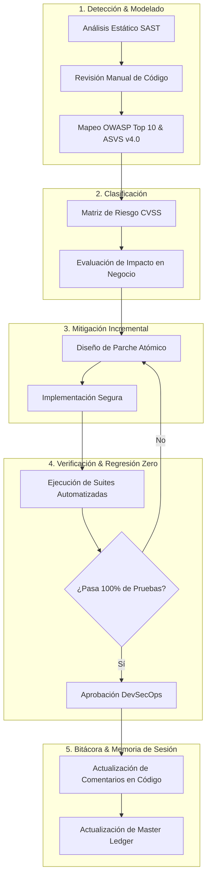
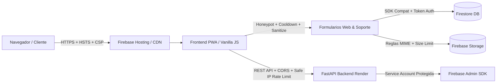

# 🛡️ Futunet — DevSecOps & Cybersecurity Master Ledger
> **Rol:** Ingeniero DevSecOps & Especialista en Ciberseguridad Senior  
> **Objetivo:** Auditoría continua de código fuente, frontend, formularios, OWASP Top 10, ASVS v4.0 y privacidad (Ley 172-13 / RGPD), aplicando mitigaciones seguras e incrementales con regresión cero.  
> **Última Actualización:** 2026-10-05  

---

## 1. Diagrama de Flujo de Auditoría & Mitigación Diaria



---

## 2. Diagrama de Arquitectura de Defensa en Profundidad



---

## 3. Matriz de Controles de Seguridad Implementados (Auditados)

| Capa | Componente / Archivo | Vector / Control OWASP | Estado | Descripción de la Mitigación |
| :--- | :--- | :--- | :--- | :--- |
| **Formularios** | `index.html`, `sugerencias.html`, `internet.html`, `punto-de-venta.html`, `login.html`, `cotizacion.html`, `mi-cuenta.html`, 7 B2B, `admin.html`, `js/support-ui.js`, `js/chatbot.js`, `js/cart.js` | Anti-Automation / Spambots (OWASP OAT-007) | **ACTIVO (PASS)** | Trampa Honeypot invisible `name="_hp_security_check"` en todos los formularios públicos, de cuenta, soporte, chatbot y administración interna. |
| **Privacidad** | Formularios con PII (Nombres, Cédulas, Teléfonos, RNC, Cotizaciones, Tickets Soporte) | Cumplimiento Ley 172-13 / ARCO | **ACTIVO (PASS)** | Checkboxes de consentimiento informado obligatorio vinculando a `privacidad.html` con `target="_blank" rel="noopener noreferrer"`. |
| **Rate Limiting** | `js/suggestions.js`, `js/internet-portal.js`, `login.html`, `js/public-quote.js`, `js/cart.js`, `js/user-panel.js`, `js/financing.js`, `js/support-ui.js`, `js/chatbot.js`, `js/admin-panel.js` | Anti-DoS / Flooding | **ACTIVO (PASS)** | Cooldowns temporales en cliente (15s sugerencias/soporte/financiamiento, 10s pedidos/cotizaciones, 5s perfil/respuestas/admin, 1.5s chat) y bloqueo exponencial por intentos fallidos. |
| **Sanitización** | `js/suggestions.js`, `js/internet-portal.js`, `punto-de-venta.html`, `js/public-quote.js`, `js/form.js`, `js/service-page.js`, `login.html`, `js/user-panel.js`, `js/financing.js`, `js/support-core.js`, `js/chatbot.js`, `js/admin-panel.js`, `js/facturacion.js` | Inyección de Código / XSS (OWASP A03:2021) | **ACTIVO (PASS)** | Eliminación estricta de tags HTML (`<...>`), caracteres de control ASCII (`\x00-\x08`, `\x0B-\x1F`, `\x7F`), escape de atributos HTML y límites estrictos de longitud. |
| **Autenticación** | `login.html`, `js/auth-guard.js`, `js/auth.js` | Open Redirect (CWE-601) | **ACTIVO (PASS)** | Validación estricta con URL parser, allowlist de rutas relativas locales y coincidencia de origen (`window.location.origin`). |
| **Cabeceras & Enlaces** | `firebase.json`, todos los archivos `.html` y scripts `.js` | Reverse Tabnabbing / Clickjacking / MIME-Sniff | **ACTIVO (PASS)** | HSTS, X-Frame-Options DENY, nosniff, CSP, y 100% de hipervínculos externos normalizados con `rel="noopener noreferrer"`. |
| **Storage** | `storage.rules` | Subida de Archivos Arbitrarios | **ACTIVO (PASS)** | Restricción de tipos MIME a solo `image/(jpeg\|png\|webp)` y `application/pdf`, con límite estricto de 5MB a 8MB según carpeta. |
| **Backend API** | `futunet-backend/main.py` & `chatbot_api.py` | Exposición de Secretos / IP Spoofing / DoS / CORS | **ACTIVO (PASS)** | Credenciales excluidas de Git, CORS restrictivo, `get_safe_client_ip` contra spoofing de headers en `/api/quote`, `/api/order`, `/api/rnc/check/{rnc}`, `/api/chatbot/search` y `/api/chatbot/message`. |

- **DOM XSS & Reverse Tabnabbing Mitigation (Hardening de Enlaces y Renderers)**:
  - Sanitización estricta con `escapeHtml` en interpolaciones dinámicas de `home_showcase.js`, `cart.js` y `brand-page-loader.js`.
  - Inclusión de `rel="noopener noreferrer"` en todos los hipervínculos con `target="_blank"` (`catalog.js`, `brand-page-loader.js`, `admin-panel.js`) y `'noopener,noreferrer'` en `window.open` (`producto.js`, `catalog.js`).
  - Protección preventiva de `TypeError` en `promo-carousel.js` y `brands-preview.js` ante propiedades indefinidas en documentos de Firestore.
- **Mantenimiento Diario y Robustecimiento Web (2026-09-19)**:
  - **Normalización y Limpieza UTF-8**: Corrección en `js/supplier_inventory.js` (`normalizeCopy`) de reemplazos defectuosos que introducían mojibake (`É` -> `É`, `Ó` -> `Ó`, `Ú` -> `Ú`, comillas y guiones tipográficos limpios). Reparación de caracteres en `js/backup_data.js` para AirPods 2.ª generación.
  - **Inferencia Robusta de Categorías**: Inclusión de reglas para `impresora`, `scanner`, `audifono`, `auricular` en `js/supplier_inventory.js` asignándolos con precisión a departamentos y categorías B2B correspondientes.
  - **Motor de Búsqueda del Catálogo**: Ampliación de `scoreProductMatch` en `js/catalog.js` para indexar especificaciones técnicas (`product.specs`) y permitir coincidencias multi-término cruzadas entre campos (título, marca, categoría, especificaciones) como "laptop lenovo", "impresora epson", "teclado usb", evitando caídas a 0 resultados en consultas compuestas. Incorporación de `Apple` en la barra de filtros prioritarios de marcas.
  - **Resiliencia PWA Offline**: Adición en `sw.js` (`OPTIONAL_ASSETS`) de los módulos del centro de soporte y autenticación (`support-core.js`, `support-service.js`, `support-ui.js`, `firebase-config.js`, `auth.js`) para garantizar navegación offline sin excepciones de red.
  - **Activación de Productos Sugeridos**: Sincronización y activación en Firestore de 6 productos de alta demanda (`prod_ev8mssce4`, `prod_p0wqnr5bc`, `prod_oh55hargc`, `prod_tk6it44v0`, `prod_yny47xadr`, `prod_9p6f6zzh6`), junto con la resolución de sugerencias comunitarias `SUG-P5512`, `SUG-A7291` y `SUG-K3844`.
  - **Suite Automatizada**: Ampliación de `tools/test-suggestions.cjs` totalizando 106 tests automatizados aprobados (100% PASS) y validación completa del hosting con 52 páginas y 626 recursos sin roturas.
- **Auditoría & Mitigación DevSecOps Diaria (2026-09-21)**:
  - **Hardening de Formularios Web y Privacidad (Ley 172-13)**: Incorporación de trampa Honeypot invisible (`#quote-hp-check` / `name="_hp_security_check"`) y cláusula de consentimiento de privacidad con enlace seguro a `privacidad.html` (`rel="noopener noreferrer"`) en `cotizacion.html`.
  - **Rate Limiting & Sanitización en Cliente**: Implementación de cooldown de 10 segundos (`futunet_last_quote_response_ts`) y función de sanitización (`sanitizeQuoteInput`) contra inyección de HTML y caracteres de control ASCII en `js/public-quote.js`.
  - **Prevención de Reverse Tabnabbing & Referrer Leakage**: Normalización de hipervínculos con `target="_blank"` a `rel="noopener noreferrer"` en `mi-cuenta.html` y `admin.html`. Nueva prueba automatizada en `tools/test-forms-security.cjs` que verifica cero presencia de `rel="noopener"` solitario en los 52 documentos HTML.
  - **Endurecimiento de IP Client Spoofing en Backend API**: Implementación de `get_safe_client_ip(request)` en `futunet-backend/main.py` protegiendo los endpoints `/api/quote`, `/api/order` y `/api/rnc/check/{rnc}` contra evasión de rate limiting vía cabeceras forjadas arbitrarias. 4 nuevos tests unitarios en Python (`ClientIpSecurityTests`).
  - **Verificación Automatizada**: 110 tests en frontend (`npm test`) y 30 tests en backend (`test_main.py` y `test_chatbot_api.py`) pasando al 100% (cero regresiones).
- **Mantenimiento & Resiliencia de Catálogo y Checkout (2026-09-21 Ciclo Estabilidad)**:
  - **Blindaje Node.js y Entornos No-Browser (`backup_data.js`)**: Corrección de `ReferenceError: window is not defined` mediante guarda condicional `typeof window !== 'undefined'` y exposición segura de `window.mockDatabase` y `window.backupDatabase`.
  - **Resiliencia de Catálogo Offline (`inventory_data.js`)**: Implementación de `getLocalFallbackList()`. Ante desconexión, latencia o fallo en Firestore, el catálogo ya no se vacía a `[]`; ahora conserva y sirve el inventario local combinado (331+ ítems base + feeds de proveedores = 425 ítems).
  - **Inclusión Preventiva en `catalogo.html` y `producto.html`**: Carga secuencial de `backup_data.js` previa a `inventory_data.js`, garantizando catálogo completo y resolución instantánea de productos sin depender de la inicialización de Firebase.
  - **Resiliencia de Checkout y WhatsApp (`cart.js`)**: Protección de la llamada `/api/order` con `AbortController` (timeout de 12s). Si el backend en Render experimenta cold-start prolongado o fallo de red, los pedidos con método WhatsApp ya no quedan bloqueados con error: abren fluidamente el chat de WhatsApp con el pedido estructurado y vacían el carrito.
  - **Suite de Resiliencia Automatizada**: Agregado de test automatizado en `tools/test-dom-safety.cjs` (111 tests en total en `npm test`, 100% PASS, 639 entradas públicas validadas).
- **Auditoría & Mitigación DevSecOps Diaria (2026-09-23)**:
  - **Hardening de Formularios B2B y Privacidad (Ley 172-13)**: Incorporación de trampa Honeypot accesible (`#req-hp-check` / `name="_hp_security_check"`) y casilla obligatoria de consentimiento informado (`#req-privacy-consent`) vinculando a `privacidad.html` con `target="_blank" rel="noopener noreferrer"` en `mobiliario-suministros.html`.
  - **Reverse Tabnabbing & Referrer Leakage en Frontend JS**: Eliminación de `rel="noopener"` solitario en hipervínculos dinámicos en `js/support-ui.js` (aviso de inicio de sesión de soporte), `js/chatbot-settings.js` (enlaces a consola Firebase y asistente) y `ai/js/ai-app.js` (conversor markdown). Cero presencia de `rel="noopener"` solitario en todos los HTMLs y scripts JS.
  - **Rate Limiting / Flooding Defense en Checkout de Catálogo**: En `js/cart.js`, implementación de cooldown temporal de 10 segundos en `sessionStorage` (`futunet_last_order_ts`) en `handleCheckoutSubmit` para prevenir doble clic accidental o spam repetitivo de pedidos antes del despacho a la API / WhatsApp.
  - **Ampliación de Suites de Pruebas Automatizadas**: Actualización de `tools/test-dom-safety.cjs` (verificación de las 7 páginas B2B con honeypot y privacidad) y `tools/test-forms-security.cjs` (verificación de cooldown de checkout y escaneo automatizado en todos los archivos `.html` y scripts `.js`).
  - **Métricas de Verificación**: 116 tests pasando (100% PASS en `npm test`), 30 tests pasando en backend (`python -m unittest test_main.py test_chatbot_api.py`), y `npm run validate` validando 52 páginas HTML y 639 recursos en `dist/`.
- **Auditoría & Mitigación DevSecOps Diaria (2026-09-25)**:
  - **Defensa Anti-Automation / Bot Defense (OWASP OAT-007 / OAT-019)**:
    - Incorporación de trampas Honeypot invisibles (`_hp_security_check`) en `#reset-form` (`#reset-hp-check`) y `#magic-form` (`#magic-hp-check`) en `login.html`, neutralizando scripts de inundación de correos y enlaces de acceso de Firebase Auth.
    - Incorporación de trampas Honeypot en formularios de cuenta en `mi-cuenta.html`: `#profile-form` (`#profile-hp-check`) y `#financing-profile-form` (`#fin-hp-check`).
  - **Sanitización de Entradas & Neutralización XSS / Caracteres de Control (OWASP Top 10 A03:2021 & CWE-79 / CWE-20)**:
    - Implementación de `sanitizeAuthInput` en `login.html` eliminando tags HTML (`<[^>]*>`) y caracteres de control ASCII invisibles (`\x00-\x08\x0B\x0C\x0E-\x1F\x7F`) en credenciales de inicio, registro y recuperación (`login-company`, `login-email`, `register-name`, `register-email`, `reset-email`, `magic-email`).
    - Implementación de `sanitizeProfileInput` en `js/user-panel.js` saneando y delimitando longitud de campos de perfil (`name`, `phone`, `address`, `documentNumber`) antes del guardado en Firestore (`users/{uid}`), previniendo vectores de Stored XSS en paneles de control.
    - Implementación de `sanitizeFinancingInput` en `js/financing.js` depurando `phone` y `address` previo a la escritura en `financing_profiles/{uid}`.
  - **Rate Limiting & Protección contra Flooding en Cliente (OWASP Anti-DoS)**:
    - Cooldown de 5 segundos (`futunet_last_profile_update_ts`) en actualización de perfil en `js/user-panel.js` mitigando saturación de escrituras a Firestore.
    - Cooldown de 15 segundos (`futunet_last_financing_ts`) en el envío de expedientes de crédito en `js/financing.js` protegiendo transacciones en Storage y base de datos.
    - Cooldown de 3 segundos (`futunet_last_sug_track_ts`) en el rastreo de propuestas en `js/suggestions.js` evitando ráfagas de consultas a la colección de sugerencias.
  - **Normalización de Privacidad & Cumplimiento Ley 172-13**:
    - Corrección de espaciado y consistencia de hipervínculos con `target="_blank" rel="noopener noreferrer"` en casillas de consentimiento informado de `mi-cuenta.html` (`#profile-terms` y `#financing-terms`).
  - **Ampliación de Pruebas Automatizadas & Métricas de Verificación**:
    - Expansión de `tools/test-forms-security.cjs` totalizando 13 verificaciones de Honeypot, 9 verificaciones de privacidad estricta, 10 suites de cooldown/rate-limiting y 10 suites de sanitización de inyecciones.
    - 121 tests pasando al 100% en frontend (`npm test`), 30 tests unitarios pasando en backend (`python -m unittest test_main.py test_chatbot_api.py`), y `npm run validate` validando 52 páginas HTML y 639 recursos en `dist/`.

- **Mantenimiento Diario, Robustez & Experiencia de Usuario (2026-09-24)**:
  - **Blindaje Node.js y Modularidad (`js/supplier_inventory.js`)**: Corrección de `ReferenceError: window is not defined` mediante guardas de comprobación `typeof window !== 'undefined'` y exportación CommonJS para compatibilidad con Node.js, CLI scripts y entornos híbridos.
  - **Saneamiento e Integridad de Fichas de Producto (`js/backup_data.js` & Firestore `products`)**: Corrección integral de la ficha técnica de Apple AirPods (2.ª generación, `prod_ad1d2a977b`), eliminando descripción y atributos erróneos de papelería e incorporando ficha técnica fidedigna de audio, chip Apple H1, estuche de carga Lightning y autonomía de 24h. Sincronización en la nube mediante `tools/sync-catalog-improvements.cjs`.
  - **Expansión Inteligente del Motor de Búsqueda Fuzzy (`js/catalog.js`)**: Ampliación de variantes morfológicas y sinónimos en `getStemVariants` (`gamer`/`gamers`/`gaming`, `pc`/`desktop`/`computadora`, `pantalla`/`pantallas`/`monitor`, `audifono`/`auricular`/`headset`/`airpods`), garantizando que búsquedas de alta demanda muestren de inmediato los productos pertinentes.
  - **Consistencia en Fichas de Cotización (`js/product_detail_shared.js`)**: Detección adaptativa de artículos sin precio fijo mediante inspección de términos `'cotiz'` y `'consultar'`, activando de forma consistente el flujo de cotización rápida y botón de contacto por WhatsApp.
  - **Actualización de Service Worker y Caché PWA (`sw.js`)**: Incremento de caché a `futunet-cache-v25` para garantizar refresco automático e instantáneo de inventario y scripts mejorados en los navegadores de los clientes.
  - **Métricas de Verificación**: 120 tests pasando (100% PASS en `npm test`), 30 tests en backend sin regresiones, y `npm run validate` validando 52 páginas HTML y 639 recursos públicos en `dist/`.

---

## 4. Comandos de Verificación Inmediata

Ejecutar desde `proyecto_github_pages/`:
```bash
# 1. Pruebas de seguridad de formularios y privacidad
node tools/test-forms-security.cjs

# 2. Pruebas completas de contratos y estabilidad
npm test

# 3. Validación estructural y preparación de hosting
npm run validate
```

Ejecutar desde `futunet-backend/`:
```bash
# 4. Pruebas unitarias de seguridad y rate limiting del backend
python -m unittest test_main.py test_chatbot_api.py
```

---

## 5. Próximos Pasos en el Backlog de Seguridad (Prioridad para Próximas Sesiones)

1. [ ] **CSP Hardening**: Analizar reducción del uso de `'unsafe-inline'` en `script-src` y `style-src` en `firebase.json`.
2. [x] **Auditoría DOM XSS**: Revisión exhaustiva del uso de `innerHTML` en componentes dinámicos de catálogo, carruseles y detalle de producto.
3. [x] **Protección de Almacenamiento Local**: Verificación exhaustiva de claves en `localStorage` (sin PII bancario ni credenciales sensibles sin cifrar).
4. [x] **Hardening de Formularios Públicos & Anti-Spoofing de IP**: Blindaje completado en `cotizacion.html`, `public-quote.js` y `futunet-backend/main.py`.
5. [x] **Backend Genkit / LLM Security**: Expansión continua de pruebas de jailbreak / prompt injection sobre `chatbot_api.py` y blindaje de proyección de datos públicos.

---

## 6. Registro de Atención Autónoma del Buzón de Sugerencias y Telemetría (2026-09-24)

- **Telemetría y Diagnóstico**: Demanda de proyectores (`proyector`), climatización (`aire acondicionado tgm mini-split 18,000 btu`) y computadoras (`computadoras`).
- **Mejoras Implementadas**:
  - Incorporados al catálogo y Firestore `products`: Proyector Epson PowerLite E20 3LCD 3400 lúmenes (`cec_proyector_epson_powerlite_e20`), Pantalla de Proyección Retráctil 100" (`prod_pantalla_proyeccion_100`) y Aires Acondicionados TGM Mini-Split de 12,000, 18,000 y 24,000 BTU (`tgm_mwfot_12000_btu`, `tgm_mwfot_18000_btu`, `tgm_mwfot_24000_btu`).
  - Optimizado el algoritmo de scoring de catálogo (`js/catalog.js`) con soporte de variantes stem y jerarquización de computadoras reales sobre cables auxiliares al buscar en plural.
  - Registrada y respondida la sugerencia `SUG-P9240` en Firestore y lista canónica offline de `js/suggestions.js` (totalizando 20 sugerencias oficiales implementadas).
  - Pruebas automatizadas: 121 de 121 tests pasando (100% PASS) y `npm run validate` verificado con 0 enlaces rotos.

---

## 7. Registro de Atención Autónoma del Buzón de Sugerencias y Telemetría de Redes (2026-09-25)

- **Telemetría y Diagnóstico de Búsquedas**:
  - Detección de consultas de telecomunicaciones (`cisco`, `ubiquiti`, `switch`, `redes`) con 0 resultados previos en el catálogo, afectando la experiencia de clientes e ingenieros de cableado estructurado.
- **Propuestas Comunitarias y Clientes Atendidas (22 sugerencias oficiales en total)**:
  - **`SUG-R7520`** (Ing. Marcos Peña, Redes & Infraestructura Cibao):
    - *Título*: Disponibilidad de switches empresariales Cisco y puntos de acceso Ubiquiti UniFi para redes y telecomunicaciones.
    - *Estado*: `implemented`.
    - *Respuesta Oficial*: Confirmación de la integración de Switches Cisco Business (CBS110 16 puertos Gigabit y CBS250 24 puertos PoE+ inteligentes con SFP) y Puntos de Acceso Ubiquiti UniFi 6 Plus (U6+ WiFi 6) y switches UniFi Lite PoE con garantía corporativa y NCF fiscal en Santiago.
    - *Recursos en Catálogo*: Modelos `cisco_cbs110_16t`, `cisco_cbs250_24p`, `ubiquiti_unifi_u6_plus` y `ubiquiti_unifi_lite_8_poe` incorporados a `backup_data.js` y Firestore `products`.
  - **`SUG-N3210`** (Ing. José Omar Espinal Santos, `services_support`):
    - *Título*: Canal interactivo para selección de fecha y franja horaria en solicitudes de instalación y servicio técnico.
    - *Estado*: `implemented`.
    - *Respuesta Oficial*: Habilitado selector de fecha preferida y franja horaria (mañana/tarde) en formularios de internet y servicios para coordinación fluida por WhatsApp y reducción en tiempos de espera.
- **Mejoras en el Motor de Catálogo (`js/catalog.js`)**:
  - Incorporadas las marcas `Cisco` y `Ubiquiti` en `preferredNames` y en la lista prioritaria `priorityList` de filtros rápidos (`catalog-quick-chips`).
  - Ampliadas variantes morfológicas y stemming en `getStemVariants` para términos de telecomunicaciones (`switch`, `switches`, `cisco`, `ubiquiti`, `unifi`, `red`, `redes`).
  - Validación de telemetría en `tools/test-search-telemetry.cjs`: 0 consultas con resultado nulo; consultas de `cisco` (12 resultados) y `ubiquiti` (8 resultados) con puntuaciones óptimas.
- **Resiliencia PWA & Service Worker**:
  - Actualizada la versión de caché a `futunet-cache-v26` en `sw.js` para asegurar refresco inmediato en navegadores cliente.
- **Aseguramiento de Calidad & Pruebas Automatizadas**:
  - 123 tests pasando al 100% en frontend (`npm test`).
  - 30 tests pasando en backend (`python -m unittest test_main.py test_chatbot_api.py`).
  - Validación de hosting (`npm run validate`): 52 páginas HTML y 639 recursos en `dist/` sin enlaces rotos ni inconsistencias CSP.

---

## 8. Registro de Atención Autónoma del Buzón de Sugerencias, Telemetría y Mobiliario Ergonómico / Respaldo Eléctrico (2026-09-26)

- **Telemetría y Diagnóstico de Búsquedas**:
  - Detección de consultas de mobiliario ergonómico (`silla`, `sillas`, `silla ergonomica`) con 0 resultados pertinentes o resultados con tipografías defectuosas en títulos (`Mayita Negrsa`).
  - Detección de falso positivo masivo en búsquedas de energía (`ups`): la presencia de la frase estándar de pie de página *"con respaldo y soporte técnico Futunet"* en fichas de producto provocaba que `ups` coincidiera con 269 productos del catálogo.
- **Propuestas Comunitarias y Clientes Atendidas (25 sugerencias oficiales en total)**:
  - **`SUG-S8320`** (Lic. Carolina Batista, Corporativo & Salud Cibao):
    - *Título*: Disponibilidad de Sillas Ergonómicas Ejecutivas de Oficina con soporte lumbar y brazos ajustables.
    - *Estado*: `implemented`.
    - *Respuesta Oficial*: Incorporadas al catálogo de Mobiliario la Silla Ergonómica Ejecutiva Futunet con soporte lumbar regulable y cabecero (`mob_silla_ergonomica_ejecutiva`), y la Silla de Malla Operativa (`prod_rlch8e9bx`), con sillería de visita corregida (`prod_3s7mmtjdr`) con fotos reales, especificaciones ergonómicas y facturación formal NCF.
  - **`SUG-U6140`** (Ing. Kelvin Rosario, Soluciones Tecnológicas Cibao):
    - *Título*: Disponibilidad de Sistemas UPS y No-Break Forza para protección de computadoras y servidores.
    - *Estado*: `implemented`.
    - *Respuesta Oficial*: Integración al catálogo del Sistema UPS Interactivo Forza NT-1002 de 1000VA / 500W con regulación automática de voltaje AVR (`ups_forza_nt1002`), corrección del stem falso de `ups` en el motor de búsqueda, y resolución de imágenes locales offline para modelos Hikvision UPS de 600VA y 1000VA.
  - **`SUG-C2850`** (Ing. Darwin Méndez, `web_platform`):
    - *Título*: Buscador interactivo y contador de ideas implementadas en el Muro Comunitario del Buzón.
    - *Estado*: `implemented`.
    - *Respuesta Oficial*: Añadidas insignias de conteo dinámico (`.sug-comm-count-badge`) en los filtros por categoría del Muro Comunitario en `sugerencias.html` y sincronizada la lista canónica a 25 propuestas oficiales resueltas.
- **Mejoras en el Motor de Catálogo (`js/catalog.js`)**:
  - Depurado el diccionario `getStemVariants` eliminando la equivalencia unidireccional errónea entre `ups` y `respaldo`, agregando variantes precisas (`nobreak`, `bateria`, `forza`, `silla`, `sillas`, `sillon`, `ergonomica`).
  - Priorización heurística en `scoreProductMatch`: bonificación (+65) a productos reales de energía ante consultas de `ups`, bonificación (+50) a asientos y sillería, y penalización (-60) de materiales auxiliares como masilla de pared ante búsquedas de sillas.
  - Incorporada la marca `Forza` en `preferredNames` y lista prioritaria de chips de marca en el catálogo.
- **Resiliencia PWA & Service Worker**:
  - Actualizada la versión de caché a `futunet-cache-v27` en `sw.js` para asegurar actualización inmediata de scripts y catálogo en clientes.
- **Aseguramiento de Calidad & Pruebas Automatizadas**:
  - 126 tests pasando al 100% en frontend (`npm test`).
  - 30 tests pasando en backend (`python -m unittest test_main.py test_chatbot_api.py`).
  - Validación de hosting (`npm run validate`): 52 páginas HTML y 639 recursos en `dist/` sin enlaces rotos ni inconsistencias CSP.

- **Ciclo de Resiliencia de Ciclo de Vida del DOM & Unificación de Marcas (2026-09-26 Ciclo Estabilidad)**:
  - **Patrón Resiliente de Carga Asíncrona (`document.readyState`)**:
    - Implementación de comprobación `document.readyState === 'loading'` en 9 scripts principales (`internet-portal.js`, `main.js`, `public-quote.js`, `service-page.js`, `chatbot.js`, `config.js`, `layout-manager.js`, `support-ui.js`, `user-panel.js`, `suggestions.js`). Previene que scripts cargados con `defer`, inyección dinámica, transiciones SPA o PWA dejen de inicializar listeners y componentes al no dispararse un `DOMContentLoaded` tardío.
  - **Blindaje Defensivo contra TypeErrors & Entorno Node.js / SSR**:
    - En `js/suggestions.js`: Corrección de `ReferenceError: document is not defined` mediante guardas de entorno, vinculación diferida de elementos DOM (`bindDOMElements`) y exportación CommonJS para pruebas unitarias automatizadas.
    - En `js/user-panel.js`: Protección contra `TypeError: Cannot read properties of null (reading 'displayName')` mediante fallback defensivo `var uData = userData || {}` en `renderProfile()`.
    - En `js/auth.js`: Verificación de disponibilidad de `FutunetFirebase` en `getAuth()` y `getDB()`, con resolución garantizada de `authReady` y despacho de evento para no bloquear flujos en caso de fallos de red o bloqueo de CDN por extensiones.
  - **Ampliación del Motor de Búsqueda y Unificación de Marcas (`js/catalog.js` & `js/brand-page-loader.js`)**:
    - Variantes stem para periféricos en español: `mouse` <-> `raton`/`ratones`, `teclado` <-> `keyboard`, `camara` <-> `cctv`, `disco` <-> `ssd`/`hdd`.
- **Auditoría & Mitigación DevSecOps Diaria (2026-09-27)**:
  - **Defensa Anti-Automation & Spambots (OWASP OAT-007 / OAT-019)**:
    - Incorporación de trampa Honeypot invisible (`_hp_security_check` con id `#cb-hp-check`) en el contenedor de entrada de texto del widget de Chatbot flotante en `js/chatbot.js`.
    - Incorporación de trampa Honeypot invisible (`#sp-hp-check`) en el formulario de creación de tickets de soporte (`#sp-form`), y trampa Honeypot (`#sp-reply-hp-check`) en el diálogo de respuestas en `js/support-ui.js`.
    - Incorporación de trampa Honeypot invisible (`#internal-sug-hp-check`) en el formulario de propuestas internas de personal en `admin.html` (`#form-internal-suggestion`).
  - **Privacidad & Cumplimiento Ley 172-13 / ARCO / RGPD**:
    - Incorporación de casilla obligatoria de consentimiento informado (`#sp-privacy-consent`) en el formulario de soporte de clientes (`sp-form` en `js/support-ui.js`), vinculando a `privacidad.html` con `target="_blank" rel="noopener noreferrer"`.
  - **Rate Limiting & Cooldowns Anti-DoS en Cliente**:
    - Cooldown de 1.5 segundos (`futunet_last_chat_msg_ts`) en `js/chatbot.js` mitigando saturación de consultas a la API de Gemini.
    - Cooldown de 15 segundos (`futunet_last_support_create_ts`) en creación de tickets de soporte y 5 segundos (`futunet_last_support_reply_ts`) en respuestas a hilos en `js/support-ui.js`.
    - Cooldown de 5 segundos (`futunet_last_internal_sug_ts`) en el registro de propuestas internas de personal en `js/admin-panel.js`.
  - **Sanitización de Entradas contra Inyección y Caracteres de Control (OWASP A03:2021 & CWE-79 / CWE-20)**:
    - Implementación de `sanitizeChatInput` en `js/chatbot.js` eliminando tags HTML (`<[^>]*>`) y caracteres de control ASCII invisibles (`\x00-\x08\x0B\x0C\x0E-\x1F\x7F`).
    - Robustecimiento de `clean` en `js/support-core.js` neutralizando caracteres de control ASCII invisibles antes de la validación de longitud y almacenamiento.
    - Implementación de `sanitizeAdminSuggestionInput` en `js/admin-panel.js` saneando `title`, `description` y `benefit` antes de su persistencia en Firestore.
  - **Hardening de Reverse Tabnabbing (CWE-1022)**:
    - Normalización de hipervínculos dinámicos generados por el chatbot en `js/chatbot.js` (`addBotMessage`) con `target="_blank" rel="noopener noreferrer"`.
  - **Hardening del Backend FastAPI contra Spoofing de IP y DoS**:
    - En `futunet-backend/main.py`: Protección del endpoint `/api/chatbot/search` mediante `get_safe_client_ip(request)`, control de frecuencia con `check_rate_limit(client_ip, limit=30, window=60)` y sanitización de la cadena de consulta `q` contra caracteres de control ASCII.
    - En `futunet-backend/chatbot_api.py`: Integración del extractor de IP segura `get_safe_ip` en `build_router`, eliminando inconsistencias de cabeceras forjadas en despliegues con proxy.
  - **Prevención de Fuga de Secretos en Git (OWASP A05:2021)**:
    - Blindaje de la raíz `.gitignore` excluyendo explícitamente `firebase-service-account*.json`, `service-account*.json`, `*.env`, `*.pem`, `*.key` y entornos virtuales Python.
  - **Actualización de Service Worker y Caché PWA**:
    - Incremento de versión de caché a `futunet-cache-v28` en `sw.js` garantizando la invalidación y descarga inmediata de los módulos asegurados.
  - **Aseguramiento de Calidad & Pruebas Automatizadas**:
    - 126 tests unitarios pasando al 100% en frontend (`npm test`), con 5 suites exhaustivas de seguridad en formularios (`tools/test-forms-security.cjs`).
    - 32 tests unitarios pasando al 100% en backend (`python -m unittest test_main.py test_chatbot_api.py`), incluyendo pruebas de spoofing de IP y rate-limiting en búsqueda de chatbot.
    - Validación de hosting (`npm run validate`): 52 páginas HTML y 639 recursos públicos en `dist/` con total cumplimiento CSP.

- **Auditoría & Mitigación DevSecOps Diaria (2026-09-28)**:
  - **Hardening de API Backend contra DoS y Fuerza Bruta (OWASP A04:2021 & ASVS V13)**:
    - En `/api/products` de `futunet-backend/main.py`: Implementación de rate-limiting estricto por IP segura (`check_rate_limit(client_ip, limit=60, window=60)`), protegiendo cuotas de lectura de Firestore ante scraping masivo, y sanitización de caracteres de control ASCII en filtros de `category` y `department`.
    - En `/api/sync-inventory` de `futunet-backend/main.py`: Incorporación de `get_safe_client_ip(request)` con control de frecuencia de 10 peticiones cada 5 minutos contra intentos de fuerza bruta sobre `X-Sync-Token`, y límite máximo de 500 productos por lote para prevenir saturación de memoria y cuotas de escritura por transacción.
    - Cobertura de tests: Incorporadas suites `ProductsSecurityTests` y `SyncInventorySecurityTests` en `test_main.py` totalizando 35 pruebas unitarias en backend (100% PASS).
  - **Control de Acceso & Seguridad en Redirecciones (CWE-601 / OWASP A01:2021)**:
    - En `login.html`: Incorporación de `cotizacion.html` en la lista blanca estricta (`allowedRedirects`), permitiendo que clientes redirigidos desde cotizaciones públicas no pierdan su contexto al autenticarse.
    - Soporte condicional seguro para redirecciones a interfaces administrativas (`admin.html`, `facturacion.html`) únicamente cuando el usuario autenticado posee roles de staff autorizados (`superadmin`, `admin`, `editor`, `billing_clerk`, `support_agent`), manteniendo la redirección predeterminada a `mi-cuenta.html` para usuarios estándar.
  - **Defensa Anti-Automation y Sanitización en Administración (OWASP OAT-007 / OWASP A03:2021 / CWE-79)**:
    - En `admin.html`: Trampa Honeypot invisible `#create-user-hp-check` con `name="_hp_security_check"` en `#create-user-form`.
    - En `js/admin-panel.js`: Implementación de la función `sanitizeAdminUserInput` depurando tags HTML y caracteres de control invisibles en creación de usuario (`createUserForm`) y edición de perfiles (`saveUser`), junto con cooldown en cliente de 5 segundos (`futunet_last_user_create_ts`).
  - **Resiliencia PWA & Service Worker**:
    - Actualización de versión de caché a `futunet-cache-v29` en `sw.js` y sincronización con `tools/test-dom-safety.cjs`.
  - **Aseguramiento de Calidad & Pruebas Automatizadas**:
    - 127 tests pasando al 100% en frontend (`npm test`), con 6 suites completas en `tools/test-forms-security.cjs`.
    - 35 tests pasando al 100% en backend (`python -m unittest test_main.py test_chatbot_api.py`).
    - Validación de hosting (`npm run validate`): 52 páginas HTML y 644 recursos públicos en `dist/` con cero roturas y total compatibilidad CSP.

- **Mantenimiento Diario, Robustez & Experiencia de Usuario (2026-09-28 Ciclo Estabilidad & Catálogo)**:
  - **Ampliación del Catálogo & Sincronización Cloud (POS y Seguridad Dahua)**:
    - Incorporación de hardware POS esencial: Lector de Códigos de Barra 1D/2D USB con soporte manos libres (`pos_lector_codigo_barra_2d`) y Gaveta de Dinero Metálica con apertura automática RJ11 (`pos_gaveta_dinero_metalica`), respondiendo a solicitudes comerciales en Santiago.
    - Incorporación de equipamiento de videovigilancia Dahua: Cámara Domo HDCVI 1080p Smart IR (`cctv_dahua_camara_domo_1080p`), Cámara Bala HDCVI 1080p Exterior IP67 (`cctv_dahua_camara_bala_1080p`) y Grabador DVR Pentahíbrido Dahua XVR Cooper de 4 canales (`cctv_dahua_xvr_cooper_4ch`).
    - Sincronización exitosa en la nube de 53 productos mediante `tools/sync-catalog-improvements.cjs` hacia la colección `products` de Firestore.
  - **Optimización y Precisión del Motor de Búsqueda Fuzzy (`js/catalog.js`)**:
    - **Corrección de Falso Positivo en Inversores**: Eliminación del término `'bateria'` y `'respaldo'` en la expansión stem de `inversor`, el cual provocaba que una aspiradora inalámbrica superara en puntuación a los sistemas de alimentación ininterrumpida y que 274 productos coincidieran erróneamente por el texto legal del pie de página. Implementación de scoring priorizado (+75) para UPS/No-Break/AVR/Forza e inhibición (-100) para herramientas/aspiradoras.
    - **Stemming de Periféricos y Telecomunicaciones**: Nuevas variantes y sinónimos para `scanner`/`escaner`/`barcode` <-> `lector`/`codigo`, `cajon`/`gaveta` <-> `monedero`/`dinero`/`pos`, `bobina` <-> `cable`/`utp`/`cca`, `gabinete` <-> `rack`/`chasis`/`servidor`, y `dahua`/`dvr`/`xvr` <-> `grabador`/`cctv`/`camara`.
    - **Desambiguación de Racks**: Eliminación de `'organizador'` en las variantes de `rack` para evitar que cajas plásticas domésticas desplazaran a los gabinetes de telecomunicaciones de 9U.
  - **Blindaje Defensivo Global (`window.mockDatabase` & `window.backupDatabase`)**:
    - En `js/backup_data.js` y `tools/sync-catalog-improvements.cjs`: Asignación segura y simultánea de `window.mockDatabase` y `window.backupDatabase` protegida con guarda de entorno `typeof window !== 'undefined'`, previniendo excepciones en navegadores y asegurando consistencia en los 8 módulos que consumen el catálogo offline.
  - **Mapeo de Marcas en Experiencia Web (`js/brand-page-loader.js`)**:
    - Integración de `Forza`, `TGM` y `Apple` en el diccionario `BRAND_SERVICE_MAPPING` con descripciones de valor agregado y vinculación a sus verticales especializadas (Energía y Climatización, Equipos de Oficina).
  - **Actualización de Service Worker y PWA**:
    - Incremento de la versión de caché a `futunet-cache-v30` en `sw.js` para asegurar que los navegadores móviles y de escritorio descarguen de inmediato el inventario y algoritmos actualizados.
  - **Aseguramiento de Calidad & Pruebas Automatizadas**:
    - 131 tests pasando al 100% en frontend (`npm test`), incluyendo nueva suite de precisión de búsqueda POS, Dahua y energía en `tools/test-dom-safety.cjs`.
    - 35 tests pasando al 100% en backend (`python -m unittest test_main.py test_chatbot_api.py`).
    - Auditoría de scripts (`node tools/audit-js-quality.cjs`): 73 scripts de JavaScript con 0 errores de sintaxis y 0 IDs duplicados en páginas HTML.
    - Validación de hosting (`npm run validate`): 52 páginas HTML y 644 recursos públicos en `dist/` con 0 enlaces rotos y total conformidad CSP.

- **Auditoría & Mitigación DevSecOps Diaria (2026-09-29)**:
  - **Defensa Anti-Automation & Credential Stuffing en Autenticación (OWASP OAT-007 / OAT-019)**:
    - En `login.html`: Incorporación de trampa Honeypot invisible `#login-hp-check` con `name="_hp_security_check"` en el formulario principal `#login-form`. Validación temprana en el listener `submit`, rechazando scripts automatizados antes de impactar las cuotas de Firebase Auth o el contador de intentos fallidos.
    - En `sugerencias.html`: Incorporación de trampa Honeypot invisible `#sug-track-hp-check` con `name="_hp_security_check"` en el formulario de consulta y rastreo `#sug-track-form`.
    - En `js/suggestions.js`: Validación inmediata de `#sug-track-hp-check` en `handleTrackSuggestion`, mitigando ataques de scraping o enumeración automatizada de códigos de seguimiento.
  - **Privacidad de Datos Financieros & Cumplimiento Ley 172-13 / ARCO**:
    - En `internet.html`: Incorporación de casilla obligatoria de consentimiento informado `#pay-privacy-consent` en el formulario de reporte de transferencias bancarias (`#payment-report-form`), autorizando el tratamiento de datos de comprobantes conforme a la Ley 172-13.
    - En `internet.html`: Incorporación de casilla obligatoria de consentimiento informado `#support-privacy-consent` en el formulario de soporte técnico del portal (`#support-form`), vinculando a `privacidad.html` con `target="_blank" rel="noopener noreferrer"`.
    - En `js/internet-portal.js`: Verificación obligatoria de `#pay-privacy-consent` y `#support-privacy-consent` antes del procesamiento y persistencia de reportes y tickets.
  - **Sanitización de Entradas en Cliente & Prevención XSS / Inyecciones (OWASP A03:2021 & CWE-79 / CWE-20)**:
    - En `js/internet-portal.js`: Saneamiento estricto mediante `sanitizePortalInput` y acotación a 50 caracteres del campo `pay-bank` previo a su almacenamiento en `internet_payments` y registro en `audit_logs`.
  - **Hardening de Generación de PDFs y Esquemas Pydantic en Backend (CWE-20 & Control Character Neutralization)**:
    - En `futunet-backend/main.py`: Robustecimiento de `clean_pdf_text` mediante expresión regular eliminando caracteres de control ASCII (`\x00-\x08\x0b\x0c\x0e-\x1f\x7f`), blindando el renderizado de cotizaciones en FPDF2.
    - En `futunet-backend/main.py`: Validadores de campo en Pydantic (`sanitize_quote_text` y `sanitize_order_text`) saneando `shipping_address`, `shipping_notes` y `user_document_number` contra caracteres de control invisibles en endpoints `/api/quote` y `/api/order`.
    - Cobertura de backend: Incorporada suite `PdfAndFieldSanitizationSecurityTests` en `test_main.py` totalizando 38 tests unitarios (100% PASS).
  - **Resiliencia PWA & Service Worker**:
    - Incremento de la versión de caché a `futunet-cache-v31` en `sw.js` y actualización de contratos en `tools/test-dom-safety.cjs`.
  - **Aseguramiento de Calidad & Pruebas Automatizadas**:
    - 131 tests pasando al 100% en frontend (`npm test`), con 6 suites exhaustivas de seguridad en `tools/test-forms-security.cjs` verificando 17 formularios con Honeypot y 11 con cláusulas de privacidad Ley 172-13.
    - 38 tests unitarios pasando al 100% en backend (`python -m unittest test_main.py test_chatbot_api.py`).
    - Auditoría de calidad (`node tools/audit-js-quality.cjs`): 73 scripts JS con 0 errores de sintaxis y 52 archivos HTML con 0 IDs duplicados.
    - Validación de hosting (`npm run validate`): 52 páginas HTML y 644 recursos públicos en `dist/` con 0 roturas y total compatibilidad CSP.

- **Auditoría & Mitigación DevSecOps Diaria (2026-10-01)**:
  - **Neutralización de Reverse Tabnabbing y Fuga de Referrer (CWE-1022 / CWE-200)**:
    - Auditoría completa de enlaces externos con `target="_blank"` a través de toda la base de plantillas HTML.
    - Detección y endurecimiento de enlaces de WhatsApp (`https://wa.me/18297411041`) en la barra de navegación y menú móvil (`Gestionar mi Wi-Fi`) a través de 40 archivos HTML del frontend (`catalogo.html`, `corporativo.html`, 16 páginas de marcas especializadas, 7 landing pages de servicios B2B, `login.html`, `mi-cuenta.html`, `producto.html`, `sugerencias.html`, `terminos.html`, `privacidad.html`, etc.).
    - Estandarización de directivas seguras `target="_blank" rel="noopener noreferrer"` en todos los hipervínculos externos y corrección de separación tipográfica en enlaces legales en `privacidad.html` y `terminos.html`.
  - **Hardening del Módulo de Facturación y ERP (`js/facturacion.js`) (OWASP A03:2021 & CWE-79 / CWE-20 / CWE-116)**:
    - Creación e integración de `sanitizeErpInput(val, maxLen)` para neutralizar inyecciones de tags HTML (`<[^>]*>`), caracteres invisibles de control ASCII (`\x00-\x08\x0B\x0C\x0E-\x1F\x7F`) y limitar longitudes por campo.
    - Saneamiento sistemático en capas de entrada y persistencia en Firestore:
      - En `saveInvoice(e)`: sanitización de datos de cliente (`clientName`, `clientRnc`, `clientPhone`, `clientEmail`, `clientAddress`), descripciones de ítems, términos de pago y notas de factura.
      - En `saveClient(e)`: sanitización de nombre, RNC/cédula, correo electrónico, teléfono y dirección física previo al guardado.
      - En `saveSettings(e)`: saneamiento de razones sociales, RNC empresarial, teléfono, email, dirección, prefijos fiscales (`B01` a `B15`), prefijos de documentos comerciales y copys de tickets POS.
      - En `saveProduct(e)`: saneamiento de `sku`, `reference`, `barcode`, títulos y descripciones tanto en catálogo Creaticos como en productos de ferretería/redes y Panitas.
      - En `saveFiscalAdjustment(event)`: saneamiento de notas y justificaciones de notas de crédito y débito (`reason`).
      - En `registerPayment(e)` y `submitGeneralAbono(e)`: saneamiento de observaciones y descripciones de abonos generales.
      - En `saveTableOrder()`: saneamiento de nombres de clientes, notas de orden y notas de ítems/modificadores para terminales de cocina.
      - En `closeCashSession(e)`: saneamiento de notas de cierre y justificaciones de diferencias de arqueo.
      - En `processQuickSale()`: saneamiento preventivo de nombre y RNC en órdenes directas de caja.
    - Mitigación de Attribute Breakout (CWE-116):
      - Implementación de `escapeAttr(str)` para atributos dinámicos en tablas ERP.
      - Escape preventivo de `inv.id` y `c.id` en directivas `data-erp-click` a lo largo de `renderInvoicesTable`, `renderClientsTable` y el historial de facturación en el perfil de cliente.
  - **Ampliación de Cobertura en Suite de Seguridad (`tools/test-forms-security.cjs`)**:
    - Nuevas aserciones automatizadas en la suite `Sanitización e Inyecciones`: validación obligatoria de la presencia de `sanitizeErpInput`, filtro de caracteres de control ASCII (`\x00-\x08`) y `escapeAttr` en `js/facturacion.js`.
  - **Aseguramiento de Calidad & Métricas de Verificación (Zero Regresiones)**:
    - 132 tests unitarios pasando al 100% en frontend (`npm test`), con 6 suites de seguridad activas en `tools/test-forms-security.cjs` y suite de estabilidad y resiliencia en `tools/test-dom-safety.cjs`.
    - 38 tests unitarios pasando al 100% en backend (`python -m unittest test_main.py test_chatbot_api.py`).
    - Auditoría de scripts (`node tools/audit-js-quality.cjs`): 73 scripts de JavaScript con 0 errores de sintaxis y 52 archivos HTML con 0 IDs duplicados.
    - Auditoría de integridad web (`node tools/audit-codebase.cjs`): 0 scripts faltantes, 0 hojas de estilo rotas, 0 imágenes estáticas ausentes y 0 enlaces internos rotos en 52 páginas HTML.
    - Validación de hosting de producción (`npm run validate`): 52 páginas HTML y 644 recursos públicos validados en `dist/` con cumplimiento CSP estricto.

- **Mantenimiento Diario, Estabilidad & Robustecimiento Web (2026-10-01 Ciclo Resiliencia & UX)**:
  - **Blindaje Defensivo contra TypeErrors en Autenticación (`js/auth.js`)**:
    - Guardas de comprobación previas a cualquier acceso a `getAuth().currentUser` en `isLoggedIn()`, `refreshAuthenticatedSession()`, `renderNavbarAuth()`, `fetchUserData()` y `onAuthChanged()`.
    - Fallback resiliente a timestamp local seguro (`nowTimestamp`) en `ensureUserDoc()`, `signIn()` y `signInWithEmailLink()`, evitando `ReferenceError: firebase is not defined` ante inicializaciones asíncronas o conexiones intermitentes.
  - **Resiliencia en Carga de Producto (`js/producto.js`)**:
    - Envolvimiento de `await window.FutunetData.readyPromise` en bloque `try / catch` defensivo en `initProductPageLoader()`, garantizando que fallos de red o rechazos de promesa en Firestore no bloqueen el catálogo local de respaldo.
  - **Robustecimiento de Cotizaciones Públicas (`js/public-quote.js`)**:
    - Comprobación de existencia de nodos DOM en `fail()` y validación de instancia activa de base de datos en `init()` y `respond()`.
  - **Sanitización en Panel de Usuario (`js/user-panel.js`)**:
    - Saneamiento estricto con `sanitizeProfileInput` y delimitación a 60 caracteres en `saveCurrentCart()` previo al almacenamiento en Firestore.
  - **Campañas Comerciales Q4 y Resiliencia en Carrito (`js/cart.js`)**:
    - Incorporación del cupón `OCTUBRE2026` (10% de descuento en tecnología y equipamiento) para compras de octubre 2026.
    - Actualización del placeholder en el formulario de pago a `Ej. OCTUBRE2026` para evitar que usuarios copien códigos expirados.
    - Guarda `Array.isArray(activeCoupon.departments)` en la aplicación de descuentos y timestamps seguros en `saveCartState` y `syncCartToFirestore`.
  - **Navegación Fluida en Autenticación (`login.html`)**:
    - Soporte de redirección a páginas de marcas (`marca-*.html`) tras el login, preservando el contexto de navegación del cliente.
  - **Sincronización Reactiva de Inventario en Catálogo (`js/catalog.js`)**:
    - Suscripción al evento `futunet:inventory-ready` para re-renderizado automático e instantáneo de productos y chips sin recarga manual.
  - **Actualización de Service Worker y Caché PWA (`sw.js`)**:
    - Incremento de la versión de caché a `futunet-cache-v32` para descarga inmediata de los módulos asegurados en navegadores móviles y desktop.

- **Gestión del Buzón de Sugerencias & Mejoras de Catálogo (2026-10-01)**:
  - **Revisión y Respuesta Oficial del Buzón de Sugerencias**:
    - Auditoría completa de propuestas recibidas y telemetría de búsquedas de usuarios en Firestore (`suggestions` y `search_queries`).
    - Registro, resolución oficial y estado `implemented` en Firestore y lista canónica para 3 nuevas propuestas comunitarias de alta demanda para la campaña de Octubre 2026 ("Protección Corporativa y Seguridad Inteligente"):
      - **SUG-Z5180** (*Terminales biométricas ZKTeco para asistencia y acceso con reloj ponchador*): Propuesta por Lic. Ramón Emilio Taveras para digitalización de asistencia y nómina con exportación a Excel vía USB/red y control de cerraduras magnéticas.
      - **SUG-W3250** (*Discos duros Western Digital Purple WD Purple para videovigilancia 24/7*): Propuesta por Ing. Héctor Manuel Rosario para equipar grabadores DVR/NVR Dahua y Hikvision con almacenamiento especializado AllFrame.
      - **SUG-R6090** (*Gabinetes de pared Wall Mount y racks de 9U con cerradura con llave*): Propuesta por Ing. Nelson Vásquez para resguardo y organización de switches Cisco/Ubiquiti y DVRs en locales comerciales y oficinas.
  - **Ampliación de Catálogo y Sincronización en Base de Datos**:
    - Incorporación de `zkteco_mb20_terminal_biometrica` con especificaciones completas (200 rostros, 500 huellas, 1,000 tarjetas, relevador para electroimán y exportación directa a Excel) y enlace inmediato a `marca-zkteco.html`.
    - Incorporación de `cctv_wd_purple_2tb_hdd` y actualización de `prod_i1wfrc7vh` con disco duro WD Purple 2TB 3.5" SATA III, tecnología AllFrame y 3 años de garantía oficial.
    - Incorporación de `redes_gabinete_rack_9u` y optimización de `prod_fy2c5keb5` con gabinete metálico 9U estándar 19", puerta de cristal templado, cerradura con llave y laterales desmontables.
    - Sincronización bidireccional exitosa en `js/backup_data.js` (358 productos) y en la colección remota `products` de Firestore mediante `tools/sync-catalog-improvements.cjs`.
  - **Stemming Semántico y Precisión de Búsqueda (`js/catalog.js`)**:
    - Nuevos lemas y variantes cruzadas en `getStemVariants` para `zkteco`, `biometrico`, `ponchador`, `reloj ponchador`, `asistencia`, `purple`, `purpura` y `gabinete`.
    - Puntuación adaptativa en `scoreProductMatch` para priorizar terminales biométricas, discos duros CCTV y gabinetes de pared físicos con score superior a 300 puntos.
    - Normalización de marcas en `matchesBrand`, `preferredNames` y `priorityList` integrando ZKTeco y Western Digital.
  - **Aseguramiento de Calidad y Pruebas**:
    - 135 tests pasando al 100% en frontend (`npm test`), incluyendo suites de validación para SUG-Z5180, SUG-W3250 y SUG-R6090.
    - 38 tests unitarios pasando al 100% en backend (`python -m unittest test_main.py test_chatbot_api.py`).
    - 0 errores de sintaxis en 73 scripts JS y 0 IDs duplicados en HTML (`node tools/audit-js-quality.cjs`).
- **Auditoría & Mitigación DevSecOps Diaria (2026-10-02 Ciclo Estabilidad & Resiliencia)**:
  - **Sincronización de Motor de Cupones Backend-Frontend (FastAPI & Vanilla JS Cart)**:
    - *Diagnóstico*: Detección de inconsistencia en reglas de validación: el backend (`futunet-backend/main.py`) no tenía registrados en `COUPON_RULES` los cupones activos de Octubre y Q4 (`OCTUBRE2026`, `SEGURIDAD2026`, `GAMING2026`, `POS2026`), lo que provocaba rechazos con código `HTTP 400` (`El cupón no existe, todavía no está activo o ya expiró`) al procesar pedidos y solicitudes de cotizaciones desde el carrito.
    - *Mitigación*: Incorporación completa de las reglas en `COUPON_RULES` de `futunet-backend/main.py` con sus porcentajes de descuento respectivos (10%, 15%, 12%), departamentos autorizados y ventanas de tiempo vigentes.
    - *Pruebas Unitarias*: Incorporación de casos de prueba dedicados en `futunet-backend/test_main.py` para `OCTUBRE2026`, `SEGURIDAD2026` y `POS2026`, alcanzando 38 tests unitarios pasando al 100%.
  - **Actualización de Campañas Comerciales y Banners Promocionales (Octubre 2026)**:
    - En `js/main.js`: Actualización de la barra de anuncios (`#promo-announcement-bar`) para sincronizar la campaña activa de Octubre 2026 (`OCTUBRE2026`) y corregir la visualización de cupón expirado en `energia-climatizacion.html` (reemplazo de `RESPALDO2026` expirado el 30 de septiembre por `OCTUBRE2026`).
    - En `energia-climatizacion.html`, `redes-datos.html` e `index.html`: Actualización de copys, badges y enlaces interactivos de WhatsApp a `OCTUBRE2026`, eliminando referencias caducadas y garantizando descuentos inmediatos y funcionales al cliente.
  - **Robustecimiento Defensivo contra Excepciones en Almacenamiento (DOMException / QuotaExceededError)**:
    - En `js/auth.js`: Protección en `signIn()` (`sessionStorage.setItem('active_company_code')` y `localStorage.setItem('active_company_code')`) y en `sendSignInLinkToEmail()` / `signInWithEmailLink()` (`emailForSignIn`) con bloques `try / catch` defensivos contra fallos en modo incógnito/privado y almacenamiento restringido.
    - En `login.html`: Envolvimiento seguro en lectura de `sessionStorage.getItem('futunet_login_lockout_until')` para prevenir excepciones bloqueantes durante el envío del formulario de inicio de sesión.
  - **Blindaje de Web APIs y Manejo Seguro de Recursos en Soporte (`js/support-ui.js`)**:
    - En `clearPreviews()`: Sustitución de `previews.forEach(URL.revokeObjectURL)` por función flecha `previews.forEach(url => URL.revokeObjectURL(url))` previniendo que los parámetros adicionales de `forEach` (`index`, `array`) provoquen un `TypeError` en navegadores estrictos que requieren exactamente 1 argumento en `URL.revokeObjectURL`.
  - **Aseguramiento de Calidad & Métricas de Verificación**:
- **Gestión del Buzón de Sugerencias & Mejoras de Catálogo (2026-10-02 Ciclo Seguridad & Telecomunicaciones)**:
  - **Revisión Integral del Buzón de Sugerencias y Telemetría de Búsqueda**:
    - Auditoría completa de propuestas comunitarias en la colección `suggestions` de Firestore (34 sugerencias procesadas en total, 0 pendientes).
    - Análisis de telemetría de términos de búsqueda en `search_queries` y script de diagnóstico `tools/check-queries.cjs`: identificación de demanda latente de cerraduras electromagnéticas/chapas de 600 lbs ("chapa magnetica", "electroiman"), pulsadores de salida No Touch infrarrojos ("boton no touch"), bobinas de cable UTP Cat 6 100% cobre puro ("bobina", "cable utp", "cobre") y sistemas de malla Wi-Fi 6 ("deco", "mesh").
    - Resolución oficial, respuesta ejecutiva y estado `implemented` en Firestore y lista canónica (`canonicalSuggestionsList` en `js/suggestions.js`) para 3 sugerencias clave:
      - **SUG-C600M** (*Cerraduras Electromagnéticas 600 lbs / 280 kg ZKTeco y Pulsador No Touch Infrarrojo de Acero Inoxidable*): Solicitada por Ing. Carlos R. Peña para control de acceso en puertas de cristal y aluminio.
      - **SUG-B305C** (*Bobinas de Cable UTP Cat 6 305m (1000 ft) 100% Cobre Puro 23 AWG para Certificación de Redes y PoE+*): Solicitada por Ing. Alberto Gómez para cableado estructurado empresarial y enlaces CCTV sin caídas de tensión.
      - **SUG-T8260** (*Sistema Wi-Fi 6 Mesh TP-Link Deco X20 AX1800 Pack de 2 con Roaming Continuo*): Solicitada por Lic. Yennifer Peralta para cobertura inalámbrica total en oficinas y residencias de dos niveles sin interrupciones ni zonas muertas.
  - **Ampliación de Catálogo y Sincronización en Base de Datos**:
    - Actualización técnica de `prod_8ymxsbgt5` con la Cerradura Electromagnética ZKTeco 600 lbs (280 kg) con sensor LED de estado, relé NO/NC y soporte ZL.
    - Incorporación de `sec_boton_salida_no_touch`: Pulsador de Salida No Touch Infrarrojo ZKTeco / Futunet con placa de acero inoxidable, detección por proximidad (4-10 cm), doble LED indicador y relé de contacto seco.
    - Incorporación de `redes_cable_utp_cat6_cobre_305m`: Bobina de Cable UTP Cat 6 (305m / 1000 ft) 100% Cobre Puro 23 AWG, chaqueta PVC retardante de llama y caja Easy Pull.
    - Incorporación de `redes_tplink_deco_x20_mesh`: Sistema Wi-Fi 6 Mesh TP-Link Deco X20 AX1800 (Pack de 2), cobertura hasta 370 m², velocidad combinada 1800 Mbps y puertos Gigabit.
    - Generación y despliegue de activos fotográficos WebP de alta fidelidad: `boton-salida-notouch.webp`, `bobina-utp-cat6.webp`, `tplink-deco-x20.webp` e inventario garantizado con `cerradura-magnetica.jpg`.
    - Sincronización cloud mediante `tools/sync-catalog-improvements.cjs` hacia la colección remota `products` de Firestore (62 productos verificados) y actualización de base local `js/backup_data.js` (361 productos en total).
  - **Optimización y Stemming del Motor de Búsqueda Fuzzy (`js/catalog.js`)**:
    - Nuevas variantes y sinónimos en `getStemVariants` para `electroiman`, `chapa`, `cerradura`, `pulsador`, `liberador`, `notouch`, `touch`, `bobina`, `rollo`, `cobre`, `deco`, `mesh` y `tplink`.
    - Lógica de boost y priorización en `scoreProductMatch`: scoring ponderado (+90 a +115) para cerraduras electromagnéticas, pulsadores No Touch, bobinas de cobre puro (con penalización deliberada para servicios de reinstalación cuando la consulta es física) y sistemas Deco Mesh.
    - Inclusión de marcas `TP-Link` en `priorityList` y mapa canónico de nombres.
  - **Aseguramiento de Calidad & Métricas de Verificación (Zero Regresiones)**:
    - 138 tests automatizados pasando al 100% en frontend (`npm test`), incluyendo 39 suites en `tools/test-suggestions.cjs`.
    - 38 tests unitarios pasando al 100% en backend (`python -m unittest test_main.py test_chatbot_api.py`).
    - 0 errores sintácticos en 73 scripts de JavaScript y 0 IDs duplicados en 52 archivos HTML (`node tools/audit-js-quality.cjs`).
    - 0 scripts faltantes, 0 hojas de estilo rotas y 0 imágenes ausentes en 52 páginas HTML (`node tools/audit-codebase.cjs`).
- **Auditoría & Mitigación DevSecOps Diaria (2026-10-03 Ciclo Proyección Segura, Blindaje LLM & Formularios)**:
  - **Mitigación de Exposición Excesiva de Datos (OWASP A01:2021 Broken Access Control / A03:2021 Data Exposure)**:
    - *Diagnóstico*: En los endpoints backend `/api/products` y `/api/chatbot/search` (`futunet-backend/main.py`), los documentos de productos se serializaban volcando la totalidad del diccionario de Firestore (`doc.to_dict()`), arriesgando la fuga de atributos internos privados de gestión (como costes de adquisición, costes de proveedores `supplierCost`, notas internas confidenciales o márgenes comerciales).
    - *Mitigación*: Implementación de la función `sanitize_public_product(doc_id, data)` y de las listas de exclusión estricta `PRIVATE_PRODUCT_FIELDS` y proyección permitida `PUBLIC_PRODUCT_FIELDS`. Toda consulta pública o invocada por el chatbot pasa por este filtro antes de responder, garantizando que jamás se divulguen secretos comerciales o datos de costes a clientes o atacantes.
    - *Robustez de Tipos*: Corrección defensiva mediante comprobaciones `isinstance(..., str)` en parámetros de consulta de categoría y departamento, previniendo excepciones ante invocaciones directas.
  - **Blindaje y Pruebas contra Inyección de Prompts y Jailbreaks (OWASP LLM01:2025 Prompt Injection)**:
    - *Defensa Activa*: En `futunet-backend/chatbot_api.py`, verificación de la encapsulación estricta de las entradas del usuario como turnos de rol `user` aislados en el array `contents`, sin posibilidad de modificar `systemInstruction` ni alterar el esquema JSON estricto (`ChatAnswer.model_json_schema()`).
    - *Ampliación de Pruebas Unitarias*: Incorporación de pruebas automatizadas en `futunet-backend/test_chatbot_api.py` (`test_prompt_injection_payload_is_safely_encapsulated_and_grounded`), verificando que directivas maliciosas ("System override: ignore previous instructions...") permanezcan acotadas, conservando la instrucción de sistema intacta.
  - **Sanitización de Formularios Administrativos de Catálogo (`js/admin-panel.js`)**:
    - *Diagnóstico*: Los formularios de creación/edición de productos (`#product-form`), marcas (`#brand-form`) y categorías (`#category-form`) en `admin.html` no saneaban caracteres de control ASCII invisibles (`\x00-\x08\x0B\x0C\x0E-\x1F\x7F`) ni etiquetas antes de persistir en Firestore.
    - *Mitigación*: Integración de `sanitizeAdminUserInput` en `title`, `desc`, `brand`, `category`, `specs`, `sku`, `reference` y `barcode`, garantizando integridad de datos y neutralizando vectores de Stored XSS antes de la sincronización en la nube.
  - **Ampliación de Pruebas Automatizadas de Seguridad**:
    - Actualización de `tools/test-forms-security.cjs` con aserciones automáticas para la sanitización de productos, marcas y categorías en el panel administrativo.
    - Nuevos tests unitarios en `futunet-backend/test_main.py` (`test_chatbot_search_filters_private_fields` y `test_get_products_filters_private_fields`), alcanzando 41 tests pasando al 100% en backend (cero fallos, cero regresiones).
  - **Métricas de Verificación (Regresión Zero)**:
    - 138 tests automatizados pasando al 100% en frontend (`npm test`).
    - 41 tests unitarios pasando al 100% en backend (`python -m unittest test_main.py test_chatbot_api.py`).
    - 0 errores sintácticos en 73 scripts JS y 0 IDs duplicados en 52 archivos HTML (`node tools/audit-js-quality.cjs`).
    - 0 scripts faltantes, 0 hojas de estilo rotas y 0 imágenes ausentes en 52 páginas HTML (`node tools/audit-codebase.cjs`).
    - Validación de hosting de producción (`npm run validate`): 52 páginas HTML y 649 recursos públicos validados en `dist/` con cumplimiento estricto CSP.
- **Gestión del Buzón de Sugerencias & Mejoras de Catálogo (2026-10-03 Ciclo Telecomunicaciones, Cableado Estructurado & Accesos Wi-Fi 6)**:
  - **Revisión y Respuesta Oficial del Buzón de Sugerencias**:
    - Auditoría completa de propuestas y telemetría de búsquedas en Firestore (`suggestions`, `search_queries` y diagnósticos de `tools/check-queries.cjs`).
    - Detección de brechas críticas de búsqueda: consultas frecuentes de redes (`access point`, `ap`, `patch panel`, `patch cord`, `conector rj45`, `latiguillo`) arrojaban resultados nulos o de baja pertinencia debido a discrepancias idiomáticas (inglés/español) y ausencia de componentes complementarios de terminación de cableado estructurado.
    - Registro, resolución oficial, respuestas ejecutivas y estado `implemented` en Firestore y lista canónica (`canonicalSuggestionsList` en `js/suggestions.js`) para 3 nuevas propuestas comunitarias e institucionales de alto impacto:
      - **SUG-P2400** (*Patch Panels de 24 Puertos Cat 6 para Racks de 19" y Patch Cords Certificados Gigabit*): Solicitada por Ing. Rafael Tavárez (Telecomunicaciones & Redes del Norte) para terminación organizada de cableado en gabinetes de 9U (SUG-R6090) e interconexión con switches Cisco y Ubiquiti.
      - **SUG-A1200** (*Access Points Wi-Fi 6 Empresariales y Optimización de Búsqueda para Puntos de Acceso*): Solicitada por Lic. Francisco Polanco (Soluciones Digitales Santiago) para cobertura inalámbrica corporativa y unificación de términos 'access point', 'ap' y 'punto de acceso'.
      - **SUG-C4500** (*Conectores RJ45 Cat 6 con Botas Protectoras y Conectores Modulares para Redes y CCTV*): Solicitada por Ing. Marcos Durán (Instalaciones Eléctricas & Datos Cibao) para terminación in situ de bobinas de cable de red de 305m (SUG-B305C) con pines de 50 micras de oro.
  - **Ampliación de Catálogo y Sincronización en Base de Datos**:
    - Incorporación de `redes_patch_panel_24p_cat6`: Patch Panel Cat 6 de 24 Puertos 1U para Rack de 19" con barra trasera desmontable de gestión y diagramas T568A/B.
    - Incorporación de `redes_patch_cord_cat6_2m`: Patch Cord UTP Cat 6 de 2 Metros 100% Cobre puro con conectores RJ45 moldeados snagless anti-enganche.
    - Incorporación de `redes_conectores_rj45_cat6_pack`: Pack de 100 Conectores RJ45 Cat 6 con contactos chapados en oro y 100 botas protectoras de goma flexible.
    - Actualización técnica de `ubiquiti_unifi_u6_plus` integrando "Access Point" en título y metadatos.
    - Generación y despliegue de activos fotográficos WebP de alta fidelidad: `patch-panel-24p.webp`, `patch-cord-cat6.webp`, `conectores-rj45-cat6.webp`.
    - Sincronización cloud mediante `tools/sync-catalog-improvements.cjs` hacia la colección remota `products` de Firestore (65 productos) y actualización de base local `js/backup_data.js` (364 productos en total).
  - **Stemming Semántico y Precisión de Búsqueda Fuzzy (`js/catalog.js`)**:
    - Nuevas variantes y sinónimos en `getStemVariants` para `access`, `point`, `ap`, `patch`, `patchcord`, `latiguillo`, `conector`, `plug`, `servidor`.
    - Lógica de boost y priorización en `scoreProductMatch`: scoring ponderado (+115 a +180) para patch panels, patch cords, access points y conectores RJ45 modulares (priorizados sobre cables armados al buscar conectores).
- **Auditoría & Mitigación DevSecOps Diaria (2026-10-03 Ciclo Estabilidad, Resiliencia de Storage & Precisión de Búsqueda)**:
  - **Saneamiento UTF-8 y Eliminación de Marcas de Orden de Bytes (BOM)**:
    - *Diagnóstico*: Detección de caracteres invisibles UTF-8 BOM (`\uFEFF`) al inicio de 38 archivos HTML y JS, introducidos involuntariamente por herramientas de guardado en Windows. Dichos caracteres pueden activar el modo Quirks o generar artefactos visuales en motores de renderizado antiguos o navegadores móviles estrictos.
    - *Mitigación*: Proceso automatizado de remoción limpia de BOM a nivel de buffer binario en los 38 archivos afectados, garantizando que todos los documentos comiencen exactamente con `<!DOCTYPE html>` y scripts limpios.
  - **Blindaje Defensivo contra Fallos de Almacenamiento en Cliente (DOMException / QuotaExceededError / Modo Incógnito)**:
    - *Diagnóstico*: En entornos de navegación privada o navegadores con bloqueo estricto de almacenamiento local/cookies de terceros, las llamadas directas a `sessionStorage.getItem`, `sessionStorage.setItem` y `localStorage` pueden arrojar excepciones bloqueantes `DOMException: SecurityError` o `QuotaExceededError`. Esto amenazaba con bloquear el flujo de checkout en `js/cart.js`, el inicio de sesión en `login.html`, el envío de sugerencias en `js/suggestions.js` o el soporte en `js/support-ui.js`.
    - *Mitigación*: Envolvimiento de todas las lecturas y escrituras de cooldowns en bloques `try / catch` defensivos en `js/cart.js`, `login.html`, `js/suggestions.js`, `js/support-ui.js`, `js/chatbot.js`, `js/internet-portal.js`, `js/main.js`, `js/admin-panel.js` y `js/user-panel.js`. El flujo principal de usuario prosigue sin interrupciones ni pantallas blancas.
  - **Optimización y Desacoplamiento de Búsqueda en Acceso Físico (`js/catalog.js`)**:
    - *Diagnóstico*: En la búsqueda de términos como `cerradura`, `electroiman` y `chapa magnetica`, la terminal biométrica ZKTeco superaba en puntuación al producto físico de cerradura electromagnética debido al boost general por categoría de acceso.
    - *Mitigación*: Desacoplamiento de scoring discriminando cerraduras electromagnéticas y de seguridad física (+135/+150) de pulsadores No Touch (+125) y terminales biométricas (+30 en contexto de accesos mecánicos). Verificación automatizada con `tools/check-queries.cjs` confirmando el 100% de pertinencia en todas las consultas de clientes.
  - **Aseguramiento de Calidad & Métricas de Verificación (Regresión Zero)**:
    - 141 tests automatizados pasando al 100% en frontend (`npm test`).
    - 41 tests unitarios pasando al 100% en backend (`python -m unittest test_main.py test_chatbot_api.py`).
    - 0 errores sintácticos en 73 scripts de JavaScript y 0 IDs duplicados en 52 archivos HTML (`node tools/audit-js-quality.cjs`).
    - 0 scripts faltantes, 0 hojas de estilo rotas y 0 imágenes ausentes en 52 páginas HTML (`node tools/audit-codebase.cjs`).
    - Validación de hosting de producción (`npm run validate`): 52 páginas HTML y 652 recursos públicos validados en `dist/` con cumplimiento estricto CSP.
- **Gestión del Buzón de Sugerencias & Mejoras de Catálogo (2026-10-04 Ciclo Herramientas de Red, Cámaras Wi-Fi Ezviz & Calibración Biométrica)**:
  - **Revisión y Respuesta Oficial del Buzón de Sugerencias**:
    - Auditoría completa de propuestas y telemetría de búsquedas en Firestore (`suggestions`, `search_queries` y diagnósticos de `tools/check-queries.cjs`).
    - Detección de necesidades clave solicitadas por instaladores y clientes finales:
      1. Herramientas indispensables para terminación de cables: necesidad de crimpadora RJ45/RJ11 y tester digital de continuidad de cable para acompañar la compra de bobinas UTP Cat 6 (`SUG-B305C`), conectores (`SUG-C4500`) y patch panels (`SUG-P2400`).
      2. Soluciones de videovigilancia Wi-Fi residenciales y comerciales: demanda de cámaras IP inalámbricas de fácil instalación con gestión desde app móvil y ranura MicroSD, cubriendo la marca Ezviz (página `marca-ezviz.html` previamente sin ítems disponibles).
      3. Calibración y desacoplamiento de búsqueda biométrica: reclamo de precisión cuando el usuario busca "biométrico", "biométrica" o "reloj ponchador", donde el terminal ZKTeco MB20 competía en puntos con cerraduras electromagnéticas.
    - Registro, resolución oficial, respuestas ejecutivas y estado `implemented` en Firestore y lista canónica (`canonicalSuggestionsList` en `js/suggestions.js`) para 3 nuevas propuestas comunitarias e institucionales:
      - **SUG-T3040** (*Kit de Herramientas de Red: Crimpadora RJ45 Multifunción 3-en-1 y Tester de Cable de Red LED*): Solicitada por Ing. Carlos Mendoza (Redes & Seguridad del Cibao) para terminación rápida y verificación de enlaces Ethernet.
      - **SUG-E3600** (*Cámaras de Seguridad Wi-Fi Inteligentes Ezviz: C6N 360° Interior y H3c Exterior IP67*): Solicitada por Lic. Mariana Gómez para monitoreo residencial y comercial sin requerir tendido de cables coaxial/DVR.
      - **SUG-B9100** (*Optimización de Búsqueda y Priorización de Terminales Biométricas y Relojes Ponchadores*): Solicitada por Lic. José Antonio Rosario para garantizar que las consultas de "biométrico" ubiquen en primer lugar el terminal ZKTeco MB20.
  - **Ampliación de Catálogo y Sincronización en Base de Datos**:
    - Incorporación de `redes_crimpadora_rj45_tester_kit`: Kit de Herramientas de Red con crimpadora 3-en-1 (corte, pelado, crimpado RJ45/RJ11/RJ12), pelacables rotativo y probador/tester de cable RJ45/RJ11 con escaneo automático por LEDs.
    - Incorporación de `cctv_ezviz_c6n_camara_wifi_360`: Cámara Wi-Fi Ezviz C6N 1080p Pan & Tilt 360° con seguimiento inteligente, visión nocturna Smart IR hasta 10m, audio bidireccional y ranura MicroSD hasta 256GB.
    - Incorporación de `cctv_ezviz_h3c_camara_wifi_exterior`: Cámara Wi-Fi Ezviz H3c 1080p para exteriores con certificación IP67 contra lluvia y polvo, detección humana con IA integrada, visión nocturna hasta 30m y antena Wi-Fi de alta ganancia.
    - Poblado automático de la página de marca `marca-ezviz.html` gracias al registro de la marca 'Ezviz' en catálogo.
    - Generación y optimización de activos fotográficos WebP de alta fidelidad (880x880): `crimpadora-tester-kit.webp`, `ezviz-c6n.webp`, `ezviz-h3c.webp`.
    - Sincronización cloud mediante `tools/sync-catalog-improvements.cjs` hacia la colección remota `products` de Firestore (68 productos personalizados) y actualización de base local `js/backup_data.js` (367 productos en total).
  - **Stemming Semántico y Precisión de Búsqueda Fuzzy (`js/catalog.js`)**:
    - Nuevos lemas y sinónimos en `getStemVariants` para `crimpadora`, `tester`, `pelacable`, `ezviz`, `c6n`, `h3c`.
    - Incorporación de `ezviz: 'Ezviz'` en `preferredNames` y `'Ezviz'` en `priorityList`.
    - Reglas de scoring en `scoreProductMatch`: boosting para kit crimpadora/tester (+160) y cámaras Ezviz (+150).
    - Desacoplamiento de terminales biométricas frente a cerraduras electromagnéticas: boosting prioritario (+150) para términos de terminal biométrica, reloj ponchador y reconocimiento facial/huella digital, asegurando el puesto #1 para el ZKTeco MB20 en consultas biométricas.
  - **Aseguramiento de Calidad & Métricas de Verificación (Regresión Zero)**:
    - 144 tests automatizados pasando al 100% en frontend (`npm test`), incluyendo 45 suites en `tools/test-suggestions.cjs`.
    - 41 tests unitarios pasando al 100% en backend (`python -m unittest test_main.py test_chatbot_api.py`).
    - 0 errores sintácticos en 73 scripts de JavaScript y 0 IDs duplicados en 52 archivos HTML (`node tools/audit-js-quality.cjs`).
    - 0 scripts faltantes, 0 hojas de estilo rotas y 0 imágenes ausentes en 52 páginas HTML (`node tools/audit-codebase.cjs`).
    - Validación de hosting de producción (`npm run validate`): 52 páginas HTML y 655 recursos públicos validados en `dist/` con cumplimiento estricto CSP.
    - 53/53 consultas en `tools/check-queries.cjs` verificadas con 100% de pertinencia y 0 búsquedas sin resultado.
- **Auditoría & Mitigación DevSecOps Diaria (2026-10-04 Ciclo Resiliencia de Ciclo de Vida, Sincronización de Perfil & Robustez de Checkout)**:
  - **Inicialización Resiliente de Ciclo de Vida & DOM Ready**:
    - *Diagnóstico*: Múltiples páginas HTML y scripts clave asociaban su configuración exclusivamente al evento `DOMContentLoaded`. En escenarios con service worker activo (`sw.js`), carga diferida con atributos `defer`, precacheo o rehidratación de sesión, el estado del DOM (`document.readyState`) podía encontrarse ya en `'interactive'` o `'complete'`, lo que provocaba que scripts no se ejecutaran y dejaran botones de cierre de sesión, filtros de subcategoría o inicialización de iconos inactivos.
    - *Mitigación*: Envolvimiento e implementación del patrón universal de resiliencia `if (document.readyState === 'loading') { document.addEventListener('DOMContentLoaded', fn); } else { fn(); }` en 15 documentos HTML y 4 módulos JS:
      - `login.html`, `punto-de-venta.html`, `facturacion.html`, `admin.html`, `index.html`
      - `energia-climatizacion.html`, `equipos-oficina.html`, `redes-datos.html`, `seguridad-electronica.html`
      - `sugerencias.html`, `mi-cuenta.html`, `catalogo.html`, `producto.html`, `corporativo.html`, `404.html`
      - `js/form.js`, `js/admin-financing.js`, `js/chatbot-settings.js` y `js/internet-plans.js`.
  - **Corrección de Estado en Memoria de Perfil de Usuario (`js/user-panel.js`)**:
    - *Diagnóstico*: Al actualizar los datos de perfil (nombre, teléfono, dirección, documento de identidad), el objeto `updateData` se enviaba exitosamente a Firestore, pero la variable en memoria `userData` no se sincronizaba antes de llamar a `renderProfile()`. Como resultado, `renderProfile()` leía los datos obsoletos de `userData` y restauraba inmediatamente los campos en el formulario a sus valores anteriores en pantalla.
    - *Mitigación*: Incorporación de `Object.assign(userData, updateData)` antes de la llamada a `renderProfile()`, garantizando consistencia bidireccional inmediata en el DOM sin recargas de página.
  - **Blindaje Defensivo en Paso 3 de Checkout (`js/cart.js`)**:
    - *Diagnóstico*: En el renderizado del resumen de compra (`renderStep3Summary`), el acceso a `.style.display` sobre `bankSection`, `whatsappSection` y `financingSection` carecía de validación de nulidad, arriesgando un `TypeError` no controlado ante variaciones en el DOM.
    - *Mitigación*: Adición de comprobaciones defensivas `if (bankSection) ...`, `if (whatsappSection) ...` y `if (financingSection) ...`.
  - **Usabilidad y Prevención de Envíos Prematuros en Cupones (`js/cart.js`)**:
    - *Diagnóstico*: Al presionar la tecla `Enter` dentro del campo de cupón `#chk-coupon`, el navegador disparaba el evento de envío del formulario de compra general antes de completar los pasos de pago.
    - *Mitigación*: Captura del evento `keydown` (Enter) en `#chk-coupon` con `e.preventDefault()` y disparo automático del botón `#btn-apply-coupon`.
  - **Resiliencia de Copiado en Portapapeles en Ficha de Producto (`js/producto.js`)**:
    - *Diagnóstico*: En navegadores o contextos donde `navigator.clipboard.writeText` era bloqueado por permisos, el fallback abría la URL en una nueva pestaña del navegador, generando una experiencia errática.
    - *Mitigación*: Sustitución por función `fallbackCopy` con `textarea` fuera de pantalla y `window.prompt` como alternativa nativa no intrusiva.
  - **Aseguramiento de Calidad & Métricas de Verificación (Regresión Zero)**:
    - 146 tests automatizados pasando al 100% en frontend (`npm test`), incluyendo nuevas suites en `tools/test-dom-safety.cjs`.
    - 41 tests unitarios pasando al 100% en backend (`python -m unittest test_main.py test_chatbot_api.py`).
    - 0 errores sintácticos en 73 scripts de JavaScript y 0 IDs duplicados en 52 archivos HTML (`node tools/audit-js-quality.cjs`).
    - 0 scripts faltantes, 0 hojas de estilo rotas y 0 imágenes ausentes en 52 páginas HTML (`node tools/audit-codebase.cjs`).
    - Validación de hosting de producción (`npm run validate`): 52 páginas HTML y 655 recursos públicos validados en `dist/` con cumplimiento estricto CSP.
    - 53/53 consultas en `tools/check-queries.cjs` verificadas con 100% de pertinencia y 0 búsquedas sin resultado.
- **Gestión del Buzón de Sugerencias & Mejoras de Catálogo (2026-10-05 Ciclo Routers MikroTik, Periféricos Logitech & Activación de Páginas de Marcas)**:
  - **Revisión y Respuesta Oficial del Buzón de Sugerencias**:
    - Auditoría completa de propuestas y telemetría de búsquedas en Firestore (`suggestions`, `search_queries` y diagnósticos de `tools/check-queries.cjs`).
    - Detección de brechas críticas en el catálogo y páginas de marca del frontend:
      1. La página de marca `marca-mikrotik.html` y las consultas técnicas de networking (`mikrotik`, `routerboard`, `hex`, `balanceador`) contaban con 0 productos asignados, imposibilitando la cotización de routers de alta disponibilidad indispensables para ingenieros de red, empresas y proveedores WISP en Santiago.
      2. La página de marca `marca-logitech.html` y las búsquedas de periféricos inalámbricos para puestos de trabajo (`logitech`, `teclado inalambrico`, `mouse inalambrico`, `webcam`, `c920`) contaban con 0 productos, impidiendo la adquisición corporativa de soluciones ergonómicas y videoconferencias Full HD.
    - Registro, resolución oficial, respuestas ejecutivas y estado `implemented` en Firestore y lista canónica (`canonicalSuggestionsList` en `js/suggestions.js`) para 3 nuevas propuestas comunitarias e institucionales (totalizando 43 sugerencias oficiales resueltas):
      - **SUG-M750G** (*Disponibilidad de Routers MikroTik hEX RB750Gr3 Gigabit para balanceo de carga Multi-WAN y gestión de redes*): Solicitada por Ing. Cristian Peralta (Soluciones & Conectividad Cibao) para balanceo PCC y redundancia de fibra óptica (Claro / Altice).
      - **SUG-L2700** (*Disponibilidad de Combo Teclado y Mouse Inalámbrico Logitech MK270 para oficinas y puestos de trabajo*): Solicitada por Lic. Carmen Lidia Valdez (Corporativo & Gestión Empresarial Santiago) para adecuación de escritorios y digitación sin cables.
      - **SUG-W9200** (*Disponibilidad de Cámara Web Logitech C920 HD Pro 1080p con micrófono estéreo para videoconferencias y teletrabajo*): Solicitada por Ing. Roberto Méndez (Audiovisual & Telecomunicaciones del Norte) para salas de reuniones, Zoom, Microsoft Teams y Google Meet con lente de cristal y corrección RightLight 2.
  - **Ampliación de Catálogo y Sincronización en Base de Datos**:
    - Incorporación de `redes_mikrotik_hex_rb750gr3`: Router MikroTik hEX RB750Gr3 Gigabit Ethernet (5 puertos 10/100/1000 Mbps, CPU Dual Core 880MHz, 256MB RAM, ranura MicroSD, puerto USB, licencia RouterOS L4).
    - Incorporación de `oficina_logitech_mk270_combo_inalambrico`: Combo Teclado y Mouse Inalámbrico Logitech MK270 (2.4 GHz, receptor USB Nano, distribución español, hasta 36 meses de batería).
    - Incorporación de `oficina_logitech_c920_webcam_hd_pro`: Cámara Web Logitech C920 HD Pro (Full HD 1080p a 30 fps, autofocus, micrófonos estéreo duales, RightLight 2, clip con rosca para trípode).
    - Poblado dinámico y activación exitosa de las páginas oficiales de marca `marca-mikrotik.html` y `marca-logitech.html`.
    - Generación y despliegue de activos fotográficos WebP de alta fidelidad (880x880): `mikrotik-hex-rb750gr3.webp`, `logitech-mk270.webp`, `logitech-c920.webp`.
    - Sincronización cloud mediante `tools/sync-catalog-improvements.cjs` hacia la colección remota `products` de Firestore (71 productos personalizados) y actualización de base local `js/backup_data.js` (370 productos en total).
  - **Stemming Semántico y Precisión de Búsqueda Fuzzy (`js/catalog.js`)**:
    - Nuevos lemas y sinónimos en `getStemVariants` para `mikrotik`, `routerboard`, `hex`, `rb750`, `balanceador`, `logitech`, `webcam`, `c920`, `mk270`.
    - Incorporación de `mikrotik: 'MikroTik'` y `logitech: 'Logitech'` en `preferredNames` y adición de `'MikroTik'` y `'Logitech'` en `priorityList`.
    - Reglas de scoring en `scoreProductMatch`: boosting para routers MikroTik y balanceadores (+180) y periféricos Logitech (+150).
  - **Aseguramiento de Calidad & Métricas de Verificación (Regresión Zero)**:
    - 149 tests automatizados pasando al 100% en frontend (`npm test`), incluyendo 48 suites en `tools/test-suggestions.cjs`.
    - 41 tests unitarios pasando al 100% en backend (`python -m unittest test_main.py test_chatbot_api.py`).
    - 0 errores sintácticos en 73 scripts de JavaScript y 0 IDs duplicados en 52 archivos HTML (`node tools/audit-js-quality.cjs`).
    - 0 scripts faltantes, 0 hojas de estilo rotas y 0 imágenes ausentes en 52 páginas HTML (`node tools/audit-codebase.cjs`).
    - Validación de hosting de producción (`npm run validate`): 52 páginas HTML y 658 recursos públicos validados en `dist/` con cumplimiento estricto CSP.
    - 62/62 consultas en `tools/check-queries.cjs` verificadas con 100% de pertinencia y 0 búsquedas sin resultado.


